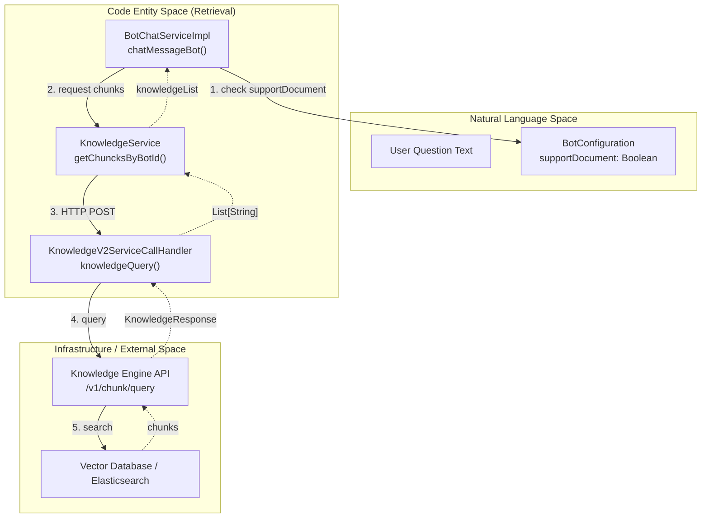
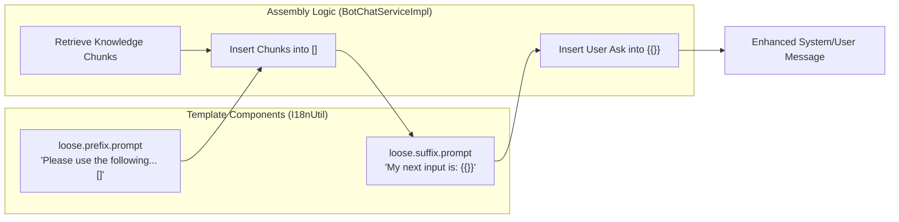
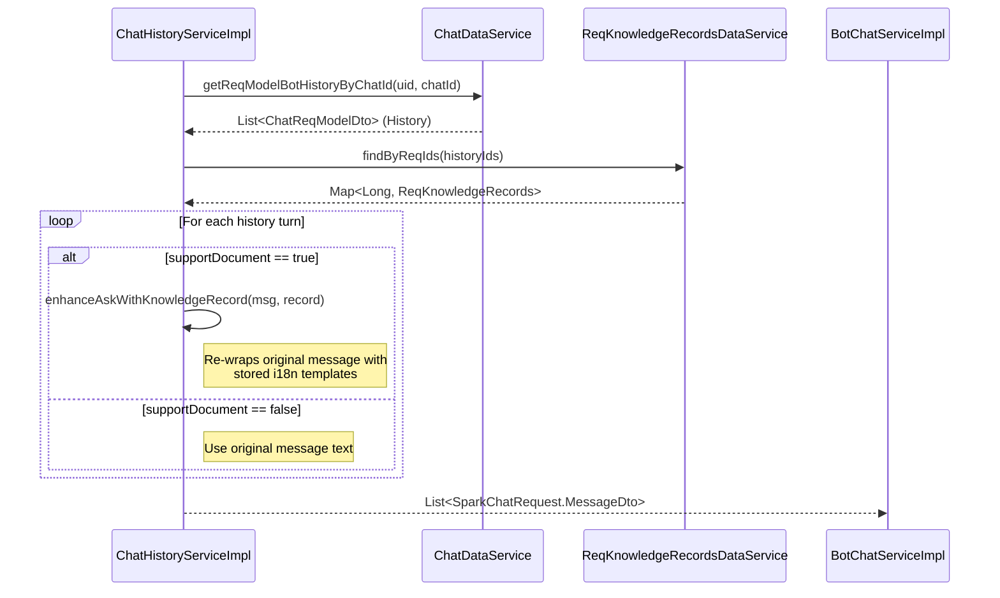

<!-- source: DeepWiki mcp.deepwiki.com · repo iflytek/astron-agent · page 8.3 Knowledge-Enhanced Chat Flow · fetched 2026-10-26 -->

# Knowledge-Enhanced Chat Flow

Relevant source files

The following files were used as context for generating this wiki page:

- [console/backend/commons/src/main/java/com/iflytek/astron/console/commons/entity/bot/ChatBotMarket.java](console/backend/commons/src/main/java/com/iflytek/astron/console/commons/entity/bot/ChatBotMarket.java)
- [console/backend/commons/src/main/java/com/iflytek/astron/console/commons/service/data/ChatHistoryService.java](console/backend/commons/src/main/java/com/iflytek/astron/console/commons/service/data/ChatHistoryService.java)
- [console/backend/hub/src/main/java/com/iflytek/astron/console/hub/service/bot/impl/BotTransactionalServiceImpl.java](console/backend/hub/src/main/java/com/iflytek/astron/console/hub/service/bot/impl/BotTransactionalServiceImpl.java)
- [console/backend/hub/src/main/java/com/iflytek/astron/console/hub/service/chat/impl/BotChatServiceImpl.java](console/backend/hub/src/main/java/com/iflytek/astron/console/hub/service/chat/impl/BotChatServiceImpl.java)
- [console/backend/hub/src/main/java/com/iflytek/astron/console/hub/service/chat/impl/ChatHistoryServiceImpl.java](console/backend/hub/src/main/java/com/iflytek/astron/console/hub/service/chat/impl/ChatHistoryServiceImpl.java)
- [console/backend/hub/src/main/java/com/iflytek/astron/console/hub/service/knowledge/impl/KnowledgeServiceImpl.java](console/backend/hub/src/main/java/com/iflytek/astron/console/hub/service/knowledge/impl/KnowledgeServiceImpl.java)
- [console/backend/hub/src/main/java/com/iflytek/astron/console/hub/service/workflow/impl/BotChainServiceImpl.java](console/backend/hub/src/main/java/com/iflytek/astron/console/hub/service/workflow/impl/BotChainServiceImpl.java)
- [console/backend/hub/src/test/java/com/iflytek/astron/console/hub/service/knowledge/impl/KnowledgeServiceImplTest.java](console/backend/hub/src/test/java/com/iflytek/astron/console/hub/service/knowledge/impl/KnowledgeServiceImplTest.java)
- [console/backend/hub/src/test/java/com/iflytek/astron/console/hub/service/share/impl/ShareServiceImplTest.java](console/backend/hub/src/test/java/com/iflytek/astron/console/hub/service/share/impl/ShareServiceImplTest.java)
- [console/backend/toolkit/src/main/java/com/iflytek/astron/console/toolkit/handler/KnowledgeV2ServiceCallHandler.java](console/backend/toolkit/src/main/java/com/iflytek/astron/console/toolkit/handler/KnowledgeV2ServiceCallHandler.java)
- [console/backend/toolkit/src/main/java/com/iflytek/astron/console/toolkit/service/repo/KnowledgeService.java](console/backend/toolkit/src/main/java/com/iflytek/astron/console/toolkit/service/repo/KnowledgeService.java)
- [console/backend/toolkit/src/main/java/com/iflytek/astron/console/toolkit/service/repo/RepoService.java](console/backend/toolkit/src/main/java/com/iflytek/astron/console/toolkit/service/repo/RepoService.java)
- [console/backend/toolkit/src/main/java/com/iflytek/astron/console/toolkit/service/workflow/TalkAgentService.java](console/backend/toolkit/src/main/java/com/iflytek/astron/console/toolkit/service/workflow/TalkAgentService.java)
- [console/backend/toolkit/src/main/java/com/iflytek/astron/console/toolkit/tool/spark/SparkApiTool.java](console/backend/toolkit/src/main/java/com/iflytek/astron/console/toolkit/tool/spark/SparkApiTool.java)
- [console/backend/toolkit/src/test/java/com/iflytek/astron/console/toolkit/service/knowledge/FileInfoV2ServiceTest.java](console/backend/toolkit/src/test/java/com/iflytek/astron/console/toolkit/service/knowledge/FileInfoV2ServiceTest.java)
- [console/backend/toolkit/src/test/java/com/iflytek/astron/console/toolkit/service/knowledge/KnowledgeServiceTest.java](console/backend/toolkit/src/test/java/com/iflytek/astron/console/toolkit/service/knowledge/KnowledgeServiceTest.java)
- [console/backend/toolkit/src/test/java/com/iflytek/astron/console/toolkit/service/knowledge/RepoServiceTest.java](console/backend/toolkit/src/test/java/com/iflytek/astron/console/toolkit/service/knowledge/RepoServiceTest.java)

## Purpose and Scope

This document describes the knowledge-enhanced chat flow in the Astron Agent platform, specifically focusing on how the system implements Retrieval-Augmented Generation (RAG) to enhance bot responses with relevant document knowledge. This page covers dataset association, knowledge chunk retrieval, i18n template wrapping, knowledge record persistence, and the integration of knowledge context into chat history.

For information about the basic chat service architecture without knowledge enhancement, see [8.1 Chat Service Architecture](). For details about LLM provider selection and model configuration, see [8.4 LLM Provider Integration](). For workflow-based chat interactions, see [4. Workflow and Publishing System]().

---

## Overview of Knowledge Enhancement

The knowledge-enhanced chat flow augments user questions with relevant document chunks retrieved from associated knowledge bases before sending them to the LLM. This RAG (Retrieval-Augmented Generation) pattern ensures that bot responses are grounded in specific domain knowledge rather than relying solely on the LLM's pre-trained knowledge.

### Key Components

| Component | Description | Primary Class/Service |
|-----------|-------------|----------------------|
| **Knowledge Retrieval** | Manages knowledge base metadata and retrieval orchestration | `KnowledgeService` |
| **Service Handler** | Low-level HTTP handler for calling the knowledge engine API | `KnowledgeV2ServiceCallHandler` |
| **Prompt Enhancement** | Wraps user questions with knowledge context using i18n templates | `BotChatServiceImpl.buildMessageList()` |
| **Knowledge Records** | Stores retrieved knowledge for history reconstruction and audit | `ReqKnowledgeRecordsDataService` |
| **History Enhancement** | Re-applies knowledge context to historical messages during context assembly | `ChatHistoryServiceImpl.getSystemBotHistory()` |
| **Repository Management** | Handles knowledge base (Repo) lifecycle and configuration | `RepoService` |

The `supportDocument` flag on bot configurations (e.g., `ChatBotMarket.supportDocument`) controls whether knowledge enhancement is enabled for a specific session.

**Sources:** [console/backend/hub/src/main/java/com/iflytek/astron/console/hub/service/chat/impl/BotChatServiceImpl.java:81-85](), [console/backend/hub/src/main/java/com/iflytek/astron/console/hub/service/chat/impl/BotChatServiceImpl.java:108-112](), [console/backend/hub/src/main/java/com/iflytek/astron/console/hub/service/chat/impl/BotChatServiceImpl.java:132-143](), [console/backend/toolkit/src/main/java/com/iflytek/astron/console/toolkit/service/repo/KnowledgeService.java:58-60]()

---

## Knowledge Retrieval Architecture

The retrieval process bridges the Natural Language Space (user queries) to the Vector/Document Space (knowledge chunks) through the `KnowledgeService`.

### Retrieval Implementation
The retrieval is triggered in `BotChatServiceImpl` when `supportDocument` is active. It calls `knowledgeService.getChuncksByBotId(botId, ask, 3)` to fetch relevant fragments. This eventually routes through `KnowledgeV2ServiceCallHandler.knowledgeQuery()` which executes a POST request to the configured knowledge engine URL. 

The `KnowledgeV2ServiceCallHandler` interacts with external RAG engines via the endpoint defined in `apiUrl.getKnowledgeUrl().concat("/v1/chunk/query")`.

**Sources:** [console/backend/hub/src/main/java/com/iflytek/astron/console/hub/service/chat/impl/BotChatServiceImpl.java:132-143](), [console/backend/toolkit/src/main/java/com/iflytek/astron/console/toolkit/handler/KnowledgeV2ServiceCallHandler.java:119-127](), [console/backend/toolkit/src/main/java/com/iflytek/astron/console/toolkit/service/repo/KnowledgeService.java:116-152]()

---

## Prompt Enhancement and i18n Wrapping

Once chunks are retrieved, they are wrapped in an internationalized template to instruct the LLM on how to use the context.

### Prompt Assembly Rules
The system uses `I18nUtil.getMessage` to fetch localized templates.
1. **Prefix**: `loose.prefix.prompt` usually contains a placeholder `[]` where the retrieved chunks are joined and inserted.
2. **Suffix**: `loose.suffix.prompt` contains a placeholder `{{}}` where the actual user question is placed.
3. **Persistence**: The resulting knowledge string is saved to the `req_knowledge_records` table via `reqKnowledgeRecordsDataService`, keyed by the request ID (`reqId`), to ensure that future history reconstruction uses the exact same context.

**Sources:** [console/backend/hub/src/main/java/com/iflytek/astron/console/hub/service/chat/impl/BotChatServiceImpl.java:132-143](), [console/backend/hub/src/main/java/com/iflytek/astron/console/hub/service/chat/impl/ChatHistoryServiceImpl.java:74-80](), [console/backend/hub/src/main/java/com/iflytek/astron/console/hub/service/chat/impl/BotChatServiceImpl.java:108-112]()

---

## Knowledge Record Persistence

To maintain the integrity of a conversation, retrieved knowledge is persisted as a record of what the bot "knew" at the time of the specific turn.

| Field | Description | Source |
|-------|-------------|--------|
| `reqId` | Foreign key to the chat request record | `ChatReqRecords.id` |
| `knowledge` | JSON array of retrieved text chunks | `KnowledgeService` |
| `uid` / `chatId` | Multi-tenant and session identifiers | `RequestContextUtil` |

This persistence is handled by `ReqKnowledgeRecordsDataService` immediately after retrieval and before the LLM call.

**Sources:** [console/backend/hub/src/main/java/com/iflytek/astron/console/hub/service/chat/impl/BotChatServiceImpl.java:108-112](), [console/backend/hub/src/main/java/com/iflytek/astron/console/hub/service/chat/impl/ChatHistoryServiceImpl.java:32-33](), [console/backend/hub/src/main/java/com/iflytek/astron/console/hub/service/chat/impl/ChatHistoryServiceImpl.java:63-65]()

---

## History Enhancement and Context Reconstruction

When a user continues a conversation, the system must provide the LLM with previous turns. If those turns were knowledge-enhanced, the history must reflect that context.

### Implementation Details
The `ChatHistoryServiceImpl.getSystemBotHistory` method orchestrates this:
1. It fetches all previous request pairs via `chatDataService.getReqModelBotHistoryByChatId`.
2. It fetches all associated `ReqKnowledgeRecords` for those request IDs via `reqKnowledgeRecordsDataService.findByReqIds`.
3. It iterates through the history and calls `enhanceAskWithKnowledgeRecord`.
4. This method performs the same i18n wrapping logic used during the initial chat, ensuring the LLM sees the historical context exactly as it was originally presented.

**Sources:** [console/backend/hub/src/main/java/com/iflytek/astron/console/hub/service/chat/impl/ChatHistoryServiceImpl.java:43-92](), [console/backend/hub/src/main/java/com/iflytek/astron/console/hub/service/chat/impl/ChatHistoryServiceImpl.java:102-158]()

---

## Token Management and Truncation

Knowledge enhancement significantly increases the prompt size. The system manages this via:
1. **Max Input Tokens**: Defined by `spark.chat.max.input.tokens` (default 8000) or specific model configurations.
2. **History Truncation**: `ChatHistoryServiceImpl.getHistory` accumulates the length of messages. If the `tempLength` exceeds `MAX_HISTORY_NUMBERS` (8000), it stops adding older messages.
3. **Dynamic Truncation**: In `BotChatServiceImpl`, the history is built and then potentially truncated to fit the specific model's `maxInputTokens` limit.

**Sources:** [console/backend/hub/src/main/java/com/iflytek/astron/console/hub/service/chat/impl/BotChatServiceImpl.java:84-85](), [console/backend/hub/src/main/java/com/iflytek/astron/console/hub/service/chat/impl/ChatHistoryServiceImpl.java:34-35](), [console/backend/hub/src/main/java/com/iflytek/astron/console/hub/service/chat/impl/ChatHistoryServiceImpl.java:156-158]()

---

