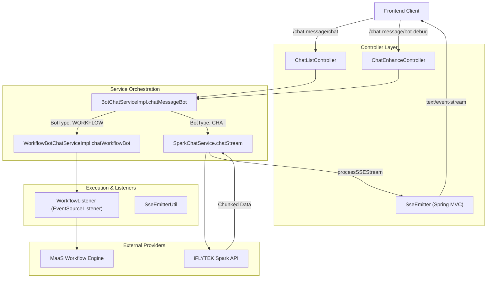
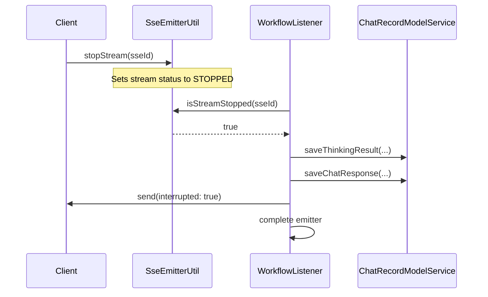

<!-- source: DeepWiki mcp.deepwiki.com · repo iflytek/astron-agent · page 8.5 Streaming Responses with SSE · fetched 2026-10-26 -->

# Streaming Responses with SSE

Relevant source files

The following files were used as context for generating this wiki page:

- [console/backend/commons/src/main/java/com/iflytek/astron/console/commons/service/workflow/impl/WorkflowBotChatServiceImpl.java](console/backend/commons/src/main/java/com/iflytek/astron/console/commons/service/workflow/impl/WorkflowBotChatServiceImpl.java)
- [console/backend/commons/src/main/java/com/iflytek/astron/console/commons/service/workflow/impl/WorkflowBotParamServiceImpl.java](console/backend/commons/src/main/java/com/iflytek/astron/console/commons/service/workflow/impl/WorkflowBotParamServiceImpl.java)
- [console/backend/commons/src/main/java/com/iflytek/astron/console/commons/util/SseEmitterUtil.java](console/backend/commons/src/main/java/com/iflytek/astron/console/commons/util/SseEmitterUtil.java)
- [console/backend/commons/src/main/java/com/iflytek/astron/console/commons/workflow/WorkflowClient.java](console/backend/commons/src/main/java/com/iflytek/astron/console/commons/workflow/WorkflowClient.java)
- [console/backend/commons/src/main/java/com/iflytek/astron/console/commons/workflow/WorkflowListener.java](console/backend/commons/src/main/java/com/iflytek/astron/console/commons/workflow/WorkflowListener.java)
- [console/backend/commons/src/test/java/com/iflytek/astron/console/commons/data/impl/UserInfoDataServiceImplUnitTest.java](console/backend/commons/src/test/java/com/iflytek/astron/console/commons/data/impl/UserInfoDataServiceImplUnitTest.java)
- [console/backend/commons/src/test/java/com/iflytek/astron/console/commons/service/data/impl/ChatListDataServiceImplTest.java](console/backend/commons/src/test/java/com/iflytek/astron/console/commons/service/data/impl/ChatListDataServiceImplTest.java)
- [console/backend/commons/src/test/java/com/iflytek/astron/console/commons/service/data/impl/UserLangChainInfoDataServiceImplTest.java](console/backend/commons/src/test/java/com/iflytek/astron/console/commons/service/data/impl/UserLangChainInfoDataServiceImplTest.java)
- [console/backend/commons/src/test/java/com/iflytek/astron/console/commons/service/space/impl/ApplyRecordServiceImplTest.java](console/backend/commons/src/test/java/com/iflytek/astron/console/commons/service/space/impl/ApplyRecordServiceImplTest.java)
- [console/backend/commons/src/test/java/com/iflytek/astron/console/commons/service/workflow/impl/WorkflowBotChatServiceImplTest.java](console/backend/commons/src/test/java/com/iflytek/astron/console/commons/service/workflow/impl/WorkflowBotChatServiceImplTest.java)
- [console/backend/commons/src/test/java/com/iflytek/astron/console/commons/service/workflow/impl/WorkflowBotParamServiceImplTest.java](console/backend/commons/src/test/java/com/iflytek/astron/console/commons/service/workflow/impl/WorkflowBotParamServiceImplTest.java)
- [console/backend/hub/src/main/java/com/iflytek/astron/console/hub/controller/chat/ChatEnhanceController.java](console/backend/hub/src/main/java/com/iflytek/astron/console/hub/controller/chat/ChatEnhanceController.java)
- [console/backend/hub/src/main/java/com/iflytek/astron/console/hub/controller/chat/ChatListController.java](console/backend/hub/src/main/java/com/iflytek/astron/console/hub/controller/chat/ChatListController.java)
- [console/backend/hub/src/main/java/com/iflytek/astron/console/hub/controller/extra/RtasrController.java](console/backend/hub/src/main/java/com/iflytek/astron/console/hub/controller/extra/RtasrController.java)
- [console/backend/hub/src/main/java/com/iflytek/astron/console/hub/service/SparkChatService.java](console/backend/hub/src/main/java/com/iflytek/astron/console/hub/service/SparkChatService.java)
- [console/backend/hub/src/main/java/com/iflytek/astron/console/hub/service/WorkflowChatService.java](console/backend/hub/src/main/java/com/iflytek/astron/console/hub/service/WorkflowChatService.java)
- [console/backend/hub/src/test/java/com/iflytek/astron/console/hub/service/bot/impl/BotTransactionalServiceImplTest.java](console/backend/hub/src/test/java/com/iflytek/astron/console/hub/service/bot/impl/BotTransactionalServiceImplTest.java)
- [console/backend/hub/src/test/java/com/iflytek/astron/console/hub/service/workflow/impl/BotChainServiceImplTest.java](console/backend/hub/src/test/java/com/iflytek/astron/console/hub/service/workflow/impl/BotChainServiceImplTest.java)

## Purpose and Scope

This document describes the Server-Sent Events (SSE) implementation for streaming chat responses from Large Language Model (LLM) providers to frontend clients. The SSE mechanism enables real-time, incremental delivery of AI-generated responses as they are produced, providing a responsive user experience during potentially long-running LLM inference operations.

The implementation covers standard chat sessions, workflow-based agent execution, debug mode for bot configuration, and specialized handling for iFLYTEK Spark models.

---

## Architecture Overview

The SSE streaming architecture implements a multi-layered pipeline where HTTP SSE connections are established at the controller layer, managed through service orchestration, and fulfilled by provider-specific streaming implementations or workflow listeners.

### SSE Streaming Pipeline Architecture

**Sources**: [console/backend/hub/src/main/java/com/iflytek/astron/console/hub/service/SparkChatService.java:54-59](), [console/backend/commons/src/main/java/com/iflytek/astron/console/commons/workflow/WorkflowListener.java:32-52](), [console/backend/commons/src/main/java/com/iflytek/astron/console/commons/service/workflow/impl/WorkflowBotChatServiceImpl.java:98-105]()

---

## Backend Implementation

### SparkChatService
The `SparkChatService` handles native iFLYTEK Spark model streaming. It uses `SparkChatClient` to build signatures and send requests.

*   **Emitter Creation**: Uses `SseEmitterUtil.createSseEmitter()` to instantiate the connection [console/backend/hub/src/main/java/com/iflytek/astron/console/hub/service/SparkChatService.java:55]().
*   **Request Building**: The `chatStream` method initializes the `SparkChatClient` using an `apiPassword` and a `SparkModel` determined by the requested model string [console/backend/hub/src/main/java/com/iflytek/astron/console/hub/service/SparkChatService.java:75-76]().
*   **Response Processing**: `onResponse` captures the `ResponseBody` and delegates to `processSSEStream` to pipe chunks to the client [console/backend/hub/src/main/java/com/iflytek/astron/console/hub/service/SparkChatService.java:101-115]().

### WorkflowBotChatServiceImpl
This service orchestrates workflow-based chats by resolving bot configuration and managing multimodal parameters.

*   **Parameter Handling**: It uses `WorkflowBotParamService` to process single and multi-file parameters, ensuring that file URLs are correctly mapped to the workflow inputs [console/backend/commons/src/main/java/com/iflytek/astron/console/commons/service/workflow/impl/WorkflowBotChatServiceImpl.java:131-134]().
*   **Workflow Request**: It builds a `WorkflowApiRequest` containing the `flowId`, user inputs, and chat history before initiating the connection via `WorkflowClient` [console/backend/commons/src/main/java/com/iflytek/astron/console/commons/service/workflow/impl/WorkflowBotChatServiceImpl.java:140-142]().
*   **Environment Resolution**: It determines whether to use the `debugUrl` or `chatUrl` based on the bot's publishing status in the `ChatBotMarket` [console/backend/commons/src/main/java/com/iflytek/astron/console/commons/service/workflow/impl/WorkflowBotChatServiceImpl.java:145-155]().

### WorkflowListener
For agent workflows, the `WorkflowListener` manages events from the MaaS (Model as a Service) platform.

*   **Event Handling**: It overrides `onEvent` to process workflow-specific data. It checks if the stream was stopped via `SseEmitterUtil.isStreamStopped(sseId)` to handle interruptions [console/backend/commons/src/main/java/com/iflytek/astron/console/commons/workflow/WorkflowListener.java:63-77]().
*   **State Accumulation**: It maintains `thinkingResult` and `finalResult` buffers to persist the complete answer to the database once the stream ends [console/backend/commons/src/main/java/com/iflytek/astron/console/commons/workflow/WorkflowListener.java:36-37]().
*   **Termination**: When `finish_reason` is "stop" or "interrupt", it saves results via `wssListenerService.getChatRecordModelService().saveChatResponse` and sends a completion frame to the client [console/backend/commons/src/main/java/com/iflytek/astron/console/commons/workflow/WorkflowListener.java:114-138]().

**Sources**: [console/backend/hub/src/main/java/com/iflytek/astron/console/hub/service/SparkChatService.java:69-121](), [console/backend/commons/src/main/java/com/iflytek/astron/console/commons/workflow/WorkflowListener.java:63-140](), [console/backend/commons/src/main/java/com/iflytek/astron/console/commons/service/workflow/impl/WorkflowBotChatServiceImpl.java:98-165]()

---

## Error Handling and Resilience

SSE implementation includes specific error handling to ensure system stability:

| Component | Error Handling Logic | Source |
|:---|:---|:---|
| `SparkChatService` | In `onFailure`, it calls `SseEmitterUtil.completeWithError` to signal the client that the connection to the LLM provider failed. | [console/backend/hub/src/main/java/com/iflytek/astron/console/hub/service/SparkChatService.java:88-92]() |
| `WorkflowListener` | Detects client disconnection through `tryServeSSEData`. If the client is gone, it continues processing to ensure data integrity for history persistence. | [console/backend/commons/src/main/java/com/iflytek/astron/console/commons/workflow/WorkflowListener.java:80-87]() |
| `WorkflowListener` | Handles non-zero error codes from the workflow engine by appending a fallback message to the final result. | [console/backend/commons/src/main/java/com/iflytek/astron/console/commons/workflow/WorkflowListener.java:108-112]() |
| `WorkflowBotChatServiceImpl` | Throws a `BusinessException` if the `UserLangChainInfo` for a bot cannot be found, preventing invalid stream initialization. | [console/backend/commons/src/main/java/com/iflytek/astron/console/commons/service/workflow/impl/WorkflowBotChatServiceImpl.java:110-112]() |

### Stream Interruption Flow

**Sources**: [console/backend/commons/src/main/java/com/iflytek/astron/console/commons/workflow/WorkflowListener.java:66-76](), [console/backend/commons/src/main/java/com/iflytek/astron/console/commons/util/SseEmitterUtil.java:1-30]()

---

## Key Utility Classes

| Class | Purpose | Source |
|:---|:---|:---|
| `SseEmitterUtil` | Provides static methods for creating emitters, sending data, and tracking the lifecycle of SSE streams (including stop signals). | [console/backend/commons/src/main/java/com/iflytek/astron/console/commons/util/SseEmitterUtil.java:1-30]() |
| `WorkflowBotParamService` | Manages the binding of file uploads and multimodal inputs to workflow execution parameters. | [console/backend/commons/src/main/java/com/iflytek/astron/console/commons/service/workflow/impl/WorkflowBotParamServiceImpl.java:30-50]() |

**Sources**: [console/backend/commons/src/main/java/com/iflytek/astron/console/commons/util/SseEmitterUtil.java:1-30](), [console/backend/commons/src/main/java/com/iflytek/astron/console/commons/service/workflow/impl/WorkflowBotParamServiceImpl.java:30-50]()

---

