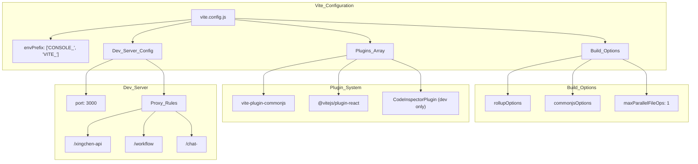
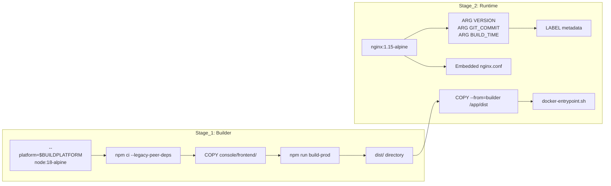
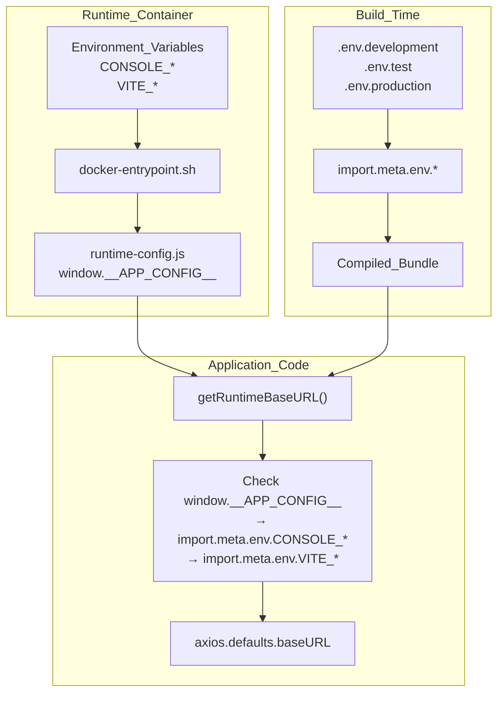

<!-- source: DeepWiki mcp.deepwiki.com · repo iflytek/astron-agent · page 9.1 Frontend Architecture and Build System · fetched 2026-10-26 -->

# Frontend Architecture and Build System

<details>
<summary>Relevant source files</summary>

The following files were used as context for generating this wiki page:

- [console/backend/hub/src/main/java/com/iflytek/astron/console/hub/service/bot/impl/TalkAgentServiceImpl.java](console/backend/hub/src/main/java/com/iflytek/astron/console/hub/service/bot/impl/TalkAgentServiceImpl.java)
- [console/frontend/.env.development](console/frontend/.env.development)
- [console/frontend/.env.production](console/frontend/.env.production)
- [console/frontend/.env.test](console/frontend/.env.test)
- [console/frontend/Dockerfile](console/frontend/Dockerfile)
- [console/frontend/docker-entrypoint.sh](console/frontend/docker-entrypoint.sh)
- [console/frontend/package.json](console/frontend/package.json)
- [console/frontend/pnpm-lock.yaml](console/frontend/pnpm-lock.yaml)
- [console/frontend/src/components/create-application-modal/index.tsx](console/frontend/src/components/create-application-modal/index.tsx)
- [console/frontend/src/components/sidebar/create-button.tsx](console/frontend/src/components/sidebar/create-button.tsx)
- [console/frontend/src/components/virtual-config-modal/index.module.scss](console/frontend/src/components/virtual-config-modal/index.module.scss)
- [console/frontend/src/components/vms-interaction-cmp/index.tsx](console/frontend/src/components/vms-interaction-cmp/index.tsx)
- [console/frontend/src/components/workflow/drawer/chat-debugger/index.scss](console/frontend/src/components/workflow/drawer/chat-debugger/index.scss)
- [console/frontend/src/config/casdoor.ts](console/frontend/src/config/casdoor.ts)
- [console/frontend/src/pages/resource-management/database-detail/database-table-add/components/database-table.tsx](console/frontend/src/pages/resource-management/database-detail/database-table-add/components/database-table.tsx)
- [console/frontend/src/pages/resource-management/database-detail/database-table-add/hooks/use-table-actions.ts](console/frontend/src/pages/resource-management/database-detail/database-table-add/hooks/use-table-actions.ts)
- [console/frontend/src/pages/resource-management/database-detail/database-table-add/hooks/use-table-datasource.ts](console/frontend/src/pages/resource-management/database-detail/database-table-add/hooks/use-table-datasource.ts)
- [console/frontend/src/pages/resource-management/database-detail/database-table-add/index.tsx](console/frontend/src/pages/resource-management/database-detail/database-table-add/index.tsx)
- [console/frontend/src/pages/resource-management/knowledge-detail/document-page/hooks/use-columns.tsx](console/frontend/src/pages/resource-management/knowledge-detail/document-page/hooks/use-columns.tsx)
- [console/frontend/src/utils/http.ts](console/frontend/src/utils/http.ts)
- [console/frontend/vite-env.d.ts](console/frontend/vite-env.d.ts)
- [console/frontend/vite.config.js](console/frontend/vite.config.js)

</details>


## Purpose and Scope

This document describes the frontend build pipeline, Docker packaging strategy, and configuration management system for the Astron Agent console frontend. It covers the Vite build system, multi-stage Docker build process, and the two-tier configuration architecture that enables runtime reconfiguration without rebuilds.

The frontend is a React-based single-page application (SPA) that interacts with various backend services (hub, chat, workflow) and integrates with Casdoor for authentication.

---

## Build System Architecture

The frontend uses **Vite** as its build tool, providing a fast development server and optimized production builds. The build system supports multiple deployment environments through environment-specific configuration files.

### Vite Configuration Structure

Vite manages the compilation and development environment through `vite.config.js`.



**Sources**: [console/frontend/vite.config.js:1-72]()

The Vite configuration implements several key features:

| Feature | Configuration | Purpose |
|---------|--------------|---------|
| Environment Prefix | `envPrefix: ['CONSOLE_', 'VITE_']` | Enables both new `CONSOLE_*` and legacy `VITE_*` variables. [console/frontend/vite.config.js:11-11]() |
| Parallel File Ops | `maxParallelFileOps: 1` | Limits parallel file operations to 1 during Rollup build to prevent race conditions. [console/frontend/vite.config.js:14-14]() |
| CommonJS Handling | `strictRequires: true` | Forces all CommonJS modules to be strictly processed. [console/frontend/vite.config.js:17-17]() |
| Path Alias | `'@': '/src'` | Simplifies imports with the `@/` prefix. [console/frontend/vite.config.js:30-32]() |
| Dev Proxy | `/xingchen-api` → backend | Routes API calls to the target backend (e.g., `http://172.29.202.54:8080`) during development. [console/frontend/vite.config.js:38-49]() |

---

## Multi-Stage Docker Build

The `Dockerfile` implements a **multi-stage build** pattern that separates the Node.js compilation environment from the Nginx runtime environment, reducing the final image size and improving security.

### Docker Build Flow

The build process involves two distinct stages: the `builder` stage for compilation and the `Runtime` stage for serving assets via Nginx.



**Sources**: [console/frontend/Dockerfile:1-85]()

### Builder Stage Details

The builder stage uses `--platform=$BUILDPLATFORM` to compile on the build machine's native architecture, then outputs architecture-agnostic JavaScript. It utilizes `npm ci` for reproducible builds based on `package-lock.json`. [console/frontend/Dockerfile:4-20]()

**Key optimizations**:
- **BuildKit cache mount**: `--mount=type=cache,target=/root/.npm` speeds up dependency installation. [console/frontend/Dockerfile:14-15]()
- **Layer caching**: Dependency manifests (`package*.json`) are copied and installed before the source code to maximize cache hits. [console/frontend/Dockerfile:11-15]()

### Runtime Stage Configuration

The runtime stage uses Nginx to serve static assets. The configuration is generated dynamically within the Dockerfile to support SPA routing and specific cache policies.

| Nginx Feature | Configuration | Purpose |
|---------------|---------------|---------|
| SPA Routing | `try_files $uri $uri/ /index.html` | Redirects all non-file requests to `index.html` for client-side routing. [console/frontend/Dockerfile:65-67]() |
| Runtime Config | `location = /runtime-config.js` | Disables caching for the dynamic configuration file to ensure instant updates. [console/frontend/Dockerfile:59-63]() |
| Asset Caching | `expires 1y` | Long-term caching for hashed JS/CSS and media assets. [console/frontend/Dockerfile:68-73]() |
| Gzip | `gzip on` | Compresses text-based assets for faster transfer. [console/frontend/Dockerfile:50-53]() |

**Sources**: [console/frontend/Dockerfile:40-75]()

---

## Two-Tier Configuration System

The frontend implements a **two-tier configuration architecture** that separates build-time environment variables (embedded in the bundle) from runtime environment variables (injected at container startup).

### Configuration Resolution Flow

The system prioritizes runtime variables injected by the `docker-entrypoint.sh` script into `window.__APP_CONFIG__`.



**Sources**: [console/frontend/docker-entrypoint.sh:1-40](), [console/frontend/src/utils/http.ts:54-59](), [console/frontend/vite-env.d.ts:24-36]()

### Runtime Configuration Injection

The `docker-entrypoint.sh` script runs when the container starts. It reads environment variables and generates a `/var/www/runtime-config.js` file which is loaded by `index.html`.

The script handles the following variable mapping:
- `CONSOLE_API_URL` (or `VITE_BASE_URL`) → `window.__APP_CONFIG__.BASE_URL` [console/frontend/docker-entrypoint.sh:5-28]()
- `CONSOLE_CASDOOR_URL` → `window.__APP_CONFIG__.CASDOOR_URL` [console/frontend/docker-entrypoint.sh:6-29]()
- `CONSOLE_CASDOOR_ID` (or `VITE_CASDOOR_CLIENT_ID`) → `window.__APP_CONFIG__.CASDOOR_ID` [console/frontend/docker-entrypoint.sh:7-30]()
- `CONSOLE_CASDOOR_APP` (or `VITE_CASDOOR_APP_NAME`) → `window.__APP_CONFIG__.CASDOOR_APP` [console/frontend/docker-entrypoint.sh:8-31]()
- `CONSOLE_CASDOOR_ORG` (or `VITE_CASDOOR_ORG_NAME`) → `window.__APP_CONFIG__.CASDOOR_ORG` [console/frontend/docker-entrypoint.sh:9-32]()

The script uses `escape_for_js` to sanitize values against injection:
```bash
escape_for_js() {
  printf '%s' "$1" | sed 's/\\/\\\\/g; s/"/\\"/g'
}
```
**Sources**: [console/frontend/docker-entrypoint.sh:13-15]()

### Application Consumption

Code entities access these values with a fallback pattern. For example, the HTTP client in `src/utils/http.ts` resolves the base URL by checking the runtime object first:

```typescript
const getRuntimeBaseURL = (): string | undefined => {
  if (typeof window === 'undefined') {
    return undefined;
  }
  return window.__APP_CONFIG__?.BASE_URL;
};
```
**Sources**: [console/frontend/src/utils/http.ts:54-59]()

Similarly, AI capabilities such as the virtual man interaction retrieve IDs from the runtime config:
```typescript
const appId = window?.__APP_CONFIG__?.SPARK_VIRTUAL_MAN_APP_ID;
```
**Sources**: [console/frontend/src/components/vms-interaction-cmp/index.tsx:15-15]()

---

## Environment Variable Management

The project uses `.env` files for build-time defaults and `vite-env.d.ts` for type safety.

### Variable Categories

| Category | Variables | Sources |
|----------|-----------|---------|
| **API Endpoints** | `CONSOLE_API_URL`, `VITE_BASE_URL` | [console/frontend/.env.test:29-30](), [console/frontend/.env.development:6-7]() |
| **Casdoor Auth** | `CONSOLE_CASDOOR_URL`, `CONSOLE_CASDOOR_ID`, `CONSOLE_CASDOOR_APP`, `CONSOLE_CASDOOR_ORG` | [console/frontend/.env.test:10-13](), [console/frontend/.env.production:5-8]() |
| **Spark AI** | `SPARK_APP_ID`, `SPARK_VIRTUAL_MAN_APP_ID` | [console/frontend/vite-env.d.ts:12-13]() |

### TypeScript Type Definitions

The `ImportMetaEnv` interface defines the available environment variables during the build process, while `AppRuntimeConfig` defines the structure of the runtime-injected object `window.__APP_CONFIG__`. [console/frontend/vite-env.d.ts:24-36]()

---

## Dependency and Build Scripts

The `package.json` file defines the scripts for various build modes and the core dependencies of the React application.

### Key Scripts

| Command | Action | Mode |
|---------|--------|------|
| `npm run dev` | Starts Vite dev server | `development` |
| `npm run build-prod` | Builds for production | `production` |
| `npm run build-test` | Builds for test env | `test` |
| `npm run lint` | Runs ESLint check | N/A |

**Sources**: [console/frontend/package.json:6-23]()

### Core Dependencies

The frontend relies on a modern stack including:
- **React 18**: UI Framework [console/frontend/package.json:70]()
- **Ant Design (antd)**: UI Component library [console/frontend/package.json:35]()
- **Axios**: HTTP Client [console/frontend/package.json:36]()
- **Zustand**: State management [console/frontend/package.json:99]()
- **Casdoor JS SDK**: Authentication [console/frontend/package.json:37]()

**Sources**: [console/frontend/package.json:24-100]()

---

