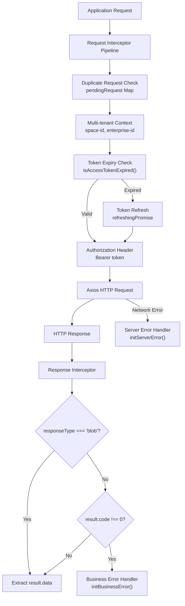
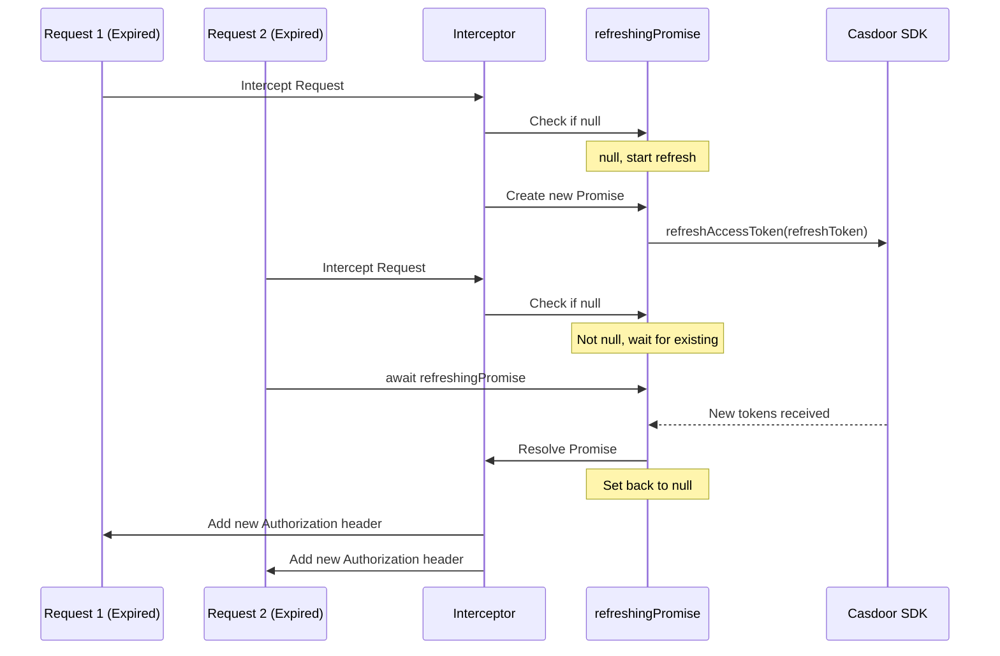
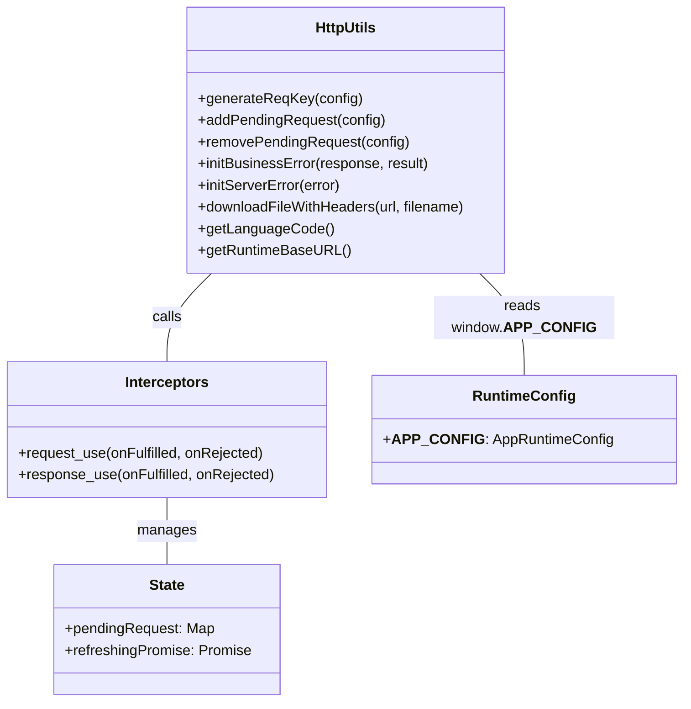
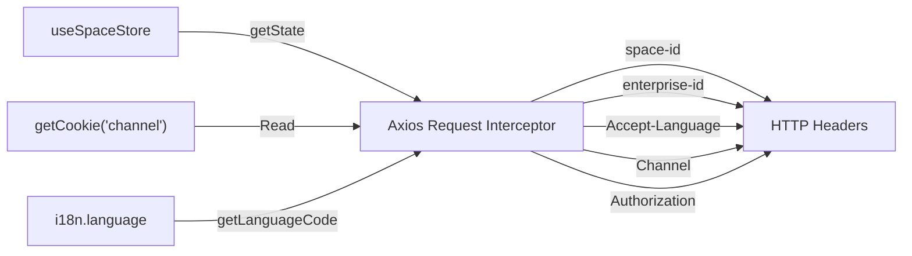

<!-- source: DeepWiki mcp.deepwiki.com · repo iflytek/astron-agent · page 9.2 HTTP Client and Request Interceptors · fetched 2026-10-26 -->

# HTTP Client and Request Interceptors

<details>
<summary>Relevant source files</summary>

The following files were used as context for generating this wiki page:

- [console/backend/hub/src/main/java/com/iflytek/astron/console/hub/service/bot/impl/TalkAgentServiceImpl.java](console/backend/hub/src/main/java/com/iflytek/astron/console/hub/service/bot/impl/TalkAgentServiceImpl.java)
- [console/frontend/.env.development](console/frontend/.env.development)
- [console/frontend/.env.production](console/frontend/.env.production)
- [console/frontend/.env.test](console/frontend/.env.test)
- [console/frontend/Dockerfile](console/frontend/Dockerfile)
- [console/frontend/docker-entrypoint.sh](console/frontend/docker-entrypoint.sh)
- [console/frontend/eslint.config.js](console/frontend/eslint.config.js)
- [console/frontend/src/components/config-page-component/config-overview/index.tsx](console/frontend/src/components/config-page-component/config-overview/index.tsx)
- [console/frontend/src/components/create-application-modal/index.tsx](console/frontend/src/components/create-application-modal/index.tsx)
- [console/frontend/src/components/sidebar/create-button.tsx](console/frontend/src/components/sidebar/create-button.tsx)
- [console/frontend/src/components/virtual-config-modal/index.module.scss](console/frontend/src/components/virtual-config-modal/index.module.scss)
- [console/frontend/src/components/vms-interaction-cmp/index.tsx](console/frontend/src/components/vms-interaction-cmp/index.tsx)
- [console/frontend/src/components/workflow/drawer/chat-debugger/index.scss](console/frontend/src/components/workflow/drawer/chat-debugger/index.scss)
- [console/frontend/src/config/casdoor.ts](console/frontend/src/config/casdoor.ts)
- [console/frontend/src/config/monaco-config.ts](console/frontend/src/config/monaco-config.ts)
- [console/frontend/src/hooks/use-chat-file-upload.ts](console/frontend/src/hooks/use-chat-file-upload.ts)
- [console/frontend/src/locales/en-En/openPlatform-En/releaseManagement.ts](console/frontend/src/locales/en-En/openPlatform-En/releaseManagement.ts)
- [console/frontend/src/locales/zh-ZH/openPlatform-ZH/releaseManagement.ts](console/frontend/src/locales/zh-ZH/openPlatform-ZH/releaseManagement.ts)
- [console/frontend/src/main.tsx](console/frontend/src/main.tsx)
- [console/frontend/src/pages/chat-page/components/chat-input.tsx](console/frontend/src/pages/chat-page/components/chat-input.tsx)
- [console/frontend/src/pages/chat-page/components/delete-modal.tsx](console/frontend/src/pages/chat-page/components/delete-modal.tsx)
- [console/frontend/src/services/knowledge.ts](console/frontend/src/services/knowledge.ts)
- [console/frontend/src/utils/http.ts](console/frontend/src/utils/http.ts)
- [console/frontend/vite-env.d.ts](console/frontend/vite-env.d.ts)
- [console/frontend/vite.config.js](console/frontend/vite.config.js)

</details>


This page documents the HTTP client configuration and request/response interceptor pipeline used in the frontend application. The system uses Axios as the HTTP client library with sophisticated interceptor patterns for authentication, multi-tenancy, error handling, and duplicate request prevention.

For authentication flow details, see **9.3 Authentication and Token Management**. For frontend service integration patterns, see **9.4 Bot Management UI Services**.

---

## Purpose and Architecture

The HTTP client infrastructure provides centralized configuration for all API requests from the frontend, implementing:

- **Request deduplication** using a pending request map to prevent redundant network calls [console/frontend/src/utils/http.ts:272-311]().
- **Automatic token refresh** with a singleton promise pattern to handle JWT expiration seamlessly [console/frontend/src/utils/http.ts:379-401]().
- **Multi-tenant context injection** via `space-id` and `enterprise-id` headers [console/frontend/src/utils/http.ts:370-374]().
- **Comprehensive error handling** for both business logic codes and network-level errors [console/frontend/src/utils/http.ts:154-247]().
- **Language localization** header management (`Accept-Language`) [console/frontend/src/utils/http.ts:32-43]().
- **Dynamic base URL resolution** supporting runtime configuration via Docker environment variables [console/frontend/src/utils/http.ts:54-59]().

All HTTP configuration is located in [console/frontend/src/utils/http.ts:1-486]().

**Sources:** [console/frontend/src/utils/http.ts:1-486]()

---

## HTTP Client Flow

The following diagram illustrates the lifecycle of a request from the application layer through the interceptors to the network.

**Diagram: Request and Response Interceptor Pipeline**


**Sources:** [console/frontend/src/utils/http.ts:362-436]()

---

## Axios Instance Configuration

The Axios instance is configured with global defaults that apply to all requests.

### Default Configuration

| Setting | Value | Purpose |
|---------|-------|---------|
| `timeout` | 30000ms (30s) | Maximum request duration [console/frontend/src/utils/http.ts:313]() |
| `X-Requested-With` | "XMLHttpRequest" | Identifies AJAX requests [console/frontend/src/utils/http.ts:314]() |
| `Content-Type` | "application/json" | Default content type [console/frontend/src/utils/http.ts:315]() |
| `web-v` | `packageJson.version` | Client version tracking [console/frontend/src/utils/http.ts:316]() |
| `Accept-Language` | Dynamic | Internationalization [console/frontend/src/utils/http.ts:324]() |

### Language Header Management

The `Accept-Language` header is automatically set and updated when the user changes language preferences using `i18next`. The `getLanguageCode` function maps internal codes to standard formats.

| Internal Code | Header Value |
|---------------|--------------|
| `zh` / `zh-CN` | `zh-CN` |
| `en` / `en-US` | `en-US` |

**Sources:** [console/frontend/src/utils/http.ts:32-43](), [console/frontend/src/utils/http.ts:324-326]()

---

## Duplicate Request Prevention

The system prevents duplicate concurrent requests using a `pendingRequest` Map that tracks in-flight requests by a unique key [console/frontend/src/utils/http.ts:283-311]().

### Request Key Generation

Request uniqueness is determined by combining the HTTP method, URL, query parameters, and request body.

```typescript
const generateReqKey = (config: AxiosRequestConfig): string => {
  const { method, url, params, data } = config;
  return [method, url, qs.stringify(params), qs.stringify(data)].join('&');
};
```

**Sources:** [console/frontend/src/utils/http.ts:277-280]()

### Duplicate Request Logic

1.  **Generate Key**: When a request starts, `generateReqKey` is called [console/frontend/src/utils/http.ts:287]().
2.  **Check Map**: `addPendingRequest` checks if the key exists in the `pendingRequest` Map [console/frontend/src/utils/http.ts:288]().
3.  **Cancel Old**: If found, the existing request is cancelled using `axios.CancelToken` [console/frontend/src/utils/http.ts:291]().
4.  **Register New**: The new request is added to the Map [console/frontend/src/utils/http.ts:293]().
5.  **Cleanup**: Upon completion (success or error), `removePendingRequest` deletes the key [console/frontend/src/utils/http.ts:305]().

**Sources:** [console/frontend/src/utils/http.ts:283-311]()

---

## Multi-Tenant Context Injection

The system supports multi-tenancy by injecting space and enterprise identifiers into request headers based on the current space context from the `useSpaceStore` (Zustand).

### Header Injection Rules

| Header | Source / Condition |
|--------|-------------------|
| `clientType` | Hardcoded to `'11'` [console/frontend/src/utils/http.ts:367]() |
| `Channel` | Extracted from cookies via `getCookie('channel')` [console/frontend/src/utils/http.ts:368]() |
| `space-id` | `useSpaceStore.getState().spaceId` [console/frontend/src/utils/http.ts:85-88](), [console/frontend/src/utils/http.ts:370]() |
| `enterprise-id` | `useSpaceStore.getState().enterpriseId` (Only if `spaceType === 'team'`) [console/frontend/src/utils/http.ts:96-102](), [console/frontend/src/utils/http.ts:372-374]() |

This same pattern is replicated in the specialized download utility function `downloadFileWithHeaders` which uses `XMLHttpRequest` directly for blob downloads [console/frontend/src/utils/http.ts:76-139]().

**Sources:** [console/frontend/src/utils/http.ts:367-374](), [console/frontend/src/utils/http.ts:85-102]()

---

## Token Refresh Strategy

The system implements automatic token refresh with a **singleton promise pattern** to prevent multiple concurrent requests from triggering multiple refresh calls.

### Token Expiry Detection

The system decodes the JWT `exp` claim and considers the token expired **30 seconds** before the actual expiration time to provide a safety buffer.

**Sources:** [console/frontend/src/utils/http.ts:341-360]()

### Refresh Singleton Pattern

The `refreshingPromise` variable ensures only one refresh operation is active at a time [console/frontend/src/utils/http.ts:379-401]().

**Diagram: Token Refresh Sequence**


**Sources:** [console/frontend/src/utils/http.ts:379-401]()

---

## Business and Server Error Handling

Errors are handled at two levels: network/server errors and business logic errors (where HTTP status is 200 but the response body indicates failure).

### Business Error Codes (`initBusinessError`)

| Code | Meaning | Action |
|------|---------|--------|
| `11120` | Usage exhausted | Emit `showUsageExhausted` event [console/frontend/src/utils/http.ts:194-198]() |
| `80000`/`90000` | Login exception | `switchPersonal()`, then `jumpToLogin()` [console/frontend/src/utils/http.ts:199-211]() |
| `80001`/`80004` | Space not found | Error message and redirect to `/space/agent` [console/frontend/src/utils/http.ts:212-224]() |
| `99900` | Spark Logout | Redirect to `/spark` [console/frontend/src/utils/http.ts:226-228]() |
| `10004` | Permanent ban | Redirect to `/ban` [console/frontend/src/utils/http.ts:229-232]() |
| `10003` | 24h ban | Show error and redirect to `/spark` [console/frontend/src/utils/http.ts:235-239]() |

### Server Error Handling (`initServerError`)

- **Status 0**: Indicates a network error or CORS failure. Returns code `100` with localized "Server busy" message [console/frontend/src/utils/http.ts:159-165]().
- **Status 401**: Unauthorized. Triggers `jumpToLogin()` and returns code `101` [console/frontend/src/utils/http.ts:167-173]().

**Sources:** [console/frontend/src/utils/http.ts:154-247]()

---

## Base URL and Runtime Configuration

The application supports dynamic base URL resolution, allowing the same container image to be deployed across different environments (Dev, Test, Prod) without rebuilding.

### Resolution Priority

1.  **Production Mode**: Hardcoded to `/console-api` [console/frontend/src/utils/http.ts:442]().
2.  **Runtime Config**: `window.__APP_CONFIG__.BASE_URL` (Injected by `docker-entrypoint.sh`) [console/frontend/src/utils/http.ts:54-59](), [console/frontend/src/utils/http.ts:445-448]().
3.  **Local Proxy**: `/xingchen-api` for localhost development [console/frontend/src/utils/http.ts:450-453]().
4.  **Environment Variables**: `CONSOLE_API_URL` or `VITE_BASE_URL` from `.env` files [console/frontend/src/utils/http.ts:455-458]().

### Runtime Injection

The `docker-entrypoint.sh` script reads environment variables at container startup and writes them to a static JS file at `/var/www/runtime-config.js` [console/frontend/docker-entrypoint.sh:4-37]().

```bash
cat <<EOF > "$RUNTIME_CONFIG_PATH"
window.__APP_CONFIG__ = window.__APP_CONFIG__ || {};
window.__APP_CONFIG__.BASE_URL = "$BASE_URL_ESCAPED";
...
EOF
```

**Sources:** [console/frontend/src/utils/http.ts:439-484](), [console/frontend/docker-entrypoint.sh:4-37](), [console/frontend/Dockerfile:59-63]()

---

## Code Entity Mapping

This diagram maps natural language concepts to the specific code entities in the `http.ts` utility and associated configuration files.

**Diagram: HTTP Utility Code Entities**


**Sources:** [console/frontend/src/utils/http.ts:277-436](), [console/frontend/src/utils/http.ts:54-59](), [console/frontend/vite-env.d.ts:24-36]()

**Diagram: Request Header Injection Logic**


**Sources:** [console/frontend/src/utils/http.ts:362-378](), [console/frontend/src/utils/http.ts:32-43](), [console/frontend/src/utils/http.ts:254-269]()

---

