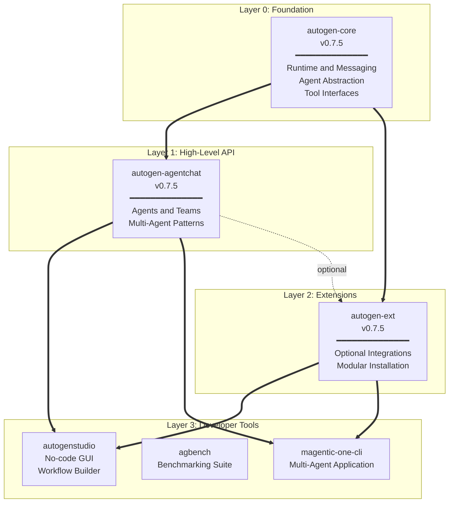
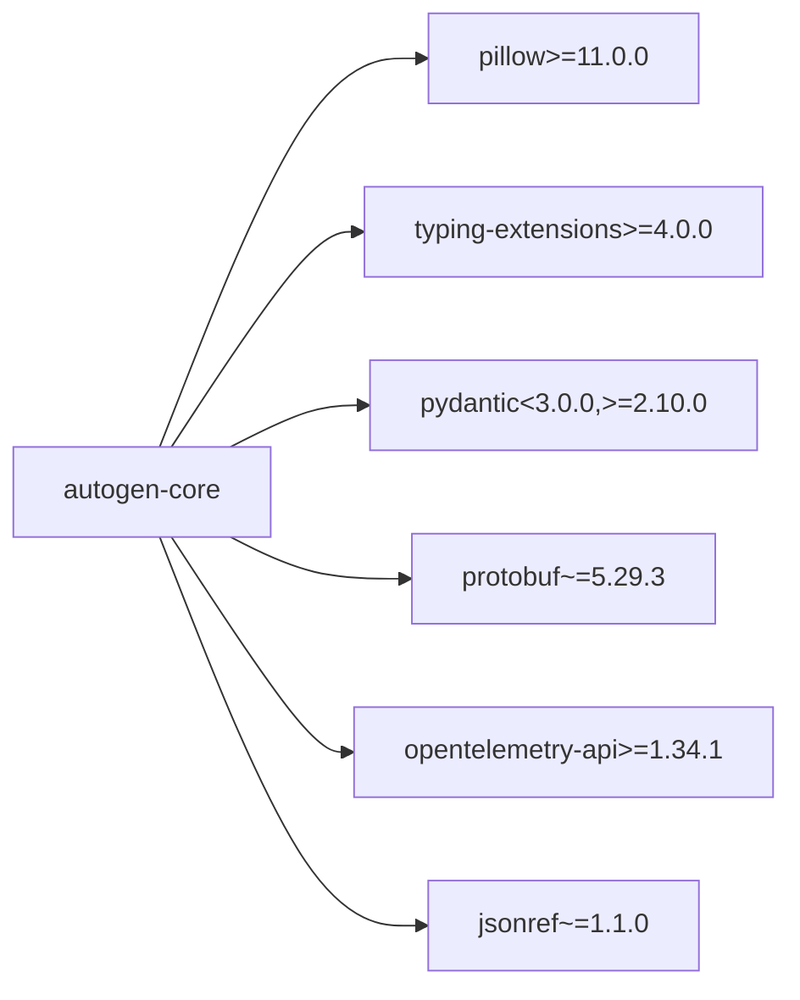
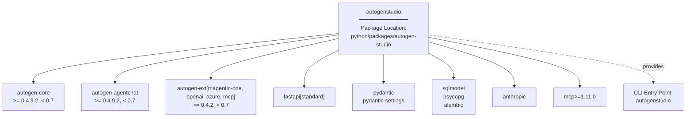
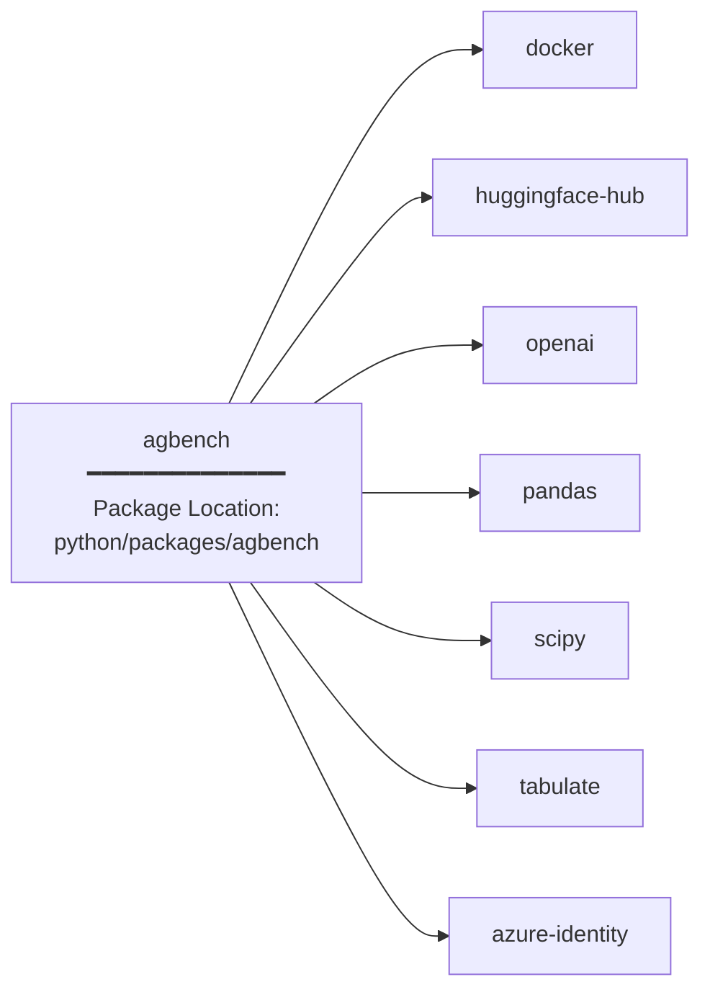
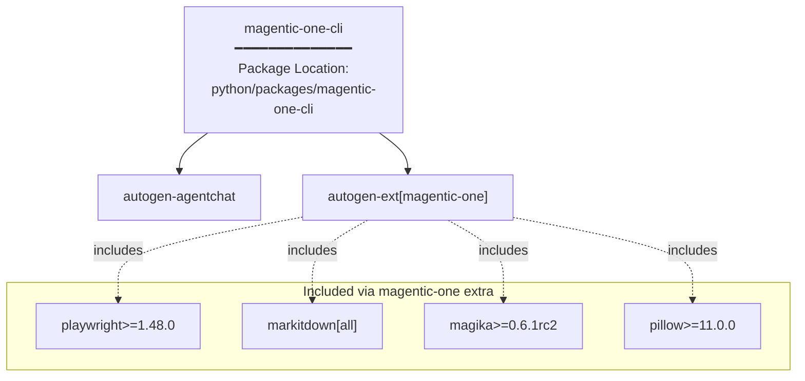
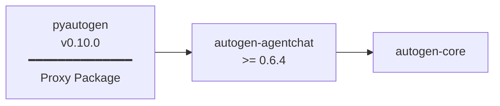
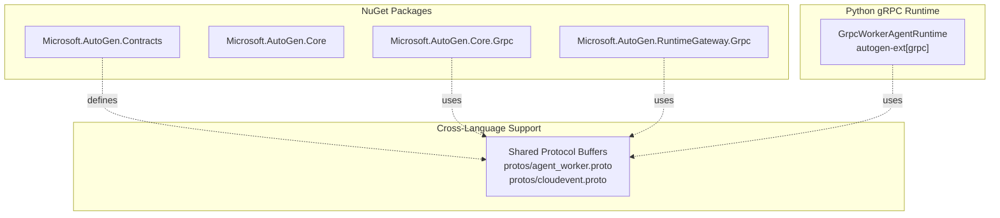
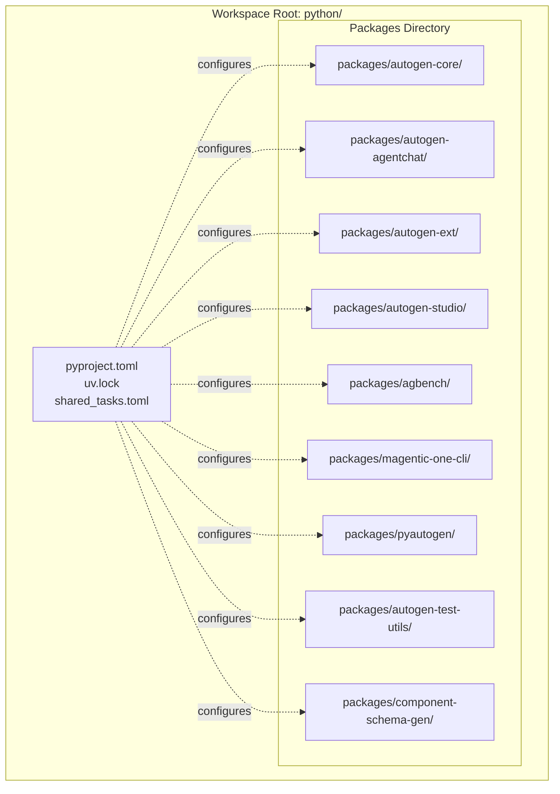

<!-- source: DeepWiki mcp.deepwiki.com · repo microsoft/autogen · page 1.1 Package Architecture · fetched 2026-10-26 -->

# Package Architecture

<details>
<summary>Relevant source files</summary>

The following files were used as context for generating this wiki page:

- [.github/ISSUE_TEMPLATE/1-bug_report.yml](.github/ISSUE_TEMPLATE/1-bug_report.yml)
- [.github/workflows/checks.yml](.github/workflows/checks.yml)
- [.github/workflows/codeql.yml](.github/workflows/codeql.yml)
- [.github/workflows/docs.yml](.github/workflows/docs.yml)
- [.github/workflows/dotnet-build.yml](.github/workflows/dotnet-build.yml)
- [.github/workflows/integration.yml](.github/workflows/integration.yml)
- [.github/workflows/single-python-package.yml](.github/workflows/single-python-package.yml)
- [README.md](README.md)
- [docs/switcher.json](docs/switcher.json)
- [python/.gitignore](python/.gitignore)
- [python/docs/src/conf.py](python/docs/src/conf.py)
- [python/packages/agbench/pyproject.toml](python/packages/agbench/pyproject.toml)
- [python/packages/autogen-agentchat/README.md](python/packages/autogen-agentchat/README.md)
- [python/packages/autogen-agentchat/pyproject.toml](python/packages/autogen-agentchat/pyproject.toml)
- [python/packages/autogen-agentchat/src/autogen_agentchat/py.typed](python/packages/autogen-agentchat/src/autogen_agentchat/py.typed)
- [python/packages/autogen-core/README.md](python/packages/autogen-core/README.md)
- [python/packages/autogen-core/pyproject.toml](python/packages/autogen-core/pyproject.toml)
- [python/packages/autogen-ext/README.md](python/packages/autogen-ext/README.md)
- [python/packages/autogen-ext/pyproject.toml](python/packages/autogen-ext/pyproject.toml)
- [python/packages/autogen-studio/pyproject.toml](python/packages/autogen-studio/pyproject.toml)
- [python/packages/pyautogen/LICENSE-CODE](python/packages/pyautogen/LICENSE-CODE)
- [python/packages/pyautogen/README.md](python/packages/pyautogen/README.md)
- [python/packages/pyautogen/pyproject.toml](python/packages/pyautogen/pyproject.toml)
- [python/packages/pyautogen/src/pyautogen/__init__.py](python/packages/pyautogen/src/pyautogen/__init__.py)
- [python/pyproject.toml](python/pyproject.toml)
- [python/templates/new-package/cookiecutter.json](python/templates/new-package/cookiecutter.json)
- [python/templates/new-package/hooks/post_gen_project.py](python/templates/new-package/hooks/post_gen_project.py)
- [python/templates/new-package/hooks/pre_gen_project.py](python/templates/new-package/hooks/pre_gen_project.py)
- [python/templates/new-package/{{cookiecutter.package_name}}/README.md](python/templates/new-package/{{cookiecutter.package_name}}/README.md)
- [python/templates/new-package/{{cookiecutter.package_name}}/pyproject.toml](python/templates/new-package/{{cookiecutter.package_name}}/pyproject.toml)
- [python/templates/new-package/{{cookiecutter.package_name}}/src/{{cookiecutter.__project_slug}}/__init__.py](python/templates/new-package/{{cookiecutter.package_name}}/src/{{cookiecutter.__project_slug}}/__init__.py)
- [python/templates/new-package/{{cookiecutter.package_name}}/src/{{cookiecutter.__project_slug}}/py.typed](python/templates/new-package/{{cookiecutter.package_name}}/src/{{cookiecutter.__project_slug}}/py.typed)
- [python/templates/new-package/{{cookiecutter.package_name}}/tests/test_example.py](python/templates/new-package/{{cookiecutter.package_name}}/tests/test_example.py)
- [python/uv.lock](python/uv.lock)

</details>


This document describes the structure and organization of the AutoGen repository's Python packages, focusing on the three-layer architecture (`autogen-core`, `autogen-agentchat`, `autogen-ext`), developer tools, and the .NET SDK. For information about specific runtime implementations, see [Agent Runtime System](#2.1). For installation instructions, see [Installation and Setup](#1.2).

## Layered Architecture

AutoGen uses a strict three-layer package architecture where each layer builds on the one below it, ensuring clear separation of concerns and controlled dependencies.



**Sources:** [README.md:14-200](), [python/packages/autogen-core/pyproject.toml:1-89](), [python/packages/autogen-agentchat/pyproject.toml:1-39](), [python/packages/autogen-ext/pyproject.toml:1-206]()

## Core Package: autogen-core

The `autogen-core` package provides foundational abstractions and runtime infrastructure that all other packages depend on.

### Package Metadata

| Property | Value |
|----------|-------|
| **Name** | `autogen-core` |
| **Version** | 0.7.5 |
| **Python Requirement** | >=3.10 |
| **License** | MIT |
| **Location** | [python/packages/autogen-core/]() |

### Core Dependencies



The core package has minimal dependencies by design, ensuring it can be integrated into diverse environments without conflicts. It provides:

- **Agent Protocol**: Base classes and interfaces for agent implementations
- **Runtime System**: `SingleThreadedAgentRuntime` and `GrpcWorkerAgentRuntime`
- **Message Types**: Type-safe message definitions and serialization
- **Tool Interfaces**: `BaseTool` and related abstractions
- **Model Client Protocol**: `ChatCompletionClient` interface

**Sources:** [python/packages/autogen-core/pyproject.toml:6-24]()

## AgentChat Package: autogen-agentchat

The `autogen-agentchat` package provides high-level agent implementations and team orchestration patterns built on top of `autogen-core`.

### Package Metadata

| Property | Value |
|----------|-------|
| **Name** | `autogen-agentchat` |
| **Version** | 0.7.5 |
| **Python Requirement** | >=3.10 |
| **License** | MIT |
| **Location** | [python/packages/autogen-agentchat/]() |

### Dependencies

The package has a single required dependency:

```python
dependencies = [
    "autogen-core==0.7.5",
]
```

This package includes:

- **Concrete Agents**: `AssistantAgent`, `CodeExecutorAgent`, `OpenAIAssistantAgent`
- **Team Patterns**: `RoundRobinGroupChat`, `SelectorGroupChat`, `Swarm`, `MagenticOneGroupChat`
- **Termination Conditions**: `MaxMessage`, `TextMention`, `TokenUsage`, `HandoffTermination`
- **Model Context**: `BufferedChatCompletionContext`, `UnboundedChatCompletionContext`
- **UI Components**: `Console` for displaying agent conversations

**Sources:** [python/packages/autogen-agentchat/pyproject.toml:6-19]()

## Extensions Package: autogen-ext

The `autogen-ext` package implements a modular plugin architecture where users install only the extensions they need.

### Package Metadata

| Property | Value |
|----------|-------|
| **Name** | `autogen-ext` |
| **Version** | 0.7.5 |
| **Python Requirement** | >=3.10 |
| **Base Dependency** | `autogen-core==0.7.5` |
| **Location** | [python/packages/autogen-ext/]() |

### Extension Categories

```mermaid
graph TB
    Ext["autogen-ext<br/>Base Package"]
    
    subgraph "LLM Providers"
        OpenAI["[openai]<br/>openai>=1.93<br/>tiktoken>=0.8.0<br/>aiofiles"]
        Anthropic["[anthropic]<br/>anthropic>=0.48"]
        Azure["[azure]<br/>azure-ai-inference>=1.0.0b9<br/>azure-ai-projects>=1.0.0b11<br/>azure-identity"]
        Ollama["[ollama]<br/>ollama>=0.4.7<br/>tiktoken>=0.8.0"]
        Gemini["[gemini]<br/>google-genai>=1.0.0"]
    end
    
    subgraph "Code Execution"
        Docker["[docker]<br/>docker~=7.0<br/>asyncio_atexit>=1.0.1"]
        Jupyter["[jupyter-executor]<br/>ipykernel>=6.29.5<br/>nbclient>=0.10.2"]
        DockerJupyter["[docker-jupyter-executor]<br/>websockets>=15.0.1<br/>aiohttp>=3.11.16"]
    end
    
    subgraph "Capabilities"
        WebSurfer["[web-surfer]<br/>playwright>=1.48.0<br/>magika>=0.6.1rc2"]
        FileSurfer["[file-surfer]<br/>markitdown~=0.1.0a3"]
        VideoSurfer["[video-surfer]<br/>opencv-python>=4.5<br/>openai-whisper"]
        MCP["[mcp]<br/>mcp>=1.11.0"]
        HTTP["[http-tool]<br/>httpx>=0.27.0"]
    end
    
    subgraph "Memory Systems"
        Chromadb["[chromadb]<br/>chromadb>=1.0.0"]
        Redis["[redis]<br/>redis>=5.2.1"]
        Mem0["[mem0]<br/>mem0ai>=0.1.98"]
        Diskcache["[diskcache]<br/>diskcache>=5.6.3"]
    end
    
    subgraph "Framework Integrations"
        Langchain["[langchain]<br/>langchain_core~=0.3.3"]
        SK["[semantic-kernel-core]<br/>semantic-kernel>=1.17.1"]
    end
    
    Ext -.-> OpenAI
    Ext -.-> Anthropic
    Ext -.-> Azure
    Ext -.-> Ollama
    Ext -.-> Gemini
    Ext -.-> Docker
    Ext -.-> Jupyter
    Ext -.-> DockerJupyter
    Ext -.-> WebSurfer
    Ext -.-> FileSurfer
    Ext -.-> VideoSurfer
    Ext -.-> MCP
    Ext -.-> HTTP
    Ext -.-> Chromadb
    Ext -.-> Redis
    Ext -.-> Mem0
    Ext -.-> Diskcache
    Ext -.-> Langchain
    Ext -.-> SK
```



### Installation Patterns

Extensions are installed using pip's extras syntax:

```bash
# Install specific extensions
pip install "autogen-ext[openai,docker]"

# Install multiple categories
pip install "autogen-ext[openai,azure,chromadb]"

# Install all magentic-one dependencies
pip install "autogen-ext[magentic-one]"
```

The `[magentic-one]` extra is a convenience bundle that includes:

```python
magentic-one = [
    "autogen-agentchat==0.7.5",
    "magika>=0.6.1rc2",
    "markitdown[all]~=0.1.0a3",
    "playwright>=1.48.0",
    "pillow>=11.0.0",
]
```

### Extension Implementations Table

| Category | Extra Name | Key Dependencies | Implements Interface |
|----------|-----------|------------------|---------------------|
| OpenAI | `[openai]` | openai>=1.93, tiktoken | `ChatCompletionClient` |
| Anthropic | `[anthropic]` | anthropic>=0.48 | `ChatCompletionClient` |
| Azure | `[azure]` | azure-ai-inference, azure-ai-projects | `ChatCompletionClient` |
| Ollama | `[ollama]` | ollama>=0.4.7 | `ChatCompletionClient` |
| Gemini | `[gemini]` | google-genai>=1.0.0 | `ChatCompletionClient` |
| Docker Executor | `[docker]` | docker~=7.0 | `CodeExecutor` |
| Jupyter Executor | `[jupyter-executor]` | ipykernel, nbclient | `CodeExecutor` |
| Docker Jupyter | `[docker-jupyter-executor]` | websockets, aiohttp | `CodeExecutor` |
| Web Surfer | `[web-surfer]` | playwright>=1.48.0 | `BaseTool` |
| File Surfer | `[file-surfer]` | markitdown | `BaseTool` |
| Video Surfer | `[video-surfer]` | opencv-python, whisper | `BaseTool` |
| MCP | `[mcp]` | mcp>=1.11.0 | `Workbench` |
| HTTP Tool | `[http-tool]` | httpx>=0.27.0 | `BaseTool` |
| ChromaDB | `[chromadb]` | chromadb>=1.0.0 | Memory Interface |
| Redis | `[redis]` | redis>=5.2.1 | Memory Interface |
| Mem0 | `[mem0]` | mem0ai>=0.1.98 | Memory Interface |
| Diskcache | `[diskcache]` | diskcache>=5.6.3 | Memory Interface |
| Langchain | `[langchain]` | langchain_core~=0.3.3 | Bridge |
| Semantic Kernel | `[semantic-kernel-core]` | semantic-kernel>=1.17.1 | Bridge |

**Sources:** [python/packages/autogen-ext/pyproject.toml:21-159]()

## Developer Tools

Three developer tools build on the core framework to provide specialized functionality.

### AutoGen Studio



AutoGen Studio provides a no-code interface for building and testing multi-agent workflows. It includes:

- **Web Interface**: FastAPI-based REST API and web UI
- **Database**: SQLModel with PostgreSQL support via psycopg
- **Migrations**: Alembic for schema management
- **CLI Command**: `autogenstudio ui --port 8080 --appdir ./my-app`

**Sources:** [python/packages/autogen-studio/pyproject.toml:6-73](), [README.md:151-158]()

### AGBench



AGBench is a benchmarking suite for evaluating agent performance. It provides:

- **Benchmark Execution**: Docker-based isolated test environments
- **Dataset Integration**: HuggingFace Hub for benchmark datasets
- **Results Analysis**: Pandas and scipy for statistical analysis
- **Reporting**: Tabulate for formatted output

**Sources:** [python/uv.lock:107-140]()

### Magentic-One CLI



The Magentic-One CLI provides a command-line interface for running the Magentic-One multi-agent system. It is a state-of-the-art multi-agent team that handles tasks requiring web browsing, code execution, and file handling.

**Sources:** [python/uv.lock:22-31](), [python/packages/autogen-ext/pyproject.toml:59-65](), [README.md:183-184]()

## Compatibility Layer: pyautogen

The `pyautogen` package serves as a proxy for backward compatibility with AutoGen v0.2.



### Package Metadata

| Property | Value |
|----------|-------|
| **Name** | `pyautogen` |
| **Version** | 0.10.0 |
| **Purpose** | Proxy package for autogen-agentchat |
| **Python Requirement** | >=3.10 |
| **Location** | [python/packages/pyautogen/]() |

The package contains no implementation code ([python/packages/pyautogen/src/pyautogen/__init__.py:1]() is empty) and simply declares a dependency on `autogen-agentchat>=0.6.4`. This allows users who have `pyautogen` in their dependency specifications to automatically receive the latest `autogen-agentchat` package.

**Important Note**: For AutoGen v0.2.x, users must pin to `pyautogen~=0.2.0`. For migration instructions, see the [Migration Guide](https://microsoft.github.io/autogen/stable/user-guide/agentchat-user-guide/migration-guide.html).

**Sources:** [python/packages/pyautogen/pyproject.toml:1-25](), [python/packages/pyautogen/README.md:1-14](), [README.md:31-32]()

## .NET SDK

A parallel implementation exists for .NET developers, providing cross-platform and cross-language agent development capabilities.



### NuGet Package Table

| Package | Purpose |
|---------|---------|
| `Microsoft.AutoGen.Contracts` | Shared contracts and interfaces |
| `Microsoft.AutoGen.Core` | Core runtime implementation |
| `Microsoft.AutoGen.Core.Grpc` | gRPC-based distributed runtime |
| `Microsoft.AutoGen.RuntimeGateway.Grpc` | Gateway for cross-language communication |

The .NET SDK supports .NET 8 and .NET 9, and can interoperate with Python agents through the gRPC runtime. Documentation is available at [microsoft.github.io/autogen/dotnet/](https://microsoft.github.io/autogen/dotnet/).

**Sources:** [README.md:191-197](), [.github/workflows/dotnet-build.yml:1-348]()

## Workspace Structure

The Python packages are organized as a uv workspace with shared configuration and tooling.



### Workspace Configuration

The workspace is defined in [python/pyproject.toml:47-49]():

```toml
[tool.uv.workspace]
members = ["packages/*"]
exclude = ["packages/autogen-magentic-one"]
```

### Workspace Members

The lockfile [python/uv.lock:20-31]() defines the following workspace members:

```
members = [
    "agbench",
    "autogen-agentchat",
    "autogen-core",
    "autogen-ext",
    "autogen-test-utils",
    "autogenstudio",
    "component-schema-gen",
    "magentic-one-cli",
    "pyautogen",
]
```

### Shared Development Dependencies

All packages inherit development dependencies from the workspace root:

| Tool | Version | Purpose |
|------|---------|---------|
| `ruff` | 0.4.8 | Linting and formatting |
| `mypy` | 1.13.0 | Static type checking |
| `pyright` | 1.1.389 | Static type checking |
| `pytest` | latest | Testing framework |
| `pytest-asyncio` | latest | Async test support |
| `pytest-cov` | latest | Coverage reporting |
| `pytest-xdist` | latest | Parallel test execution |
| `grpcio-tools` | ~1.70.0 | Protocol buffer compilation |
| `sphinx` | latest | Documentation generation |

**Sources:** [python/pyproject.toml:1-148](), [python/uv.lock:1-38]()

## Version Synchronization

All core packages maintain synchronized versions to ensure compatibility:

| Package | Current Version | Location |
|---------|----------------|----------|
| `autogen-core` | 0.7.5 | [python/packages/autogen-core/pyproject.toml:7]() |
| `autogen-agentchat` | 0.7.5 | [python/packages/autogen-agentchat/pyproject.toml:7]() |
| `autogen-ext` | 0.7.5 | [python/packages/autogen-ext/pyproject.toml:7]() |

This synchronization is enforced through exact version pins in dependencies. For example, `autogen-agentchat` specifies `autogen-core==0.7.5` (not `>=0.7.5`), and `autogen-ext` specifies both `autogen-core==0.7.5` and optional dependencies like `autogen-agentchat==0.7.5` in the `[file-surfer]` and `[web-surfer]` extras.

When new versions are released, the CI/CD system ensures all packages are published together through the [single-python-package.yml]() workflow, which can deploy any of the workspace members to PyPI.

**Sources:** [python/packages/autogen-core/pyproject.toml:7](), [python/packages/autogen-agentchat/pyproject.toml:7](), [python/packages/autogen-ext/pyproject.toml:7](), [.github/workflows/single-python-package.yml:1-45]()

---

