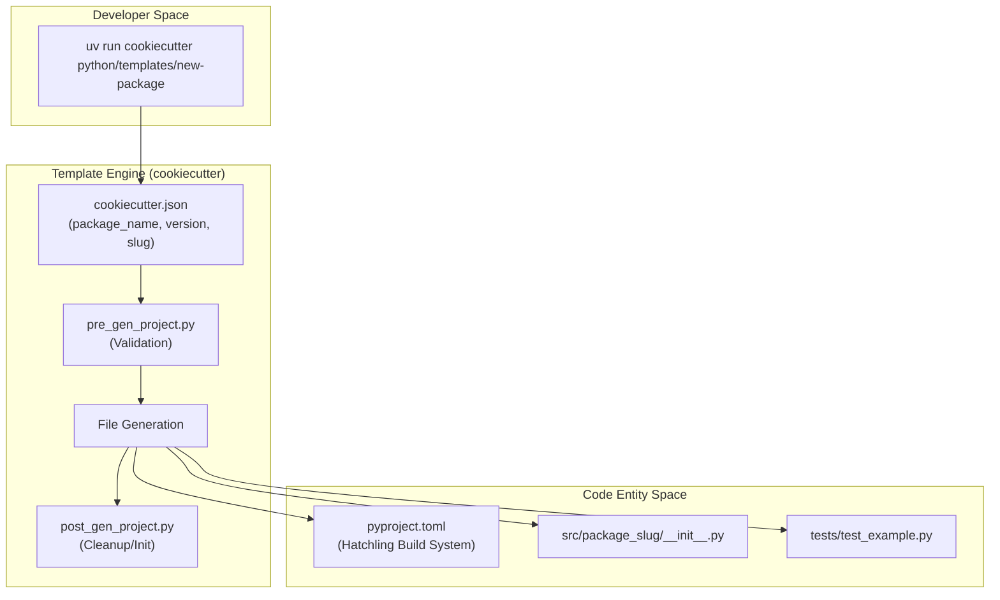
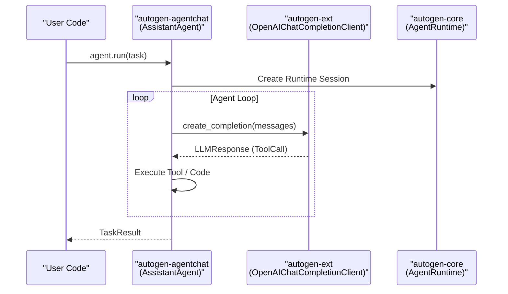

<!-- source: DeepWiki mcp.deepwiki.com · repo microsoft/autogen · page 1.2 Installation and Setup · fetched 2026-10-26 -->

# Installation and Setup

<details>
<summary>Relevant source files</summary>

The following files were used as context for generating this wiki page:

- [.github/ISSUE_TEMPLATE/1-bug_report.yml](.github/ISSUE_TEMPLATE/1-bug_report.yml)
- [.github/workflows/docs.yml](.github/workflows/docs.yml)
- [CONTRIBUTING.md](CONTRIBUTING.md)
- [README.md](README.md)
- [docs/switcher.json](docs/switcher.json)
- [python/README.md](python/README.md)
- [python/packages/agbench/pyproject.toml](python/packages/agbench/pyproject.toml)
- [python/packages/autogen-agentchat/pyproject.toml](python/packages/autogen-agentchat/pyproject.toml)
- [python/packages/autogen-core/pyproject.toml](python/packages/autogen-core/pyproject.toml)
- [python/packages/autogen-ext/pyproject.toml](python/packages/autogen-ext/pyproject.toml)
- [python/packages/autogen-studio/pyproject.toml](python/packages/autogen-studio/pyproject.toml)
- [python/templates/new-package/cookiecutter.json](python/templates/new-package/cookiecutter.json)
- [python/templates/new-package/hooks/post_gen_project.py](python/templates/new-package/hooks/post_gen_project.py)
- [python/templates/new-package/hooks/pre_gen_project.py](python/templates/new-package/hooks/pre_gen_project.py)
- [python/templates/new-package/{{cookiecutter.package_name}}/README.md](python/templates/new-package/{{cookiecutter.package_name}}/README.md)
- [python/templates/new-package/{{cookiecutter.package_name}}/pyproject.toml](python/templates/new-package/{{cookiecutter.package_name}}/pyproject.toml)
- [python/templates/new-package/{{cookiecutter.package_name}}/src/{{cookiecutter.__project_slug}}/__init__.py](python/templates/new-package/{{cookiecutter.package_name}}/src/{{cookiecutter.__project_slug}}/__init__.py)
- [python/templates/new-package/{{cookiecutter.package_name}}/src/{{cookiecutter.__project_slug}}/py.typed](python/templates/new-package/{{cookiecutter.package_name}}/src/{{cookiecutter.__project_slug}}/py.typed)
- [python/templates/new-package/{{cookiecutter.package_name}}/tests/test_example.py](python/templates/new-package/{{cookiecutter.package_name}}/tests/test_example.py)
- [python/uv.lock](python/uv.lock)

</details>


This guide covers installing AutoGen packages, configuring environment variables, and running quickstart examples. AutoGen uses a modular package architecture where you install only the components you need for your specific application.

## Installation

AutoGen requires **Python 3.10 or later** [README.md:29-29](). The framework is distributed as a set of modular packages to minimize dependency bloat.

### Pip Installation
For most users, installing the high-level `autogen-agentchat` and the specific model extension is the recommended path:

```bash
# Install AgentChat and OpenAI client extension
pip install -U "autogen-agentchat" "autogen-ext[openai]"

# Install AutoGen Studio for the no-code GUI
pip install -U "autogenstudio"
```
Sources: [README.md:31-41]()

### UV Installation (Recommended for Developers)
The repository uses `uv` as its primary package manager [python/README.md:30-32](). To set up a full development environment:

```bash
# Sync all packages and extras in the workspace
uv sync --all-extras
# Activate the virtual environment
source .venv/bin/activate
```
Sources: [python/README.md:46-49](), [python/uv.lock:20-31]()

### Extension Extras
The `autogen-ext` package provides various optional dependencies for different model providers and tools:

| Extra | Purpose | Primary Dependencies |
|-------|---------|----------------------|
| `openai` | OpenAI & Azure OpenAI | `openai`, `tiktoken`, `aiofiles` |
| `anthropic` | Anthropic Models | `anthropic` |
| `web-surfer` | Playwright Browsing | `playwright`, `pillow`, `magika`, `markitdown` |
| `docker` | Isolated Code Execution | `docker`, `asyncio_atexit` |
| `mcp` | Model Context Protocol | `mcp` |
| `jupyter-executor` | Stateful Jupyter Kernels | `ipykernel`, `nbclient` |

Sources: [python/packages/autogen-ext/pyproject.toml:21-153]()

## Environment Configuration

AutoGen agents typically require API keys for LLM providers. These should be exported as environment variables.

```bash
# OpenAI
export OPENAI_API_KEY="sk-..."

# Azure OpenAI (Example)
export AZURE_OPENAI_API_KEY="..."
export AZURE_OPENAI_ENDPOINT="https://..."
```
Sources: [README.md:45-45](), [python/packages/autogen-core/pyproject.toml:48-48]()

## Quickstart Examples

### Hello World (AssistantAgent)
The following example demonstrates creating a basic `AssistantAgent` using the `OpenAIChatCompletionClient` [README.md:52-63]().

```python
import asyncio
from autogen_agentchat.agents import AssistantAgent
from autogen_ext.models.openai import OpenAIChatCompletionClient

async def main() -> None:
    # 1. Define the model client
    model_client = OpenAIChatCompletionClient(model="gpt-4o")
    
    # 2. Define the agent
    agent = AssistantAgent("assistant", model_client=model_client)
    
    # 3. Run the task
    result = await agent.run(task="Say 'Hello World!'")
    print(result)
    
    await model_client.close()

asyncio.run(main())
```

### Tool-Augmented Agent (MCP)
This example uses the Model Context Protocol (MCP) via `McpWorkbench` to give an agent web browsing capabilities [README.md:71-99]().

```python
import asyncio
from autogen_agentchat.agents import AssistantAgent
from autogen_agentchat.ui import Console
from autogen_ext.models.openai import OpenAIChatCompletionClient
from autogen_ext.tools.mcp import McpWorkbench, StdioServerParams

async def main() -> None:
    model_client = OpenAIChatCompletionClient(model="gpt-4o")
    server_params = StdioServerParams(command="npx", args=["@playwright/mcp@latest", "--headless"])
    
    async with McpWorkbench(server_params) as mcp:
        agent = AssistantAgent(
            "web_browsing_assistant",
            model_client=model_client,
            workbench=mcp,
            model_client_stream=True
        )
        await Console(agent.run_stream(task="Search for AutoGen news"))

asyncio.run(main())
```

## Creating New Packages

For developers extending the framework, AutoGen provides a `cookiecutter` template to maintain consistency across the monorepo [python/uv.lock:43-43]().

**Template Location:** `python/templates/new-package/`

### Package Initialization Flow


Sources: [python/templates/new-package/cookiecutter.json:1-10](), [python/templates/new-package/hooks/pre_gen_project.py:1-5](), [python/templates/new-package/{{cookiecutter.package_name}}/pyproject.toml:1-10]()

## Package Architecture and Data Flow

The following diagram illustrates how the different packages interact during a standard agent execution flow.


Sources: [python/packages/autogen-agentchat/pyproject.toml:17-19](), [python/packages/autogen-ext/pyproject.toml:17-19](), [python/packages/autogen-core/pyproject.toml:6-10]()

## AutoGen Studio Setup

AutoGen Studio provides a web-based UI for prototyping multi-agent workflows without writing code.

```bash
# Run the UI
autogenstudio ui --port 8080 --appdir ./my-app
```
Sources: [README.md:167-168](), [python/packages/autogen-studio/pyproject.toml:72-72]()

The backend is built on **FastAPI** and **SQLModel** [python/packages/autogen-studio/pyproject.toml:23-28](). It manages agent configurations, session state, and database migrations via **Alembic** [python/packages/autogen-studio/pyproject.toml:30-30]().

---

