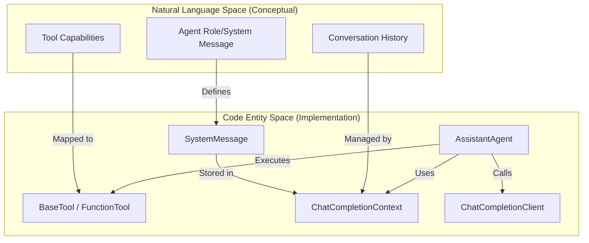
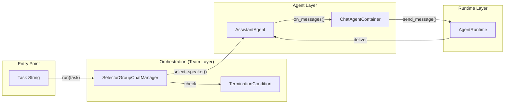

<!-- source: DeepWiki mcp.deepwiki.com · repo microsoft/autogen · page 10 Glossary · fetched 2026-10-26 -->

# Glossary

Relevant source files

The following files were used as context for generating this wiki page:

- [.github/ISSUE_TEMPLATE/1-bug_report.yml](.github/ISSUE_TEMPLATE/1-bug_report.yml)
- [.github/workflows/docs.yml](.github/workflows/docs.yml)
- [README.md](README.md)
- [docs/switcher.json](docs/switcher.json)
- [dotnet/src/Microsoft.AutoGen/Contracts/AgentProxy.cs](dotnet/src/Microsoft.AutoGen/Contracts/AgentProxy.cs)
- [dotnet/src/Microsoft.AutoGen/Contracts/IAgent.cs](dotnet/src/Microsoft.AutoGen/Contracts/IAgent.cs)
- [dotnet/src/Microsoft.AutoGen/Contracts/IAgentRuntime.cs](dotnet/src/Microsoft.AutoGen/Contracts/IAgentRuntime.cs)
- [dotnet/src/Microsoft.AutoGen/Contracts/ISaveState.cs](dotnet/src/Microsoft.AutoGen/Contracts/ISaveState.cs)
- [dotnet/src/Microsoft.AutoGen/Contracts/KVStringParseHelper.cs](dotnet/src/Microsoft.AutoGen/Contracts/KVStringParseHelper.cs)
- [dotnet/src/Microsoft.AutoGen/Core.Grpc/GrpcAgentRuntime.cs](dotnet/src/Microsoft.AutoGen/Core.Grpc/GrpcAgentRuntime.cs)
- [dotnet/src/Microsoft.AutoGen/Core/AgentsApp.cs](dotnet/src/Microsoft.AutoGen/Core/AgentsApp.cs)
- [dotnet/src/Microsoft.AutoGen/Core/BaseAgent.cs](dotnet/src/Microsoft.AutoGen/Core/BaseAgent.cs)
- [dotnet/src/Microsoft.AutoGen/Core/IHandleExtensions.cs](dotnet/src/Microsoft.AutoGen/Core/IHandleExtensions.cs)
- [dotnet/src/Microsoft.AutoGen/Core/InProcessRuntime.cs](dotnet/src/Microsoft.AutoGen/Core/InProcessRuntime.cs)
- [dotnet/src/Microsoft.AutoGen/Core/Properties/AssemblyInfo.cs](dotnet/src/Microsoft.AutoGen/Core/Properties/AssemblyInfo.cs)
- [dotnet/test/Microsoft.AutoGen.Core.Tests/AgentTests.cs](dotnet/test/Microsoft.AutoGen.Core.Tests/AgentTests.cs)
- [dotnet/test/Microsoft.AutoGen.Core.Tests/InProcessRuntimeTests.cs](dotnet/test/Microsoft.AutoGen.Core.Tests/InProcessRuntimeTests.cs)
- [python/packages/autogen-agentchat/pyproject.toml](python/packages/autogen-agentchat/pyproject.toml)
- [python/packages/autogen-agentchat/src/autogen_agentchat/agents/_assistant_agent.py](python/packages/autogen-agentchat/src/autogen_agentchat/agents/_assistant_agent.py)
- [python/packages/autogen-agentchat/src/autogen_agentchat/agents/_base_chat_agent.py](python/packages/autogen-agentchat/src/autogen_agentchat/agents/_base_chat_agent.py)
- [python/packages/autogen-agentchat/src/autogen_agentchat/agents/_message_filter_agent.py](python/packages/autogen-agentchat/src/autogen_agentchat/agents/_message_filter_agent.py)
- [python/packages/autogen-agentchat/src/autogen_agentchat/base/_chat_agent.py](python/packages/autogen-agentchat/src/autogen_agentchat/base/_chat_agent.py)
- [python/packages/autogen-agentchat/src/autogen_agentchat/base/_task.py](python/packages/autogen-agentchat/src/autogen_agentchat/base/_task.py)
- [python/packages/autogen-agentchat/src/autogen_agentchat/base/_team.py](python/packages/autogen-agentchat/src/autogen_agentchat/base/_team.py)
- [python/packages/autogen-agentchat/src/autogen_agentchat/messages.py](python/packages/autogen-agentchat/src/autogen_agentchat/messages.py)
- [python/packages/autogen-agentchat/src/autogen_agentchat/teams/_group_chat/_base_group_chat.py](python/packages/autogen-agentchat/src/autogen_agentchat/teams/_group_chat/_base_group_chat.py)
- [python/packages/autogen-agentchat/src/autogen_agentchat/teams/_group_chat/_base_group_chat_manager.py](python/packages/autogen-agentchat/src/autogen_agentchat/teams/_group_chat/_base_group_chat_manager.py)
- [python/packages/autogen-agentchat/src/autogen_agentchat/teams/_group_chat/_chat_agent_container.py](python/packages/autogen-agentchat/src/autogen_agentchat/teams/_group_chat/_chat_agent_container.py)
- [python/packages/autogen-agentchat/src/autogen_agentchat/teams/_group_chat/_events.py](python/packages/autogen-agentchat/src/autogen_agentchat/teams/_group_chat/_events.py)
- [python/packages/autogen-agentchat/src/autogen_agentchat/teams/_group_chat/_graph/__init__.py](python/packages/autogen-agentchat/src/autogen_agentchat/teams/_group_chat/_graph/__init__.py)
- [python/packages/autogen-agentchat/src/autogen_agentchat/teams/_group_chat/_graph/_digraph_group_chat.py](python/packages/autogen-agentchat/src/autogen_agentchat/teams/_group_chat/_graph/_digraph_group_chat.py)
- [python/packages/autogen-agentchat/src/autogen_agentchat/teams/_group_chat/_graph/_graph_builder.py](python/packages/autogen-agentchat/src/autogen_agentchat/teams/_group_chat/_graph/_graph_builder.py)
- [python/packages/autogen-agentchat/src/autogen_agentchat/teams/_group_chat/_magentic_one/_magentic_one_group_chat.py](python/packages/autogen-agentchat/src/autogen_agentchat/teams/_group_chat/_magentic_one/_magentic_one_group_chat.py)
- [python/packages/autogen-agentchat/src/autogen_agentchat/teams/_group_chat/_magentic_one/_magentic_one_orchestrator.py](python/packages/autogen-agentchat/src/autogen_agentchat/teams/_group_chat/_magentic_one/_magentic_one_orchestrator.py)
- [python/packages/autogen-agentchat/src/autogen_agentchat/teams/_group_chat/_round_robin_group_chat.py](python/packages/autogen-agentchat/src/autogen_agentchat/teams/_group_chat/_round_robin_group_chat.py)
- [python/packages/autogen-agentchat/src/autogen_agentchat/teams/_group_chat/_selector_group_chat.py](python/packages/autogen-agentchat/src/autogen_agentchat/teams/_group_chat/_selector_group_chat.py)
- [python/packages/autogen-agentchat/src/autogen_agentchat/teams/_group_chat/_swarm_group_chat.py](python/packages/autogen-agentchat/src/autogen_agentchat/teams/_group_chat/_swarm_group_chat.py)
- [python/packages/autogen-agentchat/tests/test_assistant_agent.py](python/packages/autogen-agentchat/tests/test_assistant_agent.py)
- [python/packages/autogen-agentchat/tests/test_group_chat.py](python/packages/autogen-agentchat/tests/test_group_chat.py)
- [python/packages/autogen-agentchat/tests/test_group_chat_endpoint.py](python/packages/autogen-agentchat/tests/test_group_chat_endpoint.py)
- [python/packages/autogen-agentchat/tests/test_group_chat_graph.py](python/packages/autogen-agentchat/tests/test_group_chat_graph.py)
- [python/packages/autogen-agentchat/tests/utils.py](python/packages/autogen-agentchat/tests/utils.py)
- [python/packages/autogen-core/pyproject.toml](python/packages/autogen-core/pyproject.toml)
- [python/packages/autogen-core/src/autogen_core/_agent.py](python/packages/autogen-core/src/autogen_core/_agent.py)
- [python/packages/autogen-core/src/autogen_core/_agent_instantiation.py](python/packages/autogen-core/src/autogen_core/_agent_instantiation.py)
- [python/packages/autogen-core/src/autogen_core/_agent_runtime.py](python/packages/autogen-core/src/autogen_core/_agent_runtime.py)
- [python/packages/autogen-core/src/autogen_core/_base_agent.py](python/packages/autogen-core/src/autogen_core/_base_agent.py)
- [python/packages/autogen-core/src/autogen_core/_single_threaded_agent_runtime.py](python/packages/autogen-core/src/autogen_core/_single_threaded_agent_runtime.py)
- [python/packages/autogen-core/src/autogen_core/_telemetry/_propagation.py](python/packages/autogen-core/src/autogen_core/_telemetry/_propagation.py)
- [python/packages/autogen-core/src/autogen_core/_telemetry/_tracing.py](python/packages/autogen-core/src/autogen_core/_telemetry/_tracing.py)
- [python/packages/autogen-core/tests/test_base_agent.py](python/packages/autogen-core/tests/test_base_agent.py)
- [python/packages/autogen-core/tests/test_runtime.py](python/packages/autogen-core/tests/test_runtime.py)
- [python/packages/autogen-ext/conftest.py](python/packages/autogen-ext/conftest.py)
- [python/packages/autogen-ext/pyproject.toml](python/packages/autogen-ext/pyproject.toml)
- [python/packages/autogen-ext/src/autogen_ext/runtimes/grpc/_worker_runtime.py](python/packages/autogen-ext/src/autogen_ext/runtimes/grpc/_worker_runtime.py)
- [python/packages/autogen-ext/src/autogen_ext/tools/mcp/__init__.py](python/packages/autogen-ext/src/autogen_ext/tools/mcp/__init__.py)
- [python/packages/autogen-ext/src/autogen_ext/tools/mcp/_actor.py](python/packages/autogen-ext/src/autogen_ext/tools/mcp/_actor.py)
- [python/packages/autogen-ext/src/autogen_ext/tools/mcp/_base.py](python/packages/autogen-ext/src/autogen_ext/tools/mcp/_base.py)
- [python/packages/autogen-ext/src/autogen_ext/tools/mcp/_config.py](python/packages/autogen-ext/src/autogen_ext/tools/mcp/_config.py)
- [python/packages/autogen-ext/src/autogen_ext/tools/mcp/_session.py](python/packages/autogen-ext/src/autogen_ext/tools/mcp/_session.py)
- [python/packages/autogen-ext/src/autogen_ext/tools/mcp/_streamable_http.py](python/packages/autogen-ext/src/autogen_ext/tools/mcp/_streamable_http.py)
- [python/packages/autogen-ext/src/autogen_ext/tools/mcp/_workbench.py](python/packages/autogen-ext/src/autogen_ext/tools/mcp/_workbench.py)
- [python/packages/autogen-ext/tests/mcp_server_comprehensive.py](python/packages/autogen-ext/tests/mcp_server_comprehensive.py)
- [python/packages/autogen-ext/tests/test_filesurfer_agent.py](python/packages/autogen-ext/tests/test_filesurfer_agent.py)
- [python/packages/autogen-ext/tests/test_websurfer_agent.py](python/packages/autogen-ext/tests/test_websurfer_agent.py)
- [python/packages/autogen-ext/tests/test_worker_runtime.py](python/packages/autogen-ext/tests/test_worker_runtime.py)
- [python/packages/autogen-ext/tests/tools/http/test_http_tool.py](python/packages/autogen-ext/tests/tools/http/test_http_tool.py)
- [python/packages/autogen-ext/tests/tools/test_mcp_actor.py](python/packages/autogen-ext/tests/tools/test_mcp_actor.py)
- [python/packages/autogen-ext/tests/tools/test_mcp_tools.py](python/packages/autogen-ext/tests/tools/test_mcp_tools.py)
- [python/packages/autogen-studio/pyproject.toml](python/packages/autogen-studio/pyproject.toml)
- [python/uv.lock](python/uv.lock)

This glossary defines codebase-specific terms, jargon, and domain concepts used throughout the AutoGen repository. It covers the layered architecture from the foundational `autogen-core` to the high-level `autogen-agentchat` and the extensions in `autogen-ext`.

## Core Concepts

### Agent Runtime
The underlying execution engine that manages agent lifecycles, message routing, and communication. It provides the infrastructure for agents to send and receive messages asynchronously.
*   **Protocol:** `AgentRuntime` defined in [python/packages/autogen-core/src/autogen_core/_agent_runtime.py:28-212]().
*   **Implementations:** 
    *   `SingleThreadedAgentRuntime`: Local, in-memory execution [python/packages/autogen-core/src/autogen_core/_single_threaded_agent_runtime.py:53-54]().
    *   `GrpcWorkerAgentRuntime`: Distributed execution using gRPC [python/packages/autogen-ext/src/autogen_ext/runtimes/grpc/_worker_runtime.py:243-244]().
    *   `.NET InProcessRuntime`: [dotnet/src/Microsoft.AutoGen/Core/InProcessRuntime.cs:11-12]().

### ChatCompletionClient
An abstraction layer that provides a unified interface for interacting with different Large Language Models (LLMs). It handles message transformation, tool schema conversion, and provider-specific API logic.
*   **Base Class:** `ChatCompletionClient` in [python/packages/autogen-core/src/autogen_core/models/_model_client.py]().
*   **Key Implementations:** `OpenAIChatCompletionClient` [python/packages/autogen-ext/src/autogen_ext/models/openai/_openai_client.py](), `AnthropicChatCompletionClient` [python/packages/autogen-ext/src/autogen_ext/models/anthropic/_anthropic_client.py]().

### Component
A serializable unit of logic or configuration. The `Component` system allows agents, tools, and clients to be defined declaratively and instantiated from JSON/YAML.
*   **Base Class:** `Component` in [python/packages/autogen-core/src/autogen_core/_component_config.py]().
*   **Usage:** Used in `AssistantAgent` to support `load_component` and `dump_component` [python/packages/autogen-agentchat/src/autogen_agentchat/agents/_assistant_agent.py:90-90]().

## AgentChat Vocabulary

### AssistantAgent
The primary high-level agent in `autogen-agentchat`. It manages a `ChatCompletionContext`, handles tool-calling loops, and can reflect on tool outputs.
*   **Implementation:** `AssistantAgent` in [python/packages/autogen-agentchat/src/autogen_agentchat/agents/_assistant_agent.py:90-1160]().
*   **Configuration:** `AssistantAgentConfig` [python/packages/autogen-agentchat/src/autogen_agentchat/agents/_assistant_agent.py:70-88]().

### Team
A collection of agents working together under a specific orchestration strategy. Teams manage the flow of conversation and termination conditions.
*   **Base Class:** `Team` in [python/packages/autogen-agentchat/src/autogen_agentchat/base/_team.py]().
*   **Orchestrators:** `RoundRobinGroupChat` [python/packages/autogen-agentchat/src/autogen_agentchat/teams/_group_chat/_round_robin_group_chat.py](), `SelectorGroupChat` [python/packages/autogen-agentchat/src/autogen_agentchat/teams/_group_chat/_selector_group_chat.py]().

### Termination Condition
Logic that determines when a multi-agent conversation should stop. Conditions can be composed using `And` and `Or` operators.
*   **Base Class:** `TerminationCondition` in [python/packages/autogen-agentchat/src/autogen_agentchat/base/_termination.py]().
*   **Examples:** `MaxMessageTermination`, `TextMentionTermination` [python/packages/autogen-agentchat/src/autogen_agentchat/conditions/__init__.py]().

## System Architecture Diagrams

### From Natural Language Space to Code Entity Space: Agent Execution
This diagram bridges the conceptual "Agent" to the specific classes and data structures that implement it.

**Sources:** [python/packages/autogen-agentchat/src/autogen_agentchat/agents/_assistant_agent.py:90-160](), [python/packages/autogen-core/src/autogen_core/models/_types.py:10-50]()

### Message Flow Architecture
This diagram tracks how a conceptual "User Request" flows through the code entities of a Team.

**Sources:** [python/packages/autogen-agentchat/src/autogen_agentchat/teams/_group_chat/_selector_group_chat.py:50-100](), [python/packages/autogen-agentchat/src/autogen_agentchat/teams/_group_chat/_chat_agent_container.py:20-60]()

## Specialized Terminology

| Term | Definition | Code Pointer |
| :--- | :--- | :--- |
| **Handoff** | A mechanism where one agent transfers control to another specific agent. | [python/packages/autogen-agentchat/src/autogen_agentchat/base/_chat_agent.py:15-30]() |
| **Workbench** | An environment (like MCP) providing tools and context to an agent. | [python/packages/autogen-core/src/autogen_core/tools/_workbench.py]() |
| **MagenticOne** | A specific multi-agent system architecture using ledgers for coordination. | [python/packages/autogen-agentchat/src/autogen_agentchat/teams/_group_chat/_magentic_one/_magentic_one_orchestrator.py]() |
| **MCP** | Model Context Protocol; used for connecting agents to external tools/data. | [python/packages/autogen-ext/src/autogen_ext/tools/mcp/_workbench.py]() |
| **Topic Type** | A string identifier used by the `AgentRuntime` to route messages to specific agents or groups. | [python/packages/autogen-core/src/autogen_core/_agent_runtime.py:30-45]() |
| **Intervention** | A hook in the runtime that allows monitoring or modifying messages before delivery. | [python/packages/autogen-core/src/autogen_core/_agent_runtime.py:180-200]() |

## Developer Tools

### agbench
A benchmarking suite for evaluating agent performance on various tasks (e.g., GAIA, HumanEval).
*   **Path:** `packages/agbench`
*   **Key Logic:** [python/uv.lock:107-117]()

### AutoGen Studio
A low-code/no-code interface for building and testing AutoGen teams.
*   **Backend:** FastAPI-based server in `packages/autogenstudio`.
*   **Frontend:** React/Gatsby application.
*   **Reference:** [python/packages/autogen-studio/pyproject.toml]()

**Sources:** [README.md:14-26](), [python/uv.lock:21-31](), [python/packages/autogen-ext/pyproject.toml:5-70]()