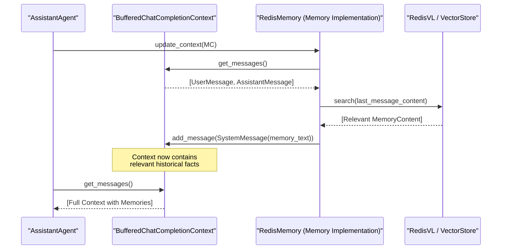
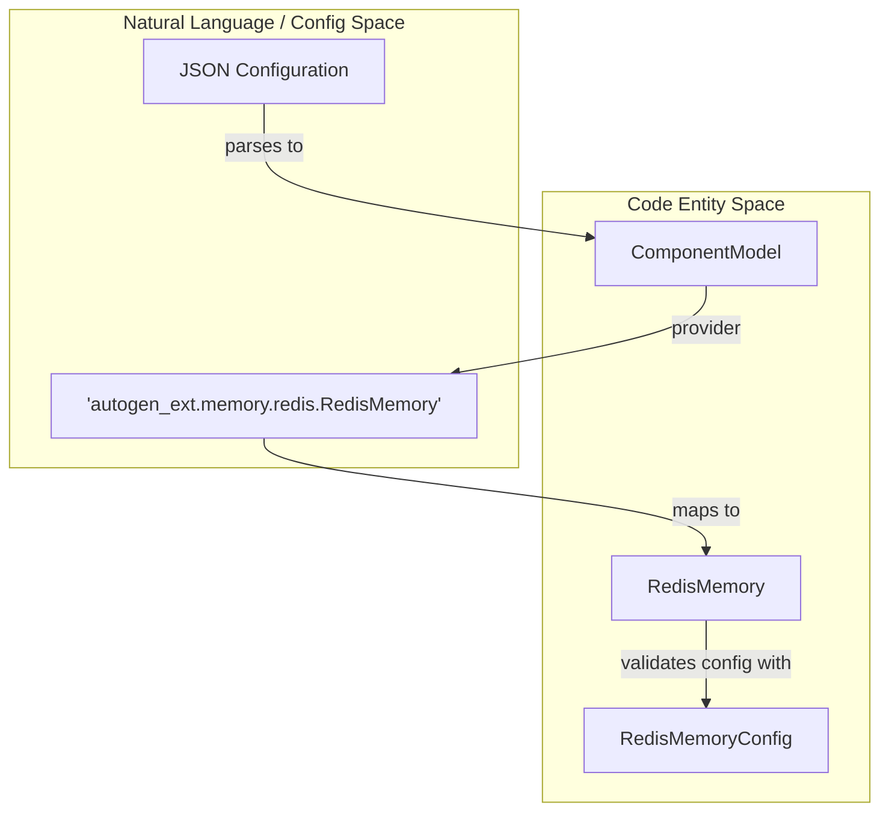

<!-- source: DeepWiki mcp.deepwiki.com · repo microsoft/autogen · page 2.4 Memory Systems · fetched 2026-10-26 -->

# Memory Systems

Relevant source files

The following files were used as context for generating this wiki page:

- [.github/workflows/pytest-mem0.yml](.github/workflows/pytest-mem0.yml)
- [.github/workflows/pytest-redis-memory.yml](.github/workflows/pytest-redis-memory.yml)
- [.gitignore](.gitignore)
- [docs/dotnet/docfx.json](docs/dotnet/docfx.json)
- [python/docs/src/user-guide/agentchat-user-guide/memory.ipynb](python/docs/src/user-guide/agentchat-user-guide/memory.ipynb)
- [python/docs/src/user-guide/autogenstudio-user-guide/installation.md](python/docs/src/user-guide/autogenstudio-user-guide/installation.md)
- [python/packages/autogen-core/src/autogen_core/_component_config.py](python/packages/autogen-core/src/autogen_core/_component_config.py)
- [python/packages/autogen-core/src/autogen_core/_runtime_impl_helpers.py](python/packages/autogen-core/src/autogen_core/_runtime_impl_helpers.py)
- [python/packages/autogen-core/src/autogen_core/memory/_base_memory.py](python/packages/autogen-core/src/autogen_core/memory/_base_memory.py)
- [python/packages/autogen-core/src/autogen_core/memory/_list_memory.py](python/packages/autogen-core/src/autogen_core/memory/_list_memory.py)
- [python/packages/autogen-core/tests/test_component_config.py](python/packages/autogen-core/tests/test_component_config.py)
- [python/packages/autogen-core/tests/test_memory.py](python/packages/autogen-core/tests/test_memory.py)
- [python/packages/autogen-ext/src/autogen_ext/agents/video_surfer/tools.py](python/packages/autogen-ext/src/autogen_ext/agents/video_surfer/tools.py)
- [python/packages/autogen-ext/src/autogen_ext/memory/__init__.py](python/packages/autogen-ext/src/autogen_ext/memory/__init__.py)
- [python/packages/autogen-ext/src/autogen_ext/memory/canvas/__init__.py](python/packages/autogen-ext/src/autogen_ext/memory/canvas/__init__.py)
- [python/packages/autogen-ext/src/autogen_ext/memory/canvas/_canvas.py](python/packages/autogen-ext/src/autogen_ext/memory/canvas/_canvas.py)
- [python/packages/autogen-ext/src/autogen_ext/memory/canvas/_canvas_writer.py](python/packages/autogen-ext/src/autogen_ext/memory/canvas/_canvas_writer.py)
- [python/packages/autogen-ext/src/autogen_ext/memory/canvas/_text_canvas.py](python/packages/autogen-ext/src/autogen_ext/memory/canvas/_text_canvas.py)
- [python/packages/autogen-ext/src/autogen_ext/memory/canvas/_text_canvas_memory.py](python/packages/autogen-ext/src/autogen_ext/memory/canvas/_text_canvas_memory.py)
- [python/packages/autogen-ext/src/autogen_ext/memory/chromadb/__init__.py](python/packages/autogen-ext/src/autogen_ext/memory/chromadb/__init__.py)
- [python/packages/autogen-ext/src/autogen_ext/memory/chromadb/_chroma_configs.py](python/packages/autogen-ext/src/autogen_ext/memory/chromadb/_chroma_configs.py)
- [python/packages/autogen-ext/src/autogen_ext/memory/chromadb/_chromadb.py](python/packages/autogen-ext/src/autogen_ext/memory/chromadb/_chromadb.py)
- [python/packages/autogen-ext/src/autogen_ext/memory/mem0/_mem0.py](python/packages/autogen-ext/src/autogen_ext/memory/mem0/_mem0.py)
- [python/packages/autogen-ext/src/autogen_ext/memory/redis/__init__.py](python/packages/autogen-ext/src/autogen_ext/memory/redis/__init__.py)
- [python/packages/autogen-ext/src/autogen_ext/memory/redis/_redis_memory.py](python/packages/autogen-ext/src/autogen_ext/memory/redis/_redis_memory.py)
- [python/packages/autogen-ext/tests/memory/test_chroma_memory.py](python/packages/autogen-ext/tests/memory/test_chroma_memory.py)
- [python/packages/autogen-ext/tests/memory/test_mem0.py](python/packages/autogen-ext/tests/memory/test_mem0.py)
- [python/packages/autogen-ext/tests/memory/test_redis_memory.py](python/packages/autogen-ext/tests/memory/test_redis_memory.py)
- [python/packages/autogen-ext/tests/memory/test_text_canvas_memory.py](python/packages/autogen-ext/tests/memory/test_text_canvas_memory.py)
- [python/packages/autogen-studio/README.md](python/packages/autogen-studio/README.md)
- [python/packages/autogen-studio/autogenstudio/validation/component_test_service.py](python/packages/autogen-studio/autogenstudio/validation/component_test_service.py)
- [python/packages/autogen-studio/autogenstudio/validation/validation_service.py](python/packages/autogen-studio/autogenstudio/validation/validation_service.py)
- [python/packages/autogen-studio/autogenstudio/web/routes/mcp.py](python/packages/autogen-studio/autogenstudio/web/routes/mcp.py)
- [python/packages/autogen-studio/autogenstudio/web/routes/validation.py](python/packages/autogen-studio/autogenstudio/web/routes/validation.py)
- [python/packages/autogen-studio/frontend/src/components/types/component-templates.ts](python/packages/autogen-studio/frontend/src/components/types/component-templates.ts)
- [python/packages/autogen-studio/frontend/src/components/views/teambuilder/builder/component-editor/fields/agent-fields.tsx](python/packages/autogen-studio/frontend/src/components/views/teambuilder/builder/component-editor/fields/agent-fields.tsx)
- [python/packages/autogen-studio/frontend/src/components/views/teambuilder/builder/component-editor/fields/tool-fields.tsx](python/packages/autogen-studio/frontend/src/components/views/teambuilder/builder/component-editor/fields/tool-fields.tsx)
- [python/packages/autogen-studio/frontend/src/components/views/teambuilder/builder/component-editor/fields/workbench/workbench-fields.tsx](python/packages/autogen-studio/frontend/src/components/views/teambuilder/builder/component-editor/fields/workbench/workbench-fields.tsx)
- [python/packages/autogen-test-utils/src/autogen_test_utils/__init__.py](python/packages/autogen-test-utils/src/autogen_test_utils/__init__.py)

Memory systems in AutoGen provide a standardized protocol for agents to store, retrieve, and manage persistent information across interactions. Unlike `ChatCompletionContext`, which manages the short-term window of messages sent to a Model Client, the `Memory` system enables long-term persistence and semantic retrieval of facts, preferences, and historical context.

## Memory Protocol and Data Types

The memory system is built around the `Memory` abstract base class defined in `autogen-core`. This protocol ensures that any storage backend—from a simple in-memory list to a complex vector database—can be used interchangeably by agents.

### Core Entities

| Class | Description | File Reference |
| :--- | :--- | :--- |
| `Memory` | Abstract base class defining the protocol for memory implementations. | [python/packages/autogen-core/src/autogen_core/memory/_base_memory.py:60-73]() |
| `MemoryContent` | A container for data stored in memory, supporting multiple MIME types. | [python/packages/autogen-core/src/autogen_core/memory/_base_memory.py:26-38]() |
| `MemoryMimeType` | Enum defining supported content formats: `TEXT`, `JSON`, `MARKDOWN`, `IMAGE`, `BINARY`. | [python/packages/autogen-core/src/autogen_core/memory/_base_memory.py:13-20]() |
| `MemoryQueryResult` | The result of a `query` operation, containing a list of `MemoryContent`. | [python/packages/autogen-core/src/autogen_core/memory/_base_memory.py:48-52]() |

### Key Protocol Functions
All memory implementations must provide the following asynchronous methods:
- `update_context(model_context)`: Injects relevant memories into a `ChatCompletionContext` (typically as a `SystemMessage`). [python/packages/autogen-core/src/autogen_core/memory/_base_memory.py:78-91]()
- `query(query, **kwargs)`: Searches the memory store using a string or `MemoryContent`. [python/packages/autogen-core/src/autogen_core/memory/_base_memory.py:94-111]()
- `add(content)`: Persists new information. [python/packages/autogen-core/src/autogen_core/memory/_base_memory.py:114-122]()
- `clear()`: Removes all entries. [python/packages/autogen-core/src/autogen_core/memory/_base_memory.py:125-127]()

**Sources:** [python/packages/autogen-core/src/autogen_core/memory/_base_memory.py:1-133]()

## Available Implementations

### ListMemory (In-Core)
`ListMemory` is a simple chronological implementation provided in the core package. It stores memories in a Python list and, when `update_context` is called, appends all stored memories to the context as a formatted string.

- **Use Case**: Small-scale persistence, debugging, or where all stored facts are always relevant.
- **Implementation**: [python/packages/autogen-core/src/autogen_core/memory/_list_memory.py:22-173]()

### RedisMemory (Semantic + Sequential)
`RedisMemory` leverages `RedisVL` to provide vector similarity search. It can operate in two modes:
1. **Semantic**: Uses embeddings (via `HFTextVectorizer`) to find memories related to the current query. [python/packages/autogen-ext/src/autogen_ext/memory/redis/_redis_memory.py:44-51]()
2. **Sequential**: Simply returns memories in the order they were added. [python/packages/autogen-ext/src/autogen_ext/memory/redis/_redis_memory.py:33-35]()

**Sources:** [python/packages/autogen-ext/src/autogen_ext/memory/redis/_redis_memory.py:1-153]()

### ChromaDB Memory
`ChromaDB` serves as a dedicated vector database implementation. It is used for high-volume semantic search and is the foundation for research-oriented modules like `TaskCentricMemory`.

**Sources:** [python/packages/autogen-ext/src/autogen_ext/memory/chromadb/_chromadb.py:1-20]()

### Mem0 Memory
`Mem0Memory` integrates the Mem0 framework, supporting both cloud-hosted and local deployments. It excels at maintaining "user-centric" memory across different sessions.
- **Cloud Mode**: Uses `MemoryClient`. [python/packages/autogen-ext/tests/memory/test_mem0.py:141-146]()
- **Local Mode**: Uses `Memory0` from the `mem0` package. [python/packages/autogen-ext/tests/memory/test_mem0.py:70-75]()

### TextCanvasMemory (Experimental)
`TextCanvasMemory` provides a shared "workspace" or "canvas" where agents can read and write text. It is designed for collaborative tasks where agents need to maintain a shared state of a document or a plan.

**Sources:** [python/packages/autogen-ext/src/autogen_ext/memory/canvas/_text_canvas_memory.py:1-30]()

## Memory Data Flow

The following diagram illustrates how an `AssistantAgent` interacts with a `Memory` implementation during a conversation.

### Agent-Memory Interaction Flow

**Sources:** [python/packages/autogen-core/src/autogen_core/memory/_list_memory.py:104-129](), [python/packages/autogen-ext/src/autogen_ext/memory/redis/_redis_memory.py:215-230]()

## Configuration and Serialization

All memory implementations inherit from `Component`, enabling them to be serialized to JSON/YAML and re-instantiated via the `ComponentModel` system. This is critical for cross-platform compatibility and for defining agent teams in AutoGen Studio.

### Memory Configuration Mapping

**Sources:** [python/packages/autogen-core/src/autogen_core/_component_config.py:18-41](), [python/packages/autogen-ext/src/autogen_ext/memory/redis/_redis_memory.py:21-41]()

### Comparison of Memory Implementations

| Implementation | Package | Backend | Retrieval Mode | Serialization Provider |
| :--- | :--- | :--- | :--- | :--- |
| `ListMemory` | `autogen-core` | In-core List | Chronological | `autogen_core.memory.ListMemory` |
| `RedisMemory` | `autogen-ext` | Redis | Semantic/Sequential | `autogen_ext.memory.redis.RedisMemory` |
| `ChromaMemory`| `autogen-ext` | ChromaDB | Vector Search | `autogen_ext.memory.chromadb.ChromaMemory` |
| `Mem0Memory`  | `autogen-ext` | Mem0 API/Local | Graph/Semantic | `autogen_ext.memory.mem0.Mem0Memory` |

**Sources:** [python/packages/autogen-core/src/autogen_core/memory/_list_memory.py:70-71](), [python/packages/autogen-ext/src/autogen_ext/memory/redis/_redis_memory.py:44-45](), [python/packages/autogen-ext/tests/memory/test_mem0.py:86-92]()

---

