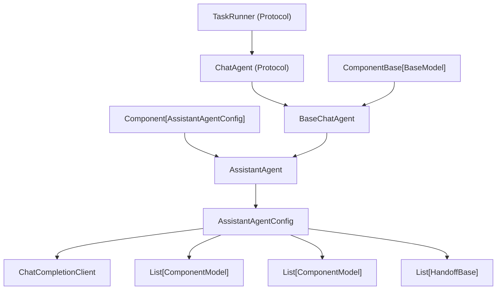
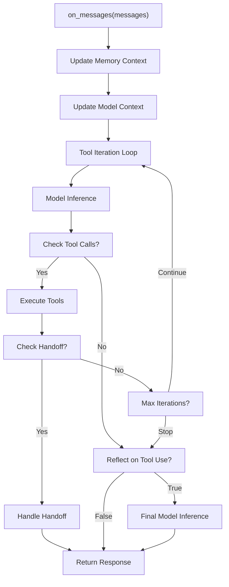
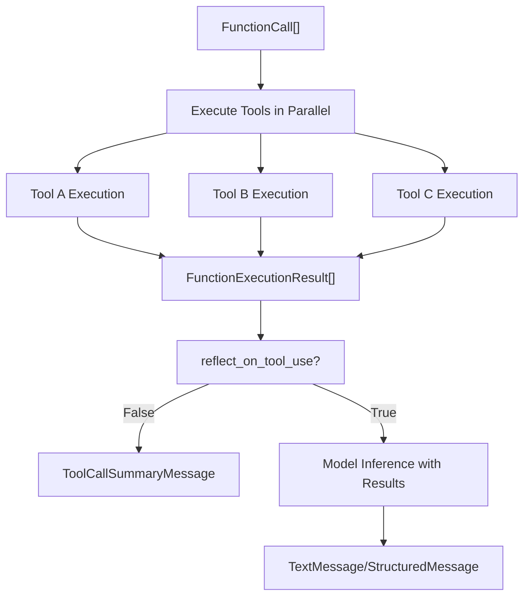

<!-- source: DeepWiki mcp.deepwiki.com · repo microsoft/autogen · page 3.1 AssistantAgent · fetched 2026-10-26 -->

# AssistantAgent

<details>
<summary>Relevant source files</summary>

The following files were used as context for generating this wiki page:

- [python/packages/autogen-agentchat/src/autogen_agentchat/agents/_assistant_agent.py](python/packages/autogen-agentchat/src/autogen_agentchat/agents/_assistant_agent.py)
- [python/packages/autogen-agentchat/src/autogen_agentchat/agents/_base_chat_agent.py](python/packages/autogen-agentchat/src/autogen_agentchat/agents/_base_chat_agent.py)
- [python/packages/autogen-agentchat/src/autogen_agentchat/agents/_user_proxy_agent.py](python/packages/autogen-agentchat/src/autogen_agentchat/agents/_user_proxy_agent.py)
- [python/packages/autogen-agentchat/src/autogen_agentchat/base/_chat_agent.py](python/packages/autogen-agentchat/src/autogen_agentchat/base/_chat_agent.py)
- [python/packages/autogen-agentchat/src/autogen_agentchat/base/_task.py](python/packages/autogen-agentchat/src/autogen_agentchat/base/_task.py)
- [python/packages/autogen-agentchat/src/autogen_agentchat/base/_team.py](python/packages/autogen-agentchat/src/autogen_agentchat/base/_team.py)
- [python/packages/autogen-agentchat/src/autogen_agentchat/messages.py](python/packages/autogen-agentchat/src/autogen_agentchat/messages.py)
- [python/packages/autogen-agentchat/src/autogen_agentchat/teams/_group_chat/_base_group_chat.py](python/packages/autogen-agentchat/src/autogen_agentchat/teams/_group_chat/_base_group_chat.py)
- [python/packages/autogen-agentchat/src/autogen_agentchat/teams/_group_chat/_base_group_chat_manager.py](python/packages/autogen-agentchat/src/autogen_agentchat/teams/_group_chat/_base_group_chat_manager.py)
- [python/packages/autogen-agentchat/src/autogen_agentchat/teams/_group_chat/_chat_agent_container.py](python/packages/autogen-agentchat/src/autogen_agentchat/teams/_group_chat/_chat_agent_container.py)
- [python/packages/autogen-agentchat/src/autogen_agentchat/teams/_group_chat/_events.py](python/packages/autogen-agentchat/src/autogen_agentchat/teams/_group_chat/_events.py)
- [python/packages/autogen-agentchat/src/autogen_agentchat/teams/_group_chat/_magentic_one/_magentic_one_group_chat.py](python/packages/autogen-agentchat/src/autogen_agentchat/teams/_group_chat/_magentic_one/_magentic_one_group_chat.py)
- [python/packages/autogen-agentchat/src/autogen_agentchat/teams/_group_chat/_magentic_one/_magentic_one_orchestrator.py](python/packages/autogen-agentchat/src/autogen_agentchat/teams/_group_chat/_magentic_one/_magentic_one_orchestrator.py)
- [python/packages/autogen-agentchat/src/autogen_agentchat/teams/_group_chat/_round_robin_group_chat.py](python/packages/autogen-agentchat/src/autogen_agentchat/teams/_group_chat/_round_robin_group_chat.py)
- [python/packages/autogen-agentchat/src/autogen_agentchat/teams/_group_chat/_selector_group_chat.py](python/packages/autogen-agentchat/src/autogen_agentchat/teams/_group_chat/_selector_group_chat.py)
- [python/packages/autogen-agentchat/src/autogen_agentchat/teams/_group_chat/_swarm_group_chat.py](python/packages/autogen-agentchat/src/autogen_agentchat/teams/_group_chat/_swarm_group_chat.py)
- [python/packages/autogen-agentchat/src/autogen_agentchat/ui/_console.py](python/packages/autogen-agentchat/src/autogen_agentchat/ui/_console.py)
- [python/packages/autogen-agentchat/tests/test_assistant_agent.py](python/packages/autogen-agentchat/tests/test_assistant_agent.py)
- [python/packages/autogen-agentchat/tests/test_group_chat.py](python/packages/autogen-agentchat/tests/test_group_chat.py)
- [python/packages/autogen-agentchat/tests/test_messages.py](python/packages/autogen-agentchat/tests/test_messages.py)
- [python/packages/autogen-agentchat/tests/test_streaming_message_id_correlation.py](python/packages/autogen-agentchat/tests/test_streaming_message_id_correlation.py)
- [python/packages/autogen-agentchat/tests/test_userproxy_agent.py](python/packages/autogen-agentchat/tests/test_userproxy_agent.py)
- [python/packages/autogen-core/src/autogen_core/utils/__init__.py](python/packages/autogen-core/src/autogen_core/utils/__init__.py)
- [python/packages/autogen-core/src/autogen_core/utils/_load_json.py](python/packages/autogen-core/src/autogen_core/utils/_load_json.py)
- [python/packages/autogen-core/tests/test_json_extraction.py](python/packages/autogen-core/tests/test_json_extraction.py)
- [python/packages/autogen-ext/src/autogen_ext/ui/_rich_console.py](python/packages/autogen-ext/src/autogen_ext/ui/_rich_console.py)
- [python/packages/autogen-test-utils/pyproject.toml](python/packages/autogen-test-utils/pyproject.toml)
- [python/packages/component-schema-gen/pyproject.toml](python/packages/component-schema-gen/pyproject.toml)
- [python/packages/magentic-one-cli/pyproject.toml](python/packages/magentic-one-cli/pyproject.toml)
- [python/packages/magentic-one-cli/src/magentic_one_cli/_m1.py](python/packages/magentic-one-cli/src/magentic_one_cli/_m1.py)

</details>


The `AssistantAgent` is the primary general-purpose agent implementation in the AutoGen AgentChat API, providing comprehensive support for LLM-based conversations with tool execution, handoffs, memory integration, and structured output capabilities. It implements the `BaseChatAgent` protocol and the `TaskRunner` interface, making it compatible with all AutoGen orchestration patterns.

## Architecture Overview

The `AssistantAgent` is built on a layered architecture that integrates model clients, tools, memory systems, and message handling into a cohesive agent implementation.

### Class Hierarchy



Sources: [python/packages/autogen-agentchat/src/autogen_agentchat/agents/_assistant_agent.py:90-90](), [python/packages/autogen-agentchat/src/autogen_agentchat/agents/_base_chat_agent.py:17-17](), [python/packages/autogen-agentchat/src/autogen_agentchat/base/_chat_agent.py:24-24]()

### Core Components Integration

```mermaid
graph LR
    AssistantAgent["AssistantAgent"]
    ModelClient["ChatCompletionClient"]
    ModelContext["ChatCompletionContext"]
    
    Tools["Tools (BaseTool[])"]
    Workbench["Workbench"]
    
    Memory["Memory[]"]
    Handoffs["Handoffs"]
    
    StructuredFactory["StructuredMessageFactory"]
    
    AssistantAgent --> ModelClient
    AssistantAgent --> ModelContext
    AssistantAgent --> Tools
    AssistantAgent --> Workbench
    AssistantAgent --> Memory
    AssistantAgent --> Handoffs
    AssistantAgent --> StructuredFactory
    
    ModelClient --> "OpenAI/Anthropic/etc"
    Tools --> "FunctionTool/McpTool"
    Workbench --> "McpWorkbench/StaticStreamWorkbench"
    Memory --> "ChromaDB/Mem0"
```

Sources: [python/packages/autogen-agentchat/src/autogen_agentchat/agents/_assistant_agent.py:724-746](), [python/packages/autogen-agentchat/src/autogen_agentchat/agents/_assistant_agent.py:70-88]()

## Message Processing Flow

The `AssistantAgent` processes incoming messages through a pipeline that handles tool execution, handoffs, memory updates, and response generation. It maintains its state between calls; callers must only pass new messages to `on_messages` or `on_messages_stream`.

### Core Message Flow



Sources: [python/packages/autogen-agentchat/src/autogen_agentchat/agents/_assistant_agent.py:109-116](), [python/packages/autogen-agentchat/src/autogen_agentchat/agents/_assistant_agent.py:1350-1550]()

### Tool Execution Process

When the model returns tool calls, they are executed immediately. If `reflect_on_tool_use` is `True` (default when using structured output), the agent performs another model inference using the results to produce a final response. If `False`, it returns a `ToolCallSummaryMessage`.



Sources: [python/packages/autogen-agentchat/src/autogen_agentchat/agents/_assistant_agent.py:140-146](), [python/packages/autogen-agentchat/src/autogen_agentchat/agents/_assistant_agent.py:1400-1500]()

## Core Capabilities

### Tool Integration

`AssistantAgent` supports multiple approaches to tool integration through the `tools` and `workbench` parameters. Tools can be Python functions (wrapped as `FunctionTool`) or more complex implementations inheriting from `BaseTool`.

The `max_tool_iterations` parameter (default 1) controls how many sequential tool call cycles the agent can perform in a single run.

Sources: [python/packages/autogen-agentchat/src/autogen_agentchat/agents/_assistant_agent.py:85-85](), [python/packages/autogen-agentchat/src/autogen_agentchat/agents/_assistant_agent.py:146-147](), [python/packages/autogen-agentchat/src/autogen_agentchat/agents/_assistant_agent.py:197-199]()

### Handoff Mechanism

Handoffs allow the agent to transfer control to another agent. This is triggered when the model produces a tool call corresponding to a registered `Handoff`.

Sources: [python/packages/autogen-agentchat/src/autogen_agentchat/agents/_assistant_agent.py:163-168](), [python/packages/autogen-agentchat/src/autogen_agentchat/agents/_assistant_agent.py:200-203]()

### Memory Integration

The agent supports multiple `Memory` backends. Before each model inference, the agent calls `update_context` on its registered memory components to inject relevant context into the model's message history.

Sources: [python/packages/autogen-agentchat/src/autogen_agentchat/agents/_assistant_agent.py:240-241](), [python/packages/autogen-agentchat/src/autogen_agentchat/agents/_assistant_agent.py:759-765]()

### Structured Output

By setting `output_content_type` to a Pydantic `BaseModel`, the agent is forced to respond with a `StructuredMessage` containing an instance of that model. This automatically enables `reflect_on_tool_use`.

Sources: [python/packages/autogen-agentchat/src/autogen_agentchat/agents/_assistant_agent.py:126-130](), [python/packages/autogen-agentchat/src/autogen_agentchat/agents/_assistant_agent.py:143-143](), [python/packages/autogen-agentchat/src/autogen_agentchat/agents/_assistant_agent.py:213-217]()

### Streaming Support

Streaming is supported via `on_messages_stream`. When `model_client_stream=True`, the agent yields `ModelClientStreamingChunkEvent` objects as the model generates content.

Sources: [python/packages/autogen-agentchat/src/autogen_agentchat/agents/_assistant_agent.py:186-193](), [python/packages/autogen-agentchat/src/autogen_agentchat/agents/_assistant_agent.py:207-209]()

## Configuration and State

### AssistantAgentConfig

The declarative configuration schema for the agent:

| Parameter | Type | Description |
|-----------|------|-------------|
| `name` | `str` | Agent identifier |
| `model_client` | `ComponentModel` | LLM client configuration |
| `tools` | `List[ComponentModel]` | Direct function tools |
| `workbench` | `List[ComponentModel]` | Tool workbenches (e.g., MCP) |
| `handoffs` | `List[HandoffBase \| str]` | Agents to which this agent can hand off |
| `model_context` | `ComponentModel` | Context management strategy |
| `memory` | `List[ComponentModel]` | Memory backend configurations |
| `system_message` | `str` | The system prompt |
| `model_client_stream` | `bool` | Whether to stream from the model client |
| `reflect_on_tool_use` | `bool` | Whether to perform a final LLM call after tools |
| `max_tool_iterations` | `int` | Limit on sequential tool calls |
| `tool_call_summary_format` | `str` | Format string for tool result summaries |

Sources: [python/packages/autogen-agentchat/src/autogen_agentchat/agents/_assistant_agent.py:70-88]()

### State Save/Load

The `AssistantAgent` implements `save_state` and `load_state` to allow persistence of its conversation history (via `ChatCompletionContext`) and memory.

Sources: [python/packages/autogen-agentchat/src/autogen_agentchat/agents/_assistant_agent.py:1750-1790]()

### Serialization

As a `Component`, the `AssistantAgent` supports `dump_component` and `load_component` for serializing its entire configuration to a JSON-compatible format.

Sources: [python/packages/autogen-agentchat/src/autogen_agentchat/agents/_assistant_agent.py:720-723]()

---

