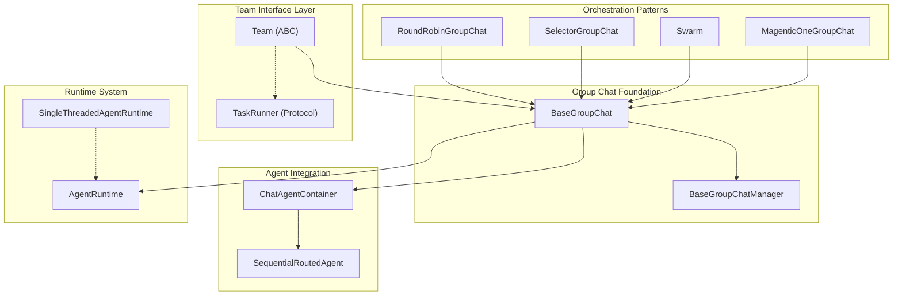
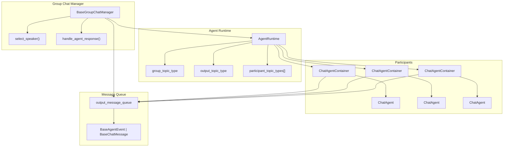
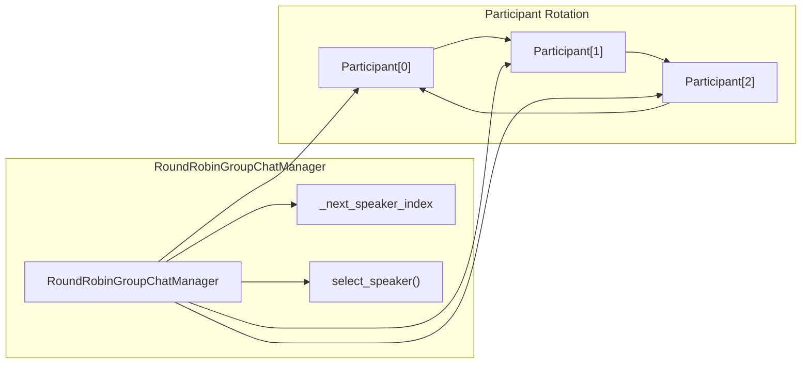
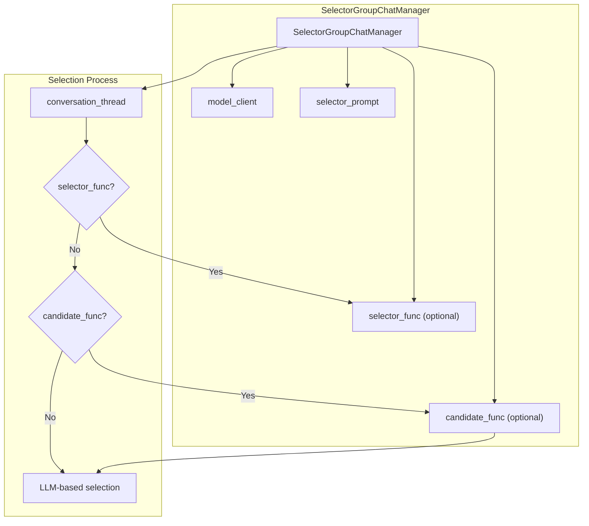
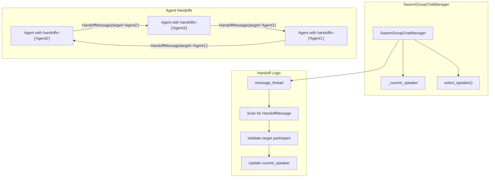
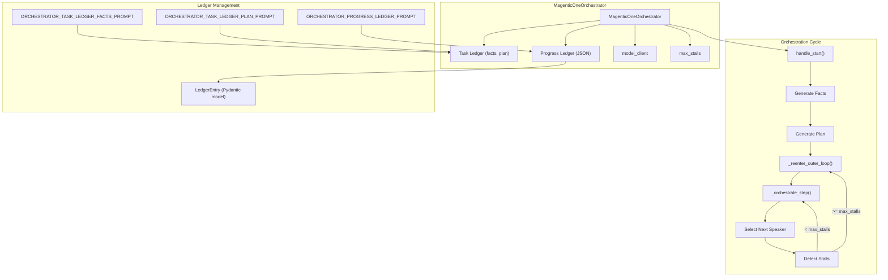
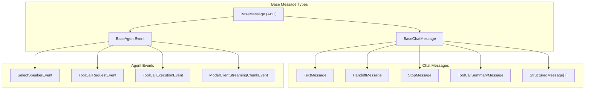

<!-- source: DeepWiki mcp.deepwiki.com · repo microsoft/autogen · page 4 Multi-Agent Teams · fetched 2026-10-26 -->

# Multi-Agent Teams

Relevant source files

The following files were used as context for generating this wiki page:

- [python/packages/autogen-agentchat/src/autogen_agentchat/__init__.py](python/packages/autogen-agentchat/src/autogen_agentchat/__init__.py)
- [python/packages/autogen-agentchat/src/autogen_agentchat/agents/_assistant_agent.py](python/packages/autogen-agentchat/src/autogen_agentchat/agents/_assistant_agent.py)
- [python/packages/autogen-agentchat/src/autogen_agentchat/agents/_base_chat_agent.py](python/packages/autogen-agentchat/src/autogen_agentchat/agents/_base_chat_agent.py)
- [python/packages/autogen-agentchat/src/autogen_agentchat/base/_chat_agent.py](python/packages/autogen-agentchat/src/autogen_agentchat/base/_chat_agent.py)
- [python/packages/autogen-agentchat/src/autogen_agentchat/base/_task.py](python/packages/autogen-agentchat/src/autogen_agentchat/base/_task.py)
- [python/packages/autogen-agentchat/src/autogen_agentchat/base/_team.py](python/packages/autogen-agentchat/src/autogen_agentchat/base/_team.py)
- [python/packages/autogen-agentchat/src/autogen_agentchat/base/_termination.py](python/packages/autogen-agentchat/src/autogen_agentchat/base/_termination.py)
- [python/packages/autogen-agentchat/src/autogen_agentchat/conditions/__init__.py](python/packages/autogen-agentchat/src/autogen_agentchat/conditions/__init__.py)
- [python/packages/autogen-agentchat/src/autogen_agentchat/conditions/_terminations.py](python/packages/autogen-agentchat/src/autogen_agentchat/conditions/_terminations.py)
- [python/packages/autogen-agentchat/src/autogen_agentchat/messages.py](python/packages/autogen-agentchat/src/autogen_agentchat/messages.py)
- [python/packages/autogen-agentchat/src/autogen_agentchat/teams/_group_chat/_base_group_chat.py](python/packages/autogen-agentchat/src/autogen_agentchat/teams/_group_chat/_base_group_chat.py)
- [python/packages/autogen-agentchat/src/autogen_agentchat/teams/_group_chat/_base_group_chat_manager.py](python/packages/autogen-agentchat/src/autogen_agentchat/teams/_group_chat/_base_group_chat_manager.py)
- [python/packages/autogen-agentchat/src/autogen_agentchat/teams/_group_chat/_chat_agent_container.py](python/packages/autogen-agentchat/src/autogen_agentchat/teams/_group_chat/_chat_agent_container.py)
- [python/packages/autogen-agentchat/src/autogen_agentchat/teams/_group_chat/_events.py](python/packages/autogen-agentchat/src/autogen_agentchat/teams/_group_chat/_events.py)
- [python/packages/autogen-agentchat/src/autogen_agentchat/teams/_group_chat/_magentic_one/_magentic_one_group_chat.py](python/packages/autogen-agentchat/src/autogen_agentchat/teams/_group_chat/_magentic_one/_magentic_one_group_chat.py)
- [python/packages/autogen-agentchat/src/autogen_agentchat/teams/_group_chat/_magentic_one/_magentic_one_orchestrator.py](python/packages/autogen-agentchat/src/autogen_agentchat/teams/_group_chat/_magentic_one/_magentic_one_orchestrator.py)
- [python/packages/autogen-agentchat/src/autogen_agentchat/teams/_group_chat/_round_robin_group_chat.py](python/packages/autogen-agentchat/src/autogen_agentchat/teams/_group_chat/_round_robin_group_chat.py)
- [python/packages/autogen-agentchat/src/autogen_agentchat/teams/_group_chat/_selector_group_chat.py](python/packages/autogen-agentchat/src/autogen_agentchat/teams/_group_chat/_selector_group_chat.py)
- [python/packages/autogen-agentchat/src/autogen_agentchat/teams/_group_chat/_swarm_group_chat.py](python/packages/autogen-agentchat/src/autogen_agentchat/teams/_group_chat/_swarm_group_chat.py)
- [python/packages/autogen-agentchat/src/autogen_agentchat/ui/__init__.py](python/packages/autogen-agentchat/src/autogen_agentchat/ui/__init__.py)
- [python/packages/autogen-agentchat/tests/test_assistant_agent.py](python/packages/autogen-agentchat/tests/test_assistant_agent.py)
- [python/packages/autogen-agentchat/tests/test_group_chat.py](python/packages/autogen-agentchat/tests/test_group_chat.py)
- [python/packages/autogen-agentchat/tests/test_termination_condition.py](python/packages/autogen-agentchat/tests/test_termination_condition.py)
- [python/packages/autogen-core/src/autogen_core/__init__.py](python/packages/autogen-core/src/autogen_core/__init__.py)
- [python/packages/autogen-ext/src/autogen_ext/__init__.py](python/packages/autogen-ext/src/autogen_ext/__init__.py)

This document covers AutoGen's multi-agent team orchestration systems, which enable coordination of multiple agents in complex workflows. The team system provides different orchestration patterns for managing conversations between multiple agents, including round-robin turns, LLM-based speaker selection, handoff-based routing, and specialized orchestration strategies.

For information about individual agent capabilities and configurations, see [AgentChat API](#3). For details about termination conditions that control team execution, see [Termination Conditions](#4.2).

## Team Architecture Overview

AutoGen's team system is built on a layered architecture that separates orchestration logic from agent implementation details.

### Core Team Architecture

**Sources:** [python/packages/autogen-agentchat/src/autogen_agentchat/base/_team.py:10-55](), [python/packages/autogen-agentchat/src/autogen_agentchat/teams/_group_chat/_base_group_chat.py:40-152](), [python/packages/autogen-agentchat/src/autogen_agentchat/teams/_group_chat/_base_group_chat_manager.py:25-84]()

### Team Orchestration Components

The team system uses several key components to manage multi-agent conversations:

| Component | Purpose | Key Methods |
|-----------|---------|-------------|
| `BaseGroupChat` | Abstract foundation for all team types | `run()`, `run_stream()`, `reset()` |
| `BaseGroupChatManager` | Manages participant coordination and message routing | `select_speaker()`, `handle_agent_response()` |
| `ChatAgentContainer` | Wraps individual agents for group participation | `handle_request()`, `handle_start()` |
| `MessageFactory` | Creates and serializes messages for team communication | `create()`, `register()` |

**Sources:** [python/packages/autogen-agentchat/src/autogen_agentchat/teams/_group_chat/_base_group_chat.py:40-152](), [python/packages/autogen-agentchat/src/autogen_agentchat/teams/_group_chat/_base_group_chat_manager.py:25-84](), [python/packages/autogen-agentchat/src/autogen_agentchat/teams/_group_chat/_chat_agent_container.py:24-55]()

## Group Chat Communication Flow

Multi-agent teams in AutoGen use a publish-subscribe messaging pattern orchestrated through the agent runtime system.

### Message Flow Architecture

**Sources:** [python/packages/autogen-agentchat/src/autogen_agentchat/teams/_group_chat/_base_group_chat.py:106-144](), [python/packages/autogen-agentchat/src/autogen_agentchat/teams/_group_chat/_base_group_chat_manager.py:172-194]()

### Team Initialization Process

The team initialization process establishes the messaging infrastructure and registers participants:

1. **Topic Creation**: Each team creates unique topic types for group communication, output streaming, and individual participant addressing [python/packages/autogen-agentchat/src/autogen_agentchat/teams/_group_chat/_base_group_chat.py:118-127]().
2. **Agent Registration**: Participants are registered with the runtime using `ChatAgentContainer` wrappers [python/packages/autogen-agentchat/src/autogen_agentchat/teams/_group_chat/_base_group_chat.py:214-230]().
3. **Subscription Setup**: Topic subscriptions are configured to enable message routing between manager and participants [python/packages/autogen-agentchat/src/autogen_agentchat/teams/_group_chat/_base_group_chat.py:233-244]().
4. **Manager Registration**: The group chat manager is registered to handle orchestration logic [python/packages/autogen-agentchat/src/autogen_agentchat/teams/_group_chat/_base_group_chat.py:204-212]().

**Sources:** [python/packages/autogen-agentchat/src/autogen_agentchat/teams/_group_chat/_base_group_chat.py:118-244]()

## Orchestration Patterns

AutoGen provides four distinct orchestration patterns for different team coordination needs. For deep dives, see [Team Orchestration](#4.1).

### RoundRobinGroupChat

The simplest orchestration pattern where participants take turns in a predetermined order.

Key implementation details:
- **Speaker Selection**: `_next_speaker_index = (current_index + 1) % len(participants)` [python/packages/autogen-agentchat/src/autogen_agentchat/teams/_group_chat/_round_robin_group_chat.py:79-82]().
- **State Management**: Tracks current speaker index in `RoundRobinManagerState` [python/packages/autogen-agentchat/src/autogen_agentchat/teams/_group_chat/_round_robin_group_chat.py:58-64]().
- **Reset Behavior**: Resets to first participant when team is reset [python/packages/autogen-agentchat/src/autogen_agentchat/teams/_group_chat/_round_robin_group_chat.py:51-56]().

**Sources:** [python/packages/autogen-agentchat/src/autogen_agentchat/teams/_group_chat/_round_robin_group_chat.py:16-83]()

### SelectorGroupChat

Uses an LLM to intelligently select the next speaker based on conversation context.

Key configuration options:
- **`selector_prompt`**: Template for LLM speaker selection [python/packages/autogen-agentchat/src/autogen_agentchat/teams/_group_chat/_selector_group_chat.py:90-90]().
- **`allow_repeated_speaker`**: Controls whether previous speaker can be selected again [python/packages/autogen-agentchat/src/autogen_agentchat/teams/_group_chat/_selector_group_chat.py:92-92]().
- **`max_selector_attempts`**: Maximum retry attempts for LLM selection [python/packages/autogen-agentchat/src/autogen_agentchat/teams/_group_chat/_selector_group_chat.py:95-95]().
- **`selector_func`**: Optional custom function to override LLM selection [python/packages/autogen-agentchat/src/autogen_agentchat/teams/_group_chat/_selector_group_chat.py:163-176]().

**Sources:** [python/packages/autogen-agentchat/src/autogen_agentchat/teams/_group_chat/_selector_group_chat.py:50-308]()

### Swarm

Enables dynamic handoffs between agents using `HandoffMessage` routing.

Key behaviors:
- **Handoff Detection**: Scans conversation thread in reverse order for latest `HandoffMessage` [python/packages/autogen-agentchat/src/autogen_agentchat/teams/_group_chat/_swarm_group_chat.py:92-97]().
- **Target Validation**: Ensures handoff target is a valid participant [python/packages/autogen-agentchat/src/autogen_agentchat/teams/_group_chat/_swarm_group_chat.py:52-57]().
- **Speaker Continuity**: Current speaker continues if no handoff is detected [python/packages/autogen-agentchat/src/autogen_agentchat/teams/_group_chat/_swarm_group_chat.py:98-98]().

**Sources:** [python/packages/autogen-agentchat/src/autogen_agentchat/teams/_group_chat/_swarm_group_chat.py:15-113]()

### MagenticOneGroupChat

Implements the Magentic-One architecture with ledger-based orchestration for complex multi-step tasks. Detailed in [MagenticOne System](#4.4).

Key features:
- **Task Ledger**: Maintains facts and high-level plan for the task [python/packages/autogen-agentchat/src/autogen_agentchat/teams/_group_chat/_magentic_one/_magentic_one_orchestrator.py:96-97]().
- **Progress Ledger**: JSON-structured progress tracking with speaker selection logic [python/packages/autogen-agentchat/src/autogen_agentchat/teams/_group_chat/_magentic_one/_magentic_one_orchestrator.py:116-117]().
- **Stall Detection**: Replans when progress stalls for `max_stalls` iterations [python/packages/autogen-agentchat/src/autogen_agentchat/teams/_group_chat/_magentic_one/_magentic_one_orchestrator.py:92-92]().

**Sources:** [python/packages/autogen-agentchat/src/autogen_agentchat/teams/_group_chat/_magentic_one/_magentic_one_orchestrator.py:58-450]()

## Termination Conditions

Teams rely on `TerminationCondition` to determine when a task is complete. Multiple conditions can be composed using AND/OR logic. For details, see [Termination Conditions](#4.2).

**Sources:** [python/packages/autogen-agentchat/src/autogen_agentchat/base/_termination.py:1-50](), [python/packages/autogen-agentchat/tests/test_termination_condition.py:34-197]()

## GraphFlow Orchestration

For workflows requiring explicit control over state transitions, `GraphFlow` provides a directed-graph based orchestration model. See [GraphFlow](#4.3) for the fluent API and node activation patterns.

## Team State Management

Teams maintain state across execution cycles and support serialization for persistence and recovery.

### State Serialization

Each orchestration pattern maintains specific state elements:

| Pattern | State Elements | Key Fields |
|---------|----------------|------------|
| `RoundRobinManagerState` | Turn tracking, message history | `next_speaker_index`, `message_thread`, `current_turn` |
| `SelectorManagerState` | Selection history, speaker context | `previous_speaker`, `message_thread`, `current_turn` |
| `SwarmManagerState` | Current speaker, handoff tracking | `current_speaker`, `message_thread`, `current_turn` |
| `MagenticOneOrchestratorState` | Ledger state, orchestration progress | `task`, `facts`, `plan`, `n_rounds`, `n_stalls` |

**Sources:** [python/packages/autogen-agentchat/src/autogen_agentchat/state.py:1-50](), [python/packages/autogen-agentchat/src/autogen_agentchat/teams/_group_chat/_round_robin_group_chat.py:58-70](), [python/packages/autogen-agentchat/src/autogen_agentchat/teams/_group_chat/_selector_group_chat.py:116-131]()

## Message Types and Events

Teams use a rich message type system to coordinate agent interactions and signal events.

### Core Message Types

**Sources:** [python/packages/autogen-agentchat/src/autogen_agentchat/messages.py:26-566](), [python/packages/autogen-agentchat/src/autogen_agentchat/teams/_group_chat/_events.py:10-114]()

## Team Integration Patterns

Teams can be composed and nested to create complex multi-agent hierarchies. Both `ChatAgent` and `Team` implement the `TaskRunner` protocol, allowing a team to act as a participant within another team [python/packages/autogen-agentchat/src/autogen_agentchat/teams/_group_chat/_base_group_chat.py:51-55]().

**Sources:** [python/packages/autogen-agentchat/src/autogen_agentchat/teams/_group_chat/_chat_agent_container.py:86-150](), [python/packages/autogen-agentchat/src/autogen_agentchat/teams/_group_chat/_base_group_chat.py:178-189]()

---

