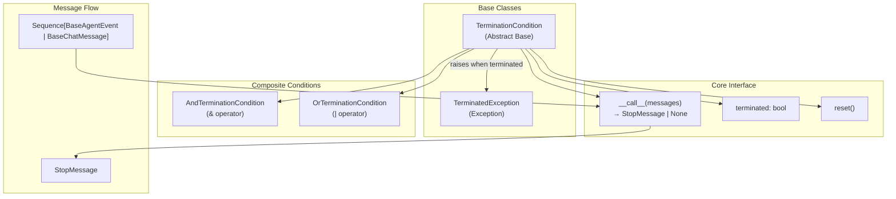
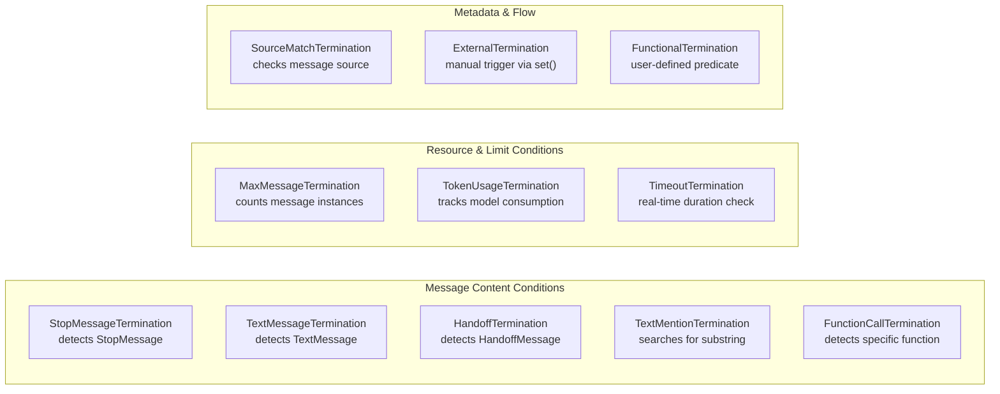
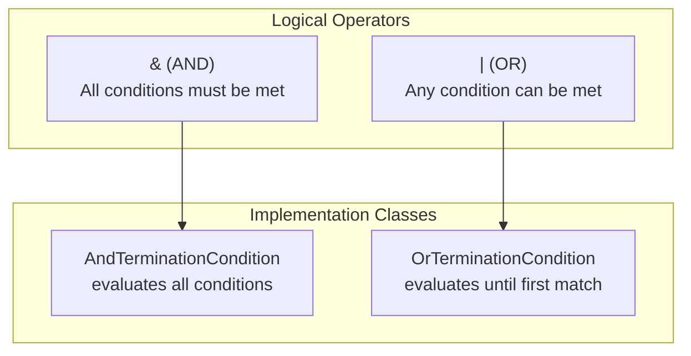
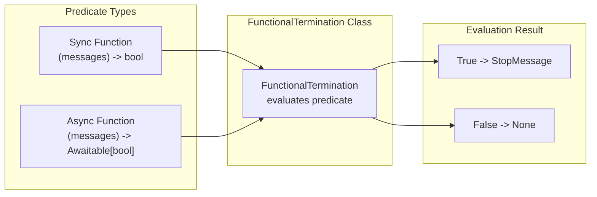
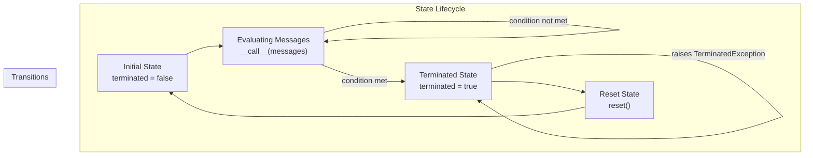
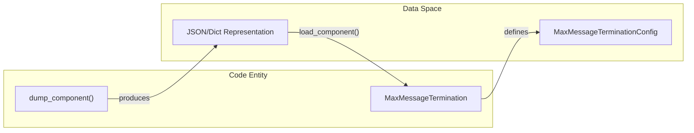

<!-- source: DeepWiki mcp.deepwiki.com · repo microsoft/autogen · page 4.2 Termination Conditions · fetched 2026-10-26 -->

# Termination Conditions

<details>
<summary>Relevant source files</summary>

The following files were used as context for generating this wiki page:

- [python/packages/autogen-agentchat/src/autogen_agentchat/__init__.py](python/packages/autogen-agentchat/src/autogen_agentchat/__init__.py)
- [python/packages/autogen-agentchat/src/autogen_agentchat/agents/_assistant_agent.py](python/packages/autogen-agentchat/src/autogen_agentchat/agents/_assistant_agent.py)
- [python/packages/autogen-agentchat/src/autogen_agentchat/agents/_base_chat_agent.py](python/packages/autogen-agentchat/src/autogen_agentchat/agents/_base_chat_agent.py)
- [python/packages/autogen-agentchat/src/autogen_agentchat/base/_chat_agent.py](python/packages/autogen-agentchat/src/autogen_agentchat/base/_chat_agent.py)
- [python/packages/autogen-agentchat/src/autogen_agentchat/base/_task.py](python/packages/autogen-agentchat/src/autogen_agentchat/base/_task.py)
- [python/packages/autogen-agentchat/src/autogen_agentchat/base/_team.py](python/packages/autogen-agentchat/src/autogen_agentchat/base/_team.py)
- [python/packages/autogen-agentchat/src/autogen_agentchat/base/_termination.py](python/packages/autogen-agentchat/src/autogen_agentchat/base/_termination.py)
- [python/packages/autogen-agentchat/src/autogen_agentchat/conditions/__init__.py](python/packages/autogen-agentchat/src/autogen_agentchat/conditions/__init__.py)
- [python/packages/autogen-agentchat/src/autogen_agentchat/conditions/_terminations.py](python/packages/autogen-agentchat/src/autogen_agentchat/conditions/_terminations.py)
- [python/packages/autogen-agentchat/src/autogen_agentchat/messages.py](python/packages/autogen-agentchat/src/autogen_agentchat/messages.py)
- [python/packages/autogen-agentchat/src/autogen_agentchat/teams/_group_chat/_base_group_chat.py](python/packages/autogen-agentchat/src/autogen_agentchat/teams/_group_chat/_base_group_chat.py)
- [python/packages/autogen-agentchat/src/autogen_agentchat/teams/_group_chat/_base_group_chat_manager.py](python/packages/autogen-agentchat/src/autogen_agentchat/teams/_group_chat/_base_group_chat_manager.py)
- [python/packages/autogen-agentchat/src/autogen_agentchat/teams/_group_chat/_chat_agent_container.py](python/packages/autogen-agentchat/src/autogen_agentchat/teams/_group_chat/_chat_agent_container.py)
- [python/packages/autogen-agentchat/src/autogen_agentchat/teams/_group_chat/_events.py](python/packages/autogen-agentchat/src/autogen_agentchat/teams/_group_chat/_events.py)
- [python/packages/autogen-agentchat/src/autogen_agentchat/teams/_group_chat/_magentic_one/_magentic_one_group_chat.py](python/packages/autogen-agentchat/src/autogen_agentchat/teams/_group_chat/_magentic_one/_magentic_one_group_chat.py)
- [python/packages/autogen-agentchat/src/autogen_agentchat/teams/_group_chat/_magentic_one/_magentic_one_orchestrator.py](python/packages/autogen-agentchat/src/autogen_agentchat/teams/_group_chat/_magentic_one/_magentic_one_orchestrator.py)
- [python/packages/autogen-agentchat/src/autogen_agentchat/teams/_group_chat/_round_robin_group_chat.py](python/packages/autogen-agentchat/src/autogen_agentchat/teams/_group_chat/_round_robin_group_chat.py)
- [python/packages/autogen-agentchat/src/autogen_agentchat/teams/_group_chat/_selector_group_chat.py](python/packages/autogen-agentchat/src/autogen_agentchat/teams/_group_chat/_selector_group_chat.py)
- [python/packages/autogen-agentchat/src/autogen_agentchat/teams/_group_chat/_swarm_group_chat.py](python/packages/autogen-agentchat/src/autogen_agentchat/teams/_group_chat/_swarm_group_chat.py)
- [python/packages/autogen-agentchat/src/autogen_agentchat/ui/__init__.py](python/packages/autogen-agentchat/src/autogen_agentchat/ui/__init__.py)
- [python/packages/autogen-agentchat/tests/test_assistant_agent.py](python/packages/autogen-agentchat/tests/test_assistant_agent.py)
- [python/packages/autogen-agentchat/tests/test_group_chat.py](python/packages/autogen-agentchat/tests/test_group_chat.py)
- [python/packages/autogen-agentchat/tests/test_termination_condition.py](python/packages/autogen-agentchat/tests/test_termination_condition.py)
- [python/packages/autogen-core/src/autogen_core/__init__.py](python/packages/autogen-core/src/autogen_core/__init__.py)
- [python/packages/autogen-ext/src/autogen_ext/__init__.py](python/packages/autogen-ext/src/autogen_ext/__init__.py)

</details>


Termination conditions provide a flexible system for controlling when multi-agent conversations should end in AutoGen. They operate by examining message sequences and determining whether specific stopping criteria have been met, such as reaching a maximum number of messages, detecting specific text content, or timing out after a duration.

For information about team orchestration patterns that use termination conditions, see [Team Orchestration](4.1). For details about message types that termination conditions analyze, see [Message Types and Tool Agents](2.3).

## Architecture Overview

The termination condition system is built around an abstract base class that provides a consistent interface for all stopping criteria. Conditions are stateful, callable objects that can be combined using logical operators.

### Termination Protocol and Base Class
The `TerminationCondition` protocol defines the contract for all implementations. It requires a `terminated` property, a `reset` method, and a `__call__` method that evaluates the message history.

Title: Termination Condition Interface and Logic


The `TerminationCondition` abstract base class defines three key methods: `__call__` for evaluating messages, `terminated` property for checking state, and `reset()` for reinitializing the condition. When a termination condition is met, it returns a `StopMessage` containing details about why the conversation ended.

Sources: [python/packages/autogen-agentchat/src/autogen_agentchat/base/_termination.py:15-86]()

## Built-in Termination Conditions

AutoGen provides a comprehensive set of pre-built termination conditions in `autogen_agentchat.conditions`. These conditions can be used individually or combined to create sophisticated termination logic.

### Condition Class Hierarchy

Title: Built-in Condition Implementation Classes


| Condition | Purpose | Key Parameters |
|-----------|---------|----------------|
| `StopMessageTermination` | Terminate when `StopMessage` is received | None |
| `MaxMessageTermination` | Limit conversation length | `max_messages`, `include_agent_event` |
| `TextMentionTermination` | Stop on specific text content | `text`, `sources` |
| `TokenUsageTermination` | Control LLM token consumption | `max_total_token`, `max_prompt_token`, `max_completion_token` |
| `HandoffTermination` | Stop on agent handoff | `target` |
| `TimeoutTermination` | Time-based stopping | `timeout_seconds` |
| `ExternalTermination` | Manual control via external signals | None |
| `SourceMatchTermination` | Stop after specific agent responds | `sources` |
| `TextMessageTermination` | Terminate on any text message | `source` |
| `FunctionCallTermination` | Stop after function execution | `function_name` |
| `FunctionalTermination` | Custom termination logic via lambda/func | `func` |

Sources: [python/packages/autogen-agentchat/src/autogen_agentchat/conditions/_terminations.py:24-615]()

### Implementation Details

*   **`MaxMessageTermination`**: Tracks the number of messages in the sequence. If `include_agent_event` is `True`, it counts events like `ToolCallExecutionEvent` in addition to `BaseChatMessage` types [python/packages/autogen-agentchat/src/autogen_agentchat/conditions/_terminations.py:113-156]().
*   **`TokenUsageTermination`**: Aggregates `models_usage` (of type `RequestUsage`) from all messages in the sequence to check against limits [python/packages/autogen-agentchat/src/autogen_agentchat/conditions/_terminations.py:441-523]().
*   **`HandoffTermination`**: Specifically looks for `HandoffMessage` where the `target` attribute matches the configured target [python/packages/autogen-agentchat/src/autogen_agentchat/conditions/_terminations.py:388-438]().

## Combining Conditions

Termination conditions support logical combination using AND (`&`) and OR (`|`) operators. This is implemented via `AndTerminationCondition` and `OrTerminationCondition` classes.

Title: Logical Composition of Conditions


The AND operator creates an `AndTerminationCondition` that requires all constituent conditions to be satisfied before terminating. The OR operator creates an `OrTerminationCondition` that terminates when any condition is met:

```python
# Both conditions must be satisfied
combined_and = MaxMessageTermination(10) & TextMentionTermination("TERMINATE")

# Either condition can trigger termination  
combined_or = MaxMessageTermination(10) | TextMentionTermination("TERMINATE")
```

When composite conditions terminate, they combine the content and sources from all triggered sub-conditions into a single `StopMessage`.

Sources: [python/packages/autogen-agentchat/src/autogen_agentchat/base/_termination.py:79-179](), [python/packages/autogen-agentchat/tests/test_termination_condition.py:206-277]()

## Custom Termination Logic

The `FunctionalTermination` condition allows developers to implement custom termination logic using callable functions. This provides maximum flexibility for domain-specific stopping criteria.

Title: Custom Predicate Flow


The functional termination condition accepts both synchronous and asynchronous functions. The function receives the current message sequence and returns `True` when termination should occur:

```python
def custom_logic(messages: Sequence[BaseAgentEvent | BaseChatMessage]) -> bool:
    if len(messages) < 1:
        return False
    # Custom logic: terminate if a specific metadata key exists
    return "final_step" in messages[-1].metadata

termination = FunctionalTermination(custom_logic)
```

Sources: [python/packages/autogen-agentchat/src/autogen_agentchat/conditions/_terminations.py:158-227](), [python/packages/autogen-agentchat/tests/test_termination_condition.py:387-433]()

## State Management and Reset

Termination conditions maintain internal state to track progress toward their stopping criteria. Once a condition reaches termination, it becomes "terminated" and raises `TerminatedException` on subsequent calls until reset.

Title: Termination Lifecycle State Machine


Each termination condition tracks its own state independently. For composite conditions, the `reset()` operation propagates to all constituent conditions:

```python
# Check termination state
if termination.terminated:
    print("Condition already reached")

# Reset for reuse in a new task
await termination.reset()
```

The reset mechanism allows termination conditions to be reused across multiple conversation sessions or team runs without recreating the objects.

Sources: [python/packages/autogen-agentchat/src/autogen_agentchat/base/_termination.py:52-77](), [python/packages/autogen-agentchat/tests/test_termination_condition.py:33-96]()

## Configuration and Serialization

Termination conditions implement the `Component` protocol, supporting serialization via `ComponentModel`. Each condition provides a declarative config schema using Pydantic.

Title: Configuration and Serialization Mapping


| Condition | Config Class | Key Fields |
|-----------|--------------|------------|
| `MaxMessageTermination` | `MaxMessageTerminationConfig` | `max_messages`, `include_agent_event` |
| `TextMentionTermination` | `TextMentionTerminationConfig` | `text` |
| `TokenUsageTermination` | `TokenUsageTerminationConfig` | `max_total_token`, `max_prompt_token`, `max_completion_token` |
| `HandoffTermination` | `HandoffTerminationConfig` | `target` |
| `TimeoutTermination` | `TimeoutTerminationConfig` | `timeout_seconds` |

Sources: [python/packages/autogen-agentchat/src/autogen_agentchat/conditions/_terminations.py:57-104](), [python/packages/autogen-agentchat/src/autogen_agentchat/base/_termination.py:88-179]()

---

