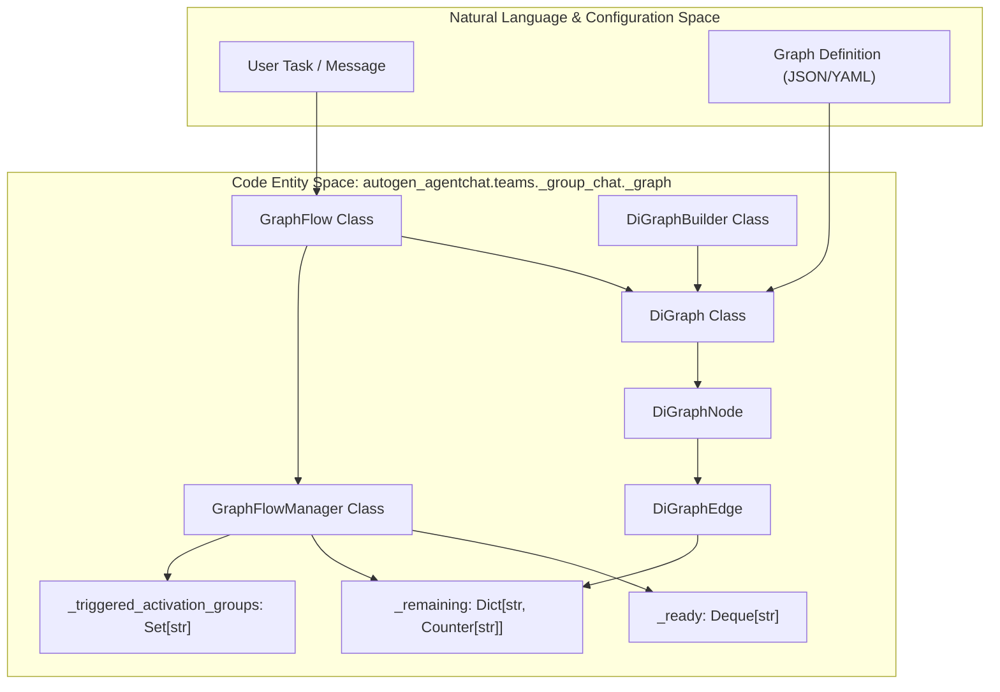
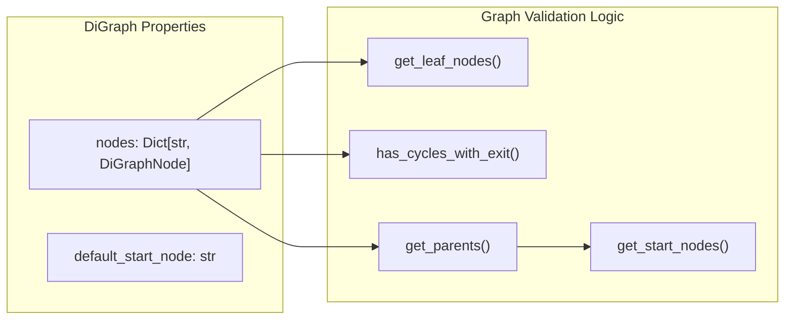
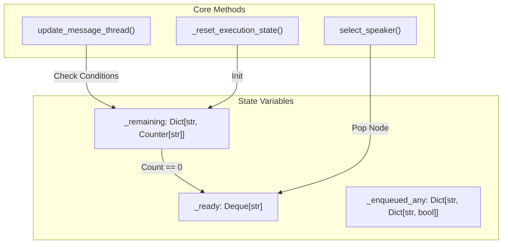

<!-- source: DeepWiki mcp.deepwiki.com · repo microsoft/autogen · page 4.3 GraphFlow · fetched 2026-10-26 -->

# GraphFlow

<details>
<summary>Relevant source files</summary>

The following files were used as context for generating this wiki page:

- [python/packages/autogen-agentchat/src/autogen_agentchat/agents/_message_filter_agent.py](python/packages/autogen-agentchat/src/autogen_agentchat/agents/_message_filter_agent.py)
- [python/packages/autogen-agentchat/src/autogen_agentchat/teams/_group_chat/_graph/__init__.py](python/packages/autogen-agentchat/src/autogen_agentchat/teams/_group_chat/_graph/__init__.py)
- [python/packages/autogen-agentchat/src/autogen_agentchat/teams/_group_chat/_graph/_digraph_group_chat.py](python/packages/autogen-agentchat/src/autogen_agentchat/teams/_group_chat/_graph/_digraph_group_chat.py)
- [python/packages/autogen-agentchat/src/autogen_agentchat/teams/_group_chat/_graph/_graph_builder.py](python/packages/autogen-agentchat/src/autogen_agentchat/teams/_group_chat/_graph/_graph_builder.py)
- [python/packages/autogen-agentchat/tests/test_group_chat_endpoint.py](python/packages/autogen-agentchat/tests/test_group_chat_endpoint.py)
- [python/packages/autogen-agentchat/tests/test_group_chat_graph.py](python/packages/autogen-agentchat/tests/test_group_chat_graph.py)
- [python/packages/autogen-agentchat/tests/utils.py](python/packages/autogen-agentchat/tests/utils.py)
- [python/packages/autogen-ext/tests/test_filesurfer_agent.py](python/packages/autogen-ext/tests/test_filesurfer_agent.py)
- [python/packages/autogen-ext/tests/test_websurfer_agent.py](python/packages/autogen-ext/tests/test_websurfer_agent.py)

</details>


GraphFlow provides directed graph-based agent execution for AutoGen multi-agent teams. It enables complex orchestration patterns including sequential chains, parallel fan-outs, conditional branching, and loops with safe exit conditions through a declarative graph structure.

For information about other team orchestration patterns like round-robin or selector-based execution, see [Team Orchestration](). For termination conditions that work with GraphFlow, see [Termination Conditions]().

## Purpose and Architecture

GraphFlow implements a directed execution model with support for controlled cycles. Each node represents a `ChatAgent` and each edge defines execution flow with optional conditions. The system manages complex dependencies and activation patterns while ensuring deterministic execution order through the `GraphFlowManager` state machine.

## GraphFlow Execution Model



Sources: [python/packages/autogen-agentchat/src/autogen_agentchat/teams/_group_chat/_graph/_digraph_group_chat.py:551-815](), [python/packages/autogen-agentchat/src/autogen_agentchat/teams/_group_chat/_graph/_digraph_group_chat.py:309-539]()

## Core Components

### GraphFlow Class
The `GraphFlow` class extends `BaseGroupChat` and orchestrates agent execution using a directed graph structure. It validates the graph during initialization and creates a `GraphFlowManager` to handle execution logic [python/packages/autogen-agentchat/src/autogen_agentchat/teams/_group_chat/_graph/_digraph_group_chat.py:783-815]().

| Property | Type | Description |
|----------|------|-------------|
| `participants` | `List[ChatAgent]` | Agents participating in the graph |
| `graph` | `DiGraph` | Directed graph defining execution flow |
| `termination_condition` | `TerminationCondition` | Optional termination logic |
| `max_turns` | `int` | Maximum execution turns |

### DiGraph Structure
The `DiGraph` represents the execution graph with nodes, edges, and validation logic. It supports both acyclic and cyclic graphs with mandatory exit conditions for cycles [python/packages/autogen-agentchat/src/autogen_agentchat/teams/_group_chat/_graph/_digraph_group_chat.py:115-300]().



Sources: [python/packages/autogen-agentchat/src/autogen_agentchat/teams/_group_chat/_graph/_digraph_group_chat.py:129-159](), [python/packages/autogen-agentchat/src/autogen_agentchat/teams/_group_chat/_graph/_digraph_group_chat.py:280-300]()

### DiGraphNode and DiGraphEdge
Nodes represent agents with activation policies, while edges define transitions with optional conditions [python/packages/autogen-agentchat/src/autogen_agentchat/teams/_group_chat/_graph/_digraph_group_chat.py:25-114]().

| Component | Key Properties | Description |
|-----------|---------------|-------------|
| `DiGraphNode` | `name`, `edges`, `activation` | Agent node with outgoing edges and activation type ("all"/"any") |
| `DiGraphEdge` | `target`, `condition`, `activation_group`, `activation_condition` | Directed edge with optional string/callable condition |

**Edge Condition Types:**
- `None`: Unconditional activation.
- `str`: Activates when string appears in message content [python/packages/autogen-agentchat/src/autogen_agentchat/teams/_group_chat/_graph/_digraph_group_chat.py:95-97]().
- `Callable[[BaseChatMessage], bool]`: Custom condition function [python/packages/autogen-agentchat/src/autogen_agentchat/teams/_group_chat/_graph/_digraph_group_chat.py:93-94]().

## Execution Flow Management

### GraphFlowManager State Machine
The `GraphFlowManager` handles stateful execution using ready queues and activation tracking [python/packages/autogen-agentchat/src/autogen_agentchat/teams/_group_chat/_graph/_digraph_group_chat.py:309-390]().



Sources: [python/packages/autogen-agentchat/src/autogen_agentchat/teams/_group_chat/_graph/_digraph_group_chat.py:392-538]()

### Activation Logic
The execution model supports two activation types for handling multiple incoming edges within an `activation_group`:

1.  **All Activation**: Node waits for all parent nodes in the group to complete [python/packages/autogen-agentchat/src/autogen_agentchat/teams/_group_chat/_graph/_digraph_group_chat.py:412-416]().
2.  **Any Activation**: Node activates when any single parent in the group completes [python/packages/autogen-agentchat/src/autogen_agentchat/teams/_group_chat/_graph/_digraph_group_chat.py:417-425]().

## DiGraphBuilder API
The `DiGraphBuilder` provides a fluent interface for constructing graphs programmatically [python/packages/autogen-agentchat/src/autogen_agentchat/teams/_group_chat/_graph/_graph_builder.py:10-94]().

| Method | Purpose | Returns |
|--------|---------|---------|
| `add_node(agent, activation)` | Add agent node to graph | `DiGraphBuilder` |
| `add_edge(source, target, condition, ...)` | Connect nodes with optional condition and activation groups | `DiGraphBuilder` |
| `set_entry_point(agent)` | Set default start node | `DiGraphBuilder` |
| `build()` | Generate validated `DiGraph` | `DiGraph` |

Sources: [python/packages/autogen-agentchat/src/autogen_agentchat/teams/_group_chat/_graph/_graph_builder.py:104-180]()

## Cycle Management

### Cycle Detection and Validation
GraphFlow supports cycles but requires at least one conditional edge per cycle to ensure termination. The `has_cycles_with_exit()` method performs a DFS-based validation [python/packages/autogen-agentchat/src/autogen_agentchat/teams/_group_chat/_graph/_digraph_group_chat.py:149-198]().

**Cycle Validation Rules:**
- All cycles must contain at least one conditional edge.
- Conditional edges provide the necessary exit mechanism.
- Graph validation fails if an unconditional cycle is detected [python/packages/autogen-agentchat/src/autogen_agentchat/teams/_group_chat/_graph/_digraph_group_chat.py:186-193]().

### Activation Groups
`activation_group` allows distinguishing between different paths leading to the same node, which is critical for complex cyclic graphs [python/packages/autogen-agentchat/src/autogen_agentchat/teams/_group_chat/_graph/_digraph_group_chat.py:48-57]().

## Integration with Message Filtering

GraphFlow works with `MessageFilterAgent` to control message history visibility for agents in complex workflows [python/packages/autogen-agentchat/src/autogen_agentchat/agents/_message_filter_agent.py:41-59]().

### MessageFilterAgent
A wrapper agent that filters incoming messages before passing them to the inner agent based on `MessageFilterConfig` [python/packages/autogen-agentchat/src/autogen_agentchat/agents/_message_filter_agent.py:140-149]().

```python
# Agent sees only first user message and last message from B
agent_a = MessageFilterAgent(
    name="A",
    wrapped_agent=agent_a_inner,
    filter=MessageFilterConfig(
        per_source=[
            PerSourceFilter(source="user", position="first", count=1),
            PerSourceFilter(source="B", position="last", count=1),
        ]
    ),
)
```

Sources: [python/packages/autogen-agentchat/src/autogen_agentchat/agents/_message_filter_agent.py:61-135]()

## State Management and Persistence

### State Serialization
`GraphFlowManager` supports state persistence through `BaseGroupChatManagerState` [python/packages/autogen-agentchat/src/autogen_agentchat/teams/_group_chat/_graph/_digraph_group_chat.py:512-538]().

| Method | Purpose |
|--------|---------|
| `save_state()` | Serializes `_remaining`, `_ready`, `_enqueued_any`, and `_triggered_activation_groups` |
| `load_state(state)` | Restores the execution queues and counters from a saved state |

Sources: [python/packages/autogen-agentchat/src/autogen_agentchat/teams/_group_chat/_graph/_digraph_group_chat.py:512-538]()

---

