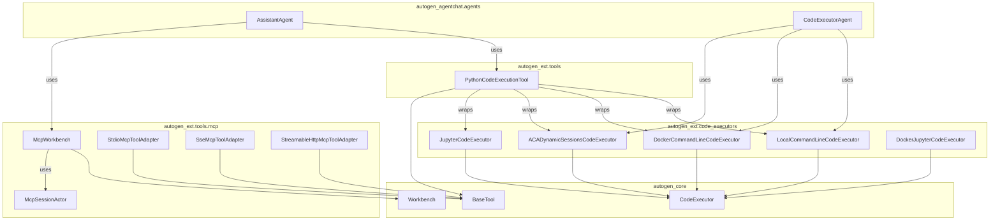
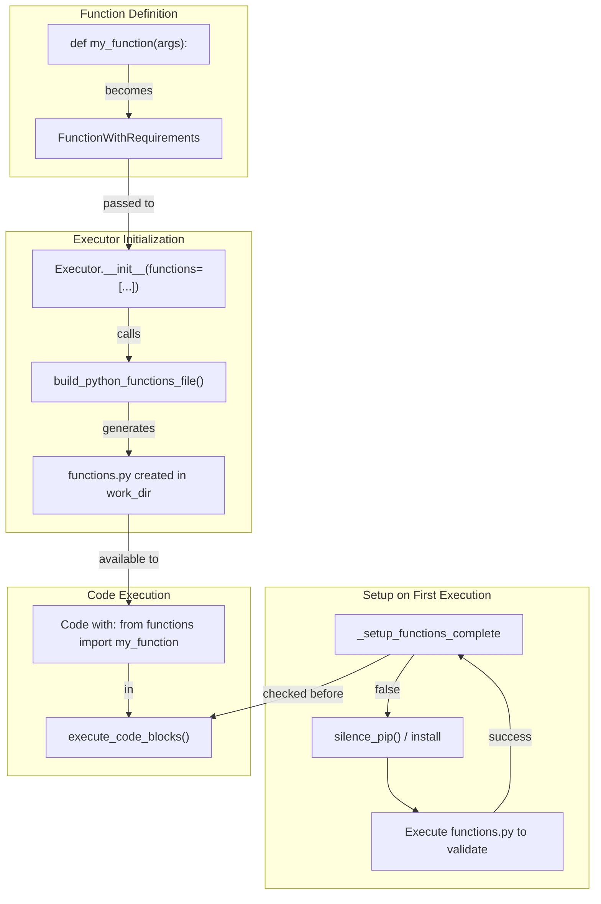

<!-- source: DeepWiki mcp.deepwiki.com · repo microsoft/autogen · page 6 Tools and Extensions · fetched 2026-10-26 -->

# Tools and Extensions

Relevant source files

The following files were used as context for generating this wiki page:

- [python/packages/autogen-ext/src/autogen_ext/code_executors/azure/_azure_container_code_executor.py](python/packages/autogen-ext/src/autogen_ext/code_executors/azure/_azure_container_code_executor.py)
- [python/packages/autogen-ext/src/autogen_ext/code_executors/docker/_docker_code_executor.py](python/packages/autogen-ext/src/autogen_ext/code_executors/docker/_docker_code_executor.py)
- [python/packages/autogen-ext/src/autogen_ext/code_executors/jupyter/_jupyter_code_executor.py](python/packages/autogen-ext/src/autogen_ext/code_executors/jupyter/_jupyter_code_executor.py)
- [python/packages/autogen-ext/src/autogen_ext/code_executors/local/__init__.py](python/packages/autogen-ext/src/autogen_ext/code_executors/local/__init__.py)
- [python/packages/autogen-ext/src/autogen_ext/tools/mcp/__init__.py](python/packages/autogen-ext/src/autogen_ext/tools/mcp/__init__.py)
- [python/packages/autogen-ext/src/autogen_ext/tools/mcp/_actor.py](python/packages/autogen-ext/src/autogen_ext/tools/mcp/_actor.py)
- [python/packages/autogen-ext/src/autogen_ext/tools/mcp/_base.py](python/packages/autogen-ext/src/autogen_ext/tools/mcp/_base.py)
- [python/packages/autogen-ext/src/autogen_ext/tools/mcp/_config.py](python/packages/autogen-ext/src/autogen_ext/tools/mcp/_config.py)
- [python/packages/autogen-ext/src/autogen_ext/tools/mcp/_session.py](python/packages/autogen-ext/src/autogen_ext/tools/mcp/_session.py)
- [python/packages/autogen-ext/src/autogen_ext/tools/mcp/_streamable_http.py](python/packages/autogen-ext/src/autogen_ext/tools/mcp/_streamable_http.py)
- [python/packages/autogen-ext/src/autogen_ext/tools/mcp/_workbench.py](python/packages/autogen-ext/src/autogen_ext/tools/mcp/_workbench.py)
- [python/packages/autogen-ext/tests/code_executors/test_aca_dynamic_sessions.py](python/packages/autogen-ext/tests/code_executors/test_aca_dynamic_sessions.py)
- [python/packages/autogen-ext/tests/code_executors/test_aca_user_defined_functions.py](python/packages/autogen-ext/tests/code_executors/test_aca_user_defined_functions.py)
- [python/packages/autogen-ext/tests/code_executors/test_commandline_code_executor.py](python/packages/autogen-ext/tests/code_executors/test_commandline_code_executor.py)
- [python/packages/autogen-ext/tests/code_executors/test_docker_commandline_code_executor.py](python/packages/autogen-ext/tests/code_executors/test_docker_commandline_code_executor.py)
- [python/packages/autogen-ext/tests/code_executors/test_jupyter_code_executor.py](python/packages/autogen-ext/tests/code_executors/test_jupyter_code_executor.py)
- [python/packages/autogen-ext/tests/code_executors/test_user_defined_functions.py](python/packages/autogen-ext/tests/code_executors/test_user_defined_functions.py)
- [python/packages/autogen-ext/tests/mcp_server_comprehensive.py](python/packages/autogen-ext/tests/mcp_server_comprehensive.py)
- [python/packages/autogen-ext/tests/tools/test_mcp_actor.py](python/packages/autogen-ext/tests/tools/test_mcp_actor.py)
- [python/packages/autogen-ext/tests/tools/test_mcp_tools.py](python/packages/autogen-ext/tests/tools/test_mcp_tools.py)

This document covers the extensible tool system in AutoGen that enables agents to interact with external environments and services. The tools and extensions framework provides standardized interfaces for code execution, web browsing, file manipulation, and integration with external services through protocols like MCP (Model Context Protocol).

For information about agent-specific capabilities and configurations, see [AgentChat API](#3). For details about model integrations that enable tool calling, see [Model Integrations](#5).

## Overview

The `autogen-ext` package provides a comprehensive tools and extensions system that enables agents to execute code, interact with external services, and extend capabilities through standardized interfaces. The system is organized into three main categories:

1.  **Code Execution Tools** - Execute Python and shell scripts in various environments (local, Docker, Azure, Jupyter)
2.  **MCP Integration** - Connect to Model Context Protocol servers for external tool access
3.  **Web and File Interaction** - Browser automation and file system navigation capabilities

All tools implement the `BaseTool` interface from `autogen-core`, providing type-safe execution with cancellation support. Code execution is managed through the `CodeExecutor` interface, which is implemented by multiple backends to support different isolation and deployment scenarios.

### Tool and Executor Architecture

**Sources:** [python/packages/autogen-ext/src/autogen_ext/code_executors/docker/_docker_code_executor.py:85-149](), [python/packages/autogen-ext/src/autogen_ext/code_executors/local/__init__.py:45-138](), [python/packages/autogen-ext/src/autogen_ext/tools/mcp/_workbench.py:47-234](), [python/packages/autogen-ext/src/autogen_ext/tools/mcp/_base.py:29-56]()

### Code Executor Configuration and Lifecycle

```mermaid
graph TB
    subgraph "CodeExecutor Interface"
        EB["execute_code_blocks(code_blocks, cancellation_token)"]
        SL["Lifecycle: start() / stop()"]
        WD["work_dir property"]
    end
    
    subgraph "Local Execution"
        LCE["LocalCommandLineCodeExecutor"]
        LCEC["LocalCommandLineCodeExecutorConfig"]
        VC["virtual_env_context: SimpleNamespace"]
        LCE -->|configured by| LCEC
        LCE -->|optional| VC
    end
    
    subgraph "Docker Execution"
        DCE["DockerCommandLineCodeExecutor"]
        DCEC["DockerCommandLineCodeExecutorConfig"]
        DC["docker.models.containers.Container"]
        DR["docker.types.DeviceRequest"]
        DCE -->|configured by| DCEC
        DCE -->|manages| DC
        DCE -->|optional| DR
    end
    
    subgraph "Azure Execution"
        ACE["ACADynamicSessionsCodeExecutor"]
        TP["TokenProvider (credential)"]
        PME["pool_management_endpoint"]
        SID["session_id"]
        ACE -->|requires| TP
        ACE -->|connects to| PME
        ACE -->|tracks| SID
    end
    
    subgraph "Jupyter Execution"
        JCE["JupyterCodeExecutor"]
        JCC["JupyterCodeExecutorConfig"]
        JCE -->|configured by| JCC
        
        DJCE["DockerJupyterCodeExecutor"]
    end
    
    subgraph "Common Features"
        CB["CodeBlock(code, language)"]
        CR["CodeResult(exit_code, output, code_file)"]
        FWR["FunctionWithRequirements"]
        CT["CancellationToken"]
    end
    
    EB --> CB
    EB --> CR
    EB --> CT
    
    LCE --> EB
    DCE --> EB
    ACE --> EB
    JCE --> EB
    DJCE --> EB
    
    LCE -->|supports| FWR
    DCE -->|supports| FWR
```

**Sources:** [python/packages/autogen-ext/src/autogen_ext/code_executors/docker/_docker_code_executor.py:68-138](), [python/packages/autogen-ext/src/autogen_ext/code_executors/local/__init__.py:36-160](), [python/packages/autogen-ext/src/autogen_ext/code_executors/azure/_azure_container_code_executor.py:46-107](), [python/packages/autogen-ext/src/autogen_ext/code_executors/jupyter/_jupyter_code_executor.py:40-124]()

## PythonCodeExecutionTool

The `PythonCodeExecutionTool` provides a high-level tool interface that wraps any `CodeExecutor` implementation, making it available to agents through the tool system. This allows agents to execute Python code as a tool call rather than through direct code executor integration.

The tool is typically used with `AssistantAgent` to enable code execution as a model-selected tool rather than through `CodeExecutorAgent`'s automatic code extraction.

### Integration Example

The tool integrates with different executor backends through the `executor` configuration parameter, which accepts a `ComponentModel` (serialized executor configuration). This enables flexible deployment scenarios while maintaining a consistent tool interface.

**Sources:** [python/packages/autogen-ext/src/autogen_ext/code_executors/local/__init__.py:127-128](), [python/packages/autogen-ext/src/autogen_ext/code_executors/docker/_docker_code_executor.py:137-138]()

## User-Defined Functions

Code executors support user-defined functions that can be made available to executed code through a generated Python module. This enables agents to access custom functionality without requiring the functions to be defined in the executed code itself.

### Function Registration Flow

**Sources:** [python/packages/autogen-ext/src/autogen_ext/code_executors/local/__init__.py:151-161](), [python/packages/autogen-ext/src/autogen_ext/code_executors/docker/_docker_code_executor.py:169-180](), [python/packages/autogen-ext/src/autogen_ext/code_executors/azure/_azure_container_code_executor.py:97-103]()

### Function Requirements

Functions can specify dependencies using the `FunctionWithRequirements` interface. When the executor starts, it:
1.  Generates a module (defaulting to `functions.py`) containing all function definitions via `build_python_functions_file`. [python/packages/autogen-ext/src/autogen_ext/code_executors/local/__init__.py:24]().
2.  Installs required packages via `pip install`.
3.  Makes functions available via `from functions import func_name`.

**Sources:** [python/packages/autogen-ext/src/autogen_ext/code_executors/local/__init__.py:141-145](), [python/packages/autogen-ext/src/autogen_ext/code_executors/docker/_docker_code_executor.py:152-156]()

## MCP Integration

AutoGen supports the Model Context Protocol (MCP) through the `McpWorkbench` and specialized adapters. This allows agents to discover and call tools provided by any MCP-compliant server.

### MCP Component Architecture

| Class | Role |
| :--- | :--- |
| `McpWorkbench` | A `Workbench` implementation that manages an MCP session and lists/calls tools. [python/packages/autogen-ext/src/autogen_ext/tools/mcp/_workbench.py:47]() |
| `McpSessionActor` | Manages the command loop for an MCP session in a separate task. [python/packages/autogen-ext/src/autogen_ext/tools/mcp/_actor.py:54]() |
| `McpSessionHost` | Handles sampling, elicitation, and roots callbacks from the MCP server. [python/packages/autogen-ext/src/autogen_ext/tools/mcp/_host.py:343]() |
| `StdioMcpToolAdapter` | Adapts an individual MCP tool for use as an AutoGen `BaseTool` via STDIO. [python/packages/autogen-ext/src/autogen_ext/tools/mcp/_stdio.py:11]() |

**Sources:** [python/packages/autogen-ext/src/autogen_ext/tools/mcp/_workbench.py:47-80](), [python/packages/autogen-ext/src/autogen_ext/tools/mcp/_actor.py:54-87]()

## Detailed Subsections

The tools and extensions system is organized into several specialized areas:

*   **[Code Execution](#6.1)**: Document `CodeExecutor` implementations including `DockerCommandLineCodeExecutor`, `LocalCommandLineCodeExecutor`, and `ACADynamicSessionsCodeExecutor`. Covers stateful vs. stateless execution patterns.
*   **[MCP Integration](#6.2)**: Explain integration via `McpWorkbench`, `McpSessionActor`, and server connections (STDIO, SSE, StreamableHTTP).
*   **[Web and File Interaction](#6.3)**: Document `MultimodalWebSurfer` for browser automation and `FileSurfer` for markdown-based file navigation.
*   **[Azure AI Agent and Additional Integrations](#6.4)**: Document `AzureAIAgent` service integration, response caching with `ChatCompletionCache`, and the `agbench` suite.

**Sources:** [python/packages/autogen-ext/src/autogen_ext/code_executors/docker/_docker_code_executor.py:85-138](), [python/packages/autogen-ext/src/autogen_ext/tools/mcp/_workbench.py:47-90](), [python/packages/autogen-ext/src/autogen_ext/code_executors/azure/_azure_container_code_executor.py:46-107]()

---

