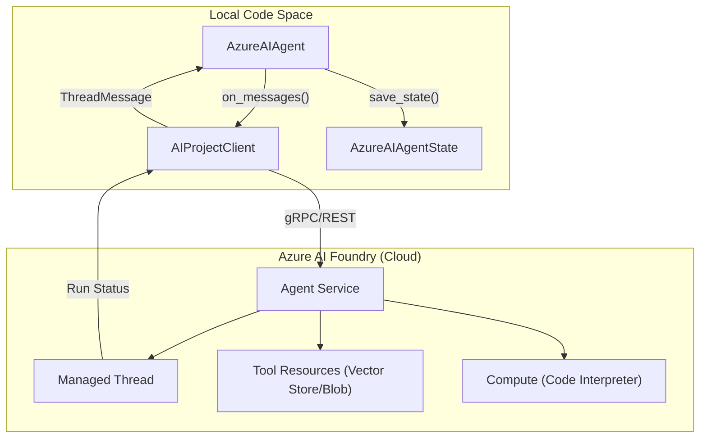
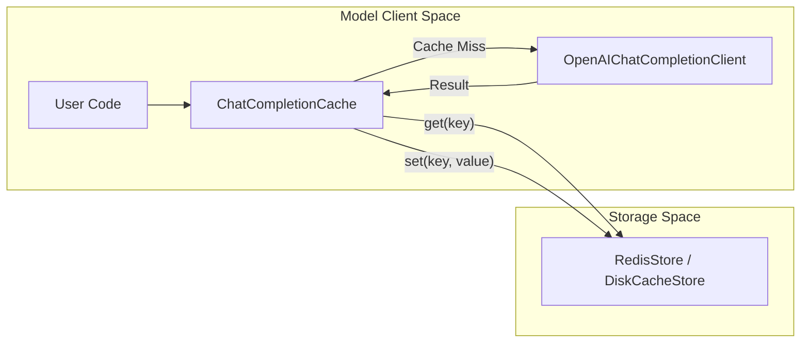

<!-- source: DeepWiki mcp.deepwiki.com · repo microsoft/autogen · page 6.4 Azure AI Agent and Additional Integrations · fetched 2026-10-26 -->

# Azure AI Agent and Additional Integrations

Relevant source files

The following files were used as context for generating this wiki page:

- [python/packages/agbench/.gitignore](python/packages/agbench/.gitignore)
- [python/packages/agbench/CONTRIBUTING.md](python/packages/agbench/CONTRIBUTING.md)
- [python/packages/agbench/README.md](python/packages/agbench/README.md)
- [python/packages/agbench/benchmarks/GAIA/Templates/ParallelAgents/expected_answer.txt](python/packages/agbench/benchmarks/GAIA/Templates/ParallelAgents/expected_answer.txt)
- [python/packages/agbench/benchmarks/GAIA/Templates/ParallelAgents/prompt.txt](python/packages/agbench/benchmarks/GAIA/Templates/ParallelAgents/prompt.txt)
- [python/packages/agbench/benchmarks/GAIA/Templates/ParallelAgents/requirements.txt](python/packages/agbench/benchmarks/GAIA/Templates/ParallelAgents/requirements.txt)
- [python/packages/agbench/benchmarks/GAIA/Templates/ParallelAgents/scenario.py](python/packages/agbench/benchmarks/GAIA/Templates/ParallelAgents/scenario.py)
- [python/packages/agbench/benchmarks/HumanEval/Templates/AgentChat/reasoning_model_context.py](python/packages/agbench/benchmarks/HumanEval/Templates/AgentChat/reasoning_model_context.py)
- [python/packages/agbench/benchmarks/HumanEval/Templates/AgentChat/scenario.py](python/packages/agbench/benchmarks/HumanEval/Templates/AgentChat/scenario.py)
- [python/packages/agbench/src/agbench/remove_missing_cmd.py](python/packages/agbench/src/agbench/remove_missing_cmd.py)
- [python/packages/agbench/src/agbench/run_cmd.py](python/packages/agbench/src/agbench/run_cmd.py)
- [python/packages/agbench/src/agbench/tabulate_cmd.py](python/packages/agbench/src/agbench/tabulate_cmd.py)
- [python/packages/autogen-core/src/autogen_core/_cache_store.py](python/packages/autogen-core/src/autogen_core/_cache_store.py)
- [python/packages/autogen-ext/src/autogen_ext/agents/azure/_azure_ai_agent.py](python/packages/autogen-ext/src/autogen_ext/agents/azure/_azure_ai_agent.py)
- [python/packages/autogen-ext/src/autogen_ext/agents/azure/_types.py](python/packages/autogen-ext/src/autogen_ext/agents/azure/_types.py)
- [python/packages/autogen-ext/src/autogen_ext/cache_store/diskcache.py](python/packages/autogen-ext/src/autogen_ext/cache_store/diskcache.py)
- [python/packages/autogen-ext/src/autogen_ext/cache_store/redis.py](python/packages/autogen-ext/src/autogen_ext/cache_store/redis.py)
- [python/packages/autogen-ext/src/autogen_ext/models/cache/_chat_completion_cache.py](python/packages/autogen-ext/src/autogen_ext/models/cache/_chat_completion_cache.py)
- [python/packages/autogen-ext/tests/cache_store/test_diskcache_store.py](python/packages/autogen-ext/tests/cache_store/test_diskcache_store.py)
- [python/packages/autogen-ext/tests/cache_store/test_redis_store.py](python/packages/autogen-ext/tests/cache_store/test_redis_store.py)
- [python/packages/autogen-ext/tests/models/test_chat_completion_cache.py](python/packages/autogen-ext/tests/models/test_chat_completion_cache.py)
- [python/packages/autogen-ext/tests/test_azure_ai_agent.py](python/packages/autogen-ext/tests/test_azure_ai_agent.py)

This page documents the integration with Azure AI Foundry's agent service, the response caching infrastructure for model clients, and the `agbench` benchmarking suite. These components extend the core AutoGen capabilities to enterprise-grade agent hosting, performance optimization through caching, and systematic evaluation.

## Azure AI Agent

The `AzureAIAgent` class provides an integration with the Azure AI Foundry agent service (formerly Azure AI Assistant API). It allows AutoGen users to leverage hosted capabilities such as managed code interpretation, enterprise search grounding, and persistent threads.

### Implementation and Architecture
The `AzureAIAgent` implements the `BaseChatAgent` protocol [python/packages/autogen-ext/src/autogen_ext/agents/azure/_azure_ai_agent.py:73-73](). It manages the lifecycle of an Azure AI Agent and its associated threads via the `AIProjectClient` [python/packages/autogen-ext/src/autogen_ext/agents/azure/_azure_ai_agent.py:66-66]().

Key capabilities include:
- **Managed Tools**: Integration with `BingGroundingTool`, `CodeInterpreterTool`, and `FileSearchTool` [python/packages/autogen-ext/src/autogen_ext/agents/azure/_azure_ai_agent.py:36-64]().
- **State Persistence**: The `AzureAIAgentState` model captures `agent_id`, `thread_id`, and `vector_store_id` for session resumption [python/packages/autogen-ext/src/autogen_ext/agents/azure/_types.py:36-57]().
- **Tool Mapping**: Supports a mix of Azure-native tool definitions and standard AutoGen `Tool` objects [python/packages/autogen-ext/src/autogen_ext/agents/azure/_types.py:15-33]().

### Data Flow: Azure AI Agent Interaction
The following diagram illustrates how `AzureAIAgent` communicates with the Azure AI Foundry service.

**Azure AI Agent Service Integration**

Sources: [python/packages/autogen-ext/src/autogen_ext/agents/azure/_azure_ai_agent.py:73-155](), [python/packages/autogen-ext/src/autogen_ext/agents/azure/_types.py:36-57]()

## Chat Completion Cache

The `ChatCompletionCache` is a wrapper for `ChatCompletionClient` that provides response caching to reduce latency and API costs.

### Cache Infrastructure
- **ChatCompletionCache**: A wrapper class that intercepts `create` and `create_stream` calls [python/packages/autogen-ext/src/autogen_ext/models/cache/_chat_completion_cache.py:29-32]().
- **CacheStore**: A protocol for storage backends.
    - **InMemoryStore**: Default volatile storage [python/packages/autogen-ext/src/autogen_ext/models/cache/_chat_completion_cache.py:174-174]().
    - **RedisStore**: Persistent storage using Redis, supporting Pydantic model serialization [python/packages/autogen-ext/src/autogen_ext/cache_store/redis.py:25-25]().
    - **DiskCacheStore**: Persistent storage using local disk [python/packages/autogen-ext/src/autogen_ext/models/cache/_chat_completion_cache.py:69-69]().

### Serialization Logic
The `RedisStore` handles complex types by detecting `BaseModel` instances and using `model_dump_json()` for storage [python/packages/autogen-ext/src/autogen_ext/cache_store/redis.py:101-115](). When retrieving, it attempts to parse strings as JSON to restore the original structure [python/packages/autogen-ext/src/autogen_ext/cache_store/redis.py:68-77]().

**Caching Data Flow**

Sources: [python/packages/autogen-ext/src/autogen_ext/models/cache/_chat_completion_cache.py:29-175](), [python/packages/autogen-ext/src/autogen_ext/cache_store/redis.py:87-118]()

## agbench Benchmarking Suite

`agbench` is a toolset for evaluating agent performance across standardized benchmarks like GAIA and HumanEval.

### Core Commands
- **run_cmd**: Executes scenario instances. It supports running scenarios natively or within isolated Docker containers [python/agbench/src/agbench/run_cmd.py:59-79]().
- **tabulate_cmd**: Aggregates results from run logs into tables, CSV, or Excel formats [python/agbench/src/agbench/tabulate_cmd.py:110-142]().

### Scenario Expansion
The `expand_scenario` function prepares the execution environment by copying templates and performing string substitutions for parameters defined in `.jsonl` instance files [python/agbench/src/agbench/run_cmd.py:181-198]().

### Benchmark Templates
Benchmarks are defined using a structured template system:
- **GAIA**: Focuses on general AI assistant tasks requiring tool use [python/packages/agbench/benchmarks/GAIA/Templates/ParallelAgents/scenario.py]().
- **HumanEval**: Focuses on code generation and logical reasoning [python/packages/agbench/benchmarks/HumanEval/Templates/AgentChat/scenario.py]().

| Feature | Description |
| :--- | :--- |
| **Subsampling** | Supports running a random subset of benchmark instances [python/agbench/src/agbench/run_cmd.py:120-130]().
| **Docker Isolation** | Prevents side effects by running agent code in `DEFAULT_DOCKER_IMAGE_TAG` ("agbench") [python/agbench/src/agbench/run_cmd.py:42-42]().
| **Scoring** | Uses `default_scorer` to detect success strings like "ALL TESTS PASSED" in console logs [python/agbench/src/agbench/tabulate_cmd.py:68-87]().

Sources: [python/agbench/src/agbench/run_cmd.py:59-198](), [python/agbench/src/agbench/tabulate_cmd.py:110-223]()

---

