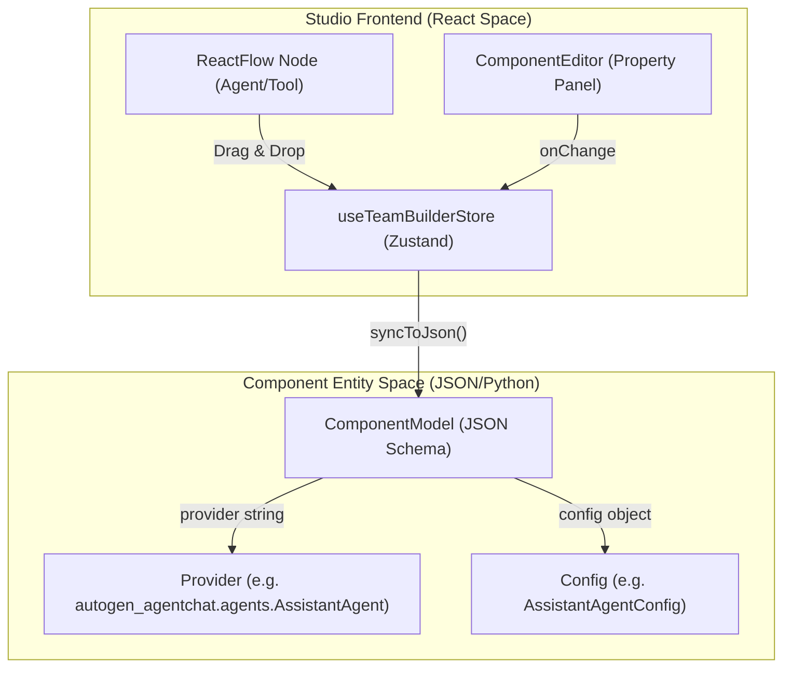
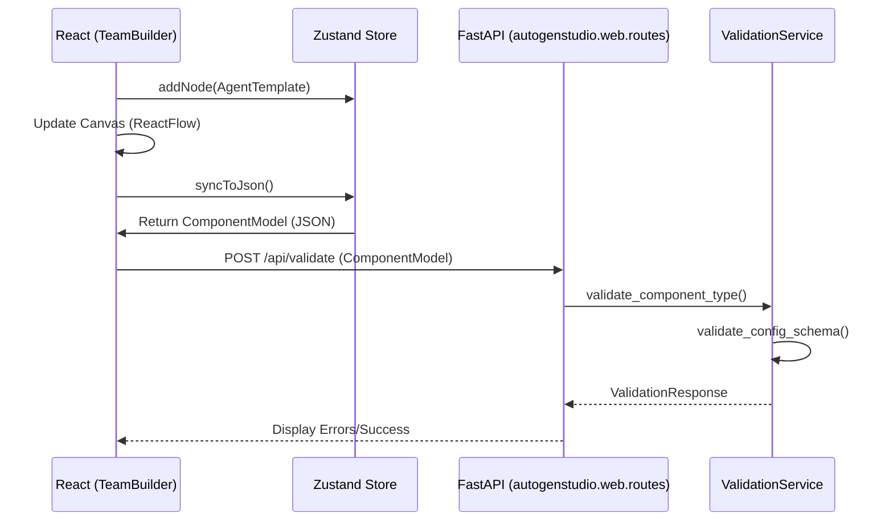

<!-- source: DeepWiki mcp.deepwiki.com · repo microsoft/autogen · page 7.2 Studio Frontend · fetched 2026-10-26 -->

# Studio Frontend

Relevant source files

The following files were used as context for generating this wiki page:

- [.github/workflows/pytest-redis-memory.yml](.github/workflows/pytest-redis-memory.yml)
- [.gitignore](.gitignore)
- [docs/dotnet/docfx.json](docs/dotnet/docfx.json)
- [python/docs/src/user-guide/agentchat-user-guide/memory.ipynb](python/docs/src/user-guide/agentchat-user-guide/memory.ipynb)
- [python/packages/autogen-ext/src/autogen_ext/memory/redis/__init__.py](python/packages/autogen-ext/src/autogen_ext/memory/redis/__init__.py)
- [python/packages/autogen-ext/src/autogen_ext/memory/redis/_redis_memory.py](python/packages/autogen-ext/src/autogen_ext/memory/redis/_redis_memory.py)
- [python/packages/autogen-ext/tests/memory/test_redis_memory.py](python/packages/autogen-ext/tests/memory/test_redis_memory.py)
- [python/packages/autogen-studio/autogenstudio/validation/validation_service.py](python/packages/autogen-studio/autogenstudio/validation/validation_service.py)
- [python/packages/autogen-studio/autogenstudio/web/config.py](python/packages/autogen-studio/autogenstudio/web/config.py)
- [python/packages/autogen-studio/autogenstudio/web/routes/mcp.py](python/packages/autogen-studio/autogenstudio/web/routes/mcp.py)
- [python/packages/autogen-studio/autogenstudio/web/routes/settingsroute.py](python/packages/autogen-studio/autogenstudio/web/routes/settingsroute.py)
- [python/packages/autogen-studio/frontend/gatsby-config.ts](python/packages/autogen-studio/frontend/gatsby-config.ts)
- [python/packages/autogen-studio/frontend/package.json](python/packages/autogen-studio/frontend/package.json)
- [python/packages/autogen-studio/frontend/src/components/footer.tsx](python/packages/autogen-studio/frontend/src/components/footer.tsx)
- [python/packages/autogen-studio/frontend/src/components/types/component-templates.ts](python/packages/autogen-studio/frontend/src/components/types/component-templates.ts)
- [python/packages/autogen-studio/frontend/src/components/views/deploy/guides/guides.tsx](python/packages/autogen-studio/frontend/src/components/views/deploy/guides/guides.tsx)
- [python/packages/autogen-studio/frontend/src/components/views/deploy/guides/python.tsx](python/packages/autogen-studio/frontend/src/components/views/deploy/guides/python.tsx)
- [python/packages/autogen-studio/frontend/src/components/views/deploy/manager.tsx](python/packages/autogen-studio/frontend/src/components/views/deploy/manager.tsx)
- [python/packages/autogen-studio/frontend/src/components/views/gallery/detail.tsx](python/packages/autogen-studio/frontend/src/components/views/gallery/detail.tsx)
- [python/packages/autogen-studio/frontend/src/components/views/gallery/manager.tsx](python/packages/autogen-studio/frontend/src/components/views/gallery/manager.tsx)
- [python/packages/autogen-studio/frontend/src/components/views/playground/chat/logrenderer.tsx](python/packages/autogen-studio/frontend/src/components/views/playground/chat/logrenderer.tsx)
- [python/packages/autogen-studio/frontend/src/components/views/settings/manager.tsx](python/packages/autogen-studio/frontend/src/components/views/settings/manager.tsx)
- [python/packages/autogen-studio/frontend/src/components/views/settings/store.tsx](python/packages/autogen-studio/frontend/src/components/views/settings/store.tsx)
- [python/packages/autogen-studio/frontend/src/components/views/settings/view/environment.tsx](python/packages/autogen-studio/frontend/src/components/views/settings/view/environment.tsx)
- [python/packages/autogen-studio/frontend/src/components/views/settings/view/modelconfig.tsx](python/packages/autogen-studio/frontend/src/components/views/settings/view/modelconfig.tsx)
- [python/packages/autogen-studio/frontend/src/components/views/settings/view/panel.tsx](python/packages/autogen-studio/frontend/src/components/views/settings/view/panel.tsx)
- [python/packages/autogen-studio/frontend/src/components/views/settings/view/ui.tsx](python/packages/autogen-studio/frontend/src/components/views/settings/view/ui.tsx)
- [python/packages/autogen-studio/frontend/src/components/views/teambuilder/builder/builder.tsx](python/packages/autogen-studio/frontend/src/components/views/teambuilder/builder/builder.tsx)
- [python/packages/autogen-studio/frontend/src/components/views/teambuilder/builder/component-editor/component-editor.tsx](python/packages/autogen-studio/frontend/src/components/views/teambuilder/builder/component-editor/component-editor.tsx)
- [python/packages/autogen-studio/frontend/src/components/views/teambuilder/builder/component-editor/fields/agent-fields.tsx](python/packages/autogen-studio/frontend/src/components/views/teambuilder/builder/component-editor/fields/agent-fields.tsx)
- [python/packages/autogen-studio/frontend/src/components/views/teambuilder/builder/component-editor/fields/tool-fields.tsx](python/packages/autogen-studio/frontend/src/components/views/teambuilder/builder/component-editor/fields/tool-fields.tsx)
- [python/packages/autogen-studio/frontend/src/components/views/teambuilder/builder/component-editor/fields/workbench/workbench-fields.tsx](python/packages/autogen-studio/frontend/src/components/views/teambuilder/builder/component-editor/fields/workbench/workbench-fields.tsx)
- [python/packages/autogen-studio/frontend/src/components/views/teambuilder/builder/library.tsx](python/packages/autogen-studio/frontend/src/components/views/teambuilder/builder/library.tsx)
- [python/packages/autogen-studio/frontend/src/components/views/teambuilder/sidebar.tsx](python/packages/autogen-studio/frontend/src/components/views/teambuilder/sidebar.tsx)
- [python/packages/autogen-studio/frontend/src/hooks/provider.tsx](python/packages/autogen-studio/frontend/src/hooks/provider.tsx)
- [python/packages/autogen-studio/frontend/src/styles/global.css](python/packages/autogen-studio/frontend/src/styles/global.css)
- [python/packages/autogen-studio/frontend/yarn.lock](python/packages/autogen-studio/frontend/yarn.lock)

The AutoGen Studio frontend is a modern web application built with **Gatsby** and **React**, designed to provide a low-code interface for composing, testing, and deploying multi-agent teams. It leverages **Ant Design** for UI components and **Tailwind CSS** for styling, with state management handled primarily by **Zustand**.

## Build and Project Setup

The frontend is located in `python/packages/autogen-studio/frontend/` and follows a standard Node.js/Yarn project structure.

### Build Pipeline
The build process is orchestrated via `package.json` scripts:
*   **Develop**: Runs `gatsby develop` for local hot-reloading [python/packages/autogen-studio/frontend/package.json:11-12]().
*   **Build**: Performs a production build using `gatsby build --prefix-paths`. It cleans the target directory in the Python package (`../autogenstudio/web/ui`) and syncs the generated static files there using `rsync` [python/packages/autogen-studio/frontend/package.json:14-14]().
*   **Typecheck**: Uses `tsc` to validate TypeScript types [python/packages/autogen-studio/frontend/package.json:17-17]().

### Key Dependencies
*   **UI Framework**: `antd` (Ant Design) [python/packages/autogen-studio/frontend/package.json:32-32]().
*   **Visualization**: `@xyflow/react` (React Flow) for agent graph visualization [python/packages/autogen-studio/frontend/package.json:31-31]().
*   **State Management**: `zustand` [python/packages/autogen-studio/frontend/package.json:51-51]().
*   **Editor**: `@monaco-editor/react` for JSON and code editing [python/packages/autogen-studio/frontend/package.json:29-29]().

Sources: [python/packages/autogen-studio/frontend/package.json:1-62]()

---

## Team Builder

The Team Builder is the core workspace for designing agent architectures. It consists of a visual canvas, a component library, and a detailed property editor.

### Component Architecture and Data Flow
The builder uses a "Source of Truth" pattern where the visual graph state and the underlying `ComponentModel` are synchronized.

| Component | Role | File Reference |
| :--- | :--- | :--- |
| `TeamBuilder` | Main orchestrator for the builder view. | [python/packages/autogen-studio/frontend/src/components/views/teambuilder/builder/builder.tsx:66-71]() |
| `useTeamBuilderStore` | Zustand store managing nodes, edges, and history (undo/redo). | [python/packages/autogen-studio/frontend/src/components/views/teambuilder/builder/store.tsx]() |
| `ComponentLibrary` | Sidebar containing draggable agent/tool templates. | [python/packages/autogen-studio/frontend/src/components/views/teambuilder/builder/library.tsx]() |
| `ComponentEditor` | Slide-over panel for configuring specific agent/tool properties. | [python/packages/autogen-studio/frontend/src/components/views/teambuilder/builder/component-editor/component-editor.tsx]() |

### Data Flow: Natural Language to Code Entity
The following diagram illustrates how UI interactions translate into the underlying AutoGen component system.

**UI to Component Model Mapping**

Sources: [python/packages/autogen-studio/frontend/src/components/views/teambuilder/builder/builder.tsx:118-122](), [python/packages/autogen-studio/frontend/src/components/views/teambuilder/builder/builder.tsx:216-242]()

### Component Editor Fields
The editor dynamically renders fields based on the component type:
*   **Agent Fields**: Configures `name`, `system_message`, `model_client`, and `tools`. It supports adding **Workbenches** (Static or MCP) [python/packages/autogen-studio/frontend/src/components/views/teambuilder/builder/component-editor/fields/agent-fields.tsx:128-202]().
*   **Tool Fields**: Currently displays a deprecation warning for `FunctionTool` due to security concerns (RCE risk via `exec()`), recommending **MCP Workbenches** instead [python/packages/autogen-studio/frontend/src/components/views/teambuilder/builder/component-editor/fields/tool-fields.tsx:15-25]().
*   **Workbench Fields**: Configures `McpWorkbench` with parameters for Stdio or HTTP streaming [python/packages/autogen-studio/frontend/src/components/views/teambuilder/builder/component-editor/fields/agent-fields.tsx:157-240]().

### Validation Logic
The frontend triggers backend validation via `validationAPI.validateComponent` [python/packages/autogen-studio/frontend/src/components/views/teambuilder/builder/builder.tsx:201-203](). The backend `ValidationService` performs:
1.  **Provider Import**: Checks if the provider string can be resolved to a Python class [python/packages/autogenstudio/validation/validation_service.py:27-35]().
2.  **Schema Validation**: Validates the `config` object against the component's `component_config_schema` [python/packages/autogenstudio/validation/validation_service.py:70-86]().
3.  **Dry-run Instantiation**: Attempts to load the component using `load_component` to ensure all dependencies are met [python/packages/autogenstudio/validation/validation_service.py:114-131]().

Sources: [python/packages/autogenstudio/validation/validation_service.py:1-160](), [python/packages/autogen-studio/frontend/src/components/views/teambuilder/builder/component-editor/fields/agent-fields.tsx:86-110]()

---

## Playground

The Playground is the execution environment where users interact with their teams.

### Chat and Run View
The `ChatView` handles real-time message exchange via WebSockets. It renders different message types using the `LogRenderer`, which provides specialized displays for:
*   **Text Messages**: Standard markdown rendering.
*   **Tool Calls**: Visualizing the function name and arguments.
*   **Tool Results**: Displaying output or errors from tool execution.
*   **Agent Flow**: A visual trace of which agent is speaking and the transition between them.

### Agent Flow Visualization
The playground includes a visualization of the team's internal graph, allowing users to see the `SelectorGroupChat` or `RoundRobinGroupChat` logic in action during a run.

Sources: [python/packages/autogen-studio/frontend/src/components/views/playground/chat/logrenderer.tsx]()

---

## Gallery and Store

The Gallery acts as a repository for reusable agent templates and team configurations.

*   **Default Gallery**: Built-in templates provided by AutoGen Studio.
*   **Gallery API**: Used by the `TeamSidebar` to fetch and list available galleries [python/packages/autogen-studio/frontend/src/components/views/teambuilder/sidebar.tsx:58-64]().
*   **Persistence**: Selected gallery IDs are persisted in `localStorage` to maintain user context across sessions [python/packages/autogen-studio/frontend/src/components/views/teambuilder/sidebar.tsx:67-72]().

Sources: [python/packages/autogen-studio/frontend/src/components/views/teambuilder/sidebar.tsx:36-103]()

---

## Settings and Environment

The Settings view manages the global configuration required for agent operation.

### Model Configuration
Users can define multiple model configurations (e.g., OpenAI, Azure OpenAI). These are stored in the database and referenced by agents via their `model_client` field.

### Environment Variables
The `Environment` panel allows users to set API keys and other environment variables (e.g., `OPENAI_API_KEY`) that are required by the backend to instantiate model clients and tools.

Sources: [python/packages/autogen-studio/frontend/src/components/views/settings/view/modelconfig.tsx](), [python/packages/autogen-studio/frontend/src/components/views/settings/view/environment.tsx]()

---

## Deployment Guides

Studio provides integrated documentation for moving from the UI to production.

*   **Python Guide**: Shows how to export a team as JSON and load it using the `autogen-agentchat` Python SDK [python/packages/autogen-studio/frontend/src/components/views/deploy/guides/python.tsx]().
*   **Docker Guide**: Provides instructions for containerizing the team for scalable deployment.

Sources: [python/packages/autogen-studio/frontend/src/components/views/deploy/guides/guides.tsx]()

---

## System Integration Diagram

The following diagram bridges the frontend UI components to the backend API routes and Python services.

**Frontend-Backend Interaction**

Sources: [python/packages/autogen-studio/frontend/src/components/views/teambuilder/builder/builder.tsx:193-213](), [python/packages/autogenstudio/validation/validation_service.py:25-111]()

---

