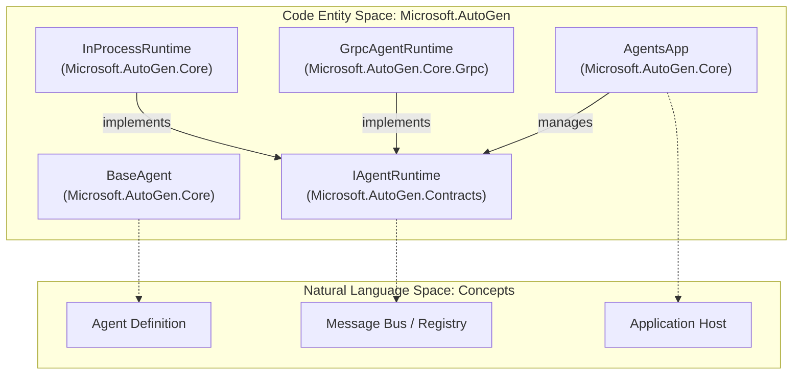
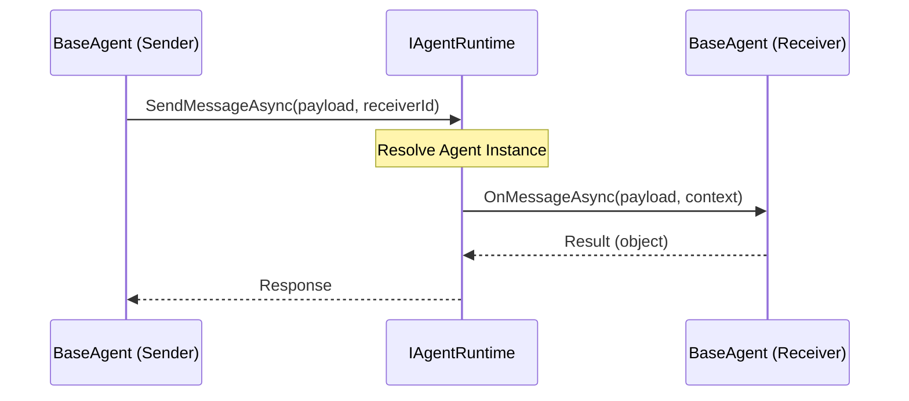

<!-- source: DeepWiki mcp.deepwiki.com · repo microsoft/autogen · page 8 .NET Framework · fetched 2026-10-26 -->

# .NET Framework

Relevant source files

The following files were used as context for generating this wiki page:

- [dotnet/AutoGen.sln](dotnet/AutoGen.sln)
- [dotnet/Directory.Build.props](dotnet/Directory.Build.props)
- [dotnet/nuget/nuget-package.props](dotnet/nuget/nuget-package.props)
- [dotnet/samples/dev-team/DevTeam.Backend/Agents/Developer/Developer.cs](dotnet/samples/dev-team/DevTeam.Backend/Agents/Developer/Developer.cs)
- [dotnet/samples/dev-team/DevTeam.Backend/Agents/DeveloperLead/DeveloperLead.cs](dotnet/samples/dev-team/DevTeam.Backend/Agents/DeveloperLead/DeveloperLead.cs)
- [dotnet/samples/dev-team/DevTeam.Backend/Agents/ProductManager/ProductManager.cs](dotnet/samples/dev-team/DevTeam.Backend/Agents/ProductManager/ProductManager.cs)
- [dotnet/samples/dev-team/DevTeam.Backend/DevTeam.Backend.csproj](dotnet/samples/dev-team/DevTeam.Backend/DevTeam.Backend.csproj)
- [dotnet/src/AutoGen.DotnetInteractive/InProccessDotnetInteractiveKernelBuilder.cs](dotnet/src/AutoGen.DotnetInteractive/InProccessDotnetInteractiveKernelBuilder.cs)
- [dotnet/src/Microsoft.AutoGen/Agents/Microsoft.AutoGen.Agents.csproj](dotnet/src/Microsoft.AutoGen/Agents/Microsoft.AutoGen.Agents.csproj)
- [dotnet/src/Microsoft.AutoGen/Contracts/AgentProxy.cs](dotnet/src/Microsoft.AutoGen/Contracts/AgentProxy.cs)
- [dotnet/src/Microsoft.AutoGen/Contracts/IAgent.cs](dotnet/src/Microsoft.AutoGen/Contracts/IAgent.cs)
- [dotnet/src/Microsoft.AutoGen/Contracts/IAgentRuntime.cs](dotnet/src/Microsoft.AutoGen/Contracts/IAgentRuntime.cs)
- [dotnet/src/Microsoft.AutoGen/Contracts/ISaveState.cs](dotnet/src/Microsoft.AutoGen/Contracts/ISaveState.cs)
- [dotnet/src/Microsoft.AutoGen/Contracts/KVStringParseHelper.cs](dotnet/src/Microsoft.AutoGen/Contracts/KVStringParseHelper.cs)
- [dotnet/src/Microsoft.AutoGen/Core.Grpc/GrpcAgentRuntime.cs](dotnet/src/Microsoft.AutoGen/Core.Grpc/GrpcAgentRuntime.cs)
- [dotnet/src/Microsoft.AutoGen/Core/AgentsApp.cs](dotnet/src/Microsoft.AutoGen/Core/AgentsApp.cs)
- [dotnet/src/Microsoft.AutoGen/Core/BaseAgent.cs](dotnet/src/Microsoft.AutoGen/Core/BaseAgent.cs)
- [dotnet/src/Microsoft.AutoGen/Core/IHandleExtensions.cs](dotnet/src/Microsoft.AutoGen/Core/IHandleExtensions.cs)
- [dotnet/src/Microsoft.AutoGen/Core/InProcessRuntime.cs](dotnet/src/Microsoft.AutoGen/Core/InProcessRuntime.cs)
- [dotnet/src/Microsoft.AutoGen/Core/Properties/AssemblyInfo.cs](dotnet/src/Microsoft.AutoGen/Core/Properties/AssemblyInfo.cs)
- [dotnet/src/Microsoft.AutoGen/Extensions/Aspire/Microsoft.AutoGen.Extensions.Aspire.csproj](dotnet/src/Microsoft.AutoGen/Extensions/Aspire/Microsoft.AutoGen.Extensions.Aspire.csproj)
- [dotnet/src/Microsoft.AutoGen/Extensions/MEAI/Microsoft.AutoGen.Extensions.MEAI.csproj](dotnet/src/Microsoft.AutoGen/Extensions/MEAI/Microsoft.AutoGen.Extensions.MEAI.csproj)
- [dotnet/src/Microsoft.AutoGen/Extensions/SemanticKernel/Microsoft.AutoGen.Extensions.SemanticKernel.csproj](dotnet/src/Microsoft.AutoGen/Extensions/SemanticKernel/Microsoft.AutoGen.Extensions.SemanticKernel.csproj)
- [dotnet/test/Microsoft.AutoGen.Core.Tests/AgentTests.cs](dotnet/test/Microsoft.AutoGen.Core.Tests/AgentTests.cs)
- [dotnet/test/Microsoft.AutoGen.Core.Tests/InProcessRuntimeTests.cs](dotnet/test/Microsoft.AutoGen.Core.Tests/InProcessRuntimeTests.cs)

This document covers the AutoGen for .NET SDK, the official .NET implementation of the AutoGen framework. It enables .NET developers to build multi-agent AI applications using familiar C# patterns, such as Dependency Injection, gRPC, and Microsoft.Extensions.AI abstractions.

The .NET SDK is organized into a layered architecture that separates core agent protocols, high-level chat abstractions, and provider-specific integrations.

## Architecture Overview

The AutoGen for .NET SDK is built on a distributed agent runtime model. It supports both in-process execution for rapid prototyping and gRPC-based distributed execution for scalable production environments.

### .NET SDK Component Space

The following diagram bridges the conceptual agent system to the specific .NET projects and classes found in the codebase.

**Sources:** [dotnet/src/Microsoft.AutoGen/Core/BaseAgent.cs:15-15](), [dotnet/src/Microsoft.AutoGen/Contracts/IAgentRuntime.cs:11-11](), [dotnet/src/Microsoft.AutoGen/Core/InProcessRuntime.cs:12-12](), [dotnet/src/Microsoft.AutoGen/Core/AgentsApp.cs:89-89](), [dotnet/src/Microsoft.AutoGen/Core.Grpc/GrpcAgentRuntime.cs:88-88]()

### Package Hierarchy

The .NET solution is composed of several specialized projects, ranging from core abstractions to provider extensions like Semantic Kernel and OpenAI.

| Project Name | Purpose | Key Entities |
| :--- | :--- | :--- |
| `Microsoft.AutoGen.Contracts` | Interfaces and base types for cross-process compatibility. | `IAgentRuntime`, `AgentId`, `ISaveState` |
| `Microsoft.AutoGen.Core` | The fundamental agent implementation and local runtime. | `BaseAgent`, `InProcessRuntime`, `AgentsApp` |
| `Microsoft.AutoGen.Core.Grpc` | Distributed runtime using gRPC for agent communication. | `GrpcAgentRuntime`, `GrpcMessageRouter` |
| `AutoGen.Core` | High-level agent communication and middleware. | `AgentChat`, `Middleware` |
| `AutoGen.OpenAI` | Integration with OpenAI/Azure OpenAI. | `OpenAIChatRequestMessageConnector` |
| `AutoGen.SemanticKernel` | Adapter for Microsoft's Semantic Kernel ecosystem. | `SemanticKernelAgent` |

**Sources:** [dotnet/AutoGen.sln:6-85](), [dotnet/src/Microsoft.AutoGen/Core/BaseAgent.cs:10-15](), [dotnet/src/Microsoft.AutoGen/Contracts/IAgentRuntime.cs:6-11](), [dotnet/src/Microsoft.AutoGen/Core.Grpc/GrpcAgentRuntime.cs:88-88]()

## Core Framework Systems

The .NET implementation centers on the `IAgentRuntime`, which acts as a message broker and lifecycle manager for agents.

### Messaging and Runtime Flow

Agents communicate by sending messages to `AgentId` targets or publishing to `TopicId` channels. The runtime resolves the target and handles delivery.

**Sources:** [dotnet/src/Microsoft.AutoGen/Core/BaseAgent.cs:83-99](), [dotnet/src/Microsoft.AutoGen/Contracts/IAgentRuntime.cs:25-38](), [dotnet/src/Microsoft.AutoGen/Core/InProcessRuntime.cs:102-134]()

### Key Components

- **[.NET Agent System](#8.1)**: Detailed look at the `BaseAgent` class, the `IHandle<T>` pattern for message processing, and the `InProcessRuntime` vs `GrpcAgentRuntime` implementations. Covers the middleware pipeline and the source generator used for creating function contracts.
- **[.NET SDK Distribution](#8.2)**: Guide on how to consume the SDK via NuGet, including package naming conventions (`Microsoft.AutoGen.*` vs `AutoGen.*`), nightly build access, and project setup for .NET 8.0.

## Integration Patterns

The .NET SDK is designed to be highly extensible through two primary mechanisms:
1. **Microsoft.Extensions.AI**: Support for the unified AI abstractions in .NET. [dotnet/src/Microsoft.AutoGen/Agents/Microsoft.AutoGen.Agents.csproj:16-16]()
2. **Semantic Kernel**: Deep integration with Semantic Kernel for memory and orchestration. [dotnet/src/Microsoft.AutoGen/Extensions/SemanticKernel/Microsoft.AutoGen.Extensions.SemanticKernel.csproj:13-15]()

For more details on building and deploying .NET agents, see the child pages:
- [.NET Agent System](#8.1)
- [.NET SDK Distribution](#8.2)

**Sources:** [dotnet/src/Microsoft.AutoGen/Core/AgentsApp.cs:13-22](), [dotnet/src/Microsoft.AutoGen/Core/InProcessRuntime.cs:12-16](), [dotnet/src/Microsoft.AutoGen/Core.Grpc/GrpcAgentRuntime.cs:88-95]()

---

