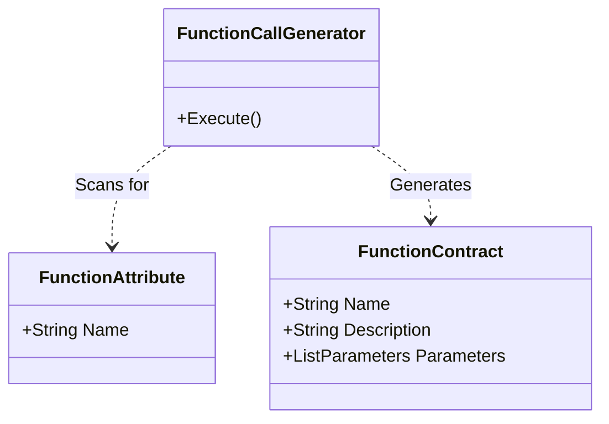

<!-- source: DeepWiki mcp.deepwiki.com · repo microsoft/autogen · page 8.1 .NET Agent System · fetched 2026-10-26 -->

# .NET Agent System

<details>
<summary>Relevant source files</summary>

The following files were used as context for generating this wiki page:

- [dotnet/AutoGen.sln](dotnet/AutoGen.sln)
- [dotnet/Directory.Build.props](dotnet/Directory.Build.props)
- [dotnet/Directory.Packages.props](dotnet/Directory.Packages.props)
- [dotnet/nuget/nuget-package.props](dotnet/nuget/nuget-package.props)
- [dotnet/samples/dev-team/DevTeam.Backend/Agents/Developer/Developer.cs](dotnet/samples/dev-team/DevTeam.Backend/Agents/Developer/Developer.cs)
- [dotnet/samples/dev-team/DevTeam.Backend/Agents/DeveloperLead/DeveloperLead.cs](dotnet/samples/dev-team/DevTeam.Backend/Agents/DeveloperLead/DeveloperLead.cs)
- [dotnet/samples/dev-team/DevTeam.Backend/Agents/ProductManager/ProductManager.cs](dotnet/samples/dev-team/DevTeam.Backend/Agents/ProductManager/ProductManager.cs)
- [dotnet/samples/dev-team/DevTeam.Backend/DevTeam.Backend.csproj](dotnet/samples/dev-team/DevTeam.Backend/DevTeam.Backend.csproj)
- [dotnet/src/AutoGen.Anthropic/Agent/AnthropicClientAgent.cs](dotnet/src/AutoGen.Anthropic/Agent/AnthropicClientAgent.cs)
- [dotnet/src/AutoGen.Anthropic/AnthropicClient.cs](dotnet/src/AutoGen.Anthropic/AnthropicClient.cs)
- [dotnet/src/AutoGen.Anthropic/Converters/ContentBaseConverter.cs](dotnet/src/AutoGen.Anthropic/Converters/ContentBaseConverter.cs)
- [dotnet/src/AutoGen.Anthropic/DTO/ChatCompletionRequest.cs](dotnet/src/AutoGen.Anthropic/DTO/ChatCompletionRequest.cs)
- [dotnet/src/AutoGen.Anthropic/DTO/ChatCompletionResponse.cs](dotnet/src/AutoGen.Anthropic/DTO/ChatCompletionResponse.cs)
- [dotnet/src/AutoGen.Anthropic/DTO/Content.cs](dotnet/src/AutoGen.Anthropic/DTO/Content.cs)
- [dotnet/src/AutoGen.Anthropic/DTO/Tool.cs](dotnet/src/AutoGen.Anthropic/DTO/Tool.cs)
- [dotnet/src/AutoGen.Anthropic/Middleware/AnthropicMessageConnector.cs](dotnet/src/AutoGen.Anthropic/Middleware/AnthropicMessageConnector.cs)
- [dotnet/src/AutoGen.Anthropic/Utils/AnthropicConstants.cs](dotnet/src/AutoGen.Anthropic/Utils/AnthropicConstants.cs)
- [dotnet/src/AutoGen.Core/Agent/IAgent.cs](dotnet/src/AutoGen.Core/Agent/IAgent.cs)
- [dotnet/src/AutoGen.Core/Extension/GroupChatExtension.cs](dotnet/src/AutoGen.Core/Extension/GroupChatExtension.cs)
- [dotnet/src/AutoGen.Core/Function/FunctionAttribute.cs](dotnet/src/AutoGen.Core/Function/FunctionAttribute.cs)
- [dotnet/src/AutoGen.Core/Message/ToolCallMessage.cs](dotnet/src/AutoGen.Core/Message/ToolCallMessage.cs)
- [dotnet/src/AutoGen.Core/Middleware/FunctionCallMiddleware.cs](dotnet/src/AutoGen.Core/Middleware/FunctionCallMiddleware.cs)
- [dotnet/src/AutoGen.Core/Orchestrator/RoundRobinOrchestrator.cs](dotnet/src/AutoGen.Core/Orchestrator/RoundRobinOrchestrator.cs)
- [dotnet/src/AutoGen.DotnetInteractive/DotnetInteractiveKernelBuilder.cs](dotnet/src/AutoGen.DotnetInteractive/DotnetInteractiveKernelBuilder.cs)
- [dotnet/src/AutoGen.DotnetInteractive/InProccessDotnetInteractiveKernelBuilder.cs](dotnet/src/AutoGen.DotnetInteractive/InProccessDotnetInteractiveKernelBuilder.cs)
- [dotnet/src/AutoGen.Mistral/DTOs/ChatCompletionResponse.cs](dotnet/src/AutoGen.Mistral/DTOs/ChatCompletionResponse.cs)
- [dotnet/src/AutoGen.Mistral/DTOs/Error.cs](dotnet/src/AutoGen.Mistral/DTOs/Error.cs)
- [dotnet/src/AutoGen.Mistral/DTOs/Model.cs](dotnet/src/AutoGen.Mistral/DTOs/Model.cs)
- [dotnet/src/AutoGen.OpenAI/Agent/OpenAIChatAgent.cs](dotnet/src/AutoGen.OpenAI/Agent/OpenAIChatAgent.cs)
- [dotnet/src/AutoGen.OpenAI/Middleware/OpenAIChatRequestMessageConnector.cs](dotnet/src/AutoGen.OpenAI/Middleware/OpenAIChatRequestMessageConnector.cs)
- [dotnet/src/AutoGen.SemanticKernel/SemanticKernelChatCompletionAgent.cs](dotnet/src/AutoGen.SemanticKernel/SemanticKernelChatCompletionAgent.cs)
- [dotnet/src/AutoGen.SourceGenerator/DocumentCommentExtension.cs](dotnet/src/AutoGen.SourceGenerator/DocumentCommentExtension.cs)
- [dotnet/src/AutoGen.SourceGenerator/FunctionCallGenerator.cs](dotnet/src/AutoGen.SourceGenerator/FunctionCallGenerator.cs)
- [dotnet/src/AutoGen.SourceGenerator/FunctionExtension.cs](dotnet/src/AutoGen.SourceGenerator/FunctionExtension.cs)
- [dotnet/src/AutoGen.SourceGenerator/SourceGeneratorFunctionContract.cs](dotnet/src/AutoGen.SourceGenerator/SourceGeneratorFunctionContract.cs)
- [dotnet/src/Microsoft.AutoGen/AgentChat/Abstractions/ChatAgent.cs](dotnet/src/Microsoft.AutoGen/AgentChat/Abstractions/ChatAgent.cs)
- [dotnet/src/Microsoft.AutoGen/AgentChat/Abstractions/ITeam.cs](dotnet/src/Microsoft.AutoGen/AgentChat/Abstractions/ITeam.cs)
- [dotnet/src/Microsoft.AutoGen/AgentChat/Abstractions/Messages.cs](dotnet/src/Microsoft.AutoGen/AgentChat/Abstractions/Messages.cs)
- [dotnet/src/Microsoft.AutoGen/AgentChat/Abstractions/ModelContext.cs](dotnet/src/Microsoft.AutoGen/AgentChat/Abstractions/ModelContext.cs)
- [dotnet/src/Microsoft.AutoGen/AgentChat/Abstractions/Tools.cs](dotnet/src/Microsoft.AutoGen/AgentChat/Abstractions/Tools.cs)
- [dotnet/src/Microsoft.AutoGen/AgentChat/GroupChat/ChatAgentRouter.cs](dotnet/src/Microsoft.AutoGen/AgentChat/GroupChat/ChatAgentRouter.cs)
- [dotnet/src/Microsoft.AutoGen/AgentChat/GroupChat/GroupChatBase.cs](dotnet/src/Microsoft.AutoGen/AgentChat/GroupChat/GroupChatBase.cs)
- [dotnet/src/Microsoft.AutoGen/AgentChat/GroupChat/GroupChatHandlerRouter.cs](dotnet/src/Microsoft.AutoGen/AgentChat/GroupChat/GroupChatHandlerRouter.cs)
- [dotnet/src/Microsoft.AutoGen/AgentChat/GroupChat/GroupChatManagerBase.cs](dotnet/src/Microsoft.AutoGen/AgentChat/GroupChat/GroupChatManagerBase.cs)
- [dotnet/src/Microsoft.AutoGen/AgentChat/GroupChat/RoundRobinGroupChat.cs](dotnet/src/Microsoft.AutoGen/AgentChat/GroupChat/RoundRobinGroupChat.cs)
- [dotnet/src/Microsoft.AutoGen/AgentChat/State/BaseState.cs](dotnet/src/Microsoft.AutoGen/AgentChat/State/BaseState.cs)
- [dotnet/src/Microsoft.AutoGen/AgentChat/State/ChatAgentContainerState.cs](dotnet/src/Microsoft.AutoGen/AgentChat/State/ChatAgentContainerState.cs)
- [dotnet/src/Microsoft.AutoGen/Agents/AIAgent/InferenceAgent.cs](dotnet/src/Microsoft.AutoGen/Agents/AIAgent/InferenceAgent.cs)
- [dotnet/src/Microsoft.AutoGen/Agents/IOAgent/ConsoleAgent/IHandleConsole.cs](dotnet/src/Microsoft.AutoGen/Agents/IOAgent/ConsoleAgent/IHandleConsole.cs)
- [dotnet/src/Microsoft.AutoGen/Agents/IOAgent/FileAgent/IHandleFileIO.cs](dotnet/src/Microsoft.AutoGen/Agents/IOAgent/FileAgent/IHandleFileIO.cs)
- [dotnet/src/Microsoft.AutoGen/Agents/Microsoft.AutoGen.Agents.csproj](dotnet/src/Microsoft.AutoGen/Agents/Microsoft.AutoGen.Agents.csproj)
- [dotnet/src/Microsoft.AutoGen/Contracts/AgentProxy.cs](dotnet/src/Microsoft.AutoGen/Contracts/AgentProxy.cs)
- [dotnet/src/Microsoft.AutoGen/Contracts/IAgent.cs](dotnet/src/Microsoft.AutoGen/Contracts/IAgent.cs)
- [dotnet/src/Microsoft.AutoGen/Contracts/IAgentRuntime.cs](dotnet/src/Microsoft.AutoGen/Contracts/IAgentRuntime.cs)
- [dotnet/src/Microsoft.AutoGen/Contracts/ISaveState.cs](dotnet/src/Microsoft.AutoGen/Contracts/ISaveState.cs)
- [dotnet/src/Microsoft.AutoGen/Contracts/KVStringParseHelper.cs](dotnet/src/Microsoft.AutoGen/Contracts/KVStringParseHelper.cs)
- [dotnet/src/Microsoft.AutoGen/Core.Grpc/GrpcAgentRuntime.cs](dotnet/src/Microsoft.AutoGen/Core.Grpc/GrpcAgentRuntime.cs)
- [dotnet/src/Microsoft.AutoGen/Core.Grpc/ProtobufSerializationRegistry.cs](dotnet/src/Microsoft.AutoGen/Core.Grpc/ProtobufSerializationRegistry.cs)
- [dotnet/src/Microsoft.AutoGen/Core/AgentsApp.cs](dotnet/src/Microsoft.AutoGen/Core/AgentsApp.cs)
- [dotnet/src/Microsoft.AutoGen/Core/BaseAgent.cs](dotnet/src/Microsoft.AutoGen/Core/BaseAgent.cs)
- [dotnet/src/Microsoft.AutoGen/Core/IHandleExtensions.cs](dotnet/src/Microsoft.AutoGen/Core/IHandleExtensions.cs)
- [dotnet/src/Microsoft.AutoGen/Core/InProcessRuntime.cs](dotnet/src/Microsoft.AutoGen/Core/InProcessRuntime.cs)
- [dotnet/src/Microsoft.AutoGen/Core/Properties/AssemblyInfo.cs](dotnet/src/Microsoft.AutoGen/Core/Properties/AssemblyInfo.cs)
- [dotnet/src/Microsoft.AutoGen/Extensions/Aspire/Microsoft.AutoGen.Extensions.Aspire.csproj](dotnet/src/Microsoft.AutoGen/Extensions/Aspire/Microsoft.AutoGen.Extensions.Aspire.csproj)
- [dotnet/src/Microsoft.AutoGen/Extensions/MEAI/Microsoft.AutoGen.Extensions.MEAI.csproj](dotnet/src/Microsoft.AutoGen/Extensions/MEAI/Microsoft.AutoGen.Extensions.MEAI.csproj)
- [dotnet/src/Microsoft.AutoGen/Extensions/MEAI/ServiceCollectionChatCompletionExtensions.cs](dotnet/src/Microsoft.AutoGen/Extensions/MEAI/ServiceCollectionChatCompletionExtensions.cs)
- [dotnet/src/Microsoft.AutoGen/Extensions/SemanticKernel/Microsoft.AutoGen.Extensions.SemanticKernel.csproj](dotnet/src/Microsoft.AutoGen/Extensions/SemanticKernel/Microsoft.AutoGen.Extensions.SemanticKernel.csproj)
- [dotnet/src/Microsoft.AutoGen/RuntimeGateway.Grpc/Abstractions/AgentsRegistryState.cs](dotnet/src/Microsoft.AutoGen/RuntimeGateway.Grpc/Abstractions/AgentsRegistryState.cs)
- [dotnet/src/Microsoft.AutoGen/RuntimeGateway.Grpc/Abstractions/IMessageRegistryGrain.cs](dotnet/src/Microsoft.AutoGen/RuntimeGateway.Grpc/Abstractions/IMessageRegistryGrain.cs)
- [dotnet/src/Microsoft.AutoGen/RuntimeGateway.Grpc/Abstractions/MessageRegistryState.cs](dotnet/src/Microsoft.AutoGen/RuntimeGateway.Grpc/Abstractions/MessageRegistryState.cs)
- [dotnet/src/Microsoft.AutoGen/RuntimeGateway.Grpc/Services/Grpc/GrpcGateway.cs](dotnet/src/Microsoft.AutoGen/RuntimeGateway.Grpc/Services/Grpc/GrpcGateway.cs)
- [dotnet/src/Microsoft.AutoGen/RuntimeGateway.Grpc/Services/Grpc/GrpcGatewayService.cs](dotnet/src/Microsoft.AutoGen/RuntimeGateway.Grpc/Services/Grpc/GrpcGatewayService.cs)
- [dotnet/src/Microsoft.AutoGen/RuntimeGateway.Grpc/Services/Grpc/GrpcWorkerConnection.cs](dotnet/src/Microsoft.AutoGen/RuntimeGateway.Grpc/Services/Grpc/GrpcWorkerConnection.cs)
- [dotnet/src/Microsoft.AutoGen/RuntimeGateway.Grpc/Services/Orleans/MessageRegistryGrain.cs](dotnet/src/Microsoft.AutoGen/RuntimeGateway.Grpc/Services/Orleans/MessageRegistryGrain.cs)
- [dotnet/src/Microsoft.AutoGen/RuntimeGateway.Grpc/Services/Orleans/MessageRegistryQueue.cs](dotnet/src/Microsoft.AutoGen/RuntimeGateway.Grpc/Services/Orleans/MessageRegistryQueue.cs)
- [dotnet/src/Microsoft.AutoGen/RuntimeGateway.Grpc/Services/Orleans/StateManager.cs](dotnet/src/Microsoft.AutoGen/RuntimeGateway.Grpc/Services/Orleans/StateManager.cs)
- [dotnet/test/AutoGen.Anthropic.Tests/AnthropicClientAgentTest.cs](dotnet/test/AutoGen.Anthropic.Tests/AnthropicClientAgentTest.cs)
- [dotnet/test/AutoGen.Anthropic.Tests/AnthropicClientTest.cs](dotnet/test/AutoGen.Anthropic.Tests/AnthropicClientTest.cs)
- [dotnet/test/AutoGen.Anthropic.Tests/AnthropicTestUtils.cs](dotnet/test/AutoGen.Anthropic.Tests/AnthropicTestUtils.cs)
- [dotnet/test/AutoGen.Anthropic.Tests/AutoGen.Anthropic.Tests.csproj](dotnet/test/AutoGen.Anthropic.Tests/AutoGen.Anthropic.Tests.csproj)
- [dotnet/test/AutoGen.OpenAI.Tests/ApprovalTests/OpenAIMessageTests.BasicMessageTest.approved.txt](dotnet/test/AutoGen.OpenAI.Tests/ApprovalTests/OpenAIMessageTests.BasicMessageTest.approved.txt)
- [dotnet/test/AutoGen.OpenAI.Tests/ApprovalTests/OpenAIMessageTests.BasicMessageTest.received.txt](dotnet/test/AutoGen.OpenAI.Tests/ApprovalTests/OpenAIMessageTests.BasicMessageTest.received.txt)
- [dotnet/test/AutoGen.OpenAI.Tests/AutoGen.OpenAI.Tests.csproj](dotnet/test/AutoGen.OpenAI.Tests/AutoGen.OpenAI.Tests.csproj)
- [dotnet/test/AutoGen.OpenAI.Tests/GlobalUsing.cs](dotnet/test/AutoGen.OpenAI.Tests/GlobalUsing.cs)
- [dotnet/test/AutoGen.OpenAI.Tests/OpenAIChatAgentTest.cs](dotnet/test/AutoGen.OpenAI.Tests/OpenAIChatAgentTest.cs)
- [dotnet/test/AutoGen.OpenAI.Tests/OpenAIMessageTests.cs](dotnet/test/AutoGen.OpenAI.Tests/OpenAIMessageTests.cs)
- [dotnet/test/AutoGen.OpenAI.Tests/OpenAISampleTest.cs](dotnet/test/AutoGen.OpenAI.Tests/OpenAISampleTest.cs)
- [dotnet/test/AutoGen.SourceGenerator.Tests/AutoGen.SourceGenerator.Tests.csproj](dotnet/test/AutoGen.SourceGenerator.Tests/AutoGen.SourceGenerator.Tests.csproj)
- [dotnet/test/AutoGen.SourceGenerator.Tests/FunctionCallTemplateTests.cs](dotnet/test/AutoGen.SourceGenerator.Tests/FunctionCallTemplateTests.cs)
- [dotnet/test/AutoGen.Tests/Function/FunctionTests.cs](dotnet/test/AutoGen.Tests/Function/FunctionTests.cs)
- [dotnet/test/AutoGen.Tests/GroupChat/GroupChatTests.cs](dotnet/test/AutoGen.Tests/GroupChat/GroupChatTests.cs)
- [dotnet/test/AutoGen.Tests/Orchestrator/RoundRobinOrchestratorTests.cs](dotnet/test/AutoGen.Tests/Orchestrator/RoundRobinOrchestratorTests.cs)
- [dotnet/test/AutoGen.Tests/Orchestrator/WorkflowOrchestratorTests.cs](dotnet/test/AutoGen.Tests/Orchestrator/WorkflowOrchestratorTests.cs)
- [dotnet/test/Microsoft.AutoGen.AgentChat.Tests/AgentChatSmokeTest.cs](dotnet/test/Microsoft.AutoGen.AgentChat.Tests/AgentChatSmokeTest.cs)
- [dotnet/test/Microsoft.AutoGen.AgentChat.Tests/LifecycleObjectTests.cs](dotnet/test/Microsoft.AutoGen.AgentChat.Tests/LifecycleObjectTests.cs)
- [dotnet/test/Microsoft.AutoGen.AgentChat.Tests/RunContextStackTests.cs](dotnet/test/Microsoft.AutoGen.AgentChat.Tests/RunContextStackTests.cs)
- [dotnet/test/Microsoft.AutoGen.Core.Tests/AgentTests.cs](dotnet/test/Microsoft.AutoGen.Core.Tests/AgentTests.cs)
- [dotnet/test/Microsoft.AutoGen.Core.Tests/InProcessRuntimeTests.cs](dotnet/test/Microsoft.AutoGen.Core.Tests/InProcessRuntimeTests.cs)
- [dotnet/test/Microsoft.AutoGen.RuntimeGateway.Grpc.Tests/GrpcGatewayServiceTests.cs](dotnet/test/Microsoft.AutoGen.RuntimeGateway.Grpc.Tests/GrpcGatewayServiceTests.cs)
- [dotnet/test/Microsoft.AutoGen.RuntimeGateway.Grpc.Tests/Helpers/Grpc/TestGrpcClient.cs](dotnet/test/Microsoft.AutoGen.RuntimeGateway.Grpc.Tests/Helpers/Grpc/TestGrpcClient.cs)
- [dotnet/test/Microsoft.AutoGen.RuntimeGateway.Grpc.Tests/Helpers/Orleans/ClusterFixture.cs](dotnet/test/Microsoft.AutoGen.RuntimeGateway.Grpc.Tests/Helpers/Orleans/ClusterFixture.cs)
- [dotnet/test/Microsoft.AutoGen.RuntimeGateway.Grpc.Tests/MessageRegistryTests.cs](dotnet/test/Microsoft.AutoGen.RuntimeGateway.Grpc.Tests/MessageRegistryTests.cs)

</details>


## Purpose and Scope

The .NET Agent System provides a comprehensive C# SDK for building LLM-powered agents and multi-agent workflows within the AutoGen ecosystem. This system enables .NET developers to leverage AutoGen's capabilities through native C# APIs, offering seamless integration with popular platforms like OpenAI, Semantic Kernel, and LM Studio.

This document covers the .NET SDK architecture, including the `Microsoft.AutoGen.Core` runtime, the `AgentChat` orchestration layer, and the middleware pipeline that facilitates tool calling and platform integration.

## Architecture Overview

The .NET implementation is organized into a layered architecture that separates low-level messaging and runtime management from high-level agent orchestration and platform-specific connectors.

### Package Hierarchy and Core Entities

The system is built on a modular foundation, with `Microsoft.AutoGen.Core` providing the fundamental messaging infrastructure.

```mermaid
graph TD
    subgraph "Core Layer (Microsoft.AutoGen.Core)"
        IR["InProcessRuntime"]
        GAR["GrpcAgentRuntime"]
        BA["BaseAgent"]
        AA["AgentsApp"]
        IAR["IAgentRuntime"]
    end

    subgraph "AgentChat Layer"
        GCB["GroupChatBase"]
        RRGC["RoundRobinGroupChat"]
        CAR["ChatAgentRouter"]
    end

    subgraph "Integration Layer"
        OAI["AutoGen.OpenAI"]
        SK["AutoGen.SemanticKernel"]
        ANT["AutoGen.Anthropic"]
        GEM["AutoGen.Gemini"]
    end

    subgraph "Middleware Pipeline"
        FCM["FunctionCallMiddleware"]
        OCMC["OpenAIChatRequestMessageConnector"]
    end

    IAR <|-- IR
    IAR <|-- GAR
    BA --|> IAR
    AA --> IAR
    GCB --> CAR
    CAR --> BA
    OAI --|> BA
    FCM --o BA
    OCMC --o OAI
```

*Sources: [dotnet/src/Microsoft.AutoGen/Core/BaseAgent.cs:15-16](), [dotnet/src/Microsoft.AutoGen/Core/InProcessRuntime.cs:12-12](), [dotnet/src/Microsoft.AutoGen/Core/AgentsApp.cs:89-91](), [dotnet/src/Microsoft.AutoGen/Core.Grpc/GrpcAgentRuntime.cs:88-88](), [dotnet/src/AutoGen.OpenAI/Agent/OpenAIChatAgent.cs:33-33]()*

## Core Runtime System

The runtime system manages agent lifecycles, message routing, and state persistence.

### IAgentRuntime and Implementations
The `IAgentRuntime` interface defines the contract for sending and publishing messages.
- **`InProcessRuntime`**: A high-performance, single-process runtime used for local agent execution. It manages `agentInstances` and `agentFactories` locally. [dotnet/src/Microsoft.AutoGen/Core/InProcessRuntime.cs:12-18]()
- **`GrpcAgentRuntime`**: A distributed runtime that uses gRPC to communicate with a remote gateway. It leverages `GrpcMessageRouter` to handle cross-process communication. [dotnet/src/Microsoft.AutoGen/Core.Grpc/GrpcAgentRuntime.cs:88-101]()

### BaseAgent and Messaging
The `BaseAgent` class is the foundation for all agents. It uses reflection to map incoming message types to handler methods defined via `IHandle<T>`. [dotnet/src/Microsoft.AutoGen/Core/BaseAgent.cs:15-29]()
- **`OnMessageAsync`**: The entry point for incoming messages, which dispatches to the appropriate `HandlerInvoker`. [dotnet/src/Microsoft.AutoGen/Core/BaseAgent.cs:83-93]()
- **`SendMessageAsync` / `PublishMessageAsync`**: Methods used by the agent to interact with the runtime. [dotnet/src/Microsoft.AutoGen/Core/BaseAgent.cs:95-104]()

### AgentsApp
The `AgentsApp` and `AgentsAppBuilder` provide a fluent API for configuring the agent host, registering agents from assemblies, and starting the runtime. [dotnet/src/Microsoft.AutoGen/Core/AgentsApp.cs:13-87]()

## Platform Integrations and Middleware

The .NET SDK provides extensive support for various LLM providers and a middleware pipeline to extend agent behavior.

### Supported Platforms
| Platform | Implementation Package | Key Classes |
| :--- | :--- | :--- |
| **OpenAI** | `AutoGen.OpenAI` | `OpenAIChatAgent` |
| **Semantic Kernel** | `AutoGen.SemanticKernel` | `SemanticKernelAgent` |
| **Anthropic** | `AutoGen.Anthropic` | `AnthropicClientAgent` |
| **Mistral** | `AutoGen.Mistral` | `MistralClient` |
| **Ollama** | `AutoGen.Ollama` | `OllamaAgent` |

*Sources: [dotnet/src/AutoGen.OpenAI/Agent/OpenAIChatAgent.cs:33-33](), [dotnet/src/AutoGen.Anthropic/Agent/AnthropicClientAgent.cs:22-22](), [dotnet/src/AutoGen.sln:20-53]()*

### Middleware Pipeline
Middleware allows for intercepting and transforming messages.
- **`FunctionCallMiddleware`**: Automatically intercepts `ToolCallMessage` objects. If the tool name exists in the `functionMap`, it executes the local function and returns a `ToolCallResultMessage`, bypassing the inner agent if necessary. [dotnet/src/AutoGen.Core/Middleware/FunctionCallMiddleware.cs:33-86]()
- **`OpenAIChatRequestMessageConnector`**: A specialized middleware that translates between AutoGen's `IMessage` types and the OpenAI SDK's `ChatMessage` objects. [dotnet/src/AutoGen.OpenAI/Middleware/OpenAIChatRequestMessageConnector.cs:25-48]()

## Source Generator for Function Contracts

To simplify tool integration, the system includes a source generator (`AutoGen.SourceGenerator`).



*Sources: [dotnet/src/AutoGen.SourceGenerator/FunctionCallGenerator.cs:1-20](), [dotnet/src/AutoGen.Core/Function/FunctionAttribute.cs:13-13]()*

The generator looks for methods decorated with `[Function]` and produces the necessary `FunctionContract` and glue code to invoke those methods from the `FunctionCallMiddleware`.

## AgentChat Layer

The `AgentChat` layer provides high-level orchestration for multi-agent conversations.

### Group Chat and Routing
- **`GroupChatBase`**: The base class for managing a collection of agents and the flow of messages between them. [dotnet/test/AutoGen.Tests/GroupChat/GroupChatTests.cs:10-20]()
- **`RoundRobinGroupChat`**: A simple implementation that rotates turns among participants.
- **`ChatAgentRouter`**: Responsible for determining which agent should receive the next message based on the conversation state.

### Terminations
Termination conditions allow the system to stop a conversation based on specific criteria, such as a maximum number of messages or a specific text mention (e.g., "EXIT").

*Sources: [dotnet/test/AutoGen.Tests/GroupChat/GroupChatTests.cs:10-40]()*

## Development and Distribution

The SDK is distributed as a set of NuGet packages targeting `netstandard2.0` and `net8.0`.

- **`Microsoft.AutoGen.Core`**: The base messaging and runtime library. [dotnet/src/Microsoft.AutoGen/Core/Microsoft.AutoGen.Core.csproj:1-20]()
- **`AutoGen.OpenAI`**: Integration for OpenAI and Azure OpenAI.
- **`AutoGen.SourceGenerator`**: Build-time generation of function tools. [dotnet/src/AutoGen.SourceGenerator/AutoGen.SourceGenerator.csproj:1-15]()

*Sources: [dotnet/Directory.Build.props:7-7](), [dotnet/Directory.Packages.props:33-70]()*

---

