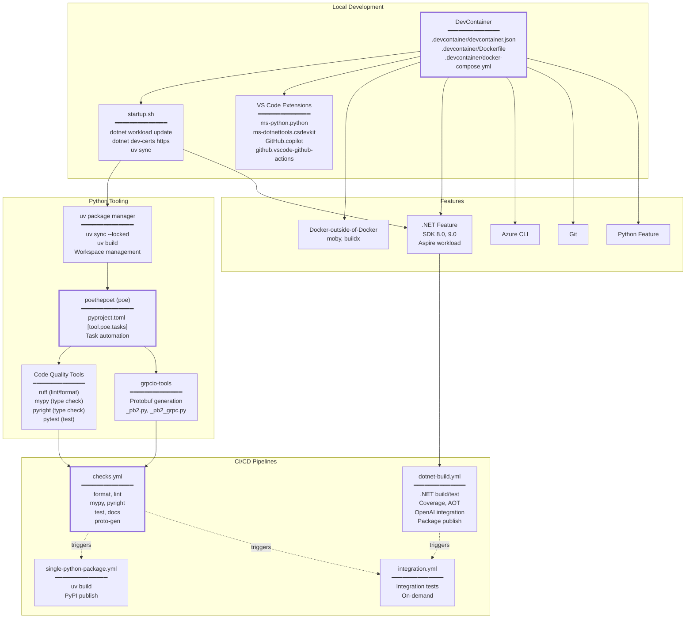
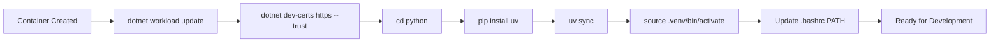
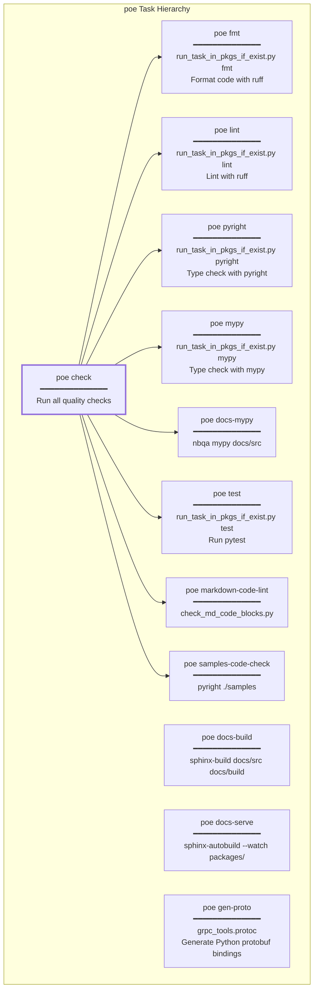

<!-- source: DeepWiki mcp.deepwiki.com · repo microsoft/autogen · page 9 Development Environment · fetched 2026-10-26 -->

# Development Environment

<details>
<summary>Relevant source files</summary>

The following files were used as context for generating this wiki page:

- [.devcontainer/Dockerfile](.devcontainer/Dockerfile)
- [.devcontainer/devcontainer.json](.devcontainer/devcontainer.json)
- [.devcontainer/docker-compose.yml](.devcontainer/docker-compose.yml)
- [.devcontainer/startup.sh](.devcontainer/startup.sh)
- [.github/workflows/checks.yml](.github/workflows/checks.yml)
- [.github/workflows/codeql.yml](.github/workflows/codeql.yml)
- [.github/workflows/dotnet-build.yml](.github/workflows/dotnet-build.yml)
- [.github/workflows/integration.yml](.github/workflows/integration.yml)
- [.github/workflows/single-python-package.yml](.github/workflows/single-python-package.yml)
- [python/.gitignore](python/.gitignore)
- [python/docs/src/conf.py](python/docs/src/conf.py)
- [python/packages/pyautogen/LICENSE-CODE](python/packages/pyautogen/LICENSE-CODE)
- [python/packages/pyautogen/README.md](python/packages/pyautogen/README.md)
- [python/packages/pyautogen/pyproject.toml](python/packages/pyautogen/pyproject.toml)
- [python/packages/pyautogen/src/pyautogen/__init__.py](python/packages/pyautogen/src/pyautogen/__init__.py)
- [python/pyproject.toml](python/pyproject.toml)

</details>


This document provides a comprehensive guide to the AutoGen repository's development environment, including workspace structure, containerized development setup, code quality tooling, and CI/CD pipelines. It is intended for developers contributing to the AutoGen codebase.

For detailed information about specific topics, see:
- Python workspace structure and tooling: [Python Workspace](#9.1)
- Development container configuration: [Development Containers](#9.2)
- CI/CD workflow details: [CI/CD Workflows](#9.3)

## Development Environment Overview

The AutoGen repository supports dual-platform development with parallel Python and .NET ecosystems. The development environment is standardized through a DevContainer configuration that provides consistent tooling across all contributors, including Docker, .NET SDK, Python with `uv` package manager, Azure CLI, and Git.

### Repository Structure

The repository is organized as a monorepo with separate directories for Python and .NET components:

```
autogen/
├── python/                    # Python monorepo workspace
│   ├── packages/             # Python packages (core, agentchat, ext, etc.)
│   ├── pyproject.toml        # Workspace-level configuration
│   └── uv.lock              # Locked dependencies
├── dotnet/                   # .NET SDK
│   └── src/                 # .NET source code
├── protos/                   # Shared protobuf definitions
├── .devcontainer/           # DevContainer configuration
└── .github/workflows/       # CI/CD workflows
```

**Sources:** [python/pyproject.toml:47-49]()

### Development Environment Architecture



**Sources:** [.devcontainer/devcontainer.json:1-48](), [.devcontainer/startup.sh:1-14](), [python/pyproject.toml:110-136]()

## DevContainer Configuration

The repository provides a fully-configured DevContainer for consistent development environments. The container is based on Ubuntu and includes all necessary tools for both Python and .NET development.

### Container Features

| Feature | Purpose | Configuration |
|---------|---------|---------------|
| `docker-outside-of-docker` | Docker access from container | Moby engine, Docker Buildx |
| `dotnet` | .NET SDK | Multi-version support (8.0, 9.0) |
| `dotnet-aspire-daily` | .NET Aspire workload | Latest daily build |
| `azure-cli` | Azure CLI tools | Azure resource management |
| `git` | Version control | Git operations |
| `python` | Python runtime | Python 3.10+ |
| `azd` | Azure Developer CLI | Azure deployment |

**Sources:** [.devcontainer/devcontainer.json:14-27]()

### Post-Creation Setup

The `startup.sh` script executes after container creation:



**Sources:** [.devcontainer/startup.sh:1-14](), [.devcontainer/devcontainer.json:32]()

### VS Code Integration

The DevContainer includes pre-configured VS Code extensions:

- `ms-python.python` - Python language support
- `ms-python.debugpy` - Python debugging
- `GitHub.copilot` - AI-powered code completion
- `ms-dotnettools.csdevkit` - C# development kit
- `ms-dotnettools.vscodeintellicode-csharp` - C# IntelliCode
- `github.vscode-github-actions` - GitHub Actions workflow integration

**Sources:** [.devcontainer/devcontainer.json:36-47]()

## Python Development Tooling

The Python workspace uses modern tooling for dependency management, code quality, and task automation. All configuration is centralized in `python/pyproject.toml`.

### Package Management with uv

The repository uses `uv` as its package manager, providing fast dependency resolution and workspace management:

```bash
# Sync all dependencies (install from lockfile)
uv sync --locked --all-extras

# Build a specific package
uv build --package autogen-core --out-dir dist/
```

The workspace is configured with members defined in [python/pyproject.toml:47-49]():

```toml
[tool.uv.workspace]
members = ["packages/*"]
exclude = ["packages/autogen-magentic-one"]
```

**Sources:** [python/pyproject.toml:40-60](), [.github/workflows/checks.yml:24]()

### Code Quality Tools

| Tool | Version | Purpose | Configuration |
|------|---------|---------|---------------|
| `ruff` | 0.4.8 | Linting and formatting | [python/pyproject.toml:61-79]() |
| `mypy` | 1.13.0 | Type checking | [python/pyproject.toml:81-97]() |
| `pyright` | 1.1.389 | Type checking | [python/pyproject.toml:98-103]() |
| `pytest` | Latest | Testing framework | [python/pyproject.toml:144-147]() |

**Sources:** [python/pyproject.toml:1-38]()

### Task Automation with poe

The `poethepoet` task runner (invoked as `poe`) provides a consistent interface for development tasks:



**Sources:** [python/pyproject.toml:110-136]()

### Protobuf Generation

The repository uses `grpcio-tools` to generate Python bindings from protobuf definitions shared between Python and .NET:

```bash
poe gen-proto
```

This executes [python/pyproject.toml:130-133](), generating files:
- `*_pb2.py` - Message classes
- `*_pb2_grpc.py` - gRPC service stubs
- `*_pb2.pyi` - Type stubs for mypy
- `*_pb2_grpc.pyi` - gRPC type stubs

Generated files are placed in `packages/autogen-ext/src/autogen_ext/runtimes/grpc/protos/`.

**Sources:** [python/pyproject.toml:130-136]()

## CI/CD Pipeline

The repository uses GitHub Actions for continuous integration and deployment. The pipeline enforces code quality, runs tests, builds documentation, and publishes packages.

### CI/CD Workflow Structure

```mermaid
graph TB
    subgraph "Trigger Events"
        Push["Push to main/staging"]
        PR["Pull Request"]
        Manual["workflow_dispatch"]
        Schedule["Scheduled (CodeQL)"]
    end
    
    subgraph "checks.yml Jobs"
        Format["format<br/>━━━━━━━━━━━━━━<br/>poe fmt --check"]
        
        Lint["lint<br/>━━━━━━━━━━━━━━<br/>poe lint"]
        
        MypyMatrix["mypy (matrix)<br/>━━━━━━━━━━━━━━<br/>Per-package type check<br/>5 packages"]
        
        PyrightMatrix["pyright (matrix)<br/>━━━━━━━━━━━━━━<br/>Per-package type check<br/>5 packages"]
        
        TestMatrix["test (matrix)<br/>━━━━━━━━━━━━━━<br/>pytest with coverage<br/>3 packages"]
        
        TestGRPC["test-grpc<br/>━━━━━━━━━━━━━━<br/>gRPC-specific tests<br/>autogen-ext"]
        
        TestWindows["test-autogen-ext-pwsh<br/>━━━━━━━━━━━━━━<br/>Windows tests<br/>PowerShell"]
        
        DocsCheck["docs<br/>━━━━━━━━━━━━━━<br/>poe docs-check<br/>Sphinx build"]
        
        DocsExamples["docs-example-check<br/>━━━━━━━━━━━━━━<br/>poe docs-check-examples"]
        
        SamplesCheck["samples-code-check<br/>━━━━━━━━━━━━━━<br/>poe samples-code-check"]
        
        MarkdownCheck["markdown-code-lint<br/>━━━━━━━━━━━━━━<br/>poe markdown-code-lint"]
        
        ProtoCheck["check-proto-changes-python<br/>━━━━━━━━━━━━━━<br/>poe gen-proto<br/>Verify uncommitted changes"]
        
        CodeCov["codecov<br/>━━━━━━━━━━━━━━<br/>Upload coverage reports<br/>Needs: test, test-grpc"]
    end
    
    subgraph "dotnet-build.yml Jobs"
        PathsFilter["paths-filter<br/>━━━━━━━━━━━━━━<br/>Check for dotnet/ changes"]
        
        DotNetBuild["build (matrix)<br/>━━━━━━━━━━━━━━<br/>Ubuntu, macos-latest<br/>dotnet format, build, test"]
        
        IntegrationTest["integration-test<br/>━━━━━━━━━━━━━━<br/>.NET integration tests<br/>Aspire workload"]
        
        AOTTest["aot-test<br/>━━━━━━━━━━━━━━<br/>AOT compatibility check"]
        
        OpenAITest["openai-test<br/>━━━━━━━━━━━━━━<br/>OpenAI integration<br/>main branch only"]
        
        Publish["publish<br/>━━━━━━━━━━━━━━<br/>Azure DevOps, GitHub, MyGet<br/>Needs: openai-test"]
    end
    
    subgraph "Deployment"
        SinglePackage["single-python-package.yml<br/>━━━━━━━━━━━━━━<br/>workflow_dispatch<br/>uv build + PyPI publish"]
        
        IntegrationManual["integration.yml<br/>━━━━━━━━━━━━━━<br/>Manual integration tests<br/>workflow_dispatch"]
    end
    
    Push --> Format
    Push --> Lint
    Push --> MypyMatrix
    Push --> PyrightMatrix
    Push --> TestMatrix
    Push --> TestGRPC
    Push --> TestWindows
    Push --> DocsCheck
    Push --> DocsExamples
    Push --> SamplesCheck
    Push --> MarkdownCheck
    Push --> ProtoCheck
    
    PR --> Format
    PR --> Lint
    PR --> MypyMatrix
    PR --> PyrightMatrix
    PR --> TestMatrix
    PR --> TestGRPC
    PR --> TestWindows
    PR --> DocsCheck
    PR --> DocsExamples
    PR --> SamplesCheck
    PR --> MarkdownCheck
    PR --> ProtoCheck
    
    TestMatrix --> CodeCov
    TestGRPC --> CodeCov
    
    Push --> PathsFilter
    PR --> PathsFilter
    PathsFilter --> DotNetBuild
    DotNetBuild --> IntegrationTest
    DotNetBuild --> AOTTest
    AOTTest --> OpenAITest
    OpenAITest --> Publish
    
    Manual --> SinglePackage
    Manual --> IntegrationManual
    
    style Format stroke-width:3px
    style DotNetBuild stroke-width:3px
    style CodeCov stroke-width:2px
```



**Sources:** [.github/workflows/checks.yml:1-359](), [.github/workflows/dotnet-build.yml:1-348]()

### checks.yml: Python Quality Gates

The primary Python CI workflow runs on every push and pull request:

| Job | Purpose | Runs On | Key Commands |
|-----|---------|---------|--------------|
| `format` | Code formatting verification | ubuntu-latest | `poe fmt --check` |
| `lint` | Ruff linting | ubuntu-latest | `poe lint` |
| `mypy` | Type checking (mypy) | ubuntu-latest | `poe --directory $package mypy` (matrix: 5 packages) |
| `pyright` | Type checking (pyright) | ubuntu-latest | `poe --directory $package pyright` (matrix: 5 packages) |
| `test` | Unit tests with coverage | ubuntu-latest | `poe --directory $package test` (matrix: 3 packages) |
| `test-grpc` | gRPC-specific tests | ubuntu-latest | `poe --directory ./packages/autogen-ext test-grpc` |
| `test-autogen-ext-pwsh` | Windows compatibility tests | windows-latest | `poe --directory ./packages/autogen-ext test-windows` |
| `docs` | Documentation build | ubuntu-latest | `poe docs-check` |
| `docs-example-check` | Documentation examples | ubuntu-latest | `poe docs-check-examples` |
| `samples-code-check` | Sample code type check | ubuntu-latest | `poe samples-code-check` |
| `markdown-code-lint` | Markdown code blocks | ubuntu-latest | `poe markdown-code-lint` |
| `check-proto-changes-python` | Protobuf generation | ubuntu-latest | `poe gen-proto`, `poe gen-test-proto` |
| `codecov` | Upload coverage reports | ubuntu-latest | Aggregates coverage from test jobs |

**Sources:** [.github/workflows/checks.yml:14-262]()

### dotnet-build.yml: .NET Build Pipeline

The .NET workflow includes build, test, and publish stages:

| Job | Purpose | Runs On | Key Commands |
|-----|---------|---------|--------------|
| `paths-filter` | Skip if no .NET changes | ubuntu-latest | `dorny/paths-filter` |
| `build` | Build and unit test | ubuntu-latest, macos-latest | `dotnet format --verify-no-changes`, `dotnet build`, `dotnet test` |
| `integration-test` | Integration tests | ubuntu-latest | `dotnet test --filter "Category=Integration"` |
| `aot-test` | AOT compatibility | ubuntu-latest | `.tools/test-aot-compatibility.ps1` |
| `openai-test` | OpenAI integration | ubuntu-latest | `dotnet test` (main branch only) |
| `publish` | Package publish | ubuntu-latest | `dotnet pack`, publish to Azure DevOps/GitHub/MyGet |

**Sources:** [.github/workflows/dotnet-build.yml:50-347]()

### Deployment Workflows

**single-python-package.yml**

Manual workflow for deploying individual Python packages to PyPI:

1. Select package from dropdown: `autogen-agentchat`, `autogen-core`, `autogen-ext`, `agbench`, `autogen-studio`, `magentic-one-cli`, `pyautogen`
2. Specify Git tag
3. Workflow executes: `uv build --package $package --out-dir dist/`
4. Publishes to PyPI using trusted publishing (OIDC)

**Sources:** [.github/workflows/single-python-package.yml:1-45]()

**integration.yml**

Manual workflow for running integration tests against a specific branch:

- Accepts branch name input
- Runs full test suite with `poe test` for each package
- Uploads coverage artifacts

**Sources:** [.github/workflows/integration.yml:1-55]()

## Development Workflow

### Setting Up the Environment

1. **Clone the repository:**
   ```bash
   git clone https://github.com/microsoft/autogen.git
   cd autogen
   ```

2. **Open in DevContainer:**
   - VS Code: "Reopen in Container" prompt or Command Palette → "Dev Containers: Reopen in Container"
   - GitHub Codespaces: Create codespace from repository

3. **Verify setup:**
   ```bash
   # Python environment should be activated automatically
   python --version  # Should be 3.10+
   uv --version
   poe --version
   
   # .NET should be available
   dotnet --version  # Should be 8.0.x or 9.0.x
   ```

**Sources:** [.devcontainer/startup.sh:1-14]()

### Running Code Quality Checks

```bash
# Navigate to Python workspace
cd python

# Run all checks (same as CI)
poe check

# Run individual checks
poe fmt          # Format code
poe lint         # Lint code
poe mypy         # Type check with mypy
poe pyright      # Type check with pyright
poe test         # Run tests

# Build documentation
poe docs-build
poe docs-serve   # Live-reloading local server
```

**Sources:** [python/pyproject.toml:110-129]()

### Testing Changes

```bash
# Test a specific package
cd packages/autogen-core
poe test

# Test with coverage
poe test  # Coverage automatically included

# Test on Windows (in DevContainer)
cd packages/autogen-ext
poe test-windows

# Test gRPC functionality
cd packages/autogen-ext
poe test-grpc
```

**Sources:** [.github/workflows/checks.yml:124-195]()

### Building Packages

```bash
# Build a single package
cd python
uv build --package autogen-core --out-dir dist/

# Build all packages
for pkg in autogen-core autogen-agentchat autogen-ext; do
    uv build --package $pkg --out-dir dist/
done
```

**Sources:** [.github/workflows/single-python-package.yml:39]()

### Generating Protobuf Bindings

When modifying `.proto` files in `protos/`:

```bash
cd python

# Generate Python bindings
poe gen-proto

# Generate test proto bindings
poe gen-test-proto

# Verify no uncommitted changes (CI check)
git status packages/autogen-ext/src/autogen_ext/runtimes/grpc/protos/
```

**Sources:** [python/pyproject.toml:130-143](), [.github/workflows/checks.yml:335-359]()

### .NET Development

```bash
cd dotnet

# Restore dependencies
dotnet restore

# Format code
dotnet format

# Build
dotnet build --configuration Release

# Run tests
dotnet test --filter "Category=UnitV2"
dotnet test --filter "Category=Integration"

# Install dev certificates for gRPC
dotnet dev-certs https --trust
```

**Sources:** [.github/workflows/dotnet-build.yml:88-107]()

## Troubleshooting

### Common Issues

**Issue: `uv sync` fails with dependency conflicts**
```bash
# Solution: Update lockfile
uv lock --upgrade
uv sync --locked
```

**Issue: Pyright/Mypy type errors in generated protobuf files**
```bash
# Solution: Regenerate protobuf bindings
poe gen-proto
```

**Issue: Docker not available in DevContainer**
```bash
# Solution: Ensure Docker Desktop is running on host
# Verify Docker socket mount in .devcontainer/docker-compose.yml
docker ps  # Should work inside container
```

**Sources:** [.devcontainer/docker-compose.yml:9-11]()

**Issue: .NET tests fail with certificate errors**
```bash
# Solution: Trust dev certificates
dotnet dev-certs https --clean
dotnet dev-certs https --trust
```

**Sources:** [.devcontainer/startup.sh:5](), [.github/workflows/dotnet-build.yml:104]()

**Issue: CI checks fail but local checks pass**
```bash
# Solution: Ensure using same versions as CI
# Check versions in pyproject.toml [dependency-groups.dev]
# Python version: 3.11 (as used in CI)
python --version
```

**Sources:** [python/pyproject.toml:2-6](), [.github/workflows/checks.yml:22-23]()

---

