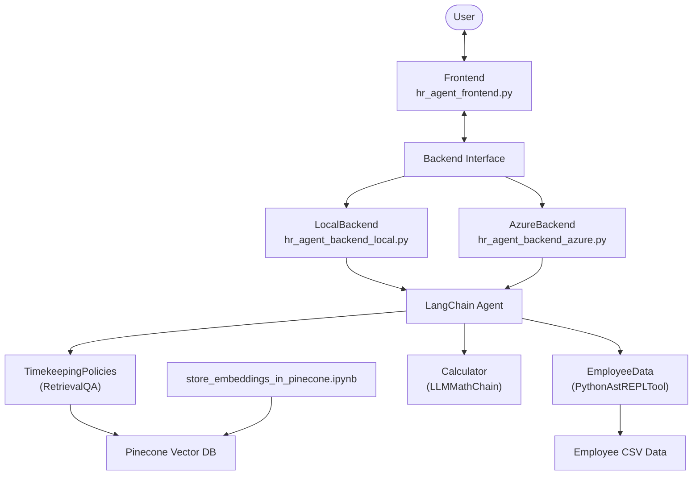
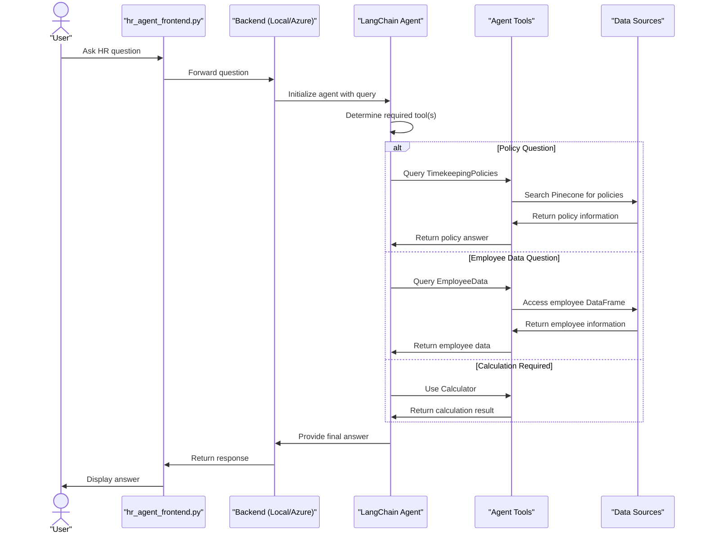
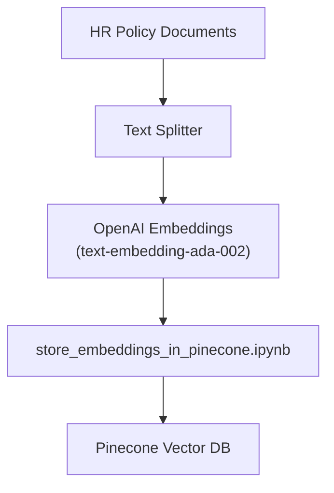

<!-- source: DeepWiki mcp.deepwiki.com · repo stepanogil/autonomous-hr-chatbot · page 1 Overview · fetched 2026-10-26 -->

# Overview

Relevant source files

The following files were used as context for generating this wiki page:

- [README.md](README.md)
- [requirements.txt](requirements.txt)

This document provides a high-level overview of the Autonomous HR Chatbot system, which is designed to answer HR-related queries by utilizing large language models (LLMs) and specialized tools. The system can interpret natural language questions, retrieve relevant information from HR policies, access employee data, and perform calculations to provide accurate responses without human intervention.

For detailed information about system implementation, see [System Architecture](#2). For deployment instructions, refer to the [Deployment Guide](#5).

## System Architecture

The following diagram illustrates the high-level architecture of the Autonomous HR Chatbot system and how it maps to the actual codebase:

### System Components Diagram

Sources: [README.md:10-17]()

## Key Components

### Frontend

The system uses a Streamlit-based chat interface implemented in `hr_agent_frontend.py` that provides users with a simple way to interact with the HR chatbot. It leverages the `streamlit_chat` component to render conversations in a familiar chat format.

### Backend Implementations

The system supports two deployment options through different backend implementations:

1. **Local Backend** (`hr_agent_backend_local.py`): Connects directly to the OpenAI API for local deployment
2. **Azure Backend** (`hr_agent_backend_azure.py`): Integrates with Azure OpenAI Service for cloud deployment

Both implementations use LangChain's agent framework to orchestrate interactions between the language model and various tools.

### Agent Tools

The HR chatbot comes equipped with three specialized tools:

| Tool | Implementation | Purpose | Data Source |
|------|---------------|---------|------------|
| Timekeeping Policies | `RetrievalQA` | Retrieves HR policy information | Pinecone Vector DB |
| Employee Data | `PythonAstREPLTool` | Accesses employee information | CSV file as Pandas DataFrame |
| Calculator | `LLMMathChain` | Performs mathematical calculations | N/A |

Sources: [README.md:14-17]()

## Data Flow

### Interaction Flow Diagram

Sources: [README.md:10-17]()

## Data Preparation

### Document Processing Pipeline

Before using the system, HR policy documents must be processed and stored in the Pinecone vector database. The repository includes a Jupyter notebook (`store_embeddings_in_pinecone.ipynb`) that handles this process by:
1. Splitting documents into smaller chunks
2. Creating embeddings using OpenAI's `text-embedding-ada-002` model
3. Storing these embeddings in Pinecone for semantic search

Employee data is managed through a CSV file containing dummy employee information, which is loaded as a pandas DataFrame at runtime.

Sources: [README.md:37-41]()

## Technical Stack

The Autonomous HR Chatbot is built using the following technologies:

| Component | Technology | Purpose |
|-----------|------------|---------|
| Language Model | `gpt-3.5-turbo` / Azure OpenAI | Natural language processing |
| Framework | `langchain==0.0.220` | LLM application orchestration |
| Vector Database | `pinecone-client==2.2.2` | Storing document embeddings |
| Frontend | `streamlit==1.24.0`, `streamlit-chat==0.1.1` | User interface |
| Data Manipulation | `pandas==2.0.3` | Employee data processing |
| Embeddings | `text-embedding-ada-002` | Text vectorization |
| Cloud Services (Optional) | Azure OpenAI, Azure Data Lake, Azure Data Factory | Cloud deployment components |

Sources: [README.md:43-53](), [requirements.txt:1-103]()

## Use Cases

The HR chatbot can handle various HR-related queries, including:

1. **Policy Questions**: "What is the company policy on remote work?"
2. **Employee Data Queries**: "How many vacation days does John Smith have left?"
3. **Calculations**: "If I take 3 days off in July, how many vacation days will I have remaining?"

The system autonomously determines which tools to use based on the user's question, providing a seamless experience that combines the language understanding capabilities of LLMs with access to structured data and policies.

Sources: [README.md:10-17]()

## Related Documentation

- For detailed system architecture: [System Architecture](#2)
- For information about agent tools: [Agent Tools and Capabilities](#3)
- For data processing details: [Data Processing Pipeline](#4)
- For deployment instructions: [Deployment Guide](#5)
- For development guidelines: [Development and Contribution Guide](#6)

---

