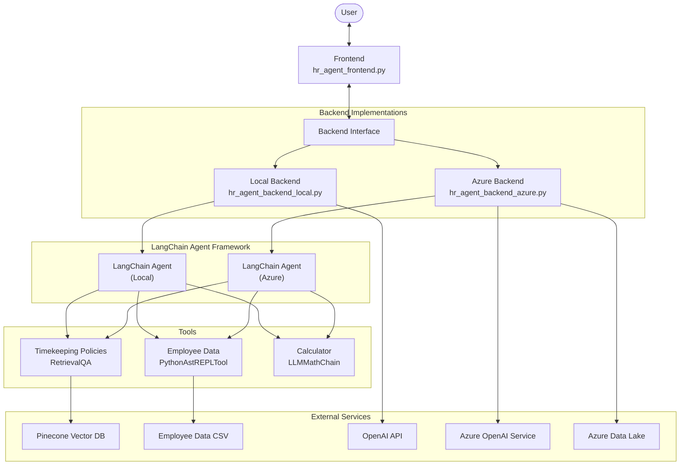
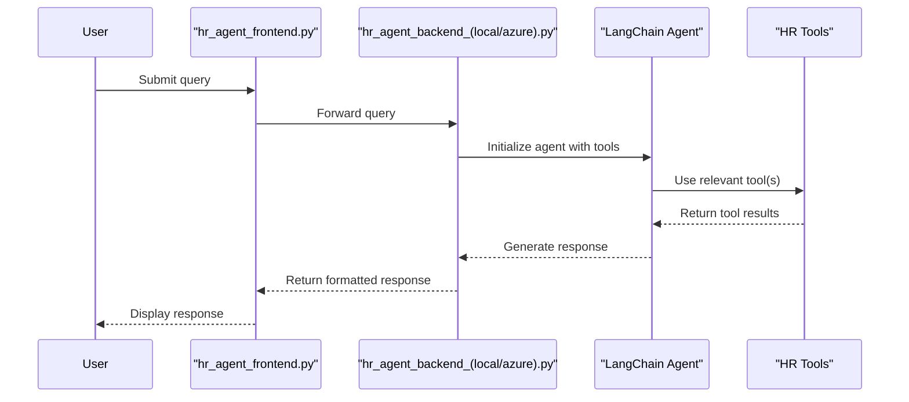
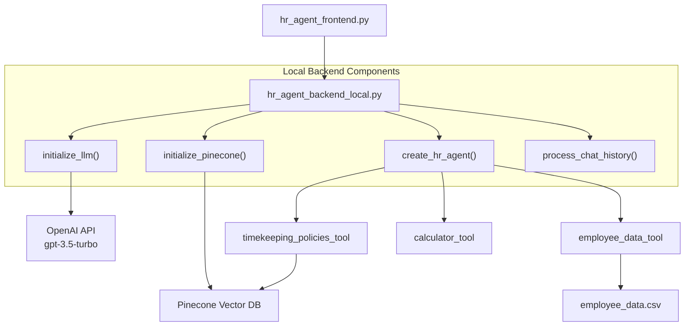
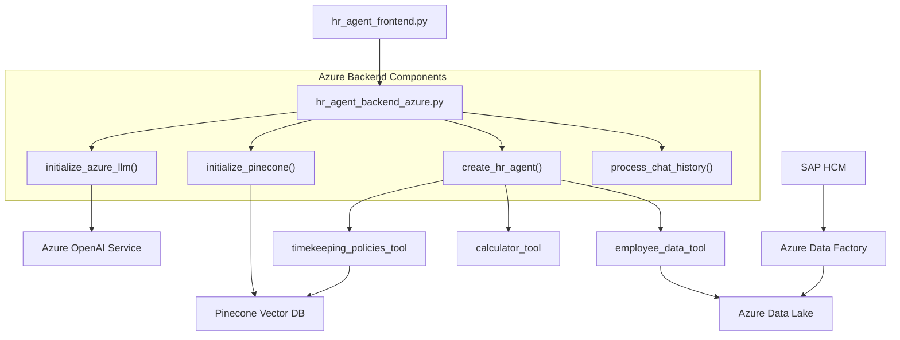
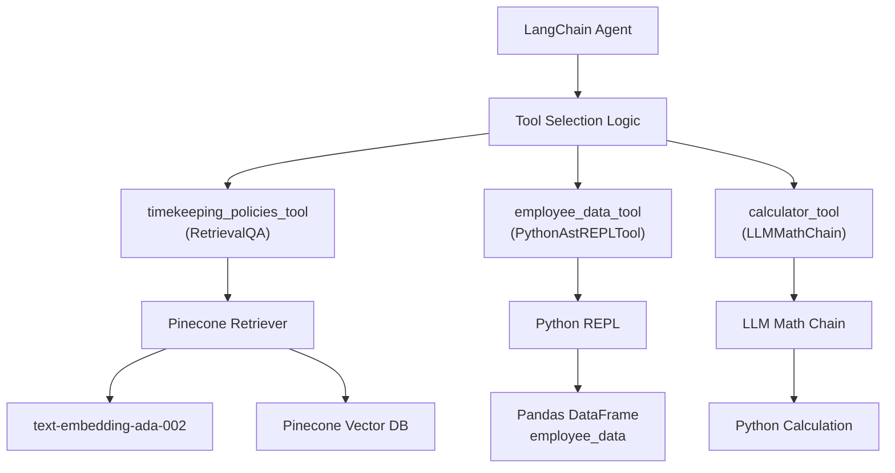
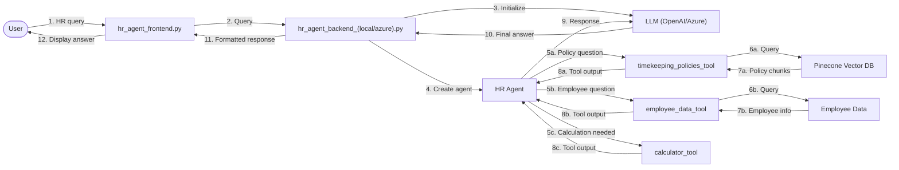
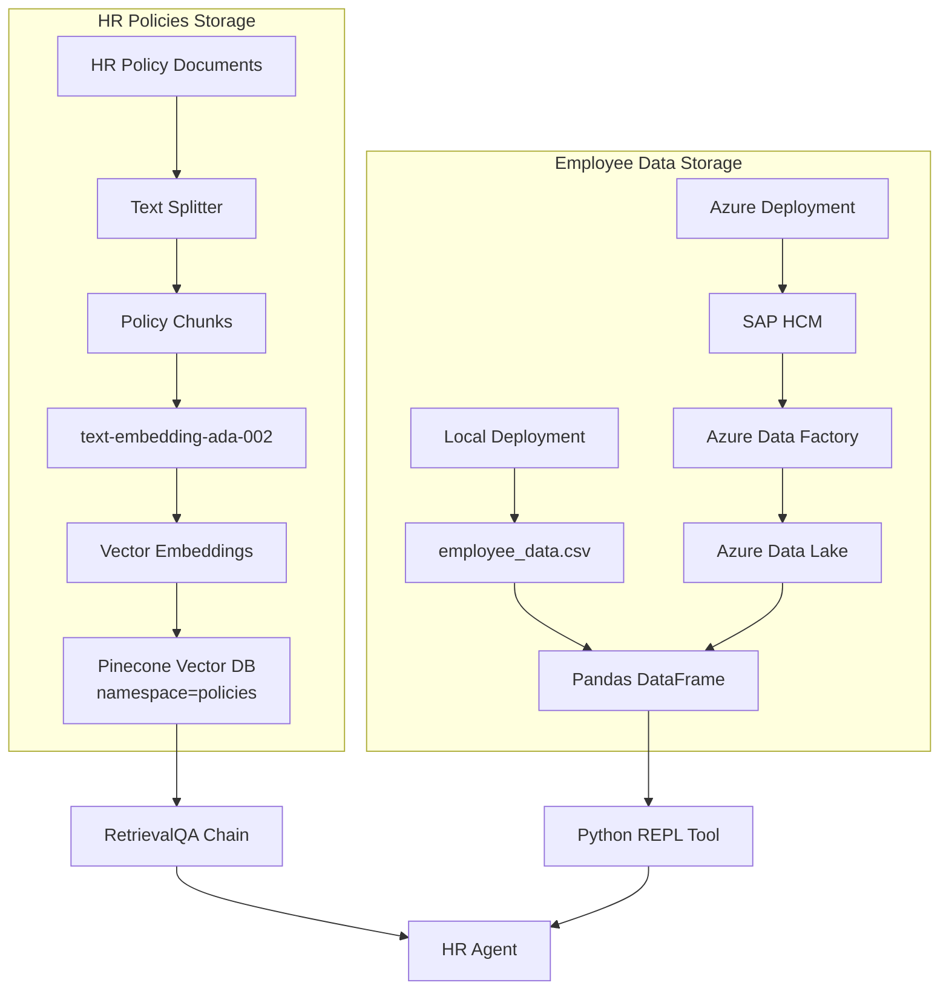
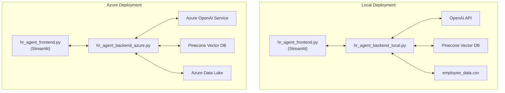

<!-- source: DeepWiki mcp.deepwiki.com · repo stepanogil/autonomous-hr-chatbot · page 2 System Architecture · fetched 2026-10-26 -->

# System Architecture

Relevant source files

The following files were used as context for generating this wiki page:

- [README.md](README.md)

This document describes the high-level architecture of the Autonomous HR Chatbot system, including its major components, their interactions, and deployment options. This architecture enables the HR chatbot to answer employee questions by leveraging language models, specialized tools, and structured data sources.

For implementation details of specific components, see [Frontend Implementation](#2.1), [Backend Implementation](#2.2), and [Agent Tools and Capabilities](#3).

## System Overview

The Autonomous HR Chatbot is built with a modular architecture that separates the user interface from backend processing logic. The system uses LangChain's agent framework to orchestrate language models and specialized tools that access HR policies, employee data, and perform calculations.

Sources: [README.md:11-18](), [hr_agent_frontend.py](), [hr_agent_backend_local.py](), [hr_agent_backend_azure.py]()

## Core Components

The system consists of the following major components:

| Component | Implementation | Purpose |
|-----------|---------------|---------|
| Frontend | Streamlit-based UI | Provides chat interface for user interaction |
| Backend | Local or Azure implementations | Processes user queries and manages agent interactions |
| Agent Framework | LangChain | Orchestrates tools and language model responses |
| Language Model | OpenAI or Azure OpenAI | Generates responses and reasons about user queries |
| Tools | RetrievalQA, PythonAstREPLTool, LLMMathChain | Provides access to policies, employee data, and calculations |
| Vector Database | Pinecone | Stores and retrieves HR policy embeddings |
| Data Storage | CSV/Azure Data Lake | Stores employee information |

Sources: [README.md:11-18](), [README.md:44-53]()

## Component Interactions

The following diagram illustrates how components interact during a typical user query:

Sources: [hr_agent_frontend.py](), [hr_agent_backend_local.py](), [hr_agent_backend_azure.py]()

## Backend Implementations

The system supports two backend implementations that share the same interface but differ in their external integrations:

### Local Backend Architecture

Sources: [hr_agent_backend_local.py](), [README.md:34]()

### Azure Backend Architecture

Sources: [hr_agent_backend_azure.py](), [README.md:51-53]()

For detailed information about each backend implementation, see [Local Backend](#2.2.1) and [Azure Backend](#2.2.2).

## Tools Architecture

The HR Agent uses three specialized tools integrated through LangChain's agent framework:

Sources: [README.md:14-17](), [hr_agent_backend_local.py]()

For more information on the tools and their capabilities, see [Agent Tools and Capabilities](#3).

## Data Flow Architecture

The following diagram illustrates how data flows through the system during a typical user interaction:

Sources: [hr_agent_frontend.py](), [hr_agent_backend_local.py](), [hr_agent_backend_azure.py]()

## Data Storage Architecture

The system uses different storage solutions for different types of data:

Sources: [README.md:14-17](), [README.md:37-41](), [README.md:51-53]()

For detailed information about data processing and storage, see [Data Processing Pipeline](#4).

## Deployment Options

The system supports two primary deployment scenarios:

Sources: [README.md:44-53](), [README.md:29-36]()

For detailed deployment instructions, see [Deployment Guide](#5), including [Local Deployment](#5.1) and [Azure Deployment](#5.2).

## Technical Dependencies

The system relies on the following key technologies:

| Technology | Purpose | Used In |
|------------|---------|---------|
| Streamlit | User interface framework | Frontend |
| streamlit_chat | Chat component | Frontend |
| LangChain | Agent framework | Backend |
| OpenAI/Azure OpenAI | Language model provider | Backend |
| Pinecone | Vector database | Backend/Tools |
| Pandas | Data manipulation | Tools/Employee Data |
| Python 3.10+ | Runtime environment | All components |

Sources: [README.md:44-53]()

## Summary

The Autonomous HR Chatbot architecture is designed with modularity and flexibility in mind, allowing for both local and cloud-based deployment options while maintaining consistent functionality. The system integrates language models with specialized tools to provide contextually relevant responses to HR queries by accessing policies, employee data, and performing calculations as needed.

For implementation details about specific components, please refer to the linked wiki pages for each subsystem.

---

