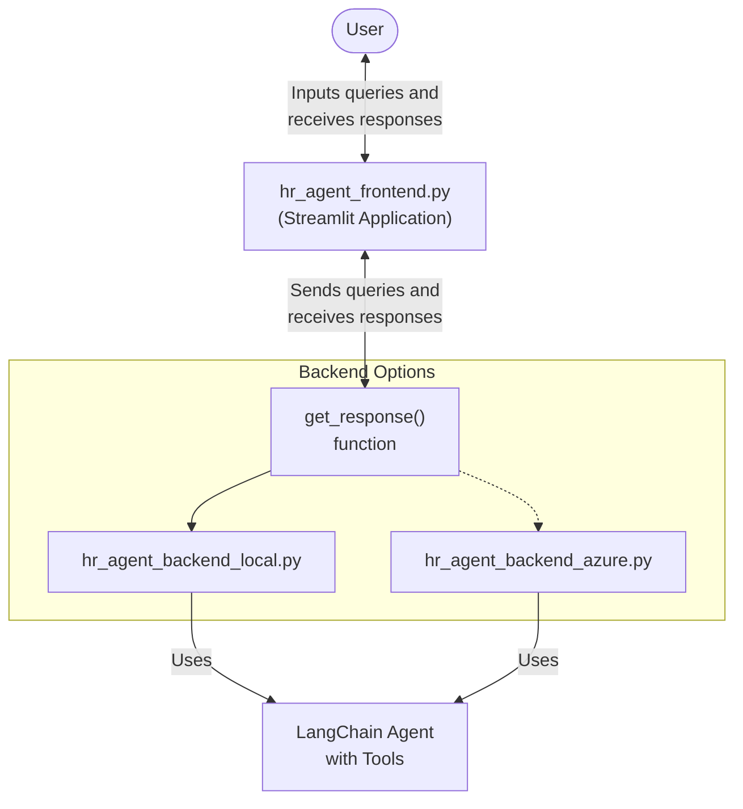
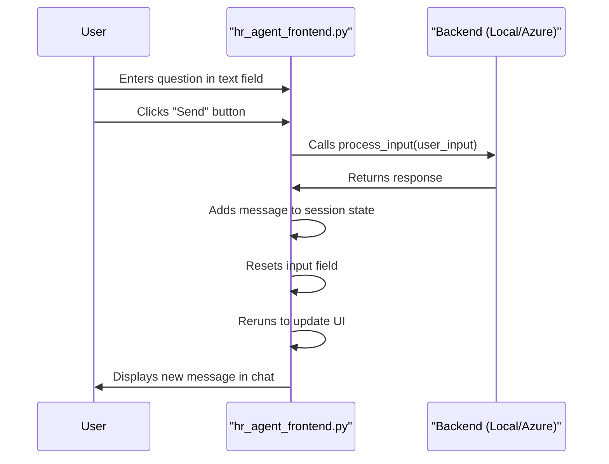
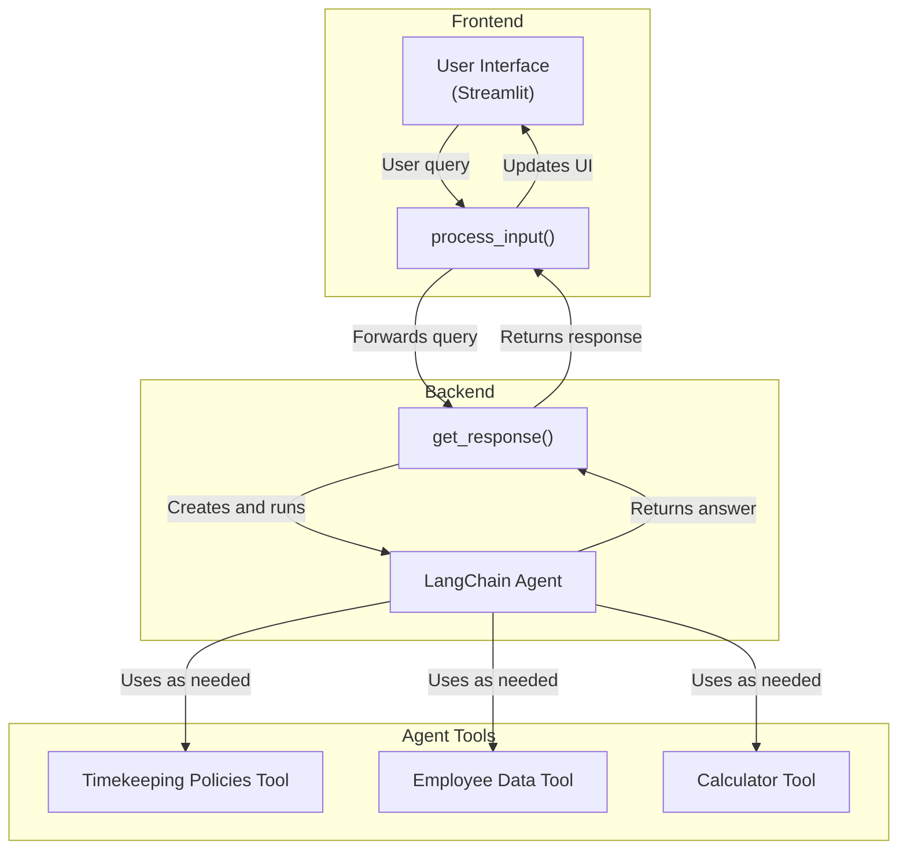

<!-- source: DeepWiki mcp.deepwiki.com · repo stepanogil/autonomous-hr-chatbot · page 2.1 Frontend Implementation · fetched 2026-10-26 -->

# Frontend Implementation

<details>
<summary>Relevant source files</summary>

The following files were used as context for generating this wiki page:

- [README.md](README.md)
- [hr_agent_frontend.py](hr_agent_frontend.py)

</details>


## Purpose and Scope

This document details the frontend implementation of the Autonomous HR Chatbot system, which provides the user interface for interacting with the HR agent. The frontend is built using Streamlit and the streamlit_chat component to create a simple yet effective chat interface. For information about the backend implementation that processes the user queries, see [Backend Implementation](#2.2).

## Component Overview

The frontend serves as the entry point for user interaction with the HR chatbot system. It handles user input, displays chat messages, and communicates with the backend to process HR-related queries.



Sources: [hr_agent_frontend.py:1-5]()

## Frontend Implementation Details

The frontend is implemented in a single Python file (`hr_agent_frontend.py`) using Streamlit, a Python library for creating web applications. The implementation focuses on simplicity and user experience.

### Key Components and Libraries

- **Streamlit**: The core framework used to build the web interface
- **streamlit_chat**: A component that provides styled chat message bubbles
- **Backend connector**: Imports the `get_response` function from either the local or Azure backend

```mermaid
classDiagram
    class "StreamlitApp" {
        +session_state
        +process_input(user_input)
        +display_messages()
    }
    
    class "BackendConnector" {
        +get_response(user_input)
    }
    
    class "StreamlitChat" {
        +message(text, is_user, key)
    }
    
    "StreamlitApp" --> "BackendConnector" : uses
    "StreamlitApp" --> "StreamlitChat" : uses for display
```

Sources: [hr_agent_frontend.py:1-5](), [README.md:11-13]()

### User Interface Structure

The frontend presents a simple chat interface with:
- A header and introductory text
- A text input field for users to type their queries
- A "Send" button to submit queries
- A chat container displaying the conversation history with distinct styling for user and bot messages

Sources: [hr_agent_frontend.py:12-14](), [hr_agent_frontend.py:23-25](), [hr_agent_frontend.py:37-41]()

### Session State Management

Streamlit's session state is used to maintain the conversation history across user interactions:

- `st.session_state["past"]`: Stores the history of user messages
- `st.session_state["generated"]`: Stores the history of bot responses
- `st.session_state["input_message_key"]`: Manages the text input field's state

This state management ensures that the conversation persists even when the Streamlit app reruns.

Sources: [hr_agent_frontend.py:15-21](), [hr_agent_frontend.py:30-33]()

## User Interaction Flow

The following diagram illustrates the sequence of events when a user interacts with the frontend:



Sources: [hr_agent_frontend.py:27-35]()

## Code Implementation Details

### Input Processing

When a user submits a message, the following process occurs:

1. The `process_input` function is called with the user input
2. This function calls `get_response` from the backend implementation
3. The response is returned to the main application flow

```python
def process_input(user_input):
    response = get_response(user_input)
    return response
```

Sources: [hr_agent_frontend.py:8-10]()

### Message Display

The frontend uses the `streamlit_chat` component's `message` function to display messages with appropriate styling:

1. User messages are displayed with `is_user=True`
2. Bot responses are displayed with default styling
3. Each message is given a unique key to prevent rendering issues

Sources: [hr_agent_frontend.py:37-41]()

## Configuration Options

The frontend allows for switching between different backend implementations by commenting/uncommenting the relevant import statements:

```python
#from hr_agent_backend_azure import get_response
from hr_agent_backend_local import get_response
```

By default, the local backend is used, but developers can switch to the Azure backend by changing which import line is commented out.

Sources: [hr_agent_frontend.py:4-5]()

## Frontend-Backend Integration

The following diagram shows how the frontend's `process_input` function connects to the backend services and tools:



Sources: [hr_agent_frontend.py:8-10](), [README.md:14-17]()

## Sample User Experience

The frontend provides a clean chat interface similar to popular messaging applications. Users can:

1. Type their HR-related questions in the text input field
2. Submit questions by clicking the "Send" button
3. View the conversation history with distinct styling for user and bot messages
4. Ask follow-up questions in the same session

The README provides sample screenshots demonstrating the chat interface and the bot's use of tools to answer questions.

Sources: [README.md:19-25](), [hr_agent_frontend.py:12-14](), [hr_agent_frontend.py:37-41]()

## Deployment

To run the frontend application, users execute the Streamlit command:

```
streamlit run hr_agent_frontend.py
```

This launches a local web server that hosts the application, accessible via a web browser.

Sources: [README.md:35]()

---

