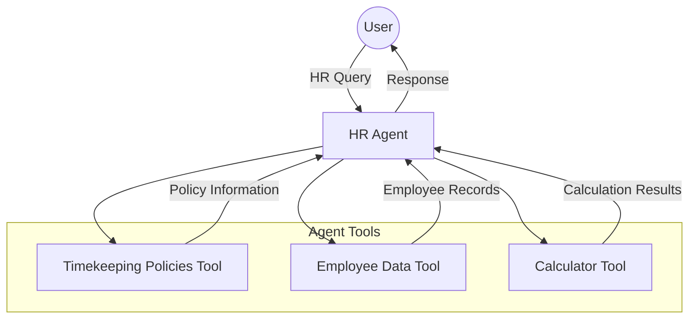
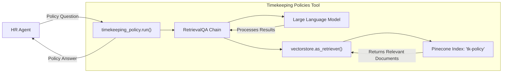
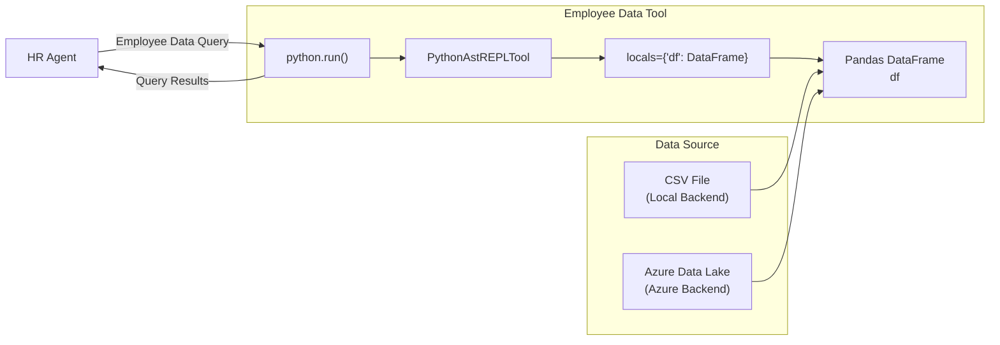
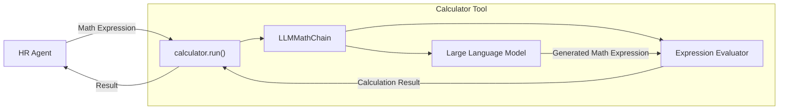
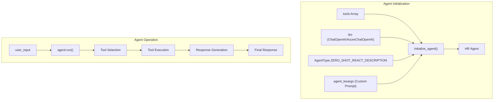

<!-- source: DeepWiki mcp.deepwiki.com · repo stepanogil/autonomous-hr-chatbot · page 3 Agent Tools and Capabilities · fetched 2026-10-26 -->

# Agent Tools and Capabilities

<details>
<summary>Relevant source files</summary>

The following files were used as context for generating this wiki page:

- [README.md](README.md)
- [hr-agent-code-jupyter-notebook.ipynb](hr-agent-code-jupyter-notebook.ipynb)
- [hr_agent_backend_azure.py](hr_agent_backend_azure.py)
- [hr_agent_backend_local.py](hr_agent_backend_local.py)

</details>


## Purpose and Scope

This document details the tools available to the Autonomous HR Chatbot agent and explains how these tools work together to provide comprehensive HR assistance. It covers the implementation, functionality, and integration of each tool within the agent framework. For information on the overall system architecture, see [System Architecture](#2).

## Overview of Agent Tools

The Autonomous HR Chatbot is equipped with three specialized tools that allow it to perform a variety of HR-related tasks:

1. **Timekeeping Policies Tool** - Retrieves and provides information from HR policy documents
2. **Employee Data Tool** - Accesses and manipulates employee information
3. **Calculator Tool** - Performs mathematical calculations for payroll and leave-related queries

These tools work together within a LangChain agent framework to enable the HR chatbot to respond intelligently to user queries.



Sources: [hr_agent_backend_local.py:61-95](), [hr_agent_backend_azure.py:86-120](), [README.md:14-17]()

## Tool Implementation and Configuration

Each tool is implemented as a LangChain `Tool` object that wraps around specific functionality. The tools are configured in both local and Azure backend implementations.

```mermaid
classDiagram
    class Tool {
        +name: string
        +func: callable
        +description: string
    }
    
    class "RetrievalQA" {
        +run(query)
    }
    
    class "PythonAstREPLTool" {
        +run(code)
    }
    
    class "LLMMathChain" {
        +run(expression)
    }
    
    Tool "1" *-- "1" "RetrievalQA": Timekeeping Policies
    Tool "1" *-- "1" "PythonAstREPLTool": Employee Data
    Tool "1" *-- "1" "LLMMathChain": Calculator
```

Sources: [hr_agent_backend_local.py:61-95](), [hr_agent_backend_azure.py:86-120]()

### Tools Configuration Code

Tools are initialized with a name, function, and description that helps the agent understand when and how to use each tool. Below are the key components of each tool's initialization:

1. **Timekeeping Policies Tool**:
   - Uses a RetrievalQA chain to access HR policy information
   - Connected to Pinecone vector database for semantic search

2. **Employee Data Tool**:
   - Uses PythonAstREPLTool to run Python code against a pandas DataFrame
   - Provides access to employee records through Python's data manipulation capabilities

3. **Calculator Tool**:
   - Uses LLMMathChain for handling mathematical expressions
   - Supports arithmetic operations for leave calculations, salary computations, etc.

Sources: [hr_agent_backend_local.py:43-54](), [hr_agent_backend_azure.py:52-78]()

## Timekeeping Policies Tool

The Timekeeping Policies Tool enables the agent to retrieve relevant information from HR policy documents using semantic search.

### Implementation Details

The tool is implemented as a RetrievalQA chain that connects to a Pinecone vector database containing embeddings of HR policy documents.



Sources: [hr_agent_backend_local.py:43-47](), [hr_agent_backend_azure.py:52-56]()

### Function and Usage

When the agent identifies a query about HR policies, it invokes the Timekeeping Policies Tool. The tool:

1. Takes the query string as input
2. Uses the embedded query to search for relevant passages in the Pinecone vector database
3. Retrieves the most relevant policy information
4. Uses the LLM to formulate a comprehensive answer based on the retrieved information
5. Returns the answer to the agent

The tool's description instructs the agent on how to use it with an example:

```
Useful for when you need to answer questions about employee timekeeping policies.

<user>: What is the policy on unused vacation leave?
<assistant>: I need to check the timekeeping policies to answer this question.
<assistant>: Action: Timekeeping Policies
<assistant>: Action Input: Vacation Leave Policy - Unused Leave
...
```

Sources: [hr_agent_backend_local.py:62-73](), [hr_agent_backend_azure.py:86-98]()

## Employee Data Tool

The Employee Data Tool allows the agent to access and manipulate employee information stored in a pandas DataFrame.

### Implementation Details

This tool uses the `PythonAstREPLTool` from LangChain, which enables the execution of Python code to query and manipulate a pandas DataFrame.



Sources: [hr_agent_backend_local.py:50-51](), [hr_agent_backend_azure.py:70-76]()

### Data Access Methods

The Employee Data Tool accesses employee information differently depending on the backend:

1. **Local Backend**:
   - Loads employee data directly from a CSV file: `employee_data.csv`
   - Uses `pd.read_csv()` to create the DataFrame

2. **Azure Backend**:
   - Connects to Azure Data Lake Storage
   - Retrieves the CSV file using the DataLakeServiceClient
   - Converts the file content to a DataFrame

The tool description includes the available DataFrame columns and an example of usage:

```
Useful for when you need to answer questions about employee data stored in pandas dataframe 'df'.
Run python pandas operations on 'df' to help you get the right answer.
'df' has the following columns: ['employee_id', 'name', 'position', 'organizational_unit', 'rank', 
'hire_date', 'regularization_date', 'vacation_leave', 'sick_leave', 'basic_pay_in_php', 
'employment_status', 'supervisor']

<user>: How many Sick Leave do I have left?
<assistant>: df[df['name'] == 'Alexander Verdad']['sick_leave']
<assistant>: You have n sick leaves left.
```

Sources: [hr_agent_backend_local.py:50-51](), [hr_agent_backend_local.py:74-86](), [hr_agent_backend_azure.py:59-76](), [hr_agent_backend_azure.py:99-111]()

## Calculator Tool

The Calculator Tool provides mathematical computation capabilities for handling payroll calculations, leave balances, and other numerical HR operations.

### Implementation Details

This tool is implemented using LangChain's `LLMMathChain`, which allows the agent to perform arithmetic operations by leveraging the LLM's ability to generate Python code for calculations.



Sources: [hr_agent_backend_local.py:54](), [hr_agent_backend_azure.py:79]()

### Function and Usage

The Calculator Tool is used when numerical calculations are needed. It:

1. Takes a mathematical expression as input
2. Uses the LLM to translate the expression into executable Python code
3. Evaluates the expression
4. Returns the result to the agent

The tool's description is simple:

```
Useful when you need to do math operations or arithmetic.
```

This tool is particularly useful for complex HR calculations such as:
- Leave encashment amounts
- Prorated salary calculations
- Overtime pay computation
- Tax and benefit calculations

Sources: [hr_agent_backend_local.py:88-94](), [hr_agent_backend_azure.py:112-119]()

## Tool Integration with Agent Framework

The tools are integrated into the LangChain agent framework using the `initialize_agent` function with the `ZERO_SHOT_REACT_DESCRIPTION` agent type.



Sources: [hr_agent_backend_local.py:97-107](), [hr_agent_backend_azure.py:123-132]()

### Agent Decision Process

When the agent receives a user query, it follows this decision process:

1. Analyzes the query to determine which tool(s) are needed
2. Selects the appropriate tool based on the query content
3. Formulates the proper input for the selected tool
4. Executes the tool with the input
5. Interprets the tool's output
6. May use multiple tools in sequence if needed
7. Generates a final response based on all tool outputs

The agent uses a custom prompt template defined in the `agent_kwargs` parameter:

```python
agent_kwargs = {'prefix': f'You are friendly HR assistant. You are tasked to assist the current user: {user} on questions related to HR. You have access to the following tools:'}
```

This custom prompt helps the agent understand its role and the available tools.

Sources: [hr_agent_backend_local.py:97-107](), [hr_agent_backend_azure.py:123-132]()

## Example Tool Usage Scenarios

Here are some common scenarios where each tool is utilized:

| Query Type | Primary Tool | Secondary Tool | Example Query |
|------------|--------------|----------------|--------------|
| Policy Information | Timekeeping Policies | None | "What is the policy on maternity leave?" |
| Employee Data | Employee Data | None | "How many sick leaves do I have left?" |
| Calculation | Calculator | None | "What is 15% of my basic salary?" |
| Leave Encashment | Employee Data | Calculator, Timekeeping Policies | "How much will I get if I encash all my vacation leaves?" |
| Eligibility Check | Timekeeping Policies | Employee Data | "Am I eligible for paternity leave?" |

### Multi-Tool Interaction Example

For complex queries that require multiple tools, the interaction follows this pattern:

1. User asks: "How much will I be paid if I encash my unused VLs?"
2. Agent uses Timekeeping Policies Tool to check the VL encashment policy
3. Agent uses Employee Data Tool to retrieve the user's basic salary and vacation leave balance
4. Agent uses Calculator Tool to calculate the encashment amount (basic salary ÷ 30 × unused VLs)
5. Agent formulates a final response combining all the information

Sources: [hr-agent-code-jupyter-notebook.ipynb:326-376]()

## Tool Performance Optimization

To optimize the performance of the tools, the following strategies are employed:

1. **Precise Tool Descriptions**: Each tool has a detailed description that helps the agent understand when and how to use it
2. **Example-Based Guidance**: Tool descriptions include examples of proper usage
3. **Context-Aware Tools**: The Employee Data Tool is aware of the current user through the variable `user = 'Alexander Verdad'`
4. **Streamlined Data Access**: The DataFrame columns are provided in the tool description to guide the agent

Sources: [hr_agent_backend_local.py:56-59](), [hr_agent_backend_azure.py:81-84]()

## Conclusion

The agent tools and capabilities described in this document form the core functionality of the Autonomous HR Chatbot. By combining these specialized tools with a large language model within the LangChain agent framework, the system can handle a wide variety of HR-related queries with minimal human intervention.

For information on how data is processed and stored in the system, see [Data Processing Pipeline](#4).

---

