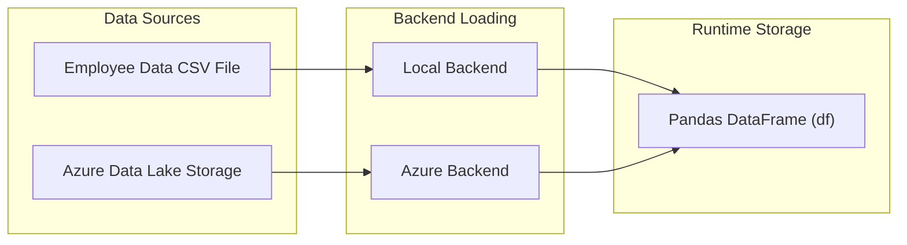
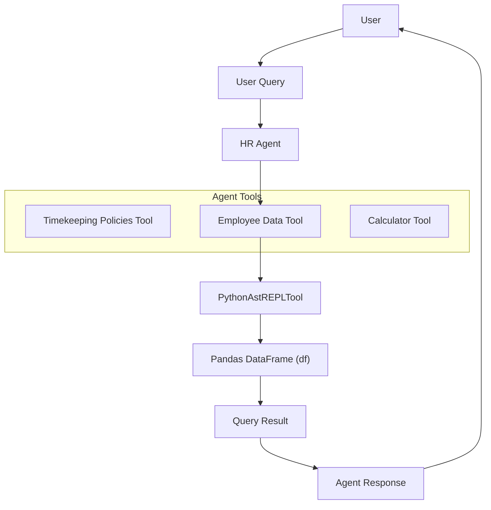
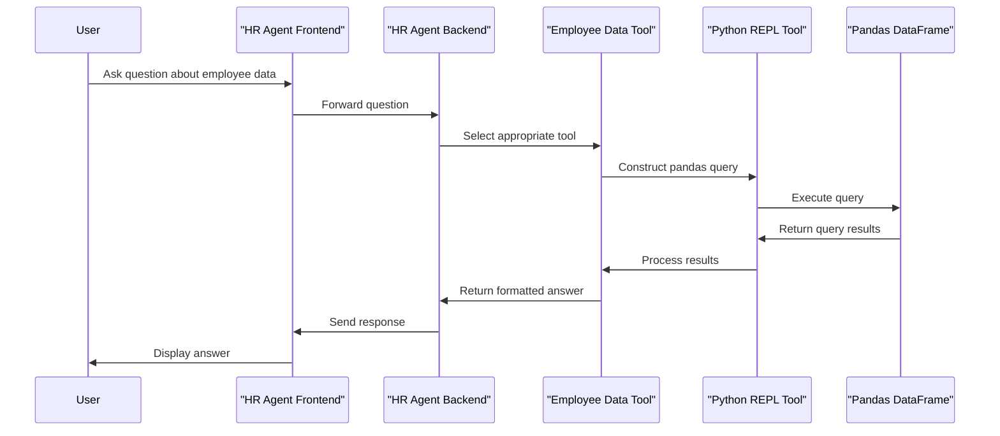

<!-- source: DeepWiki mcp.deepwiki.com · repo stepanogil/autonomous-hr-chatbot · page 4.2 Employee Data Structure · fetched 2026-10-26 -->

# Employee Data Structure

<details>
<summary>Relevant source files</summary>

The following files were used as context for generating this wiki page:

- [employee_data.csv](employee_data.csv)
- [hr_agent_backend_azure.py](hr_agent_backend_azure.py)
- [hr_agent_backend_local.py](hr_agent_backend_local.py)
- [hr_policy.txt](hr_policy.txt)

</details>


## Purpose and Scope

This document details the structure, storage, and usage of employee data within the Autonomous HR Chatbot system. It describes how employee information is organized, how it's loaded in different deployment environments, and how the HR agent interacts with this data to answer employee-related queries.

For information about how this data is processed as part of the larger system pipeline, see [Data Processing Pipeline](#4).

## Employee Data Schema

The employee data schema defines the structure of the employee information used by the HR chatbot. The data is stored in a tabular format with the following fields:

| Field Name | Data Type | Description |
|------------|-----------|-------------|
| employee_id | Integer | Unique identifier for each employee |
| name | String | Full name of the employee |
| position | String | Job title/role of the employee |
| organizational_unit | String | Department or division the employee belongs to |
| rank | String | Employee rank (e.g., Rank and File, Supervisor, Manager) |
| hire_date | Date | Date when the employee was hired |
| regularization_date | Date | Date when the employee was regularized (may be empty) |
| vacation_leave | Float | Current vacation leave balance |
| sick_leave | Float | Current sick leave balance |
| basic_pay_in_php | Float | Basic monthly salary in Philippine Pesos |
| employment_status | String | Current status (e.g., Permanent, Probation) |
| supervisor | String | Name of the employee's immediate supervisor |

### Data Schema Diagram

```mermaid
classDiagram
    class "EmployeeData" {
        +Integer employee_id
        +String name
        +String position
        +String organizational_unit
        +String rank
        +Date hire_date
        +Date regularization_date
        +Float vacation_leave
        +Float sick_leave
        +Float basic_pay_in_php
        +String employment_status
        +String supervisor
    }
```

Sources: [employee_data.csv:1-7]()

## Data Storage and Loading

The employee data is stored and loaded differently depending on the deployment environment of the HR chatbot.

### Storage Mechanisms Diagram



Sources: [hr_agent_backend_local.py:50-51](), [hr_agent_backend_azure.py:58-71]()

### Local Deployment

In a local deployment, the employee data is stored in a CSV file (`employee_data.csv`) in the project root directory. When the application starts, the HR agent backend loads this data into a pandas DataFrame:

```python
df = pd.read_csv("employee_data.csv")
```

Sources: [hr_agent_backend_local.py:50]()

### Azure Deployment

In an Azure deployment, the employee data is stored in Azure Data Lake Storage. The HR agent backend retrieves the data using the Azure Data Lake Storage client:

```python
file = client.get_file_system_client("<your azure storage account name>") \
             .get_file_client("employee_data/employee_data.csv") \
             .download_file() \
             .readall() \
             .decode('utf-8')
csv_file = StringIO(file)
df = pd.read_csv(csv_file)
```

Sources: [hr_agent_backend_azure.py:58-75]()

## Integration with HR Agent Tools

The employee data is made available to the HR agent through a Python REPL tool that has access to the DataFrame. This allows the agent to execute pandas operations to query and manipulate the employee data.

### Tool Integration Diagram



Sources: [hr_agent_backend_local.py:76-86](), [hr_agent_backend_azure.py:100-112]()

## Employee Data Tool Configuration

The Employee Data tool is configured with a description that guides the agent on how to use it. The tool has access to the pandas DataFrame (`df`) and can perform any valid pandas operation on it.

```python
Tool(
    name = "Employee Data",
    func=python.run,
    description = f"""
    Useful for when you need to answer questions about employee data stored in pandas dataframe 'df'. 
    Run python pandas operations on 'df' to help you get the right answer.
    'df' has the following columns: {df_columns}
    
    <user>: How many Sick Leave do I have left?
    <assistant>: df[df['name'] == '{user}']['sick_leave']
    <assistant>: You have n sick leaves left.              
    """
)
```

Sources: [hr_agent_backend_local.py:76-86](), [hr_agent_backend_azure.py:100-112]()

## Common Query Patterns

The HR agent uses the Employee Data tool to answer various employee-related queries. Here are some common query patterns:

### Personal Information Queries

```python
# Get a specific employee's information
df[df['name'] == 'Alexander Verdad']

# Get an employee's position
df[df['name'] == 'Alexander Verdad']['position']

# Get an employee's organizational unit
df[df['name'] == 'Alexander Verdad']['organizational_unit']
```

### Leave Balance Queries

```python
# Get an employee's vacation leave balance
df[df['name'] == 'Alexander Verdad']['vacation_leave']

# Get an employee's sick leave balance
df[df['name'] == 'Alexander Verdad']['sick_leave']
```

### Organizational Queries

```python
# Get all employees in a specific department
df[df['organizational_unit'] == 'HR Department']

# Get all employees with a specific rank
df[df['rank'] == 'Supervisor']

# Get all employees under a specific supervisor
df[df['supervisor'] == 'Joseph Santos']
```

Sources: [hr_agent_backend_local.py:76-86](), [hr_agent_backend_azure.py:100-112](), [employee_data.csv:1-7]()

## Sample Data

The employee data CSV includes sample records that demonstrate the data structure. Here's an example of the data contained in the CSV file:

| employee_id | name | position | organizational_unit | rank | hire_date | regularization_date | vacation_leave | sick_leave | basic_pay_in_php | employment_status | supervisor |
|-------------|------|----------|---------------------|------|-----------|---------------------|----------------|------------|------------------|-------------------|------------|
| 1005674 | Joseph Peña | Accounts Receivable Supervisor | Finance Department | Supervisor | 2/16/2013 | 7/16/2013 | 30 | 15 | 20000 | Permanent | Richard Santos |
| 1005675 | Mark Delos Santos | HR Assistant | HR Department | Rank and File | 1/1/2023 | | 20 | 2 | 15000 | Probation | Jinky Francisco |
| 1005676 | Alexander Verdad | Account Receivable Assistant | Finance Department | Rank and File | 11/1/2017 | 5/1/2018 | 45 | 8 | 15000 | Permanent | Joseph Santos |

Sources: [employee_data.csv:1-7]()

## Data Flow in the System

The following diagram illustrates how employee data flows through the system, from storage to user query response:



Sources: [hr_agent_backend_local.py:76-86](), [hr_agent_backend_azure.py:100-112]()

## Limitations and Considerations

- The employee data is stored in a static CSV file, which means it needs to be manually updated when employee information changes.
- The system currently supports only read operations on the employee data; it cannot modify the data.
- In the local implementation, the CSV file must be present in the project root directory.
- In the Azure implementation, the appropriate authentication credentials must be configured to access the Azure Data Lake Storage.

Sources: [hr_agent_backend_local.py:50](), [hr_agent_backend_azure.py:58-71]()

---

