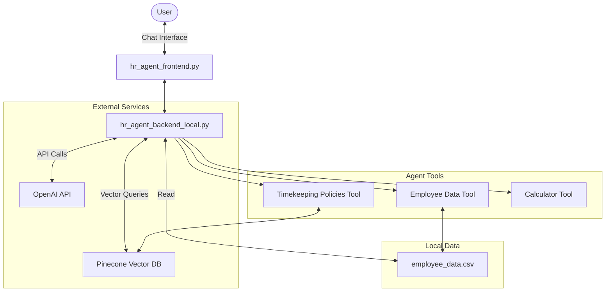
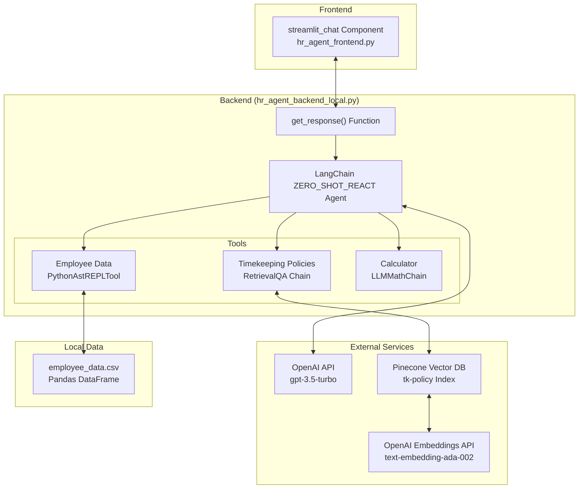
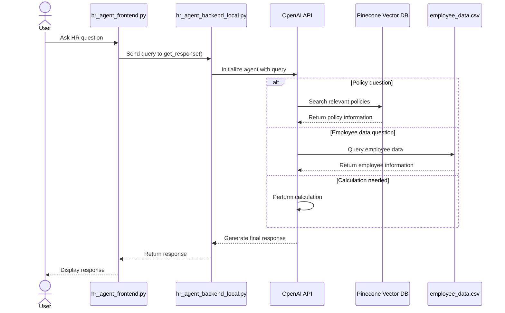

<!-- source: DeepWiki mcp.deepwiki.com · repo stepanogil/autonomous-hr-chatbot · page 5.1 Local Deployment · fetched 2026-10-26 -->

# Local Deployment

<details>
<summary>Relevant source files</summary>

The following files were used as context for generating this wiki page:

- [README.md](README.md)
- [hr_agent_backend_local.py](hr_agent_backend_local.py)
- [requirements.txt](requirements.txt)

</details>


This document provides detailed instructions for deploying the Autonomous HR Chatbot system on a local environment. For deploying on Azure cloud infrastructure, see [Azure Deployment](#5.2).

## Overview

Local deployment uses the direct OpenAI API instead of Azure OpenAI Service, stores employee data in a local CSV file, and still leverages Pinecone as the vector database for storing HR policy embeddings. This approach is simpler to set up and suitable for development, testing, and small-scale deployments.



Sources: [README.md:29-41](), [hr_agent_backend_local.py:1-15]()

## Prerequisites

Before beginning local deployment, ensure you have the following:

### Required Software
- Python 3.10
- Git (for cloning the repository)

### Required API Keys
- OpenAI API key (from platform.openai.com)
- Pinecone API key and environment (free tier available)

### Required Files
- HR policy documents for embedding into Pinecone
- Employee data CSV file

Sources: [README.md:31-33](), [hr_agent_backend_local.py:16-29]()

## Step-by-Step Setup

### 1. Environment Setup

1. Install Python 3.10
   ```bash
   # Installation commands vary by operating system
   # See links in README for platform-specific instructions
   ```

2. Clone the repository
   ```bash
   git clone https://github.com/stepanogil/autonomous-hr-chatbot
   cd autonomous-hr-chatbot
   ```

3. Install dependencies
   ```bash
   pip install -r requirements.txt
   ```

Sources: [README.md:31-33](), [requirements.txt:1-104]()

### 2. Configure API Keys

Open `hr_agent_backend_local.py` and replace the placeholder API keys with your own:

```python
# Pinecone configuration
pinecone.init(
    api_key="<your pinecone api key>",  
    environment="<your pinecone environment>"  
) 

# OpenAI configuration
embed = OpenAIEmbeddings(
    model = 'text-embedding-ada-002',
    openai_api_key="<your openai api key from from platform.openai.com>",
)

# ChatGPT configuration
llm = ChatOpenAI(    
    openai_api_key="<your openai api key from from platform.openai.com>", 
    model_name="gpt-3.5-turbo", 
    temperature=0.0
)
```

Sources: [hr_agent_backend_local.py:16-41]()

### 3. Prepare Pinecone Vector Database

Before running the application, you need to store HR policy embeddings in Pinecone:

1. Create a Pinecone account at [pinecone.io](https://pinecone.io/) (free tier available)
2. Create a new index named `tk-policy` with dimensions set to 1536 (for OpenAI's text-embedding-ada-002 model)
3. Open and run the `store_embeddings_in_pinecone.ipynb` notebook:
   - Replace Pinecone and OpenAI API keys with your own
   - This notebook processes your HR policy documents, creates embeddings, and stores them in the Pinecone index


Sources: [README.md:37-41](), [hr_agent_backend_local.py:16-35]()

### 4. Prepare Employee Data

Ensure you have the `employee_data.csv` file in the root directory of the project. This file should contain employee information with columns matching those referenced in the backend code:

The Employee Data CSV needs to contain at minimum these columns:
- `name`: Employee's full name
- `sick_leave`: Available sick leave
- Other columns as referenced in your code

You can modify the user being served by the chatbot by editing line 57 in `hr_agent_backend_local.py`:

```python
user = 'Alexander Verdad' # set user
```

Sources: [hr_agent_backend_local.py:50-58]()

### 5. Run the Application

Once everything is configured, run the Streamlit frontend:

```bash
streamlit run hr_agent_frontend.py
```

The application should now be accessible at `http://localhost:8501` in your web browser.

Sources: [README.md:35]()

## Configuration Options

### Agent Configuration

The HR agent is configured in `hr_agent_backend_local.py` with several customizable parameters:

| Parameter | Description | Default Value | File Location |
|-----------|-------------|---------------|--------------|
| `llm.model_name` | The OpenAI model to use | "gpt-3.5-turbo" | hr_agent_backend_local.py:39 |
| `llm.temperature` | Controls randomness (0-1) | 0.0 | hr_agent_backend_local.py:40 |
| `user` | The current user being served | "Alexander Verdad" | hr_agent_backend_local.py:57 |
| `index_name` | Pinecone index name | "tk-policy" | hr_agent_backend_local.py:22 |

### Tools Configuration

The agent has access to three tools, which can be customized in the `tools` list:

1. **Timekeeping Policies**: Retrieves information from the Pinecone vector database
2. **Employee Data**: Accesses and manipulates the employee data CSV using pandas
3. **Calculator**: Performs mathematical calculations when needed

You can modify the tool descriptions to adjust how the agent uses them by editing the description strings in the `tools` list.

Sources: [hr_agent_backend_local.py:60-95]()

## System Architecture Details



Sources: [hr_agent_backend_local.py:1-111]()

## Data Flow



Sources: [hr_agent_backend_local.py:108-111](), [README.md:19-25]()

## Troubleshooting

### Common Issues and Solutions

| Issue | Possible Cause | Solution |
|-------|---------------|----------|
| "Missing API key" error | API keys not set | Update API keys in hr_agent_backend_local.py |
| "Index not found" error | Pinecone index not created | Create "tk-policy" index in Pinecone console |
| Employee data not found | Missing CSV file | Ensure employee_data.csv is in the root directory |
| Embedding creation fails | OpenAI API issues | Check API key validity and billing status |
| Agent not responding correctly | Incorrect tool configuration | Review tool descriptions in hr_agent_backend_local.py |

### Debugging Tips

1. Enable verbose mode in the agent initialization to see detailed agent reasoning:
   ```python
   agent = initialize_agent(tools, llm, agent=AgentType.ZERO_SHOT_REACT_DESCRIPTION, verbose=True, agent_kwargs=agent_kwargs)
   ```

2. Test each component individually before running the full system:
   - Test Pinecone connection and query separately
   - Verify CSV data loading works correctly
   - Test OpenAI API connection

Sources: [hr_agent_backend_local.py:102-107]()

---

