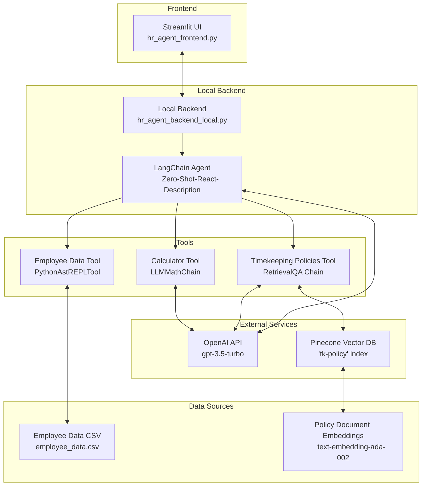
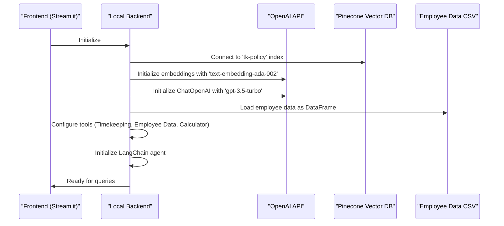
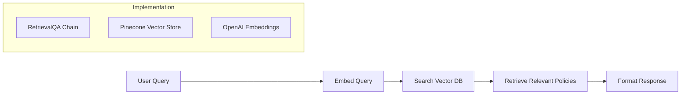
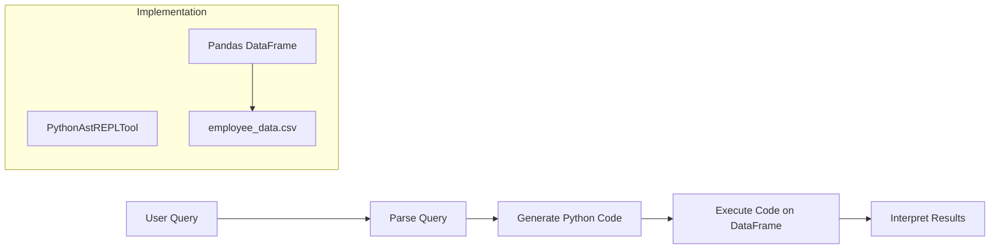
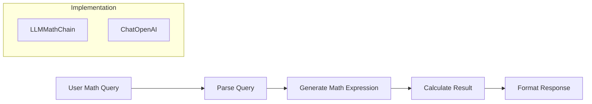
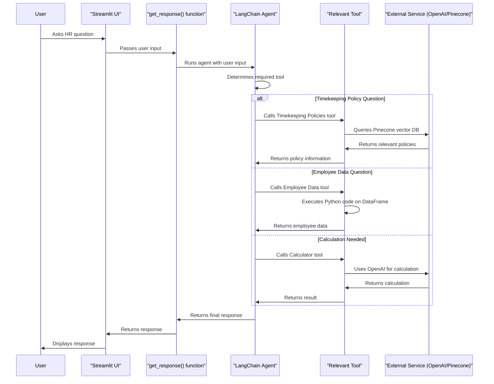

<!-- source: DeepWiki mcp.deepwiki.com · repo stepanogil/autonomous-hr-chatbot · extra page Local Backend · fetched 2026-10-26 -->

# Local Backend

<details>
<summary>Relevant source files</summary>

The following files were used as context for generating this wiki page:

- [README.md](README.md)
- [hr_agent_backend_local.py](hr_agent_backend_local.py)

</details>


## Purpose and Scope

This document details the Local Backend implementation of the Autonomous HR Chatbot system. The Local Backend provides a self-contained implementation that can run entirely on a local machine, connecting directly to external APIs like OpenAI and Pinecone without requiring Azure cloud services. This page focuses on the architecture, components, and functionality specific to the local deployment option.

For information about the Azure-based implementation, see [Azure Backend](#2.2.2).

## Architecture Overview

The Local Backend is implemented in `hr_agent_backend_local.py` and serves as one of two possible backend implementations for the HR Chatbot system. It connects the frontend to various tools and services while maintaining all processing logic locally.



Sources: [hr_agent_backend_local.py:1-107](), [README.md:11-17]()

## Core Components

### Backend Initialization

The Local Backend initializes key components needed for the HR chatbot functionality:

1. **Pinecone Vector Database Client** - Connects to a Pinecone index that stores embeddings of HR policy documents
2. **OpenAI Embeddings** - Creates vector representations of user queries
3. **Language Model (LLM)** - Uses OpenAI's GPT-3.5-turbo model for generating responses
4. **Vector Store** - Bridges between Pinecone and the embedding functionality
5. **Agent** - Zero-shot agent that coordinates tool usage



Sources: [hr_agent_backend_local.py:16-41]()

### Configuration and API Keys

The Local Backend requires configuration with several API keys:

| Configuration Item | Description | Code Reference |
|--------------------|-------------|----------------|
| Pinecone API Key | Required to access the vector database | [hr_agent_backend_local.py:18]() |
| Pinecone Environment | Environment setting for Pinecone | [hr_agent_backend_local.py:19]() |
| OpenAI API Key | Required for embeddings and LLM access | [hr_agent_backend_local.py:28](), [hr_agent_backend_local.py:38]() |
| Index Name | Name of the Pinecone index ('tk-policy') | [hr_agent_backend_local.py:22]() |

Sources: [hr_agent_backend_local.py:16-41]()

## Tools Integration

The Local Backend integrates three primary tools that enable the agent to assist with HR queries:

### 1. Timekeeping Policies Tool

This tool allows the agent to retrieve relevant HR policies from the Pinecone vector database using semantic search.



Sources: [hr_agent_backend_local.py:43-48](), [hr_agent_backend_local.py:61-74]()

### 2. Employee Data Tool

This tool enables the agent to query and manipulate employee data stored in a local CSV file.



Sources: [hr_agent_backend_local.py:50-51](), [hr_agent_backend_local.py:75-87]()

### 3. Calculator Tool

This tool allows the agent to perform mathematical operations when needed.



Sources: [hr_agent_backend_local.py:53-54](), [hr_agent_backend_local.py:88-94]()

## Agent Configuration

The Local Backend sets up a LangChain agent with:

1. Zero-shot agent type that can reason about which tool to use without examples
2. Custom prompt prefix that establishes the agent's role as an HR assistant
3. Access to all three tools (Timekeeping Policies, Employee Data, Calculator)
4. Information about the current user to personalize responses

```
agent_kwargs = {'prefix': f'You are friendly HR assistant. You are tasked to assist the current user: {user} on questions related to HR. You have access to the following tools:'}
```

Sources: [hr_agent_backend_local.py:97-107]()

## Data Flow

The following diagram illustrates how the Local Backend processes user queries:



Sources: [hr_agent_backend_local.py:108-111]()

## Local vs Azure Backend Comparison

| Feature | Local Backend | Azure Backend |
|---------|---------------|---------------|
| Implementation File | `hr_agent_backend_local.py` | `hr_agent_backend_azure.py` |
| LLM Provider | Direct OpenAI API | Azure OpenAI Service |
| Employee Data Source | Local CSV file | Azure Data Lake |
| API Keys Required | OpenAI API, Pinecone API | Azure OpenAI API, Azure Data Lake credentials, Pinecone API |
| Deployment | Local machine | Azure cloud services |
| Integration with Enterprise Systems | Limited | Enhanced (e.g., SAP HCM via Azure Data Factory) |

Sources: [README.md:43-53]()

## Usage

The Local Backend exposes a single function for the frontend to use:

```python
def get_response(user_input):
    response = agent.run(user_input)
    return response
```

This function is called by the Streamlit frontend to process user queries and return responses.

Sources: [hr_agent_backend_local.py:108-111]()

## Local Backend Setup Requirements

To set up the Local Backend, you need:

1. An OpenAI API key for both the embedding model and the LLM
2. A Pinecone account with API key and environment
3. A Pinecone index named 'tk-policy' with embeddings of HR policy documents
4. A local employee data CSV file

Follow the setup instructions in the README to initialize all dependencies before running the system.

Sources: [README.md:29-36](), [README.md:37-41]()

---

