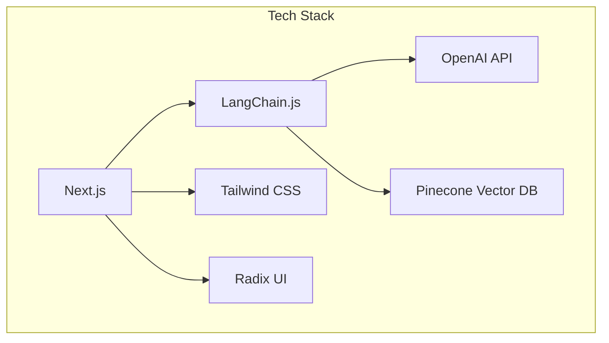
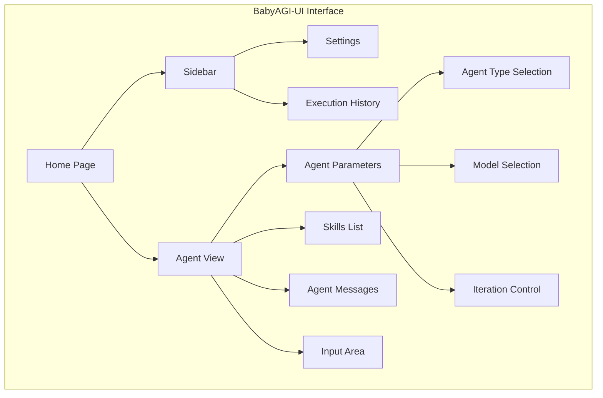
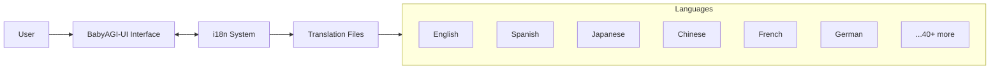
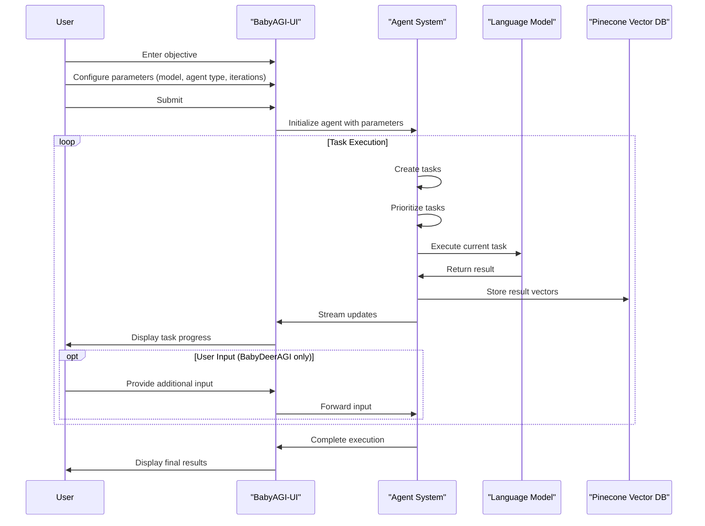

<!-- source: DeepWiki mcp.deepwiki.com · repo miurla/babyagi-ui · page 1.1 Getting Started · fetched 2026-10-26 -->

# Getting Started

<details>
<summary>Relevant source files</summary>

The following files were used as context for generating this wiki page:

- [.env.example](.env.example)
- [README.md](README.md)
- [next-i18next.config.js](next-i18next.config.js)
- [next.config.js](next.config.js)
- [public/favicon.ico](public/favicon.ico)
- [public/images/screenshot-230722.png](public/images/screenshot-230722.png)
- [public/images/serpapi-logo.svg](public/images/serpapi-logo.svg)
- [public/og-image.png](public/og-image.png)
- [src/pages/_document.tsx](src/pages/_document.tsx)
- [src/utils/languages.ts](src/utils/languages.ts)

</details>


This document provides a step-by-step guide to installing, configuring, and running the BabyAGI-UI application - a web interface for interacting with autonomous AI agents. If you're looking for information about the system architecture, see [System Architecture](#1.2).

## System Requirements

Before installing BabyAGI-UI, ensure you have the following prerequisites:

- Node.js (latest LTS version recommended)
- npm (comes with Node.js)
- Required API keys:
  - OpenAI API key
  - Pinecone API key
  - (Optional) SerpAPI key or Google Custom Search API key for search capabilities

### Technology Stack

BabyAGI-UI is built on the following technologies:



Sources: [README.md:21-28]()

## Installation

Follow these steps to install BabyAGI-UI:

1. Clone the repository:

```bash
git clone https://github.com/miurla/babyagi-ui
```

2. Navigate to the project directory:

```bash
cd babyagi-ui
```

3. Install dependencies:

```bash
npm install
```

Sources: [README.md:42-60]()

## Configuration

### Environment Setup

BabyAGI-UI requires several environment variables to be configured. Create a `.env` file in the root directory by copying the example file:

```bash
cp .env.example .env
```

Then edit the `.env` file to set the following variables:

| Variable | Description | Required |
|----------|-------------|----------|
| `OPENAI_API_KEY` | Your OpenAI API key | Yes |
| `PINECONE_API_KEY` | Your Pinecone API key | Yes |
| `PINECONE_ENVIRONMENT` | Pinecone environment (e.g., "us-west4-gcp") | Yes |
| `NEXT_PUBLIC_TABLE_NAME` | Name for your Pinecone index (default: "baby-agi-test-table") | Yes |
| `NEXT_PUBLIC_USE_USER_API_KEY` | Set to "true" to use user API key (default: "false") | No |
| `SERP_API_KEY` | Your SerpAPI key for search functionality | No |
| `GOOGLE_SEARCH_API_KEY` & `GOOGLE_CUSTOM_INDEX_ID` | Alternative to SerpAPI for search | No |
| `BASE_URL` | Your application URL (e.g., "http://localhost:3000") | Yes |

Sources: [.env.example:1-34]()

### Pinecone Setup

Before running the application, you need to create an index in Pinecone with the following recommended settings:

- Dimensions: 1536
- Metric: Cosine
- Pod Type: p1.x1 (or any available option suitable for your needs)

Sources: [README.md:63-65]()

## Running the Application

To start the development server:

```bash
npm run dev
```

The application will be available at `http://localhost:3000` by default.

### Deployment Options

For production deployment, you can use Vercel:

[](https://vercel.com/new/clone?repository-url=https%3A%2F%2Fgithub.com%2Fmiurla%2Fbabyagi-ui)

Sources: [README.md:71-83]()

## User Interface Overview

When you access BabyAGI-UI, you'll see a user interface with the following main components:



Sources: Various UI components in repository

## Language Support

BabyAGI-UI supports over 40 languages through its internationalization system. The application will automatically detect your browser's language, or you can manually select your preferred language through the settings.



Sources: [src/utils/languages.ts:1-74](), [next-i18next.config.js:1-69]()

## Agent Types

BabyAGI-UI supports several types of agents with different capabilities:

| Agent Type | Description | Key Features |
|------------|-------------|--------------|
| BabyAGI | Base agent | Task creation, execution, and prioritization |
| BabyBeeAGI | Search-enhanced agent | Web search capabilities using SerpAPI or Google Search |
| BabyDeerAGI | Parallel processing agent | User input during execution and parallel tasking |
| BabyElfAGI | Skills-based agent | Extensible skills system including text completion, web search, web browsing, and code manipulation |

To select an agent type, use the agent parameters panel in the main interface.

## Basic Usage Flow

Here's a simplified flow of how to use BabyAGI-UI:



## Usage Warning

BabyAGI-UI is designed to be run continuously as part of a task management system. Running this script continuously can result in high API usage, so please use it responsibly. Ensure you have properly set up the OpenAI API and have monitoring in place for your API usage.

Sources: [README.md:85-89]()

## Next Steps

Now that you have BabyAGI-UI up and running, you might want to explore:

- [Agent Architecture](#3) to learn more about how the different agents work
- [User Interface Components](#2) for a deeper understanding of the UI
- [Agent Skills System](#3.4) to learn about extending agents with new capabilities
- [Examples and Usage](#7) for practical application examples

Sources: Table of contents provided in the task

---

