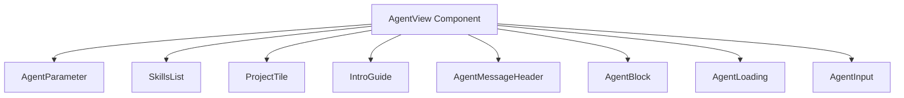
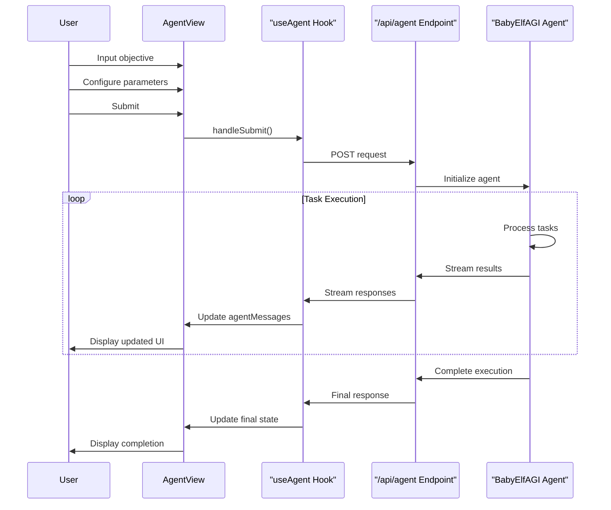
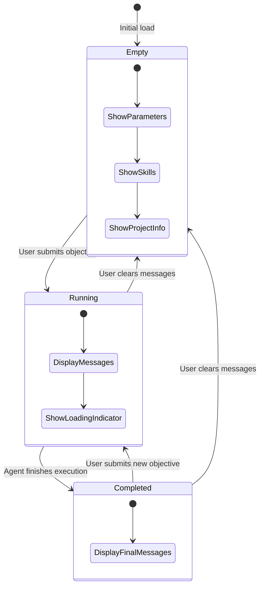
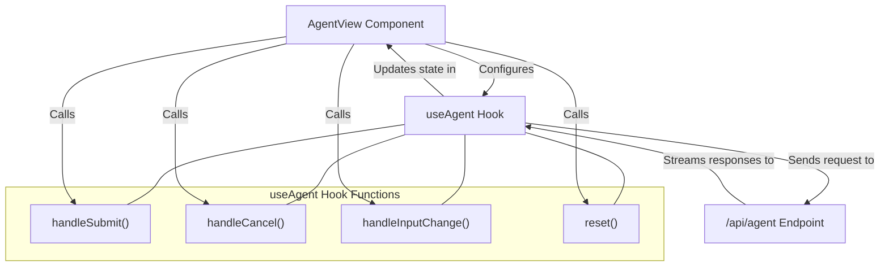
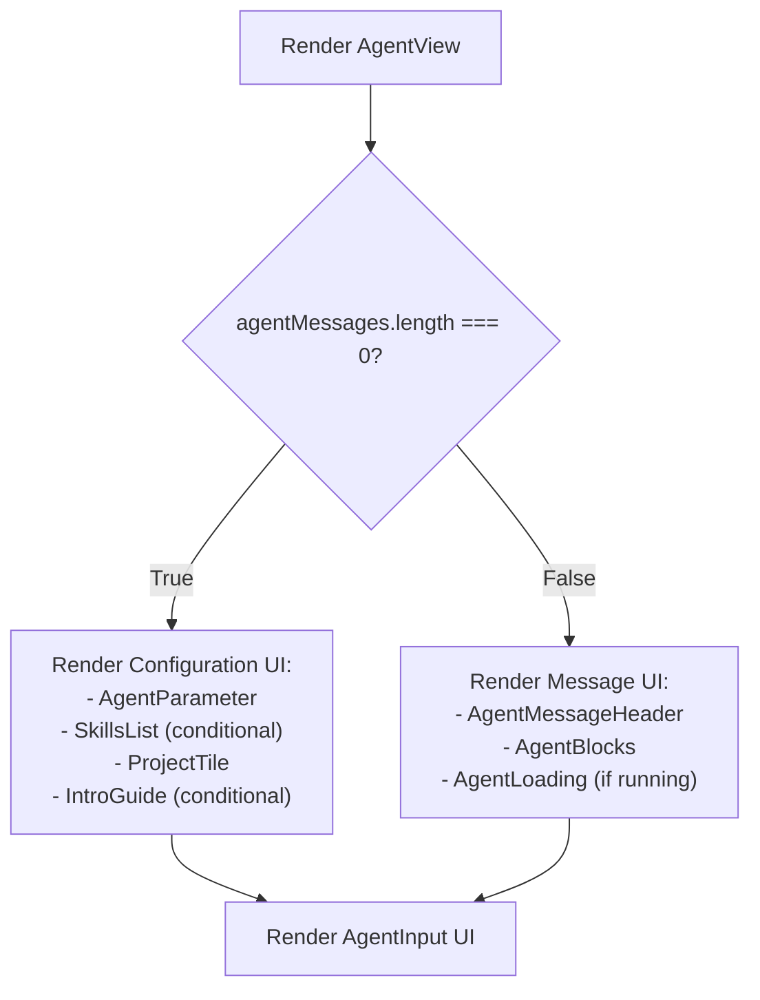

<!-- source: DeepWiki mcp.deepwiki.com · repo miurla/babyagi-ui · page 2.1 AgentView Component · fetched 2026-10-26 -->

# AgentView Component

Relevant source files

The following files were used as context for generating this wiki page:

- [src/components/Agent/AgentView.tsx](src/components/Agent/AgentView.tsx)
- [src/hooks/useAgent.ts](src/hooks/useAgent.ts)
- [src/pages/api/agent/index.ts](src/pages/api/agent/index.ts)

The AgentView component is the central interface component for interacting with AI agents in the BabyAGI-UI system. It manages agent configuration, execution flow, display of agent messages, and user interactions. This component serves as the primary viewport where users input objectives, configure agent parameters, and view the results of agent execution.

For information about the message system used to display agent activities, see [Agent Message System](#2.2). For details about specific task components, see [Agent Task Components](#2.3).

## Component Structure

The AgentView component integrates multiple child components to create a cohesive user interface:

Sources: [src/components/Agent/AgentView.tsx:37-251]()

## State Management

The AgentView component uses React's useState hook to manage its internal state:

| State Variable | Purpose |
|----------------|---------|
| `model` | Selected language model (e.g., GPT-3.5, GPT-4) |
| `iterations` | Number of iterations for agent to perform |
| `objective` | User's input objective |
| `firstTask` | First task for the agent to execute |
| `selectedAgent` | Type of agent (e.g., BabyAGI, BabyDeerAGI) |
| `language` | UI language setting |
| `agentBlocks` | Grouped agent messages for display |

The component also relies on numerous custom hooks to extend its functionality:

```mermaid
graph TD
    AgentView["AgentView Component"]
    
    AgentView --> UseSkills["useSkills()"]
    AgentView --> UseExecManagement["useExecutionManagement()"]
    AgentView --> UseApiKeyCheck["useApiKeyCheck()"]
    AgentView --> UseNotifications["useNotifications()"]
    AgentView --> UseErrorHandler["useErrorHandler()"]
    AgentView --> UseClipboard["useClipboard()"]
    AgentView --> UseFileDownload["useFileDownload()"]
    AgentView --> UseCurrentEvaluation["useCurrentEvaluation()"]
    AgentView --> UseAgent["useAgent()"]
    AgentView --> UseResetAndDeselect["useResetAndDeselect()"]
    AgentView --> UseFeedback["useFeedback()"]
    AgentView --> UseScrollControl["useScrollControl()"]
```

Sources: [src/components/Agent/AgentView.tsx:42-73](), [src/components/Agent/AgentView.tsx:116-148]()

## Agent Execution Flow

The AgentView component orchestrates the complete agent execution flow, from user input to displaying results:

Sources: [src/components/Agent/AgentView.tsx:80-102](), [src/hooks/useAgent.ts:37-230](), [src/pages/api/agent/index.ts:11-35]()

## UI Rendering States

The AgentView component has distinct rendering states based on the execution status:

The component renders different UI elements based on these states:

1. **Empty State** (`agentMessages.length === 0`):
   - AgentParameter component for configuration
   - SkillsList component (for non-BabyAGI agents)
   - ProjectTile and IntroGuide components

2. **Running/Completed States** (`agentMessages.length > 0`):
   - AgentMessageHeader showing model and agent type
   - AgentBlock components for each message group
   - AgentLoading component (only when running)
   - Reference element for automatic scrolling

3. **Input State** (always present):
   - AgentInput component for user input and control buttons

Sources: [src/components/Agent/AgentView.tsx:192-250]()

## Key Event Handlers

The component implements several event handlers to manage user interactions:

| Handler | Purpose |
|---------|---------|
| `startHandler()` | Initiates agent execution, saves execution data |
| `stopHandler()` | Aborts current execution, shows notification |
| `finishHandler()` | Handles successful completion, shows notification |
| `copyHandler()` | Copies agent messages to clipboard |
| `downloadHandler()` | Downloads messages as text file |
| `clearHandler()` | Resets state and clears messages |

Sources: [src/components/Agent/AgentView.tsx:75-114]()

## useAgent Hook Integration

The critical part of AgentView is its integration with the `useAgent` hook, which handles API communication and message processing:

The hook provides these key functions to AgentView:
- `handleSubmit`: Processes form submission and sends request to API
- `handleCancel`: Aborts current execution
- `handleInputChange`: Updates input field state
- `reset`: Clears agent messages and resets state

Sources: [src/components/Agent/AgentView.tsx:116-135](), [src/hooks/useAgent.ts:37-273]()

## Effect Management

The AgentView component uses several useEffect hooks to manage side effects:

1. **Execution Selection Effect**:
   - Loads messages when a saved execution is selected
   - Resets state when no execution is selected

2. **Language Effect**:
   - Updates language state when i18n language changes

3. **Agent Messages Effect**:
   - Updates execution history with current messages
   - Groups messages for display
   - Triggers UI updates

4. **Scroll Effect**:
   - Scrolls to the bottom when new messages arrive

Sources: [src/components/Agent/AgentView.tsx:150-190]()

## Conditional Rendering Logic

The render function in AgentView implements conditional logic to display the appropriate UI based on the current state:

Sources: [src/components/Agent/AgentView.tsx:192-250]()

## Key Implementation Details

The AgentView component is implemented as a functional React component that uses hooks for state management and side effects. It integrates with the translation system for internationalization and uses Vercel Analytics for tracking events.

The main state management occurs through:
1. Local useState variables for UI state
2. The useAgent hook for agent interaction
3. Custom hooks for specialized functionality

The component communicates with the agent backend through the `/api/agent` API endpoint, which initializes and runs the appropriate agent executor based on the selected agent type.

Sources: [src/components/Agent/AgentView.tsx:37-251](), [src/pages/api/agent/index.ts:11-35]()

---

