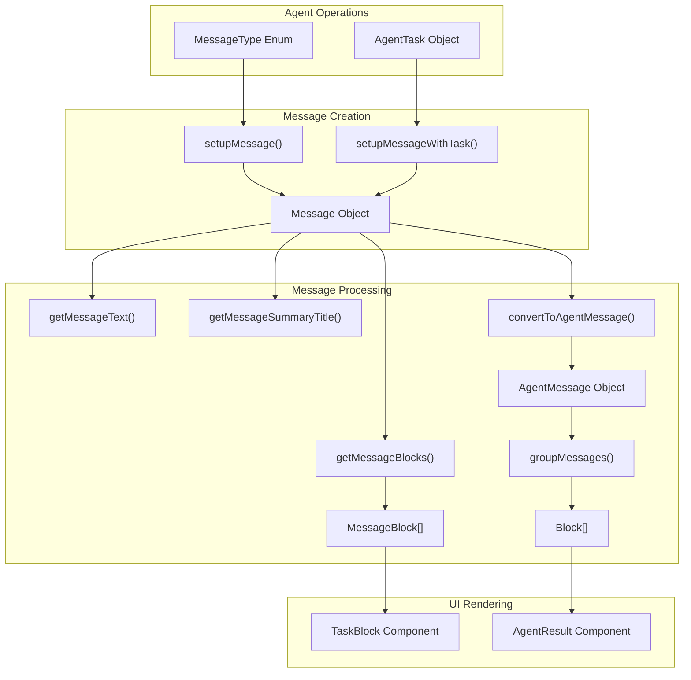
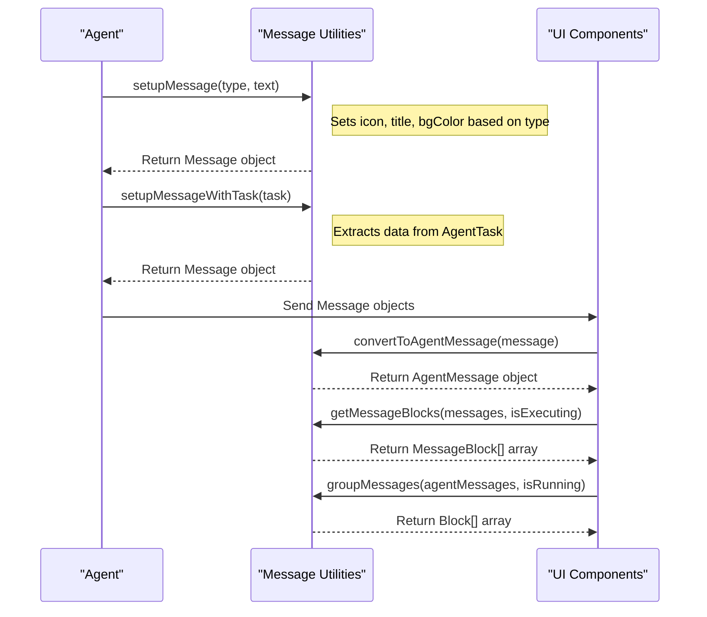
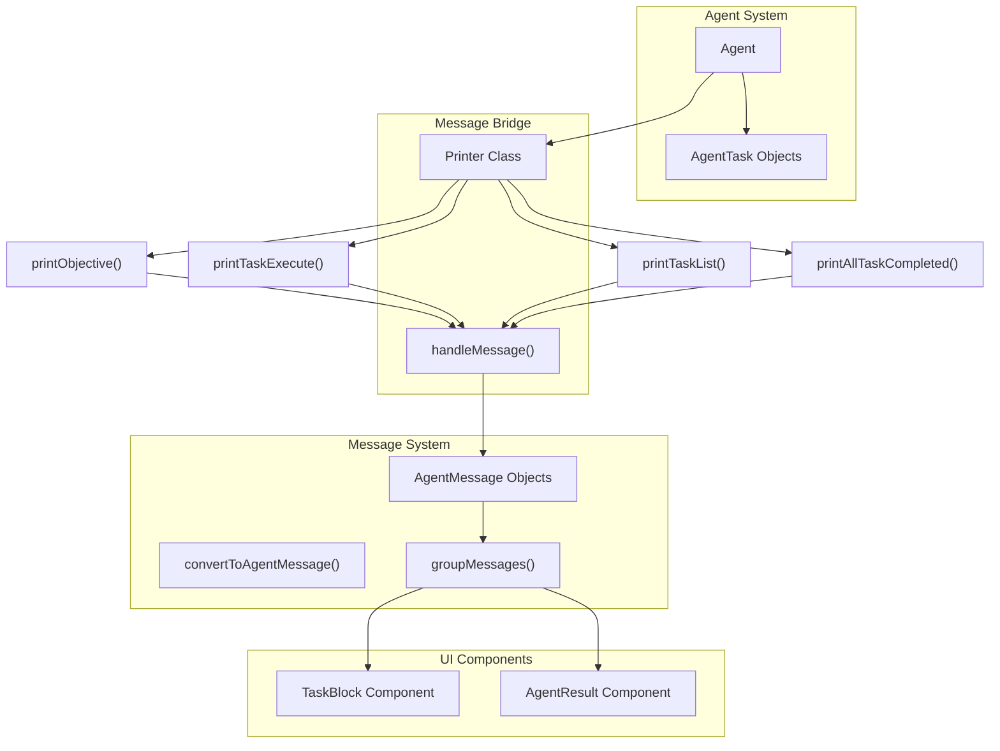
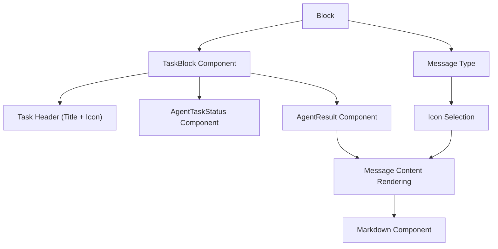

<!-- source: DeepWiki mcp.deepwiki.com · repo miurla/babyagi-ui · page 2.2 Agent Message System · fetched 2026-10-26 -->

# Agent Message System

<details>
<summary>Relevant source files</summary>

The following files were used as context for generating this wiki page:

- [src/components/Agent/AgentParameter.tsx](src/components/Agent/AgentParameter.tsx)
- [src/components/Agent/IntroGuide.tsx](src/components/Agent/IntroGuide.tsx)
- [src/components/Agent/TaskBlock.tsx](src/components/Agent/TaskBlock.tsx)
- [src/types/index.ts](src/types/index.ts)
- [src/utils/constants.ts](src/utils/constants.ts)
- [src/utils/message.ts](src/utils/message.ts)
- [src/utils/print.ts](src/utils/print.ts)

</details>


The Agent Message System is a core component of BabyAGI-UI responsible for creating, transforming, and displaying messages generated during agent execution. This system bridges the gap between agent operations and the user interface, ensuring that agent activities, tasks, and results are presented to users in a structured and comprehensible way.

For information about how these messages are visually rendered in the UI, see [Agent Task Components](#2.3).

## Message Data Structures

The message system is built around four primary data structures:

### Message

The `Message` interface represents the basic internal message format used throughout the system:

```typescript
type Message = {
  id?: number;
  text: string;
  type: MessageType;
  icon?: string;
  title?: string;
  bgColor?: string;
  status?: AgentStatus;
  open?: boolean;
  dependentTaskIds?: number[];
};
```

### AgentMessage

The `AgentMessage` interface is an enhanced message format optimized for UI display:

```typescript
type AgentMessage = {
  id?: string;
  content: string;
  type?: string;
  title?: string;
  icon?: string;
  taskId?: string;
  style?: 'text' | 'log';
  status?: 'complete' | 'incomplete' | 'running';
  options?: { [key: string]: string };
};
```

### MessageBlock

`MessageBlock` groups related `Message` objects:

```typescript
type MessageBlock = {
  id?: number;
  messages: Message[];
  status?: 'complete' | 'incomplete' | 'running';
  type?: MessageType;
};
```

### Block

`Block` groups related `AgentMessage` objects:

```typescript
type Block = {
  id?: string;
  messages: AgentMessage[];
  status?: 'complete' | 'incomplete' | 'running';
  style?: 'label' | 'task';
};
```

Sources: [src/types/index.ts:9-165]()

## Message System Architecture

The following diagram illustrates the architecture of the message system, showing how messages are created, transformed, and grouped:

### Message Transformation Flow



Sources: [src/utils/message.ts:14-116](), [src/utils/message.ts:118-140](), [src/utils/message.ts:142-155](), [src/utils/message.ts:252-341](), [src/utils/message.ts:399-441](), [src/utils/message.ts:483-516]()

## Message Creation Process

The system creates messages through several key functions in `message.ts`:

### setupMessage

The `setupMessage` function creates a basic message object from a message type:

```typescript
export const setupMessage = (
  type: MessageType,
  text?: string,
  tool?: ToolType,
  icon?: string,
  id?: number,
): Message => {
  // Sets default icon, title, and bgColor based on type
  // Returns a structured Message object
};
```

This function determines the appropriate icon and title based on the message type. It handles many different message types, including 'objective', 'task-list', 'next-task', 'task-result', etc.

### setupMessageWithTask

`setupMessageWithTask` creates a message from an agent task:

```typescript
export const setupMessageWithTask = (task: AgentTask): Message => {
  // Extracts task information including ID, task text, and tool type
  // Returns a Message object representing the task
};
```

This function converts an `AgentTask` object directly into a `Message` object, setting appropriate icons based on the task's skill or tool.

### Message Creation Sequence



Sources: [src/utils/message.ts:14-140](), [src/utils/message.ts:483-516]()

## Message Types and Styling

The message system supports various message types defined in the `MessageType` type:

```typescript
type MessageType =
  | 'objective'         // The main goal
  | 'task-list'         // List of tasks to accomplish
  | 'next-task'         // The next task to be executed
  | 'task-result'       // Result of a completed task
  | 'task-output'       // Output from a task execution
  | 'task-result-summary' // Summary of task results
  | 'search-logs'       // Logs from search operations
  | 'loading'           // Loading indicator
  | 'end-of-iterations' // End of agent iterations
  | 'session-summary'   // Summary of the session
  | 'done'              // Task completion
  | 'complete'          // Agent completion
  | 'failed'            // Task failure
  | 'user-input'        // User input request
  | 'task-execute'      // Task execution notification
  | 'final-result';     // Final result of the agent
```

Each message type has associated styling, icons, and formatting rules. The system consistently maps message types to recognizable icons:

### Message Type to Icon Mapping

| Message Type | Default Icon | Description |
|--------------|--------------|-------------|
| objective | 🎯 | Represents the main objective |
| task-list | 📝 | List of tasks |
| next-task | 👉 | The next task to be executed (varies by tool) |
| task-result | ✅ | Result of a completed task (varies by tool) |
| loading | ⏳ | Loading indicator |
| end-of-iterations | 🏁 | End of agent iterations |
| session-summary | 📑 | Summary of the session |
| done | ✅ | Task completion |
| complete | 🏁 | Agent completion |
| failed | ❌ | Task failure |
| user-input | 🧑‍💻 | User input request |

Tool-specific icons are also assigned:
- Web search: 🔍
- Web scrape: 📄
- Text completion: 🤖
- User input: 🧑‍💻

Sources: [src/utils/message.ts:14-72](), [src/types/index.ts:48-64](), [src/utils/message.ts:361-377]()

## Message Transformation Functions

The system provides functions to transform messages between different formats:

### convertToAgentMessage

Converts a `Message` to an `AgentMessage` for UI rendering:

```typescript
const convertToAgentMessage = (message: Message): AgentMessage => {
  // Converts Message format to AgentMessage format
  // Preserves key information like task ID, content, and status
};
```

This private function is used by `convertToAgentMessages` to transform an array of `Message` objects to `AgentMessage` objects:

```typescript
export const convertToAgentMessages = (messages: Message[]): AgentMessage[] => {
  return messages
    .filter((message) => message.type !== 'task-execute')
    .map((message) => convertToAgentMessage(message));
};
```

### parseMessage

Parses a JSON string into an `AgentMessage`:

```typescript
export const parseMessage = (json: string): AgentMessage | null => {
  try {
    const message = JSON.parse(json).message as AgentMessage;
    return {
      ...message,
      style: message.style ?? 'text',
      status: message.status ?? 'incomplete',
    };
  } catch (e) {
    console.error(`Failed to parse message: ${json}, length: ${json.length}`, e);
    return null;
  }
};
```

Sources: [src/utils/message.ts:483-516](), [src/utils/message.ts:343-358]()

## Message Grouping Functions

The system groups related messages together for improved UI organization:

### getMessageBlocks

Groups `Message` objects into `MessageBlock` arrays based on their IDs:

```typescript
export const getMessageBlocks = (
  messages: Message[],
  isExecutiong: boolean,
) => {
  // Groups messages by ID into MessageBlocks
  // Manages status of message blocks
  // Handles special cases like task-execute and task-output messages
};
```

This function organizes messages into blocks while maintaining their relationships and managing their status (complete, incomplete, running).

### groupMessages

Groups `AgentMessage` objects into `Block` arrays:

```typescript
export const groupMessages = (messages: AgentMessage[], isRunning: boolean) => {
  // Groups agent messages by ID into Blocks
  // Updates status based on message content
  // Manages running status based on isRunning parameter
};
```

Sources: [src/utils/message.ts:252-341](), [src/utils/message.ts:399-441]()

## Message Formatting Functions

The system provides functions to format messages for display:

### getMessageText

Extracts and formats display text from a message:

```typescript
export const getMessageText = (message: Message): string => {
  // Handles special message types with streaming status
  // Adds title formatting if appropriate
  // Returns formatted text content
};
```

### getMessageSummaryTitle

Gets a summary title for a message based on its type:

```typescript
export const getMessageSummaryTitle = (message?: Message) => {
  // Returns an appropriate translated title based on message type
};
```

### Export Functions

The system includes functions for exporting messages to text:

```typescript
export const getExportText = (messages: Message[], agentId?: string) => {
  // Filters and sorts messages based on agent type
  // Formats messages with titles and content
  // Returns a markdown-formatted string
};

export const getExportAgentMessage = (blocks: Block[]) => {
  // Formats blocks for export as text
  // Includes emojis and titles
  // Returns a markdown-formatted string
};
```

Sources: [src/utils/message.ts:142-155](), [src/utils/message.ts:238-250](), [src/utils/message.ts:215-236](), [src/utils/message.ts:443-456]()

## Integration with Agent System

The message system integrates closely with the agent system through the `Printer` class:



The `Printer` class in `print.ts` acts as a bridge between agent activities and the message system. It converts agent operations into appropriate message formats and sends them to the UI through its `handleMessage` method.

Sources: [src/utils/print.ts:4-105]()

## UI Rendering of Messages

Messages are rendered in the UI through multiple components:

### TaskBlock Component

The `TaskBlock` component renders blocks of task-related messages:

```typescript
export const TaskBlock: FC<AgentTaskProps> = ({ block }) => {
  // Extracts title, dependencies, and icon from the first message
  // Renders task details and status
  // Renders message content with appropriate formatting
};
```

The component handles:
- Displaying task titles with appropriate icons
- Showing task status (complete, incomplete, running)
- Rendering message content with Markdown formatting
- Collapsible sections for detailed information

### Message Block Rendering



Sources: [src/components/Agent/TaskBlock.tsx:1-81]()

## Conclusion

The Agent Message System in BabyAGI-UI provides a robust infrastructure for creating, transforming, and displaying messages generated during agent execution. By organizing messages into logical blocks and applying consistent formatting, the system enables users to understand complex agent operations through a clear and structured interface.

The system demonstrates a well-designed architecture with separation of concerns:
1. Message creation functions that generate structured message objects
2. Transformation functions that convert between different message formats
3. Grouping functions that organize related messages
4. Formatting functions that prepare messages for display
5. UI components that render messages in a user-friendly way

This architecture facilitates the seamless communication of agent activities to users, making the complex operations of autonomous agents more transparent and understandable.

---

