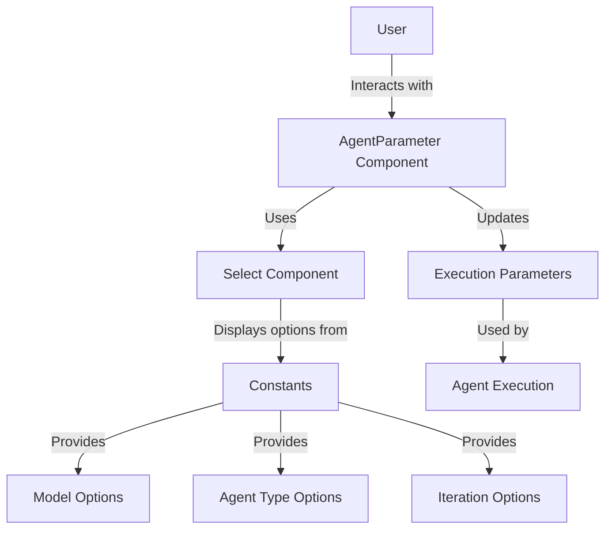
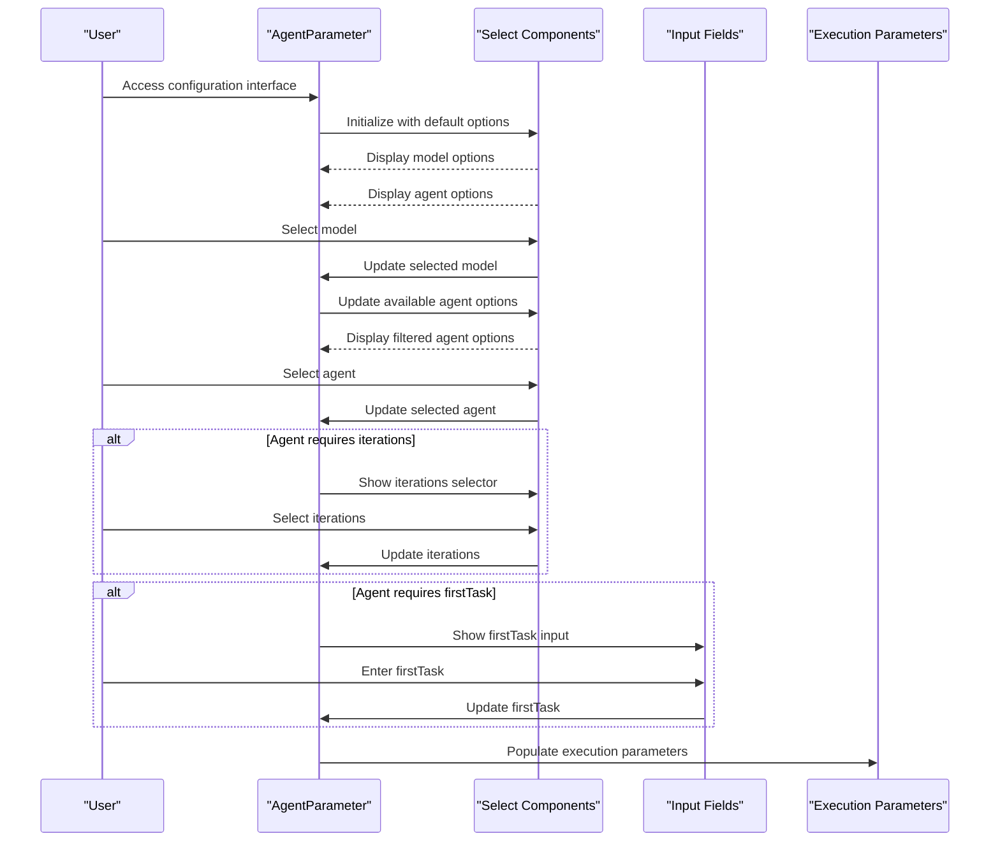

<!-- source: DeepWiki mcp.deepwiki.com · repo miurla/babyagi-ui · page 2.4 Agent Configuration Components · fetched 2026-10-26 -->

# Agent Configuration Components

<details>
<summary>Relevant source files</summary>

The following files were used as context for generating this wiki page:

- [src/components/Agent/AgentMessageHeader.tsx](src/components/Agent/AgentMessageHeader.tsx)
- [src/components/Agent/AgentParameter.tsx](src/components/Agent/AgentParameter.tsx)
- [src/components/Agent/ProjectTile.tsx](src/components/Agent/ProjectTile.tsx)
- [src/components/Agent/Select.tsx](src/components/Agent/Select.tsx)
- [src/types/index.ts](src/types/index.ts)
- [src/utils/constants.ts](src/utils/constants.ts)
- [src/utils/message.ts](src/utils/message.ts)
- [src/utils/settings.ts](src/utils/settings.ts)

</details>


This page documents the components used for setting agent parameters in BabyAGI-UI, including model selection, agent type selection, iteration settings, and other configuration options. For information about the agent task components, see [Agent Task Components](#2.3).

## 1. Configuration Component Overview

The agent configuration system allows users to customize their autonomous agents before execution. The key configuration parameters include:

- **Model**: The language model to use (e.g., GPT-4, GPT-3.5 Turbo)
- **Agent Type**: The agent implementation to run (e.g., BabyDeerAGI, BabyElfAGI)
- **Iterations**: How many iterations the agent should execute
- **First Task**: The initial task to start the execution (for certain agent types)

These configuration options are presented to the user through a set of specialized UI components and backed by predefined constants.



Sources:
- [src/components/Agent/AgentParameter.tsx:18-95]()
- [src/utils/constants.ts:8-83]()
- [src/types/index.ts:38-46]()

## 2. AgentParameter Component

The `AgentParameter` component is the main interface for configuring agent execution. It provides a unified UI for setting all necessary parameters before running an agent.

### 2.1. Component Structure

```mermaid
classDiagram
    class "AgentParameter" {
        +SelectItem model
        +setModel(model: SelectItem)
        +SelectItem iterations
        +setIterations(iterations: SelectItem)
        +String firstTask
        +setFirstTask(firstTask: String)
        +SelectItem agent
        +setAgent(agent: SelectItem)
    }
    
    "AgentParameter" --> "Select" : uses for model
    "AgentParameter" --> "Select" : uses for agent
    "AgentParameter" --> "Select" : uses for iterations
    "AgentParameter" --> "Input" : uses for firstTask
```

Sources:
- [src/components/Agent/AgentParameter.tsx:7-16]()
- [src/components/Agent/AgentParameter.tsx:18-95]()

### 2.2. Implementation Details

The `AgentParameter` component renders a form-like interface with several selection controls:

1. **Model Selection**: Dropdown for selecting the language model
2. **Agent Selection**: Dropdown for selecting the agent type
3. **Iterations Selection**: Dropdown for setting iteration count (shown only for specific agent types)
4. **First Task Input**: Text input for setting the initial task (shown only for specific agent types)

The component includes conditional logic that modifies available options based on selections:

```typescript
useEffect(() => {
  let option: SelectItem[] = [];
  if (model.id !== 'gpt-4') {
    option = AGENT.filter(
      (agent) =>
        agent.id === 'babyagi' ||
        agent.id === 'babydeeragi' ||
        agent.id === 'babyelfagi',
    );
  } else {
    option = AGENT;
  }
  setAgent(option[0]);
  setAgentOption(option);
}, [model]);
```

This effect hook restricts agent options based on the selected model, ensuring compatibility.

Sources:
- [src/components/Agent/AgentParameter.tsx:29-43]()
- [src/components/Agent/AgentParameter.tsx:45-94]()

## 3. Select Component

The `Select` component is a reusable dropdown component used for various configuration selections within AgentParameter.

### 3.1. Component Structure

```mermaid
classDiagram
    class "Select" {
        +String label
        +SelectItem item
        +SelectItem[] items
        +onChange(value: String)
        -iconLabel(item: SelectItem)
        -badge(item: SelectItem)
        -linkMessage()
    }
    
    class "SelectItem" {
        +String id
        +String name
        +String? message
        +String? icon
        +String? badge
    }
    
    "Select" --> "SelectItem" : uses
```

Sources:
- [src/components/Agent/Select.tsx:14-19]()
- [src/types/index.ts:1-7]()

### 3.2. Features

The `Select` component enhances the user experience with:

1. **Icons**: Displays icons for each option (emoji or image)
2. **Badges**: Shows status badges (e.g., "BETA", "STABLE")
3. **Information**: Provides additional details about options
4. **Styling**: Consistent styling with light/dark mode support

The component uses the Radix UI library for accessible dropdown functionality.

Sources:
- [src/components/Agent/Select.tsx:21-146]()

## 4. Configuration Options

BabyAGI-UI provides several predefined configuration options stored as constants.

### 4.1. Model Options

The following language models are available for selection:

| ID | Name | Icon | Badge |
|----|------|------|-------|
| gpt-4-1106-preview | OpenAI GPT-4 Turbo | openai-logo.svg | Preview |
| gpt-4 | OpenAI GPT-4 | openai-logo.svg | |
| gpt-3.5-turbo | OpenAI GPT-3.5 Turbo | openai-logo.svg | |

Sources:
- [src/utils/constants.ts:8-25]()

### 4.2. Agent Type Options

The system supports multiple agent types, each with different capabilities:

| ID | Name | Icon | Badge | Description |
|----|------|------|-------|------------|
| babyelfagi | BabyElfAGI | 🧝 | BETA | Agent with skills-based architecture |
| babydeeragi | BabyDeerAGI | 🦌 | STABLE | Agent with parallel tasking and user input | 
| babycatagi | BabyCatAGI | 🐱 | | Agent with web search and scraping |
| babybeeagi | BabyBeeAGI | 🐝 | | Agent with web search capabilities |
| babyagi | BabyAGI | 👶 | | Basic agent with core capabilities |

In the UI, only a subset of these agents might be available based on the selected model.

Sources:
- [src/utils/constants.ts:41-83]()

### 4.3. Iteration Options

The system provides predefined iteration count options:

| ID | Name |
|----|------|
| 0 | Infinity |
| 1 | 1 |
| 3 | 3 |
| 5 | 5 |
| 10 | 10 |
| 20 | 20 |
| 50 | 50 |

BabyBeeAGI has a special iteration setting: "Until All tasks completed 🐝".

Sources:
- [src/utils/constants.ts:27-39]()

## 5. Configuration Flow

The agent configuration process follows a specific flow:



Sources:
- [src/components/Agent/AgentParameter.tsx:29-43]()
- [src/components/Agent/AgentParameter.tsx:65-92]()

## 6. Integration with Agent Execution

The configuration components integrate with the rest of the application through the `ExecutionParams` type, which aggregates all configuration settings:

```typescript
export type ExecutionParams = {
  model: SelectItem;
  iterations: SelectItem;
  firstTask: string;
  objective: string;
  agent: AgentType;
};
```

These parameters are used to initialize and run the appropriate agent with the specified configuration.

Sources:
- [src/types/index.ts:38-45]()

## 7. Agent-Specific Configuration Behaviors

Different agent types have specific configuration requirements:

1. **BabyAGI (Base Agent)**
   - Requires iterations setting
   - Requires first task setting

2. **BabyDeerAGI & BabyElfAGI**
   - Does not require first task setting (handled internally)
   - May have restrictions on model compatibility

3. **BabyBeeAGI**
   - Uses special iteration setting ("Until All tasks completed")

The `AgentParameter` component includes conditional rendering logic to show only relevant configuration options based on the selected agent type.

Sources:
- [src/components/Agent/AgentParameter.tsx:65-92]()
- [src/utils/constants.ts:37-39]()

---

