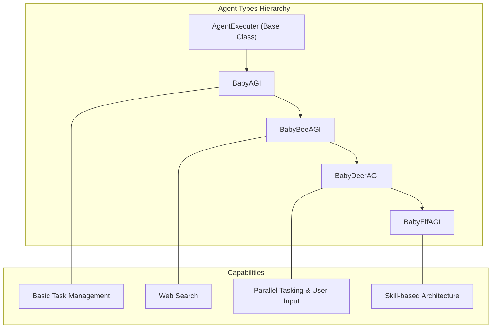
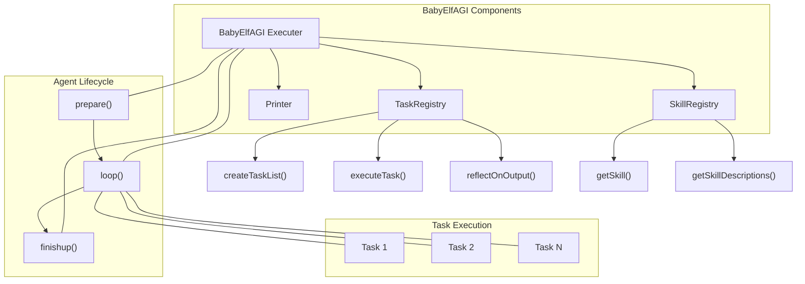
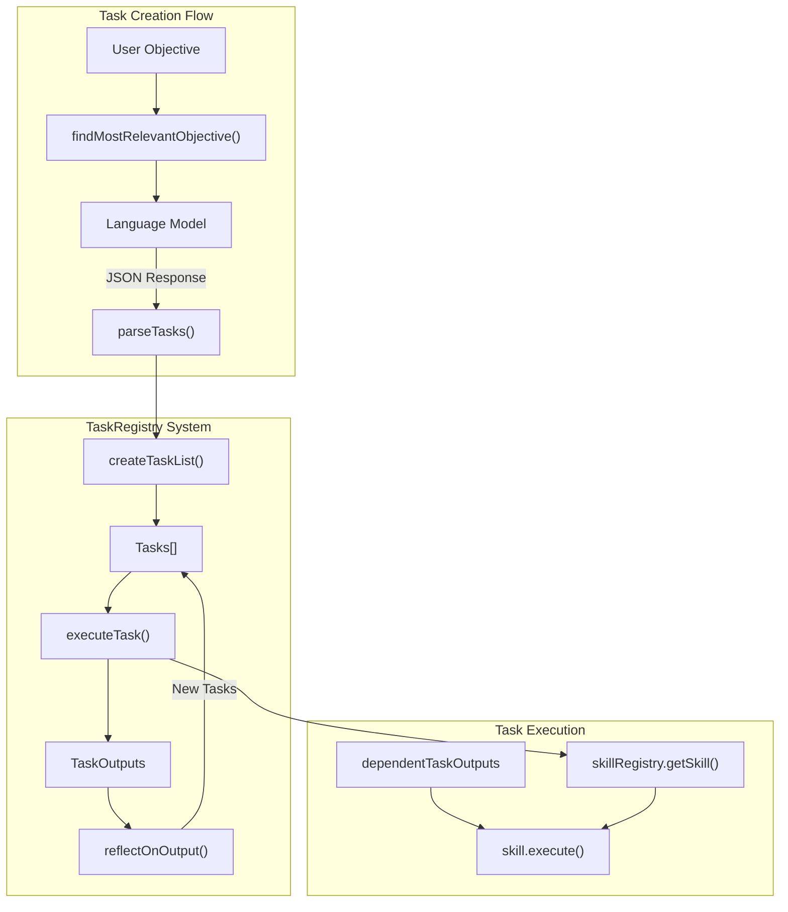
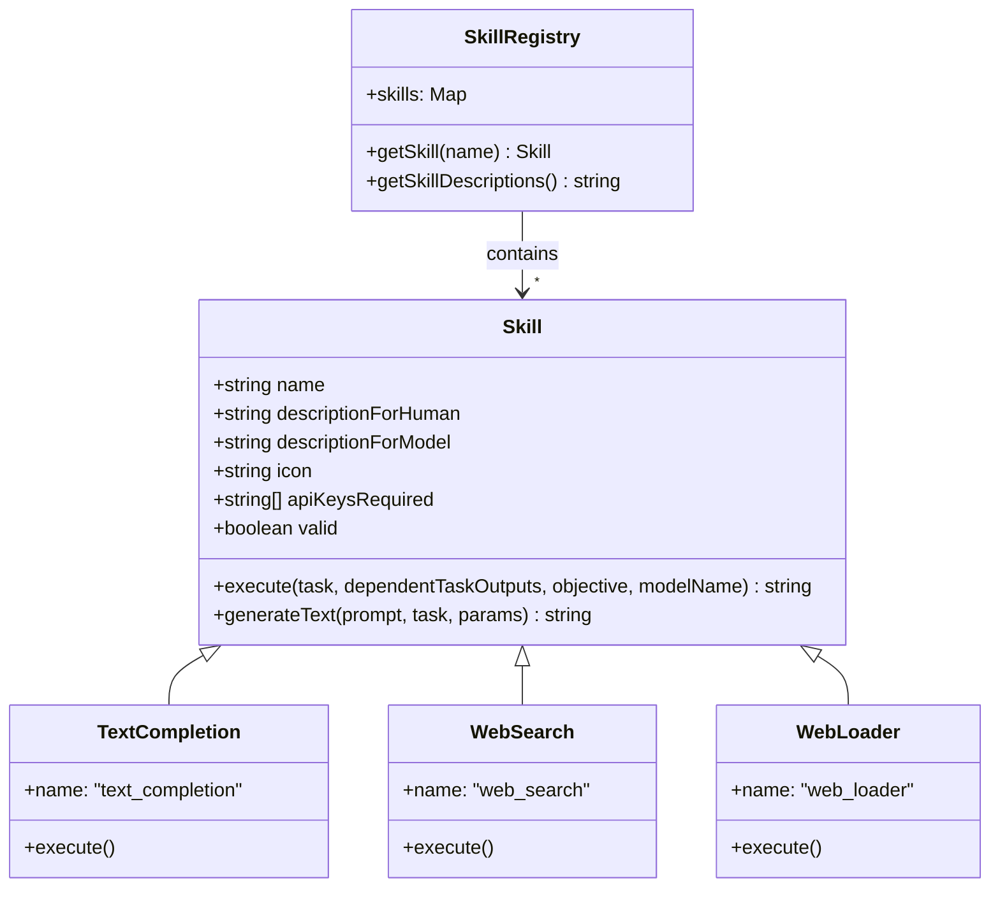
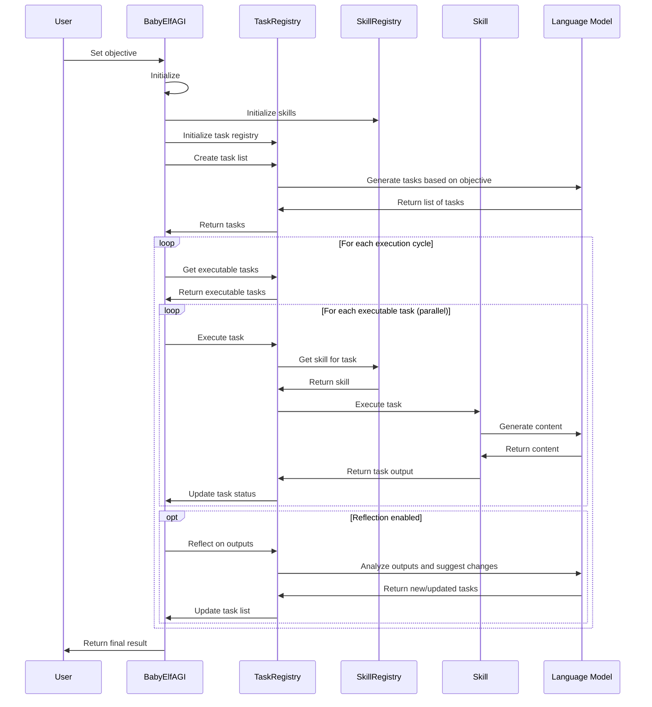
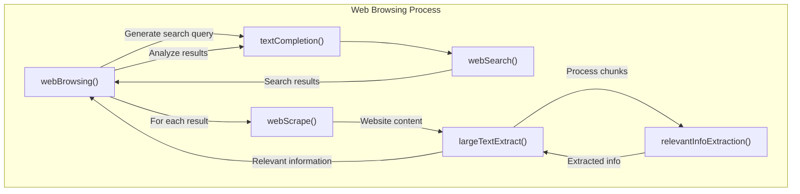
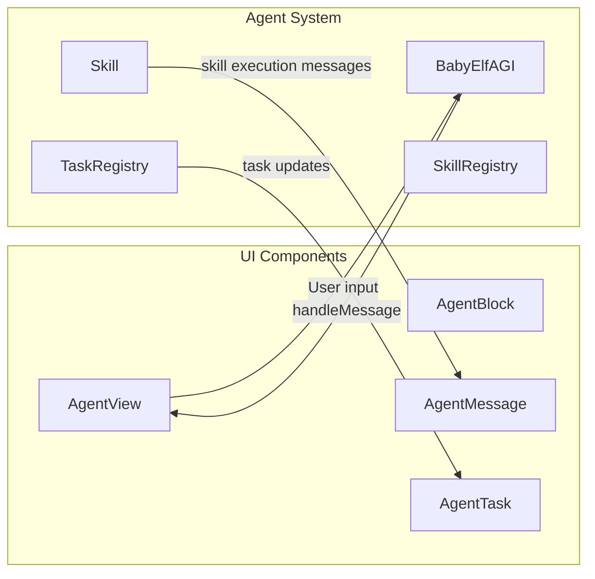

<!-- source: DeepWiki mcp.deepwiki.com · repo miurla/babyagi-ui · page 3 Agent Architecture · fetched 2026-10-26 -->

# Agent Architecture

Relevant source files

The following files were used as context for generating this wiki page:

- [src/components/Agent/AgentCollapsible.tsx](src/components/Agent/AgentCollapsible.tsx)
- [src/lib/agents/babyelfagi/executer.ts](src/lib/agents/babyelfagi/executer.ts)
- [src/lib/agents/babyelfagi/registory/taskRegistry.ts](src/lib/agents/babyelfagi/registory/taskRegistry.ts)
- [src/lib/agents/babyelfagi/skills/presets/textCompletion.ts](src/lib/agents/babyelfagi/skills/presets/textCompletion.ts)
- [src/lib/agents/babyelfagi/skills/presets/webLoader.ts](src/lib/agents/babyelfagi/skills/presets/webLoader.ts)
- [src/lib/agents/babyelfagi/skills/presets/webSearch.ts](src/lib/agents/babyelfagi/skills/presets/webSearch.ts)
- [src/lib/agents/babyelfagi/skills/skill.ts](src/lib/agents/babyelfagi/skills/skill.ts)
- [src/lib/agents/babyelfagi/tools/utils/largeTextExtract.ts](src/lib/agents/babyelfagi/tools/utils/largeTextExtract.ts)
- [src/lib/agents/babyelfagi/tools/utils/relevantInfoExtraction.ts](src/lib/agents/babyelfagi/tools/utils/relevantInfoExtraction.ts)
- [src/lib/agents/babyelfagi/tools/utils/textCompletion.ts](src/lib/agents/babyelfagi/tools/utils/textCompletion.ts)
- [src/lib/agents/babyelfagi/tools/webBrowsing.ts](src/lib/agents/babyelfagi/tools/webBrowsing.ts)

This document provides an overview of the agent system architecture in BabyAGI-UI, explaining the different agent types and their core components. For information about the user interface that interacts with these agents, see [User Interface Components](#2).

The agent architecture in BabyAGI-UI is built around a hierarchy of increasingly capable agent types, each extending the capabilities of its predecessor. All agents share a common execution flow but differ in their specialized abilities and skills. This page documents how these agents are structured, how they manage tasks, and how they utilize different skills to accomplish user objectives.

## Agent Types Hierarchy

BabyAGI-UI implements a family of agent types, each designed for specific use cases and capabilities.

**Agent Types**:
- **BabyAGI**: Base agent with fundamental task creation, execution, and prioritization
- **BabyBeeAGI**: Extends BabyAGI with web search capabilities
- **BabyDeerAGI**: Adds parallel task execution and user input handling
- **BabyElfAGI**: Implements a skills-based architecture for more flexible and specialized task execution

Sources: [src/lib/agents/babyelfagi/executer.ts]()

## Core Agent Components

The BabyElfAGI agent, which is the most advanced agent type, consists of several key components that work together to execute tasks and accomplish user objectives.

Sources: [src/lib/agents/babyelfagi/executer.ts](), [src/lib/agents/babyelfagi/registory/taskRegistry.ts]()

### Agent Lifecycle

1. **Initialization**: An agent is initialized with an objective, model name, handlers for messages and errors, language settings, and optionally specific skills and an API key.

2. **Preparation Phase**:
   - The agent initializes the skill registry and task registry
   - Task list is created based on the objective
   - Tasks are printed to the UI

3. **Execution Loop**:
   - Tasks are executed based on their dependencies
   - Task outputs are collected
   - The loop continues until all tasks are completed

4. **Finalization**:
   - The result of the last task is provided as the final output
   - A session summary is generated
   - Cleanup actions are performed

Sources: [src/lib/agents/babyelfagi/executer.ts:8-199]()

## Task Management System

The task management system is responsible for creating, executing, and managing tasks for agents. It is implemented primarily through the `TaskRegistry` class.

Sources: [src/lib/agents/babyelfagi/registory/taskRegistry.ts:7-268]()

### Task Creation Process

1. The `createTaskList` method uses the language model to generate tasks based on the objective
2. It finds the most relevant objective using vector similarity to provide examples
3. It uses a prompt that includes the objective, available skills, and examples to create tasks
4. Tasks are parsed from the LLM response and stored in the registry

Each task contains:
- ID: Unique identifier
- Task: Description of what needs to be done
- Skill: The skill required to execute the task
- Icon: Visual representation for the UI
- Dependent Task IDs: IDs of tasks that must be completed before this one
- Status: Current state (incomplete, running, complete)

Sources: [src/lib/agents/babyelfagi/registory/taskRegistry.ts:30-119]()

### Task Execution Process

1. The agent selects tasks that are ready to be executed (all dependencies completed)
2. It executes tasks in parallel (up to 5 at a time)
3. Each task is executed by retrieving the appropriate skill and calling its `execute` method
4. Task outputs are collected and used for dependent tasks
5. Task status is updated and results are displayed in the UI

Sources: [src/lib/agents/babyelfagi/executer.ts:76-174](), [src/lib/agents/babyelfagi/registory/taskRegistry.ts:120-149]()

### Task Reflection (Optional)

The system can optionally reflect on completed tasks to generate new tasks or update existing ones:

1. The `reflectOnOutput` method analyzes a task's output
2. It can suggest new tasks to add to the task list
3. It can suggest updates to existing tasks
4. These suggestions are implemented by the agent executor

Sources: [src/lib/agents/babyelfagi/registory/taskRegistry.ts:170-267](), [src/lib/agents/babyelfagi/executer.ts:146-169]()

## Skills System

The BabyElfAGI agent's most distinctive feature is its skill-based architecture. Skills are modular components that enable agents to perform specific types of tasks.

Sources: [src/lib/agents/babyelfagi/skills/skill.ts:8-181](), [src/lib/agents/babyelfagi/skills/presets/textCompletion.ts](), [src/lib/agents/babyelfagi/skills/presets/webSearch.ts](), [src/lib/agents/babyelfagi/skills/presets/webLoader.ts]()

### Skill Base Class

The `Skill` class serves as the foundation for all skills in the system:

- **Properties**:
  - `name`: Unique identifier for the skill
  - `descriptionForHuman`: Description shown to users
  - `descriptionForModel`: Description provided to the language model
  - `icon`: Visual representation in the UI
  - `apiKeysRequired`: API keys needed for the skill to function
  - `valid`: Whether the skill can be used (based on API keys and environment)

- **Methods**:
  - `execute()`: Main method that performs the skill's function
  - `generateText()`: Helper method for generating text using a language model
  - `callbackMessage()`: Sends messages to the UI

Sources: [src/lib/agents/babyelfagi/skills/skill.ts:8-181]()

### Core Skills

1. **Text Completion**
   - Generates, summarizes, and analyzes text
   - Uses OpenAI's text completion API
   - Basic skill used for most general-purpose tasks

2. **Web Search**
   - Performs web searches to gather information
   - Uses web browsing tools to search and extract relevant content
   - Specialized for retrieving up-to-date information

3. **Web Loader**
   - Extracts URLs from tasks and retrieves web page contents
   - Processes and extracts relevant information from web pages
   - Used for detailed analysis of specific websites

Sources: [src/lib/agents/babyelfagi/skills/presets/textCompletion.ts:4-35](), [src/lib/agents/babyelfagi/skills/presets/webSearch.ts:7-37](), [src/lib/agents/babyelfagi/skills/presets/webLoader.ts:7-125]()

## Task Execution Flow

The following diagram illustrates the end-to-end flow of a task execution in the BabyElfAGI agent.

Sources: [src/lib/agents/babyelfagi/executer.ts:76-174](), [src/lib/agents/babyelfagi/registory/taskRegistry.ts:30-149]()

## Agent Communication System

Agents communicate with the UI through a message system that includes different types of messages for different purposes.

| Message Type | Purpose | Properties |
|-------------|---------|------------|
| `task-list` | Display initial task list | `id`, `content`, `type`, `style`, `status` |
| `task` | Display task being executed | `id`, `taskId`, `content`, `type`, `status` |
| `log` | Display informational logs | `id`, `taskId`, `content`, `type`, `style`, `status` |
| `text` | Display text output from skills | `id`, `taskId`, `content`, `type`, `status` |
| `result` | Display final result | `id`, `content`, `type` |
| `session-summary` | Provide summary of the session | `id`, `content`, `type` |

Sources: [src/lib/agents/babyelfagi/executer.ts:183-193](), [src/lib/agents/babyelfagi/tools/webBrowsing.ts:153-161](), [src/lib/agents/babyelfagi/skills/skill.ts:157-167]()

### Web Browsing Tools

The web browsing tools are an important part of the agent's capabilities, enabling it to search the web, browse websites, and extract relevant information.

Sources: [src/lib/agents/babyelfagi/tools/webBrowsing.ts:10-186](), [src/lib/agents/babyelfagi/tools/utils/largeTextExtract.ts:5-46](), [src/lib/agents/babyelfagi/tools/utils/relevantInfoExtraction.ts:9-62]()

## Integration with UI

Agents integrate with the UI through the message system, displaying their progress and results in the AgentView component.

The collapsible component used in the UI allows for organizing and displaying agent task information in a structured way. Messages from agents are grouped and displayed in blocks corresponding to tasks or skill executions.

Sources: [src/components/Agent/AgentCollapsible.tsx:12-38]()

## Conclusion

The agent architecture in BabyAGI-UI is designed to be modular, extensible, and capable of handling a wide range of tasks. The progression from the basic BabyAGI to the advanced BabyElfAGI shows the evolution of capabilities, with each agent type building on the previous one.

The skill-based architecture of BabyElfAGI, in particular, allows for flexible composition of capabilities, enabling the agent to handle complex tasks by breaking them down into smaller, specialized sub-tasks.

For further details on specific agent implementations, see:
- [BabyAGI Base Agent](#3.1)
- [BabyDeerAGI](#3.2)
- [BabyElfAGI](#3.3)
- [Agent Skills System](#3.4)

---

