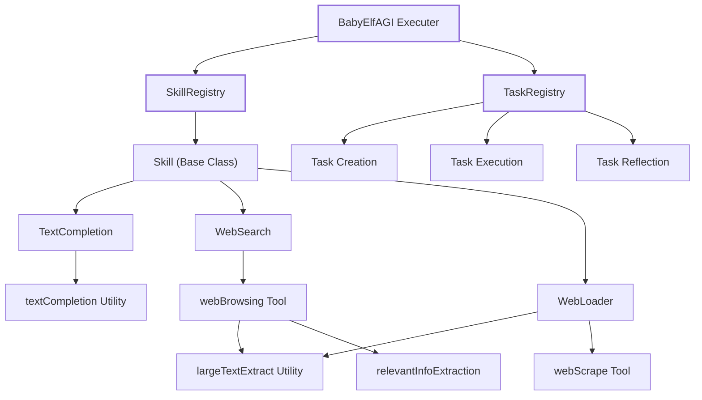
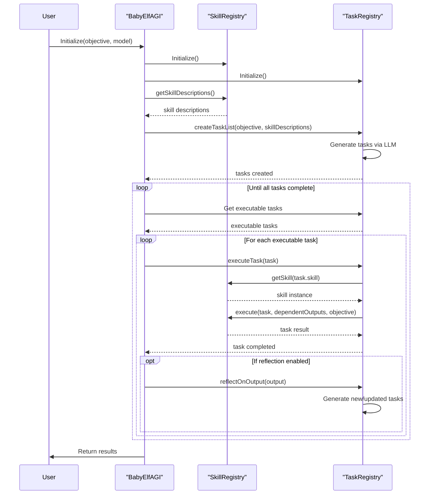
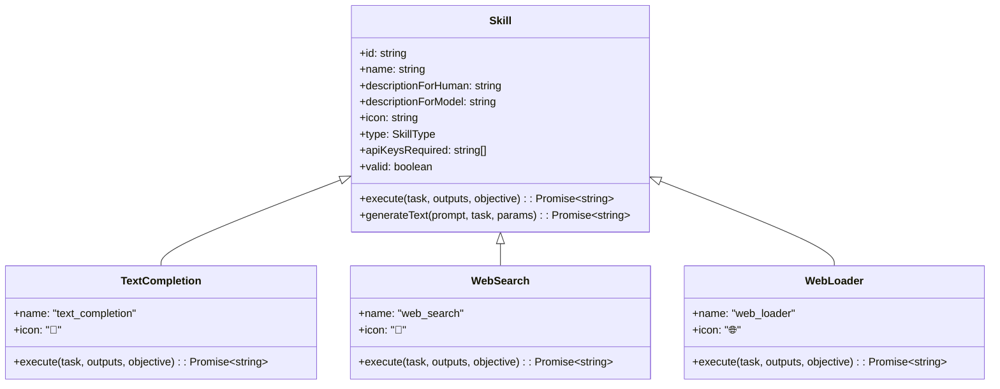
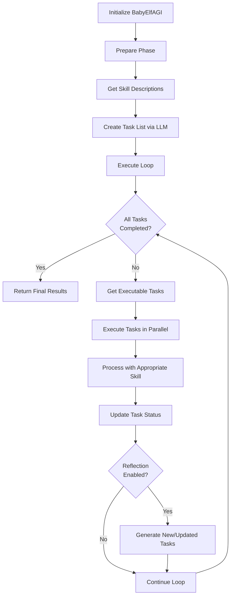

<!-- source: DeepWiki mcp.deepwiki.com · repo miurla/babyagi-ui · page 3.3 BabyElfAGI · fetched 2026-10-26 -->

# BabyElfAGI

<details>
<summary>Relevant source files</summary>

The following files were used as context for generating this wiki page:

- [src/lib/agents/babyelfagi/executer.ts](src/lib/agents/babyelfagi/executer.ts)
- [src/lib/agents/babyelfagi/registory/taskRegistry.ts](src/lib/agents/babyelfagi/registory/taskRegistry.ts)
- [src/lib/agents/babyelfagi/skills/presets/textCompletion.ts](src/lib/agents/babyelfagi/skills/presets/textCompletion.ts)
- [src/lib/agents/babyelfagi/skills/presets/webLoader.ts](src/lib/agents/babyelfagi/skills/presets/webLoader.ts)
- [src/lib/agents/babyelfagi/skills/presets/webSearch.ts](src/lib/agents/babyelfagi/skills/presets/webSearch.ts)
- [src/lib/agents/babyelfagi/skills/skill.ts](src/lib/agents/babyelfagi/skills/skill.ts)
- [src/lib/agents/babyelfagi/tools/utils/largeTextExtract.ts](src/lib/agents/babyelfagi/tools/utils/largeTextExtract.ts)
- [src/lib/agents/babyelfagi/tools/utils/relevantInfoExtraction.ts](src/lib/agents/babyelfagi/tools/utils/relevantInfoExtraction.ts)
- [src/lib/agents/babyelfagi/tools/utils/textCompletion.ts](src/lib/agents/babyelfagi/tools/utils/textCompletion.ts)
- [src/lib/agents/babyelfagi/tools/webBrowsing.ts](src/lib/agents/babyelfagi/tools/webBrowsing.ts)

</details>


BabyElfAGI is an advanced agent type in the BabyAGI-UI system that implements a skills-based architecture for executing complex tasks. It extends the base agent capabilities with a modular skill system that allows for flexible task execution through specialized skill modules. This document covers the BabyElfAGI architecture, its skill system, task management capabilities, and execution flow.

For information about other agent types, see [BabyAGI Base Agent](#3.1) and [BabyDeerAGI](#3.2). For a detailed exploration of the skill system itself, see [Agent Skills System](#3.4).

## Architecture Overview

BabyElfAGI introduces a modular architecture centered around two primary components: a skill registry that manages available skills and a task registry that handles task creation and execution.



Sources: [src/lib/agents/babyelfagi/executer.ts:8-199](), [src/lib/agents/babyelfagi/registory/taskRegistry.ts:7-268]()

## Core Components

### BabyElfAGI Executer

The `BabyElfAGI` class is the main entry point that extends the base `AgentExecuter`. It orchestrates the execution of tasks using the skill and task registries.

Key properties:
- `skillRegistry`: Manages all available skills
- `taskRegistry`: Handles task creation and execution
- `sessionSummary`: Accumulates task outputs for the final summary

Main methods:
- `prepare()`: Initializes the agent and creates the task list
- `loop()`: Executes tasks until completion
- `finishup()`: Returns final results



Sources: [src/lib/agents/babyelfagi/executer.ts:8-199]()

### Skill Registry

The `SkillRegistry` manages all available skills and provides methods to retrieve them by name. It's responsible for:

1. Registering built-in and custom skills
2. Retrieving skills by name for task execution
3. Generating descriptions of available skills for task creation

Each skill inherits from the base `Skill` class and implements its own execution logic.

Sources: [src/lib/agents/babyelfagi/skills/skill.ts:6-181]()

### Task Registry

The `TaskRegistry` handles all aspects of task management:

1. Creating tasks based on the objective and available skills
2. Executing tasks using the appropriate skill
3. Managing task dependencies
4. Optionally reflecting on task outputs to generate new tasks

```typescript
async createTaskList(id, objective, skillDescriptions, modelName, handleMessage)
async executeTask(i, task, taskOutputs, objective, skillRegistry, modelName)
async reflectOnOutput(objective, taskOutput, skillDescriptions, modelName)
```

Sources: [src/lib/agents/babyelfagi/registory/taskRegistry.ts:7-268]()

## Skill System

The skill system is the core innovation of BabyElfAGI. Each skill is a specialized module that can perform a specific type of task.

### Base Skill Class

All skills inherit from the `Skill` base class, which provides:

- Core properties: name, description, icon
- Validation of required API keys
- Text generation via language models
- Message handling for UI feedback



Sources: [src/lib/agents/babyelfagi/skills/skill.ts:6-181]()

### Built-in Skills

BabyElfAGI includes several built-in skills:

#### 1. Text Completion

The `TextCompletion` skill generates, summarizes, or analyzes text using language models.

```typescript
async execute(task, dependentTaskOutputs, objective, modelName): Promise<string> {
  const prompt = `Complete your assigned task based on the objective and only based on information provided in the dependent task output, if provided. \n###
    Output must be answered in ${this.language}.
    Your objective: ${objective}. \n###
    Your task: ${task.task} \n###
    Dependent tasks output: ${dependentTaskOutputs}  ###
    RESPONSE:`;

  return this.generateText(prompt, task, {
    temperature: 0.2,
    maxTokens: 800,
    modelName: modelName === 'gpt-4-1106-preview' ? modelName : 'gpt-3.5-turbo-16k',
  });
}
```

Sources: [src/lib/agents/babyelfagi/skills/presets/textCompletion.ts:1-35]()

#### 2. Web Search

The `WebSearch` skill performs web searches and returns relevant information using the `webBrowsing` tool.

Sources: [src/lib/agents/babyelfagi/skills/presets/webSearch.ts:1-38](), [src/lib/agents/babyelfagi/tools/webBrowsing.ts:10-186]()

#### 3. Web Loader

The `WebLoader` skill extracts content from specified URLs, using utilities like `webScrape` and `largeTextExtract`.

Sources: [src/lib/agents/babyelfagi/skills/presets/webLoader.ts:1-126](), [src/lib/agents/babyelfagi/tools/utils/largeTextExtract.ts:1-46]()

## Task Execution Flow

BabyElfAGI follows a structured execution flow:



The execution process consists of these main phases:

### 1. Preparation Phase

The agent initializes the skill and task registries and creates the initial task list based on the objective:

```typescript
async prepare() {
  await super.prepare();
  const skillDescriptions = this.skillRegistry.getSkillDescriptions();
  await this.taskRegistry.createTaskList(
    id,
    this.objective,
    skillDescriptions,
    this.modelName,
    this.handlers.handleMessage,
  );
  this.printer.printTaskList(this.taskRegistry.tasks, id);
}
```

Sources: [src/lib/agents/babyelfagi/executer.ts:53-74]()

### 2. Execution Loop

Tasks are executed in order, respecting dependencies. Multiple tasks can be executed in parallel if they're independent:

```typescript
async loop() {
  let taskOutputs: TaskOutputs = {};
  // Initialize task outputs
  for (let task of this.taskRegistry.tasks) {
    taskOutputs[task.id] = { completed: false, output: undefined };
  }
  
  // Loop until all tasks are completed
  while (!this.signal?.aborted && !Object.values(taskOutputs).every((task) => task.completed)) {
    // Get executable tasks
    const executableTasks = /* filter tasks that can be executed based on dependencies */
    
    // Execute tasks in parallel
    const taskPromises = executableTasks.map(async (task) => {
      // Execute task with appropriate skill
      const output = await this.taskRegistry.executeTask(
        i, task, taskOutputs, this.objective, this.skillRegistry, this.modelName,
      );
      
      // Update task output and status
      taskOutputs[task.id] = { completed: true, output: output };
      this.taskRegistry.updateTasks({
        id: task.id,
        updates: { status: 'complete', result: output },
      });
      
      // Optional: Reflect on output and generate new tasks
      if (REFLECTION) {
        // Reflect and possibly add new tasks or update existing ones
      }
    });
    
    await Promise.all(taskPromises);
  }
}
```

Sources: [src/lib/agents/babyelfagi/executer.ts:76-175]()

### 3. Task Execution

Each task is executed using the appropriate skill based on the task's `skill` property:

```typescript
async executeTask(i, task, taskOutputs, objective, skillRegistry, modelName) {
  const skill = skillRegistry.getSkill(task.skill ?? '');
  const dependentTaskOutputs = task.dependentTaskIds
    ? task.dependentTaskIds.map((id) => taskOutputs[id].output).join('\n')
    : '';

  return await skill.execute(
    task,
    dependentTaskOutputs,
    objective,
    modelName,
  );
}
```

Sources: [src/lib/agents/babyelfagi/registory/taskRegistry.ts:121-140]()

### 4. Optional Task Reflection

BabyElfAGI can optionally reflect on completed tasks to generate new tasks or update existing ones:

```typescript
async reflectOnOutput(objective, taskOutput, skillDescriptions, modelName) {
  // Generate prompt for reflection
  const prompt = `You are an expert task manager, review the task output to decide at least one new task to add...`;
  
  // Get reflection from language model
  const response = await model.call([
    new SystemChatMessage('You are a task creation AI.'),
    new HumanChatMessage(prompt),
  ]);
  
  // Parse and return new tasks, insertion points, and updates
  try {
    const taskList = JSON.parse(response.text);
    return [taskList[0], taskList[1], taskList[2]];
  } catch (error) {
    console.error(error);
  }
  
  return [[], [], []];
}
```

Sources: [src/lib/agents/babyelfagi/registory/taskRegistry.ts:170-267]()

## Utilities and Support Tools

BabyElfAGI relies on several utility functions to support its skills:

### Text Processing Utilities

- `textCompletion`: Generates text using language models
- `largeTextExtract`: Processes large texts by chunking and extracting relevant information
- `relevantInfoExtraction`: Extracts information relevant to the objective from text

Sources: [src/lib/agents/babyelfagi/tools/utils/textCompletion.ts:5-112](), [src/lib/agents/babyelfagi/tools/utils/largeTextExtract.ts:5-46](), [src/lib/agents/babyelfagi/tools/utils/relevantInfoExtraction.ts:9-62]()

### Web Tools

- `webBrowsing`: Performs web searches and extracts relevant information
- `webScrape`: Extracts content from web pages

Sources: [src/lib/agents/babyelfagi/tools/webBrowsing.ts:10-186]()

## Usage Example

Here's how the BabyElfAGI execution flow works with a concrete example:

1. User provides an objective: "Research the latest advancements in renewable energy"
2. BabyElfAGI creates a task list using available skills:
   - Task 1: "Search for recent developments in renewable energy" (web_search)
   - Task 2: "Analyze and summarize the information" (text_completion)
   - Task 3: "Extract key trends and technologies" (text_completion)
3. BabyElfAGI executes the tasks in order:
   - Task 1 uses WebSearch skill to find information
   - Task 2 uses TextCompletion skill to process the results from Task 1
   - Task 3 uses TextCompletion skill to identify trends, depending on Task 2
4. BabyElfAGI returns the final result and a session summary

## Conclusion

BabyElfAGI represents a significant advancement over the base BabyAGI agent with its modular skill-based architecture. This design provides several key advantages:

1. **Modularity**: New skills can be easily added without modifying the core agent
2. **Flexibility**: Tasks can use different skills based on their requirements
3. **Adaptability**: Optional reflection allows the agent to adapt its approach based on intermediate results

The skill-based approach also makes BabyElfAGI more extensible, allowing developers to implement custom skills for specialized tasks.

---

