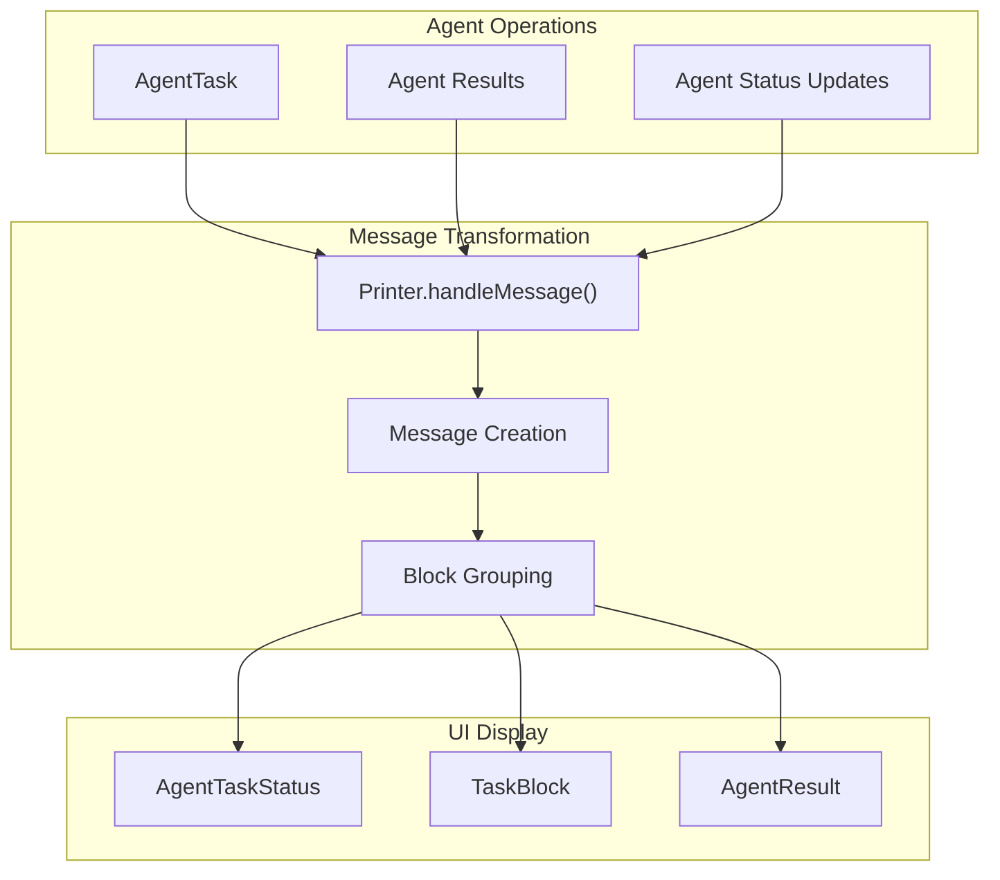
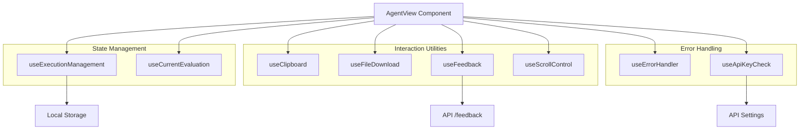
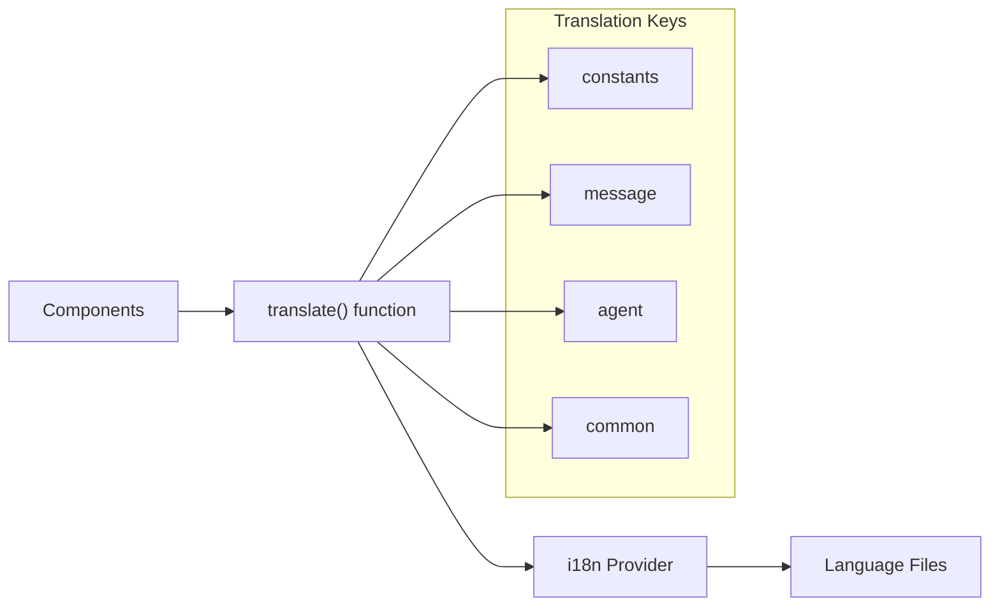
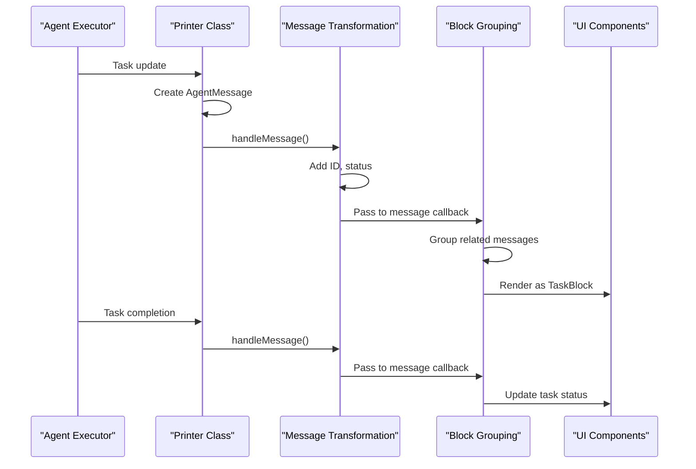
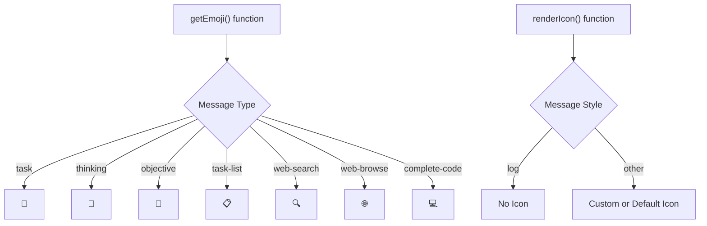

<!-- source: DeepWiki mcp.deepwiki.com · repo miurla/babyagi-ui · page 4 Core Utilities · fetched 2026-10-26 -->

# Core Utilities

<details>
<summary>Relevant source files</summary>

The following files were used as context for generating this wiki page:

- [src/components/Agent/AgentInput.tsx](src/components/Agent/AgentInput.tsx)
- [src/components/Agent/FeedbackButtons.tsx](src/components/Agent/FeedbackButtons.tsx)
- [src/components/Agent/IntroGuide.tsx](src/components/Agent/IntroGuide.tsx)
- [src/components/Agent/TaskBlock.tsx](src/components/Agent/TaskBlock.tsx)
- [src/hooks/index.ts](src/hooks/index.ts)
- [src/hooks/useApiKeyCheck.ts](src/hooks/useApiKeyCheck.ts)
- [src/hooks/useClipboard.tsx](src/hooks/useClipboard.tsx)
- [src/hooks/useCurrentEvaluation.ts](src/hooks/useCurrentEvaluation.ts)
- [src/hooks/useErrorHandler.ts](src/hooks/useErrorHandler.ts)
- [src/hooks/useExecutionManagement.tsx](src/hooks/useExecutionManagement.tsx)
- [src/hooks/useFeedback.ts](src/hooks/useFeedback.ts)
- [src/utils/print.ts](src/utils/print.ts)

</details>


This page documents the core utility functions, classes, and hooks that provide essential functionality throughout the BabyAGI-UI application. These utilities serve as the foundation that connects the user interface with the agent system, handles messaging, manages state, and provides various helper functions used across the application.

For information about message formatting specifically, see [Message Formatting Utilities](#4.1). For information about custom React hooks, see [Hook Utilities](#4.2).

## 1. Printer System

At the core of BabyAGI-UI's communication system is the `Printer` class, which serves as a bridge between the agent execution engine and the user interface. This utility is responsible for transforming internal agent operations into structured messages that can be displayed in the UI.

```mermaid
classDiagram
    class "Printer" {
        +messageCallback: function
        +verbose: boolean
        +printObjective(objective)
        +printNextTask(task)
        +printTaskExecute(task)
        +printTaskList(taskList, id)
        +printTaskOutput(output, task)
        +printTaskCompleted()
        +printAllTaskCompleted()
        +handleMessage(message)
    }
    
    class "AgentMessage" {
        +id: string
        +content: string
        +type: string
        +title?: string
        +icon?: string
        +status?: string
        +taskId?: string
        +options?: object
    }
    
    class "AgentTask" {
        +id: string
        +task: string
        +status: string
        +dependentTaskIds?: string[]
        +skill: string
        +icon?: string
    }
    
    "Printer" --> "AgentMessage" : creates
    "AgentTask" --> "Printer" : input to
```

The `Printer` class provides methods for outputting different types of agent operations:

- `printObjective`: Displays the initial objective of the agent
- `printTaskExecute`: Shows when a task is being executed
- `printTaskList`: Displays the full list of tasks and their statuses
- `printAllTaskCompleted`: Indicates all tasks have been completed

The core method `handleMessage` ensures all messages have unique IDs and proper status values before sending them to the UI via the message callback.

Sources: [src/utils/print.ts:4-105]()

## 2. Message Structure and Transformation

Messages in BabyAGI-UI follow a structured format that allows for consistent display across the interface. The system transforms agent operations into displayable message blocks through a series of utility functions.



The message transformation process includes:

1. Creating structured messages with properties like `type`, `content`, `status`, and `taskId`
2. Converting these messages into UI-friendly formats
3. Grouping related messages into blocks for display

Sources: [src/utils/print.ts:16-104](), [src/components/Agent/TaskBlock.tsx:13-80]()

## 3. Custom React Hooks

BabyAGI-UI includes a comprehensive set of custom React hooks that provide reusable functionality throughout the application. These hooks encapsulate complex logic and state management to simplify component code.



### 3.1 State Management Hooks

- **useExecutionManagement**: Manages the creation, selection, and updating of agent executions
- **useCurrentEvaluation**: Retrieves the evaluation status (good/bad) for a selected execution

### 3.2 Interaction Hooks

- **useClipboard**: Provides functionality to copy text to the clipboard with success notifications
- **useFeedback**: Handles user feedback on execution results and sends it to the server
- **useScrollControl**: Manages scrolling behavior during agent execution

### 3.3 Error Handling Hooks

- **useErrorHandler**: Provides standardized error handling with toast notifications and analytics tracking
- **useApiKeyCheck**: Verifies API key settings and alerts users when needed

Sources: [src/hooks/index.ts:1-12](), [src/hooks/useErrorHandler.ts:1-13](), [src/hooks/useClipboard.tsx:1-15](), [src/hooks/useFeedback.ts:1-61](), [src/hooks/useApiKeyCheck.ts:1-32](), [src/hooks/useExecutionManagement.tsx:1-55]()

## 4. Translation Utility

BabyAGI-UI implements internationalization through a `translate` utility function that's used throughout the application. This function retrieves text strings based on the current language setting.



The `translate` utility:
- Takes a key and a namespace (e.g., 'constants', 'agent')
- Retrieves the appropriate string from language files
- Is used extensively throughout UI components

Example usage:
```typescript
// Example from IntroGuide.tsx
translate('EXAMPLES', 'constants')
```

Sources: [src/components/Agent/IntroGuide.tsx:1-52](), [src/components/Agent/AgentInput.tsx:2-182]()

## 5. Utility Integration Table

The following table shows how core utilities are integrated across different parts of the application:

| Utility | Primary Use Cases | Related Components | Key Features |
|---------|------------------|-------------------|-------------|
| Printer | Agent output handling | AgentView, AgentBlock | Task visualization, message formatting |
| Translation | UI text localization | All UI components | 40+ language support, namespace organization |
| useErrorHandler | Error handling | API calls, agent operations | Toast notifications, analytics tracking |
| useClipboard | Copy functionality | AgentInput, result sharing | User feedback, analytics |
| useFeedback | User feedback system | AgentInput, execution results | Good/bad rating, feedback submission |
| useExecutionManagement | Execution state | Sidebar, AgentView | Storage, retrieval, selection of executions |
| useApiKeyCheck | Configuration validation | Settings, agent initialization | User prompting, validation |

Sources: [src/hooks/index.ts:1-12](), [src/components/Agent/AgentInput.tsx:50-182](), [src/components/Agent/FeedbackButtons.tsx:1-38]()

## 6. Message Flow System

The message system in BabyAGI-UI follows a specific flow from agent operations to UI representation. Understanding this flow is essential for working with the codebase.



This flow ensures that agent operations are consistently represented in the UI, with proper formatting and grouping of related messages.

Sources: [src/utils/print.ts:16-104](), [src/components/Agent/TaskBlock.tsx:13-80]()

## 7. Emoji and Icon Utilities

BabyAGI-UI includes utilities for selecting appropriate icons and emojis for different message types, enhancing visual comprehension of agent operations.



The icon system provides visual cues that help users quickly understand the type of operation being performed or displayed.

Sources: [src/components/Agent/TaskBlock.tsx:13-17]()

## Summary

The Core Utilities of BabyAGI-UI provide the essential functionality that connects the user interface with the agent execution system. The `Printer` class serves as a bridge between these systems, while custom React hooks provide reusable state management and functionality. Translation utilities enable internationalization, and message formatting utilities ensure consistent display of agent operations.

Understanding these core utilities is fundamental to working with the BabyAGI-UI codebase, as they are used extensively throughout the application.

---

