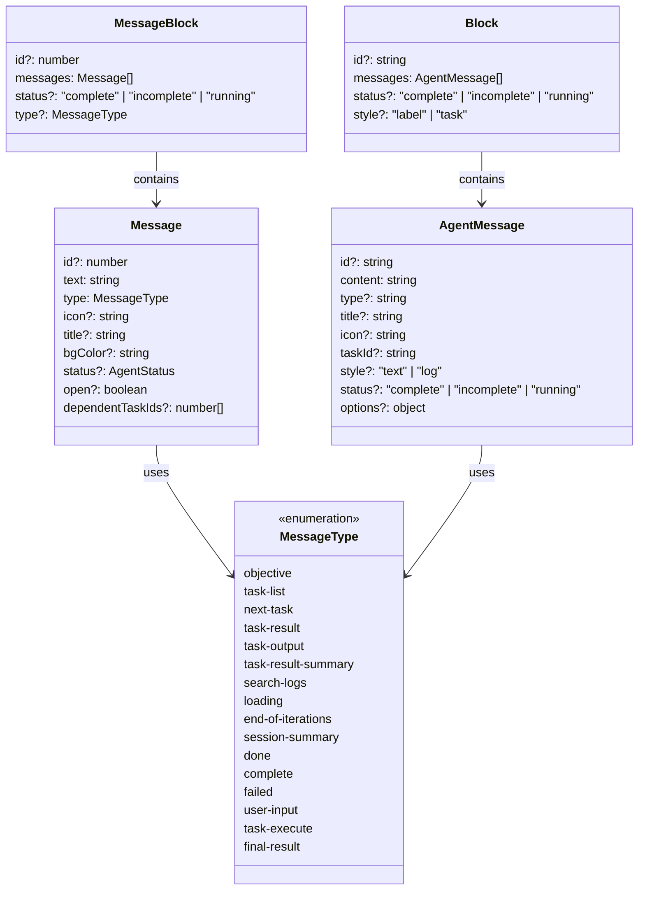
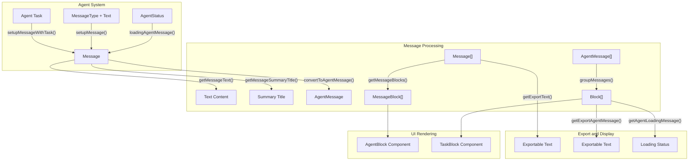
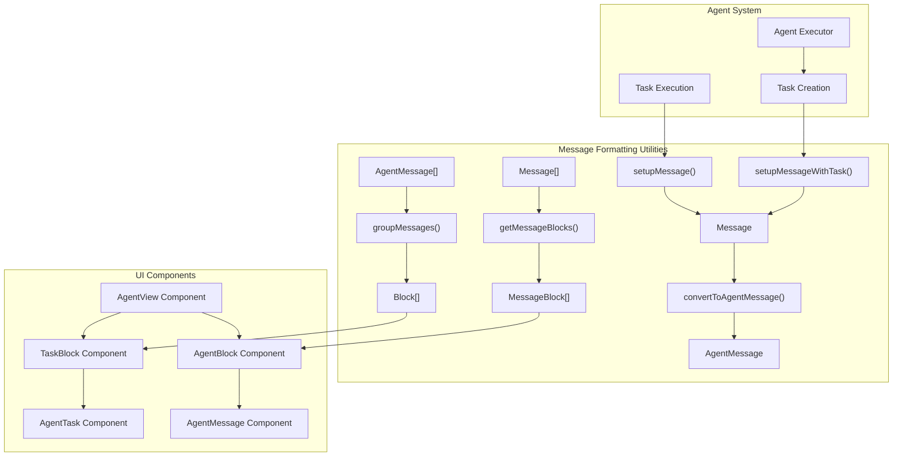

<!-- source: DeepWiki mcp.deepwiki.com · repo miurla/babyagi-ui · page 4.1 Message Formatting Utilities · fetched 2026-10-26 -->

# Message Formatting Utilities

<details>
<summary>Relevant source files</summary>

The following files were used as context for generating this wiki page:

- [src/components/Agent/AgentParameter.tsx](src/components/Agent/AgentParameter.tsx)
- [src/components/Agent/IntroGuide.tsx](src/components/Agent/IntroGuide.tsx)
- [src/components/Agent/TaskBlock.tsx](src/components/Agent/TaskBlock.tsx)
- [src/types/index.ts](src/types/index.ts)
- [src/utils/constants.ts](src/utils/constants.ts)
- [src/utils/message.ts](src/utils/message.ts)
- [src/utils/print.ts](src/utils/print.ts)

</details>


## Purpose and Scope

The Message Formatting Utilities provide a comprehensive set of functions for creating, transforming, and managing messages within the BabyAGI-UI system. These utilities handle the conversion between different message representations, format messages for display in the UI, and prepare messages for export. This document focuses on the message formatting infrastructure that serves as a critical bridge between the agent's internal processing and the user-facing display of agent activities.

For information about how these messages are displayed in UI components, see [Agent Message System](#2.2).

## Message Types and Structure

BabyAGI-UI uses several message-related data structures to represent and display agent activities. Understanding these structures is essential for working with the message formatting utilities.



**Message Type Diagram:**
- `Message`: Internal representation used across the agent logic
- `AgentMessage`: User-facing representation for UI display
- `MessageBlock`: Grouping of related `Message` objects
- `Block`: Grouping of related `AgentMessage` objects

Sources: [src/types/index.ts:9-165]()

## Message Formatting Flow

The following diagram illustrates the message formatting and transformation pipeline in BabyAGI-UI:



**Message Flow Diagram:** Shows how messages are created from agent tasks, processed through various utility functions, and finally displayed in UI components.

Sources: [src/utils/message.ts:14-516]()

## Core Message Creation Functions

These are the fundamental functions used to create message objects in the system.

### setupMessage

The `setupMessage` function creates a new `Message` object with appropriate defaults based on the message type:

```typescript
setupMessage(
  type: MessageType,
  text?: string,
  tool?: ToolType,
  icon?: string,
  id?: number,
): Message
```

This function handles:
- Setting the appropriate icon based on message type and tool
- Setting a localized title based on message type
- Setting background color based on message type

Sources: [src/utils/message.ts:14-116]()

### setupMessageWithTask

The `setupMessageWithTask` function creates a `Message` from an `AgentTask`:

```typescript
setupMessageWithTask(task: AgentTask): Message
```

Key attributes set include:
- Message text combining task ID and description
- Appropriate icon based on task skill or tool
- Message type set to 'next-task'

Sources: [src/utils/message.ts:118-140]()

### loadingAgentMessage

The `loadingAgentMessage` function creates a message showing the agent's current status:

```typescript
loadingAgentMessage(status: AgentStatus): Message
```

This function:
- Sets the appropriate text based on the agent status type (creating, executing, etc.)
- Includes any status message details
- Configures special styling for loading messages

Sources: [src/utils/message.ts:157-198]()

## Message Transformation Functions

These functions convert between different message representations and group messages.

### getMessageBlocks

The `getMessageBlocks` function organizes messages into logical blocks for display:

```typescript
getMessageBlocks(messages: Message[], isExecuting: boolean): MessageBlock[]
```

This function:
- Groups messages with the same ID into blocks
- Sets appropriate status for each block
- Filters redundant messages (e.g., removes user-input when task-output exists)
- Handles execution state to properly display running tasks

Sources: [src/utils/message.ts:253-341]()

### groupMessages

The `groupMessages` function organizes `AgentMessage` objects into `Block` objects:

```typescript
groupMessages(messages: AgentMessage[], isRunning: boolean): Block[]
```

This function:
- Creates blocks based on task IDs
- Combines sequential messages of the same type
- Updates block status based on message status
- Handles running state for proper display

Sources: [src/utils/message.ts:399-441]()

### convertToAgentMessage and convertToAgentMessages

These functions convert between the internal `Message` format and the UI-oriented `AgentMessage` format:

```typescript
convertToAgentMessage(message: Message): AgentMessage
convertToAgentMessages(messages: Message[]): AgentMessage[]
```

The conversion process:
- Maps message properties to their AgentMessage equivalents
- Formats task titles by removing task numbers
- Sets appropriate style based on message type
- Preserves task dependencies and other metadata

Sources: [src/utils/message.ts:483-516]()

## Export and Display Functions

These functions prepare messages for export or display specific status information.

### getExportText

The `getExportText` function prepares messages for export to text format:

```typescript
getExportText(messages: Message[], agentId?: string): string
```

This function:
- Filters messages based on agent type
- Sorts messages in a logical order
- Formats messages with appropriate titles and content
- Creates a single consolidated text export

Sources: [src/utils/message.ts:215-236]()

### getExportAgentMessage

The `getExportAgentMessage` function prepares blocks of agent messages for export:

```typescript
getExportAgentMessage(blocks: Block[]): string
```

This function:
- Gets appropriate titles and emojis for each block
- Combines message content within blocks
- Formats the text with markdown headings

Sources: [src/utils/message.ts:443-456]()

### getAgentLoadingMessage

The `getAgentLoadingMessage` function generates an appropriate loading message based on current agent activities:

```typescript
getAgentLoadingMessage(blocks: Block[]): string
```

This function:
- Identifies blocks with 'running' status
- Determines the current operation type (creating, executing, etc.)
- Returns the appropriate localized loading message

Sources: [src/utils/message.ts:458-481]()

## Helper Functions

The following table summarizes additional helper functions used in message formatting:

| Function | Description | Source |
|----------|-------------|--------|
| `getMessageText` | Extracts the text content from a message, with special handling for streaming messages | [src/utils/message.ts:142-155]() |
| `getMessageSummaryTitle` | Returns a localized summary title based on message type | [src/utils/message.ts:238-250]() |
| `getToolIcon` | Returns an emoji icon for a specific tool type | [src/utils/message.ts:200-213]() |
| `getEmoji` | Returns an emoji icon for a specific message type | [src/utils/message.ts:361-378]() |
| `getTitle` | Returns a localized title for a specific message type | [src/utils/message.ts:380-397]() |
| `parseMessage` | Safely parses a JSON string into an AgentMessage object | [src/utils/message.ts:343-359]() |

## Integration with UI Components

The message formatting utilities are used extensively in UI components to display agent activities. The following diagram shows how these utilities fit into the larger UI component architecture:



**Integration Diagram:** Shows how message formatting utilities bridge the gap between the agent system and UI components.

Sources: [src/utils/message.ts:14-516](), [src/components/Agent/TaskBlock.tsx:1-82]()

## Internationalization Support

Message formatting utilities work closely with the translation system to provide internationalized messages. Titles, icons, and status messages are all localized using the `translate` function:

```typescript
title = type === 'objective'
  ? translate('OBJECTIVE', 'message')
  : type === 'task-list'
  ? translate('TASK_LIST', 'message')
  // ... other types
```

This ensures that messages are displayed in the user's preferred language, with appropriate culturally-relevant text.

Sources: [src/utils/message.ts:74-101](), [src/utils/translate.ts]()

---

