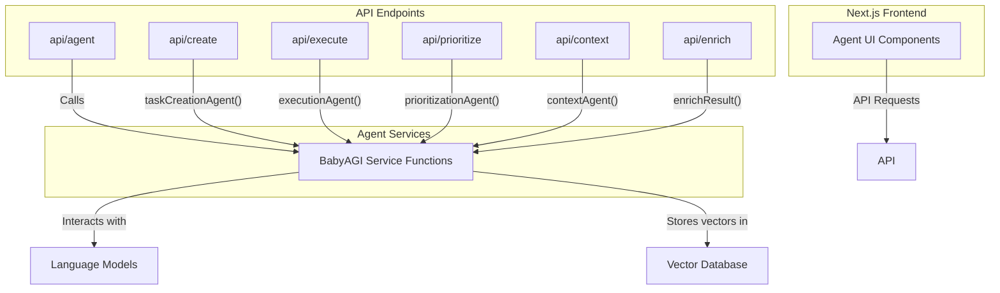
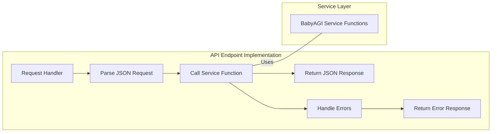

<!-- source: DeepWiki mcp.deepwiki.com · repo miurla/babyagi-ui · page 5 API Endpoints · fetched 2026-10-26 -->

# API Endpoints

<details>
<summary>Relevant source files</summary>

The following files were used as context for generating this wiki page:

- [src/pages/api/context.ts](src/pages/api/context.ts)
- [src/pages/api/create.ts](src/pages/api/create.ts)
- [src/pages/api/enrich.ts](src/pages/api/enrich.ts)
- [src/pages/api/execute.ts](src/pages/api/execute.ts)
- [src/pages/api/prioritize.ts](src/pages/api/prioritize.ts)
- [tailwind.config.js](tailwind.config.js)

</details>


This document provides a comprehensive overview of the API endpoints in BabyAGI-UI. These endpoints enable communication between the frontend user interface and the backend agent logic, facilitating operations such as task creation, execution, prioritization, context retrieval, and result enrichment.

For more detailed information about the implementation of the main agent API, see [Agent API](#5.1). For specific utility operations, see [Agent Utility APIs](#5.2).

## API Endpoints Architecture

The API endpoints in BabyAGI-UI are implemented as Next.js API routes using the Edge Runtime for serverless execution. Each endpoint serves a specific function in the agent execution process.



Sources: [src/pages/api/create.ts](), [src/pages/api/execute.ts](), [src/pages/api/prioritize.ts](), [src/pages/api/context.ts](), [src/pages/api/enrich.ts]()

## API Endpoint Flow in Agent Execution

The following diagram illustrates how these endpoints are used in the typical agent execution flow:

```mermaid
sequenceDiagram
    participant UI as Web UI
    participant Agent as api/agent
    participant Create as api/create
    participant Prioritize as api/prioritize
    participant Execute as api/execute
    participant Context as api/context
    participant Enrich as api/enrich
    
    UI->>Agent: Submit objective and parameters
    
    loop Task Execution Cycle
        Agent->>Create: Create tasks based on objective
        Create-->>Agent: Return new tasks
        
        Agent->>Prioritize: Prioritize task list
        Prioritize-->>Agent: Return prioritized tasks
        
        Agent->>Context: Get context for task execution
        Context-->>Agent: Return relevant context
        
        Agent->>Execute: Execute highest priority task
        Execute-->>Agent: Return task result
        
        Agent->>Enrich: Store task result in vector database
        Enrich-->>Agent: Confirm storage
        
        Agent->>UI: Stream updates on execution
    end
```

Sources: [src/pages/api/execute.ts](), [src/pages/api/create.ts](), [src/pages/api/prioritize.ts](), [src/pages/api/context.ts](), [src/pages/api/enrich.ts]()

## Core API Endpoints

### Main Agent API

The main API endpoint that orchestrates the entire agent execution process. This endpoint handles the initialization of the appropriate agent type and manages the execution flow.

**Note:** The main agent API is documented in detail in [Agent API](#5.1).

### Task Creation API

```
POST /api/create
```

This endpoint is responsible for creating new tasks based on the objective and the results of previously completed tasks.

| Parameter | Type | Description |
|-----------|------|-------------|
| result | string | Result of a previously completed task |
| task_description | string | Description of the task that generated the result |
| incomplete_tasks | array | List of tasks that have not been completed yet |
| objective | string | The main objective of the agent |
| model_name | string | Name of the language model to use |
| language | string | Language for the response |

**Response:** JSON object containing new tasks to be added to the task list.

Sources: [src/pages/api/create.ts:8-32]()

### Task Execution API

```
POST /api/execute
```

This endpoint executes a specific task with relevant context.

| Parameter | Type | Description |
|-----------|------|-------------|
| objective | string | The main objective of the agent |
| task | object | The task to be executed |
| table_name | string | Name of the vector store table/index |
| model_name | string | Name of the language model to use |

The execution process involves:
1. Retrieving relevant context using the `contextAgent`
2. Executing the task with the context using `executionAgent`

**Response:** JSON object containing the result of the task execution.

Sources: [src/pages/api/execute.ts:8-20]()

### Task Prioritization API

```
POST /api/prioritize
```

This endpoint prioritizes the list of tasks based on their relevance to the main objective.

| Parameter | Type | Description |
|-----------|------|-------------|
| objective | string | The main objective of the agent |
| task_names | array | List of task names to be prioritized |
| task_id | number | ID of the current task |
| model_name | string | Name of the language model to use |

**Response:** JSON object containing the prioritized list of tasks.

Sources: [src/pages/api/prioritize.ts:8-23]()

## Utility API Endpoints

### Context Retrieval API

```
POST /api/context
```

This endpoint retrieves relevant context from the vector database to assist with task execution.

| Parameter | Type | Description |
|-----------|------|-------------|
| objective | string | The main objective of the agent |
| table_name | string | Name of the vector store table/index |
| namespace | string | Namespace in the vector store |
| query_embedding | array | Vector embedding of the query |

**Response:** JSON object containing relevant context information.

Sources: [src/pages/api/context.ts:8-26]()

### Result Enrichment API

```
POST /api/enrich
```

This endpoint stores task results in the vector database for future reference.

| Parameter | Type | Description |
|-----------|------|-------------|
| task | object | The task that was executed |
| result | string | Result of the executed task |
| index | string | Name of the vector store index |
| namespace | string | Namespace in the vector store |
| vector_values | array | Vector values for storage |

**Response:** JSON object confirming successful storage.

Sources: [src/pages/api/enrich.ts:8-18]()

## Edge Runtime Configuration

All API endpoints in BabyAGI-UI are configured to use the Next.js Edge Runtime, which provides:

- Lower latency
- Faster startup times
- Global distribution
- No cold starts

This is configured in each API file using:

```javascript
export const config = {
  runtime: 'edge',
};
```

Sources: [src/pages/api/create.ts:4-6](), [src/pages/api/execute.ts:4-6](), [src/pages/api/prioritize.ts:4-6](), [src/pages/api/context.ts:4-6](), [src/pages/api/enrich.ts:4-6]()

## API Implementation Pattern



Each API endpoint follows a consistent implementation pattern:
1. Define Edge Runtime configuration
2. Parse the JSON request body
3. Call the appropriate service function from the BabyAGI service layer
4. Return a JSON response with the result
5. Handle any errors and return appropriate error responses

This pattern provides a clean separation between the API layer and the service layer, making the codebase more maintainable and easier to test.

Sources: [src/pages/api/create.ts](), [src/pages/api/execute.ts](), [src/pages/api/prioritize.ts](), [src/pages/api/context.ts](), [src/pages/api/enrich.ts]()

## Summary

The API endpoints in BabyAGI-UI serve as the bridge between the frontend user interface and the backend agent logic. They follow a consistent implementation pattern and use the Next.js Edge Runtime for optimal performance. Each endpoint has a specific role in the agent execution flow, from task creation to result enrichment, working together to provide a seamless agent execution experience.

---

