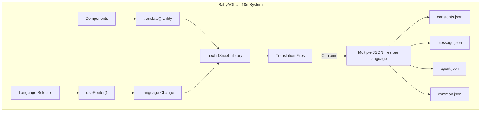
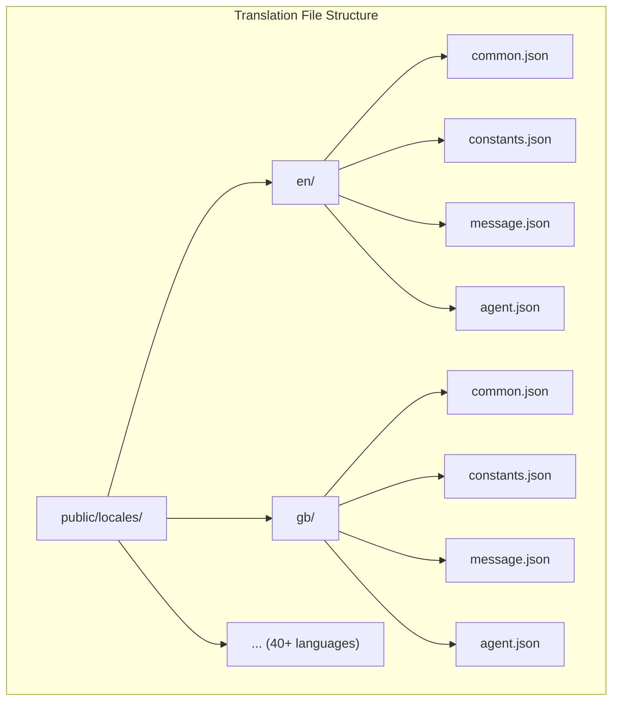
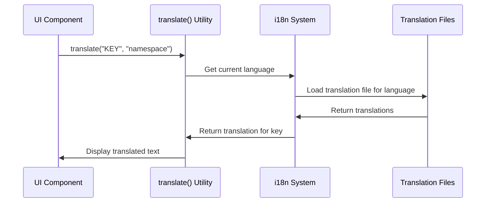
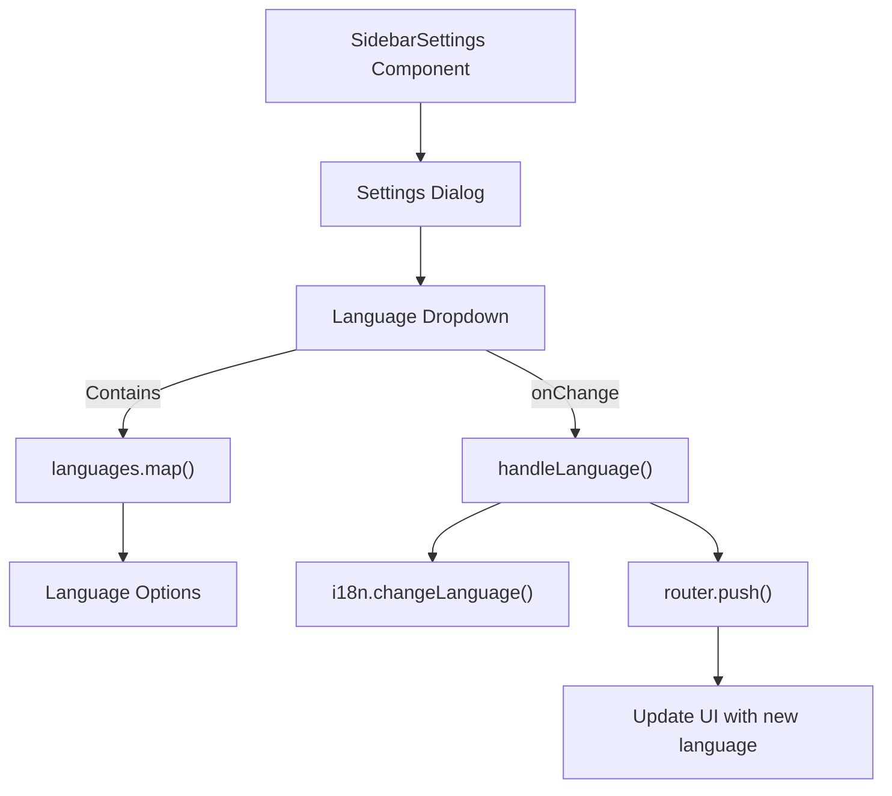

<!-- source: DeepWiki mcp.deepwiki.com · repo miurla/babyagi-ui · page 6 Internationalization (i18n) · fetched 2026-10-26 -->

# Internationalization (i18n)

<details>
<summary>Relevant source files</summary>

The following files were used as context for generating this wiki page:

- [public/locales/en/constants.json](public/locales/en/constants.json)
- [public/locales/gb/agent.json](public/locales/gb/agent.json)
- [public/locales/gb/common.json](public/locales/gb/common.json)
- [public/locales/gb/constants.json](public/locales/gb/constants.json)
- [public/locales/gb/message.json](public/locales/gb/message.json)
- [src/components/Sidebar/SidebarSettings.tsx](src/components/Sidebar/SidebarSettings.tsx)

</details>


This document describes the internationalization (i18n) system implemented in BabyAGI-UI. It covers the translation file structure, how translations are accessed and displayed throughout the application, the language selection mechanism, and how the system handles multiple languages.

## Overview

BabyAGI-UI implements a comprehensive internationalization system that supports over 40 languages. The system uses Next.js's i18n capabilities with the `next-i18next` library to provide translations for all user-facing text in the application.



Sources: [src/components/Sidebar/SidebarSettings.tsx:10-12](), [public/locales/en/constants.json]()

## Translation File Structure

The translation files are organized in a hierarchical structure under the `public/locales` directory. Each supported language has its own subdirectory identified by its language code (e.g., `en` for English, `fr` for French).

Within each language directory, there are multiple JSON files that group translations by their functional area:

- `common.json` - General UI elements and commonly used text
- `constants.json` - Constant values and system messages
- `message.json` - Task-related messages and operation statuses
- `agent.json` - Agent-specific text and notifications



Sources: [public/locales/en/constants.json](), [public/locales/gb/constants.json](), [public/locales/gb/message.json](), [public/locales/gb/agent.json](), [public/locales/gb/common.json]()

### Translation Categories

The application divides translations into different files based on their use case:

| File | Purpose | Examples |
|------|---------|----------|
| `common.json` | General UI elements | "SETTINGS", "SAVE", "MODEL" |
| `constants.json` | System constants and labels | "DARK", "LIGHT", "INFINITY" |
| `message.json` | Task-related messages | "CREATING", "EXECUTING", "TASK_RESULT" |
| `agent.json` | Agent-specific messages | "TASK_COMPLETED_TOAST", "EXECUTION_STOPPED" |

Sources: [public/locales/en/constants.json](), [public/locales/gb/common.json](), [public/locales/gb/message.json](), [public/locales/gb/agent.json]()

## Translation Implementation

BabyAGI-UI uses the `translate()` utility function to retrieve translations from the correct files based on the current language setting. This function serves as the primary interface between the application code and the translation system.



Sources: [src/components/Sidebar/SidebarSettings.tsx:8](), [src/components/Sidebar/SidebarSettings.tsx:76](), [src/components/Sidebar/SidebarSettings.tsx:138](), [src/components/Sidebar/SidebarSettings.tsx:217](), [src/components/Sidebar/SidebarSettings.tsx:270]()

### Translation Usage in Components

Components access translations using the `translate()` function, which takes a translation key and an optional namespace parameter. The namespace specifies which translation file to use (e.g., 'constants', 'common', etc.).

Examples of translation usage in the codebase:

```
translate('SETTINGS')  // Uses default namespace
translate('NOTIFICATION', 'constants')  // Uses constants namespace
translate('NOTIFICATION_LABEL', 'constants')  // Uses constants namespace
```

In cases where the translation involves dynamic content or variables, the component typically combines the translated string with the variable values.

Sources: [src/components/Sidebar/SidebarSettings.tsx:138](), [src/components/Sidebar/SidebarSettings.tsx:280](), [src/components/Sidebar/SidebarSettings.tsx:284]()

## Language Selection

The application provides a language selector in the settings dialog that allows users to change the UI language. The language selection is persisted across sessions.



Sources: [src/components/Sidebar/SidebarSettings.tsx:64-72](), [src/components/Sidebar/SidebarSettings.tsx:227-246]()

### Language Switching Process

When a user selects a new language, the following process occurs:

1. The `handleLanguage()` function is called with the selected language code
2. The i18n system's language is changed using `i18n.changeLanguage(value)`
3. The Next.js router updates the URL to include the new locale
4. The UI components re-render with the new language translations

The language selection mechanism leverages Next.js's built-in internationalized routing to handle locale changes.

Sources: [src/components/Sidebar/SidebarSettings.tsx:64-72]()

## Supported Languages

BabyAGI-UI supports over 40 languages, imported from the `@/utils/languages` module. Each language has an associated:

- Language code (e.g., 'en', 'fr')
- Display name (e.g., 'English', 'Français')
- Flag emoji (e.g., '🇺🇸', '🇫🇷')

The application displays these elements in the language selector dropdown, making it easy for users to identify and select their preferred language.

Sources: [src/components/Sidebar/SidebarSettings.tsx:12](), [src/components/Sidebar/SidebarSettings.tsx:241-245]()

## Adding New Translations

To add support for a new language or update existing translations, developers would need to:

1. Add a new language directory under `public/locales/` using the appropriate language code
2. Create the standard translation files (`common.json`, `constants.json`, `message.json`, `agent.json`)
3. Add the language to the `languages` array in the languages utility module

The system is designed to make it straightforward to add or modify translations without changing the application code.

## Integration with Next.js

BabyAGI-UI's internationalization system integrates with Next.js's built-in i18n routing capabilities. This integration allows the application to:

- Change languages while preserving the current page and state
- Use URL-based locale detection
- Serve statically-generated pages in different languages

The integration points are visible in the `handleLanguage()` function, which updates the router with the new locale while maintaining the current path and query parameters.

Sources: [src/components/Sidebar/SidebarSettings.tsx:64-72]()

---

