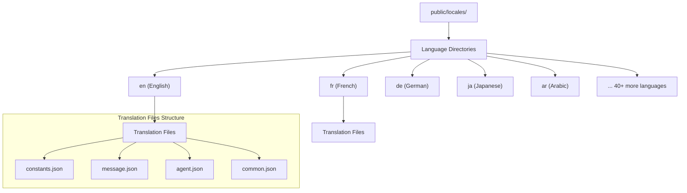
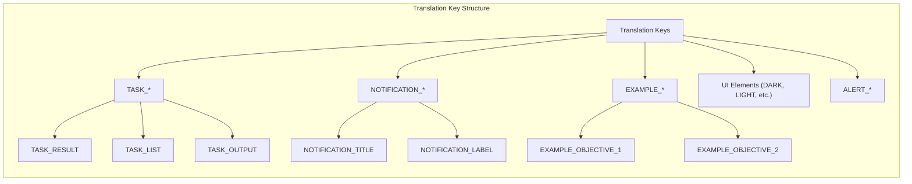

<!-- source: DeepWiki mcp.deepwiki.com · repo miurla/babyagi-ui · page 6.1 Localization Files · fetched 2026-10-26 -->

# Localization Files

<details>
<summary>Relevant source files</summary>

The following files were used as context for generating this wiki page:

- [public/locales/ar/agent.json](public/locales/ar/agent.json)
- [public/locales/ar/common.json](public/locales/ar/common.json)
- [public/locales/ar/constants.json](public/locales/ar/constants.json)
- [public/locales/ar/message.json](public/locales/ar/message.json)
- [public/locales/br/agent.json](public/locales/br/agent.json)
- [public/locales/br/common.json](public/locales/br/common.json)
- [public/locales/br/constants.json](public/locales/br/constants.json)
- [public/locales/br/message.json](public/locales/br/message.json)
- [public/locales/de/constants.json](public/locales/de/constants.json)
- [public/locales/en/message.json](public/locales/en/message.json)
- [public/locales/fr/constants.json](public/locales/fr/constants.json)
- [public/locales/he/constants.json](public/locales/he/constants.json)
- [public/locales/hi/constants.json](public/locales/hi/constants.json)
- [public/locales/hu/constants.json](public/locales/hu/constants.json)
- [public/locales/hu/message.json](public/locales/hu/message.json)
- [public/locales/ja/constants.json](public/locales/ja/constants.json)
- [public/locales/ru/constants.json](public/locales/ru/constants.json)
- [public/locales/th/constants.json](public/locales/th/constants.json)

</details>


This page details the structure and organization of localization files within the BabyAGI-UI project. These files serve as the foundation for the internationalization (i18n) system, enabling the application to support multiple languages across its user interface.

For information about how translations are applied in the application code, please see [Translation System](#6.2).

## File Structure

The localization files are organized in a hierarchical structure within the `public/locales/` directory. Each supported language has its own subdirectory containing standardized JSON files that store translated text strings.



Sources:
- `public/locales/en/message.json`
- `public/locales/fr/constants.json`
- `public/locales/de/constants.json`
- `public/locales/ar/constants.json`

## Translation File Types

The BabyAGI-UI localization system uses four standard JSON files for each language:

| File | Purpose |
|------|---------|
| **constants.json** | UI constants, warnings, placeholder text, example objectives |
| **message.json** | Task execution messages and status indicators |
| **agent.json** | Agent-specific notifications and alerts |
| **common.json** | Common UI elements like buttons, settings, and themes |

Each file contains key-value pairs where the keys remain consistent across all languages while values are translated.

### constants.json

This file contains UI constants such as warnings, examples, and system notifications.

Example from German constants.json:
```json
{
  "GPT_4_WARNING": "🚨 DIE VERWENDUNG VON GPT-4 POTENZIELL TEUER IST, ÜBERWACHEN SIE IHRE KOSTEN!",
  "INFINITY": "Unendlichkeit",
  "DARK": "Dunkel",
  "LIGHT": "Hell",
  "SYSTEM": "System",
  "EXAMPLES": "Beispiele"
}
```

Sources:
- `public/locales/hu/constants.json`
- `public/locales/br/constants.json`
- `public/locales/de/constants.json`

### message.json

This file contains messages related to task execution, status updates, and results.

Example from English message.json:
```json
{
  "CREATING": "Creating tasks... (🤖💬: *This process takes time. Please wait...*)",
  "EXECUTING": "⚒️ Executing tasks...",
  "FINISHED": "Finished",
  "TASK_RESULT": "Task Result",
  "THINKING": "Thinking..."
}
```

Sources:
- `public/locales/en/message.json`
- `public/locales/ar/message.json`
- `public/locales/br/message.json`

### agent.json

Contains agent-specific messages such as alerts and notifications.

Example:
```json
{
  "ALERT_SET_UP_API_KEY": "Please set up your OpenAI API key from the settings menu.",
  "ALL_TASKS_COMPLETED_TOAST": "All tasks completed!",
  "EXECUTION_STOPPED": "Execution stopped"
}
```

Sources:
- `public/locales/ar/agent.json`
- `public/locales/br/agent.json`

### common.json

Contains translations for common UI elements and settings.

Example:
```json
{
  "AGENT": "Agent",
  "DELETE": "Delete",
  "FIRST_TASK": "First Task",
  "LANGUAGE": "Language",
  "MODEL": "Model",
  "SETTINGS": "Settings"
}
```

Sources:
- `public/locales/br/common.json`
- `public/locales/ar/common.json`

## Translation Key Organization

The translation keys follow a consistent naming convention and organization pattern:



Sources:
- `public/locales/en/message.json`
- `public/locales/fr/constants.json`
- `public/locales/hu/constants.json`

Key characteristics:
- All uppercase with underscores separating words (e.g., `TASK_COMPLETED_TOAST`)
- Grouped by functional area (e.g., all notification-related keys start with `NOTIFICATION_`)
- Consistent across all language files

## Supported Languages

BabyAGI-UI supports over 40 languages, including:

| Language Code | Language Name |
|---------------|---------------|
| en | English |
| ar | Arabic |
| de | German |
| fr | French |
| ja | Japanese |
| hu | Hungarian |
| br | Brazilian Portuguese |
| ru | Russian |
| he | Hebrew |
| th | Thai |
| hi | Hindi |

Sources:
- `public/locales/` directory structure
- `public/locales/ar/constants.json`
- `public/locales/ja/constants.json`
- `public/locales/ru/constants.json`

## Integration with Application Components

The localization files integrate with the application through a translation provider system:

```mermaid
flowchart TD
    subgraph "Component Translation Flow"
        UI["UI Components"] --> |"import { useTranslation }"| TransHook["useTranslation() Hook"]
        TransHook --> |"t('KEY_NAME')"| TransFunc["Translation Function"]
        TransFunc --> |"Lookup"| i18n["i18n Provider"]
        i18n --> |"Load language files"| LangFiles["Language JSON Files"]
        LangFiles --> |"Return translated string"| UI
    end
    
    subgraph "Example: Agent Message Component"
        AgentMsg["AgentMessage Component"] --> |"Uses"| TransHook2["useTranslation()"]
        TransHook2 --> |"t('TASK_RESULT')"| GetTaskResult["Get TASK_RESULT translation"]
        GetTaskResult --> |"From"| MessageJSON["message.json"]
        MessageJSON --> |"Displays"| TaskResultUI["Task Result UI Element"]
    end
```



Sources:
- System architecture diagram from original specification
- `public/locales/en/message.json`

## Sample Translations for Key UI Elements

Below is a comparison of translations for some key UI elements across different languages:

| Key | English | German | French | Arabic |
|-----|---------|--------|--------|--------|
| DARK | Dark | Dunkel | Sombre | مظلم |
| LIGHT | Light | Hell | Lumière | ضوء |
| INFINITY | Infinity | Unendlichkeit | Infini | ما لا نهاية |
| TASK_RESULT | Task Result | Aufgabenergebnis | Résultat de la tâche | نتيجة المهمة |
| THINKING | Thinking... | Denken... | Réflexion... | التفكير ... |

Sources:
- `public/locales/en/message.json`
- `public/locales/de/constants.json`
- `public/locales/fr/constants.json`
- `public/locales/ar/constants.json`
- `public/locales/ar/message.json`

## Adding New Languages

To add a new language:

1. Create a new directory in `public/locales/` with the appropriate language code
2. Copy the four standard JSON files from an existing language (preferably English)
3. Translate all string values while keeping the keys identical
4. The new language will automatically appear in the language selection options

## Conclusion

The localization files in BabyAGI-UI provide a systematic approach to supporting multiple languages. The structured organization with standardized files and consistent key naming conventions ensures maintainability while enabling a fully localized user experience. This architecture makes it straightforward to add new languages or modify existing translations as needed.

---

