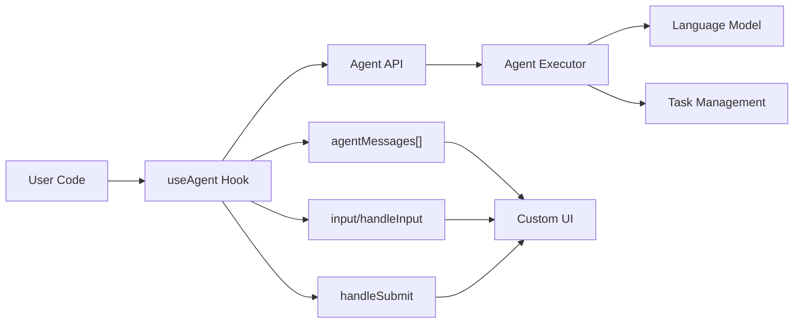
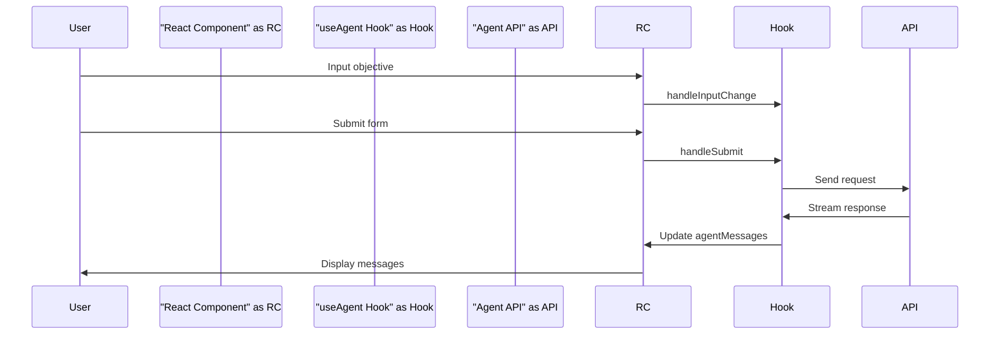
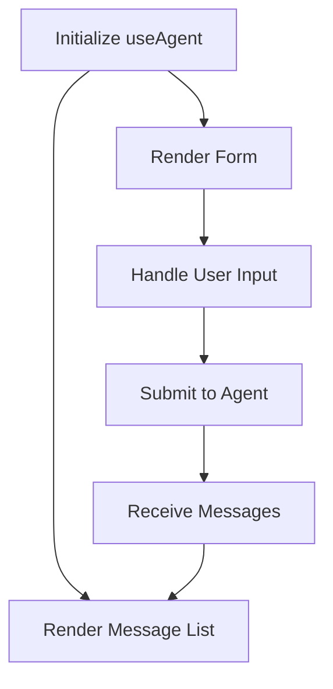
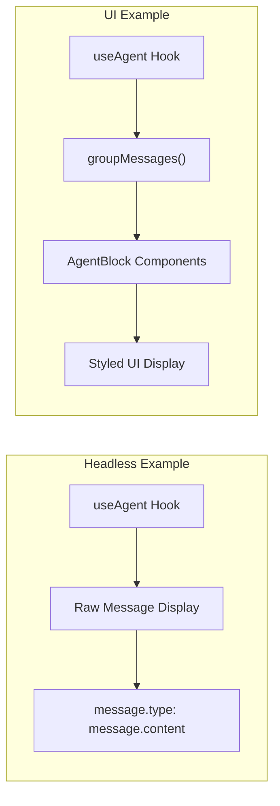
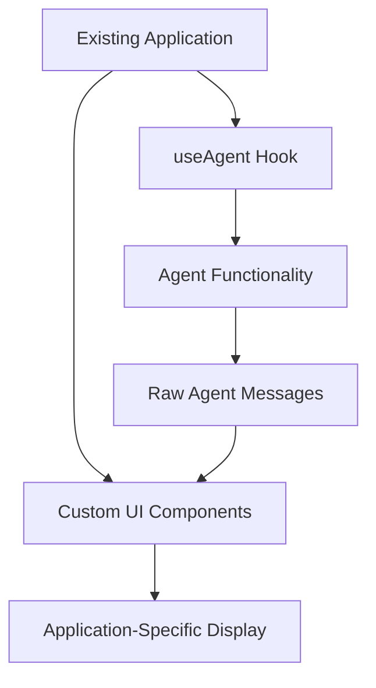
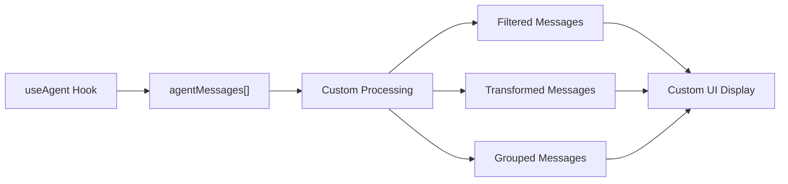
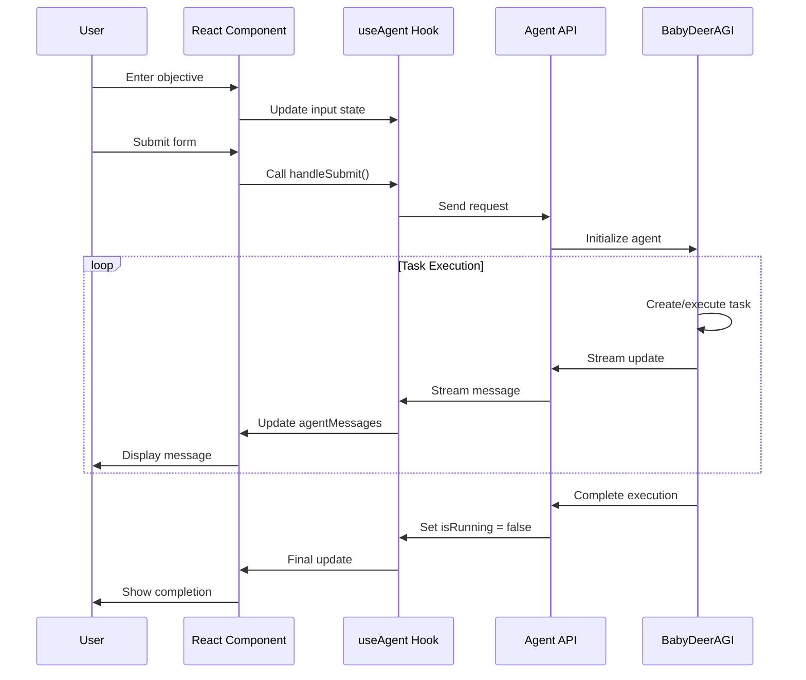

<!-- source: DeepWiki mcp.deepwiki.com · repo miurla/babyagi-ui · page 7.2 Headless Examples · fetched 2026-10-26 -->

# Headless Examples

<details>
<summary>Relevant source files</summary>

The following files were used as context for generating this wiki page:

- [src/components/Agent/FirstTimeMessage.tsx](src/components/Agent/FirstTimeMessage.tsx)
- [src/pages/example/headless/index.tsx](src/pages/example/headless/index.tsx)
- [src/pages/example/ui/index.tsx](src/pages/example/ui/index.tsx)

</details>


This page documents how to use BabyAGI-UI in headless or minimal mode, focusing on integrating agent capabilities with minimal UI components. For examples of using BabyAGI-UI with the full user interface, see [UI Examples](#7.1).

## What is Headless Mode?

In BabyAGI-UI, "headless mode" refers to utilizing the core agent functionality with minimal UI components. This approach is useful for:

- Embedding agent capabilities in existing applications
- Creating custom UIs with specific requirements
- Reducing bundle size and complexity
- Testing agent functionality in isolation



Sources: [src/pages/example/headless/index.tsx:2-8]()

## Core Components for Headless Usage

The primary component for headless integration is the `useAgent` hook, which provides all necessary functionality to interact with agents.

### The useAgent Hook

The `useAgent` hook encapsulates agent interaction logic and provides the following:

| Return Value | Type | Description |
|--------------|------|-------------|
| agentMessages | Array | Array of messages generated by the agent |
| input | String | Current input value for the objective |
| handleInputChange | Function | Handler for input change events |
| handleSubmit | Function | Handler for form submission |
| isRunning | Boolean | Indicates if the agent is currently running |

```mermaid
classDiagram
    class "useAgent Hook" {
        +api: string
        +agentId: string
        +agentMessages: AgentMessage[]
        +input: string
        +handleInputChange(): void
        +handleSubmit(): void
        +isRunning: boolean
    }

    class "AgentMessage" {
        +id: string
        +type: string
        +content: string
        +...other properties
    }

    "useAgent Hook" --> "AgentMessage" : returns
```

Sources: [src/pages/example/headless/index.tsx:2-8](), [src/pages/example/ui/index.tsx:3-13]()

## Minimal Headless Example

The most basic implementation of a headless agent requires just a few lines of code:



Sources: [src/pages/example/headless/index.tsx:1-28]()

## Implementing a Headless Interface

### Basic Implementation

The minimal implementation requires initializing the `useAgent` hook and rendering the messages:



Sources: [src/pages/example/headless/index.tsx:4-26]()

### Code Structure

A basic headless implementation follows this structure:

1. Initialize the `useAgent` hook with appropriate parameters
2. Create a form for objective input
3. Render agent messages in a simple format

The key difference between headless and UI examples is in how messages are displayed:



Sources: [src/pages/example/headless/index.tsx:18-22](), [src/pages/example/ui/index.tsx:15-31]()

## Comparing Headless vs. UI Implementation

The following table highlights the key differences between headless and UI implementations:

| Feature | Headless Implementation | UI Implementation |
|---------|-------------------------|-------------------|
| Message Processing | Direct rendering | Uses `groupMessages` utility |
| Display Components | Basic HTML elements | `AgentBlock` components |
| State Management | Minimal | Manages blocks state |
| Message Grouping | None | Groups related messages |
| Styling | Minimal or custom | Pre-styled components |

Sources: [src/pages/example/headless/index.tsx:9-24](), [src/pages/example/ui/index.tsx:7-32]()

## Integration Patterns

### Embedding in Existing Applications

When integrating BabyAGI-UI agent capabilities into existing applications, the headless approach offers flexibility:



Sources: [src/pages/example/headless/index.tsx:2-8]()

### Custom Message Processing

With the headless approach, you can implement custom message processing before display:



Sources: [src/pages/example/ui/index.tsx:15-18]()

## Configuration Options

When using the `useAgent` hook for headless implementation, you can configure the following parameters:

| Parameter | Type | Description | Example |
|-----------|------|-------------|---------|
| api | string | API endpoint for agent communication | '/api/agent' |
| agentId | string | Type of agent to use | 'babydeeragi' |
| options | object | Additional configuration options | { autoScroll: true } |

Sources: [src/pages/example/headless/index.tsx:5-8](), [src/pages/example/ui/index.tsx:10-13]()

## Use Cases for Headless Mode

### 1. Custom Agent Interfaces

Build specialized interfaces for specific use cases that don't require the full BabyAGI-UI interface.

### 2. Backend Integration

Use BabyAGI agents in server-side contexts where only the agent functionality is needed without UI components.

### 3. Testing and Development

Quickly prototype and test agent behavior with minimal UI overhead.

### 4. Embedded Agents

Embed agent capabilities within larger applications where the full UI would be too intrusive.

## Sample Usage Flow

The complete flow for using the headless implementation:



Sources: [src/pages/example/headless/index.tsx:1-28]()

## Best Practices

When implementing headless mode, consider the following best practices:

1. Provide clear feedback about agent status (running/completed)
2. Include the `FirstTimeUserMessage` component for new users
3. Handle input validation before submitting to the agent
4. Implement appropriate error handling for API failures
5. Consider accessibility when creating custom UI elements

Sources: [src/pages/example/headless/index.tsx:23](), [src/components/Agent/FirstTimeMessage.tsx:3-15]()

## Conclusion

The headless implementation of BabyAGI-UI provides a flexible way to integrate agent capabilities into various applications while maintaining full control over the UI presentation. By using the `useAgent` hook, developers can access the full power of BabyAGI agents with minimal overhead.

---

