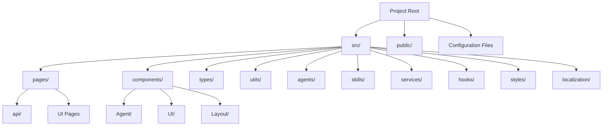
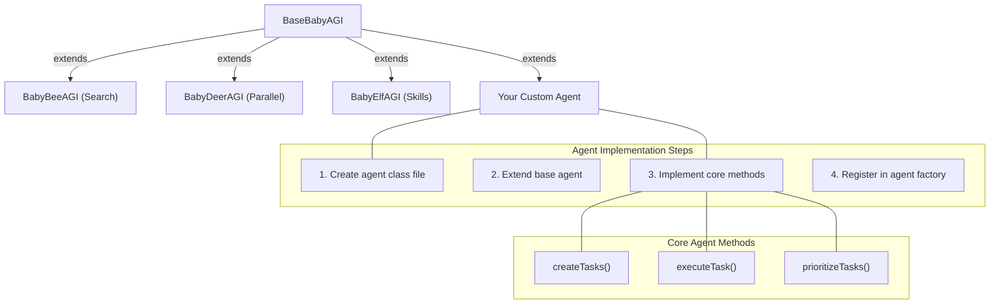
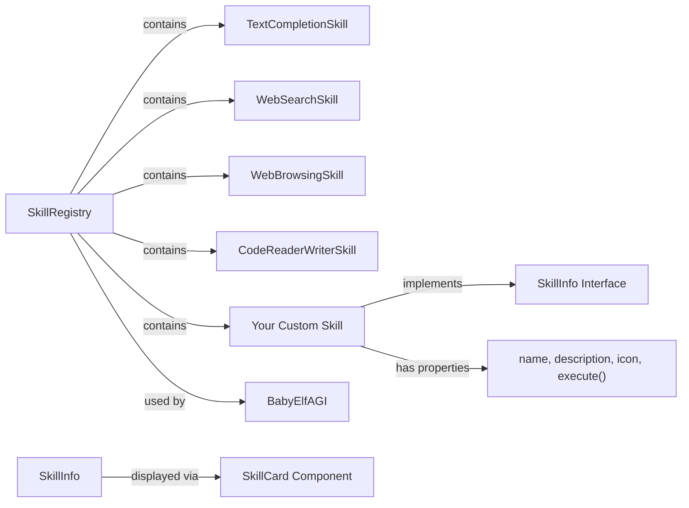
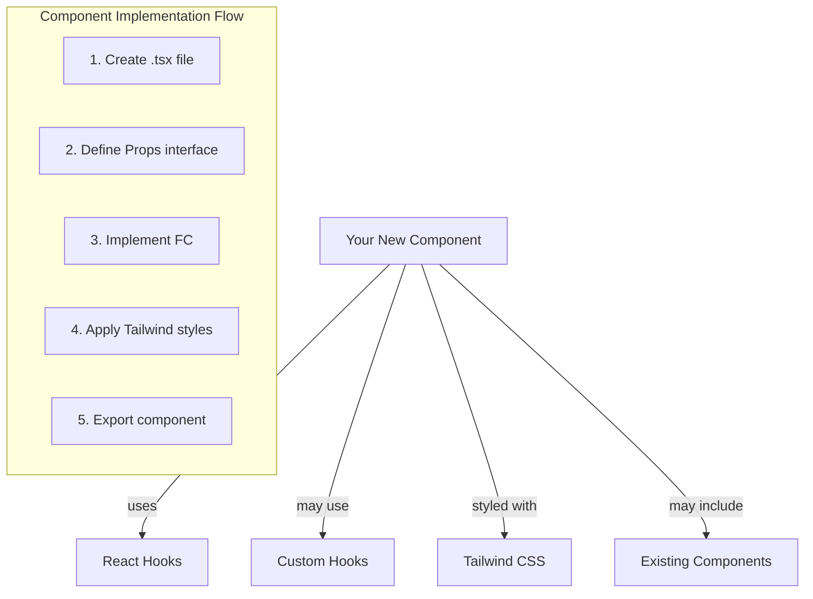
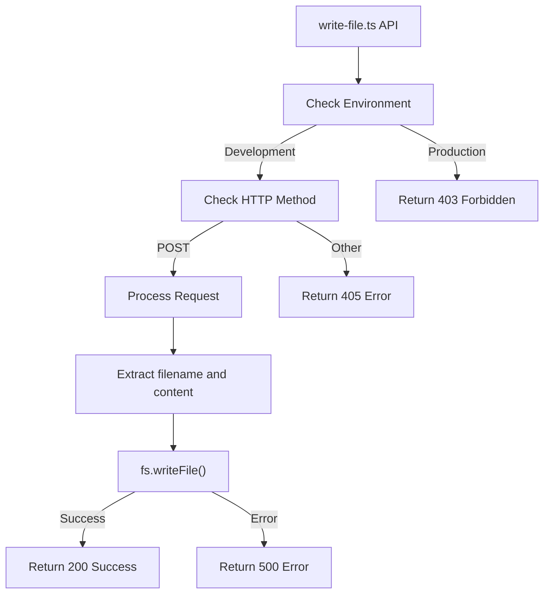

<!-- source: DeepWiki mcp.deepwiki.com · repo miurla/babyagi-ui · page 8 Development and Customization · fetched 2026-10-26 -->

# Development and Customization

<details>
<summary>Relevant source files</summary>

The following files were used as context for generating this wiki page:

- [src/components/Agent/SkillCard.tsx](src/components/Agent/SkillCard.tsx)
- [src/pages/api/local/write-file.ts](src/pages/api/local/write-file.ts)

</details>


This document provides comprehensive guidance for developers who want to extend, modify, or customize the BabyAGI-UI system. We'll cover the development environment setup, codebase structure, customization points for agents and skills, UI component modifications, and contribution workflow. For an introduction to the system's overall architecture, see [System Architecture](#1.2).

## Development Environment Setup

### Prerequisites

To develop for BabyAGI-UI, you need:
- Node.js (preferably the latest LTS version)
- npm or yarn
- Git

### Setting Up Local Development

1. Clone the repository:
```bash
git clone https://github.com/miurla/babyagi-ui.git
cd babyagi-ui
```

2. Install dependencies:
```bash
npm install
# or
yarn
```

3. Set up environment variables:
```bash
cp .env.example .env.local
```
Edit `.env.local` to add your API keys for OpenAI, Pinecone, and other services.

4. Start the development server:
```bash
npm run dev
# or
yarn dev
```

This will start the development server at [http://localhost:3000](http://localhost:3000).

## Codebase Structure

Understanding the codebase structure is essential for effective customization:



### Key Directories and Files

| Directory | Purpose |
|-----------|---------|
| `pages/` | Next.js pages and API routes |
| `components/` | React components for the UI |
| `agents/` | Agent implementations |
| `skills/` | Agent skill implementations |
| `utils/` | Utility functions |
| `types/` | TypeScript type definitions |
| `hooks/` | React custom hooks |
| `localization/` | i18n translation files |

## Extending the Agent System

The agent system is designed to be extensible. You can create new agent types or enhance existing ones.

### Agent Extension Architecture



### Creating a New Agent Type

1. Create a new file in the `src/agents/` directory
2. Extend the base agent class or one of the existing specialized agents
3. Implement or override the core methods:
   - `createTasks()` - Generate new tasks based on the objective
   - `executeTask()` - Execute a single task
   - `prioritizeTasks()` - Order tasks by importance
4. Register your agent in the agent factory system

Sources: System diagrams showing agent hierarchy

## Skill System Customization

Skills are modular capabilities that agents (particularly BabyElfAGI) can leverage. The skill system is designed for easy extension.

### Skill Architecture



### Adding a New Skill

To add a new skill:

1. Create a new skill file in the `src/skills/` directory
2. Implement the `SkillInfo` interface
3. Define required properties: name, description, icon, and execute function
4. Register the skill in the skill registry

### Skill Card UI Component

The `SkillCard` component displays skills in the UI with a hover card showing the description:

```typescript
interface SkillProps {
  skill: SkillInfo;
}
```

Sources: [src/components/Agent/SkillCard.tsx:1-50]()

## UI Component Customization

BabyAGI-UI uses React components styled with Tailwind CSS. You can customize existing components or create new ones.

### Modifying Existing Components

1. Locate the component in the `src/components/` directory
2. Make your changes while maintaining the component's API
3. The component hierarchy follows the structure shown in the UI Component Hierarchy diagram in [System Architecture](#1.2)

### Creating New Components



Example of a component structure:

```typescript
// SkillCard component structure
interface SkillProps {
  skill: SkillInfo;
}

const SkillCard: FC<SkillProps> = ({ skill }) => {
  // Format the name
  const name = skill.name.split('_').map(...).join(' ');
  
  // Render component with Tailwind classes
  return (
    <HoverCard.Root>
      <HoverCard.Trigger>
        {/* Component content */}
      </HoverCard.Trigger>
      <HoverCard.Content>
        {/* Hover content */}
      </HoverCard.Content>
    </HoverCard.Root>
  );
};
```

Sources: [src/components/Agent/SkillCard.tsx:1-50]()

## API Endpoint Customization

BabyAGI-UI uses Next.js API routes for server-side functionality. You can extend or modify these endpoints.

### Development Utility: File Writing API

An example of a development-only API endpoint:



This API is restricted to development environments and provides file writing capabilities:

```typescript
export default async function handler(
  req: NextApiRequest,
  res: NextApiResponse,
) {
  if (process.env.NODE_ENV !== 'development') {
    res.status(403).json({ error: 'Access is forbidden in this environment' });
    return;
  }
  
  // Process POST requests only
  if (req.method === 'POST') {
    const filePath = path.join(process.cwd(), req.body.filename);
    const content = req.body.content;
    
    try {
      await fs.writeFile(filePath, content, 'utf8');
      res.status(200).json({ message: 'File written successfully' });
    } catch (err) {
      console.error(err);
      res.status(500).json({ error: 'Failed to write file' });
    }
  } else {
    res.status(405).json({ error: 'Only POST method is allowed' });
  }
}
```

Sources: [src/pages/api/local/write-file.ts:1-31]()

### Creating New API Endpoints

To create a new API endpoint:

1. Create a file in `src/pages/api/` directory
2. Implement a handler function that processes requests
3. Add appropriate security checks and input validation
4. Return proper response status codes and data

For more details on existing API endpoints, see [API Endpoints](#5).

## Internationalization Customization

BabyAGI-UI supports multiple languages through its i18n system. To extend language support:

1. Add or modify translation files in the `src/localization/` directory
2. Use the translation function in components for new text
3. Test the application in different languages

For more details on the internationalization system, see [Internationalization (i18n)](#6).

## Testing Your Customizations

### Running Tests

```bash
npm run test
# or
yarn test
```

### Writing Tests

1. Create test files with the `.test.ts` or `.test.tsx` extension
2. Use Jest and React Testing Library for testing
3. Place tests alongside the components or functions they test

## Contributing Guidelines

When contributing to BabyAGI-UI:

1. Fork the repository and create a feature branch
2. Make your changes following the project's code style
3. Add or update tests as appropriate
4. Update documentation to reflect your changes
5. Submit a pull request with a clear description of your changes

### Code Style and Standards

- Follow TypeScript best practices
- Use functional components with hooks for React components
- Document complex functions and components
- Use proper typing for all variables and functions
- Format code using the project's Prettier configuration

## Deployment

To deploy your customized version of BabyAGI-UI:

1. Build the application:
```bash
npm run build
# or
yarn build
```

2. Deploy to your preferred hosting platform (Vercel, Netlify, etc.)

## Additional Resources

- For more detailed documentation on Agent implementation, see [Agent Architecture](#3)
- For UI component details, see [User Interface Components](#2)
- For more on the message system, see [Agent Message System](#2.2)
- For skill system details, see [Agent Skills System](#3.4)