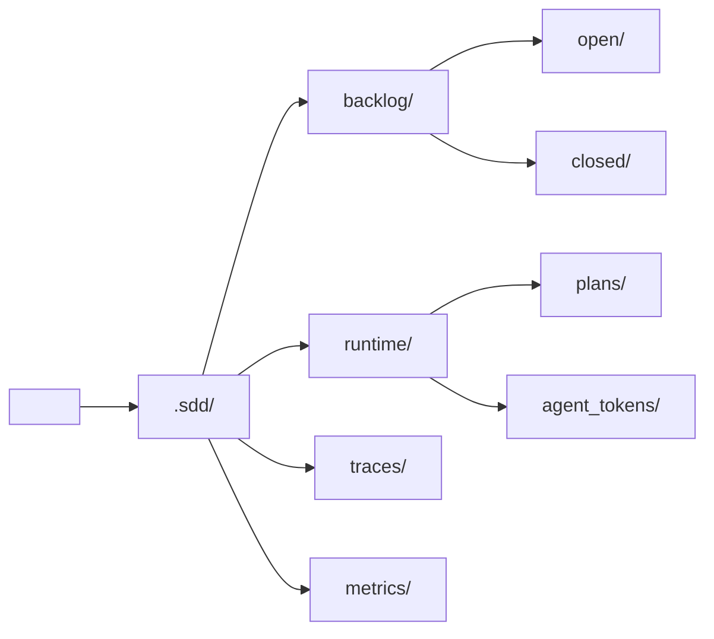
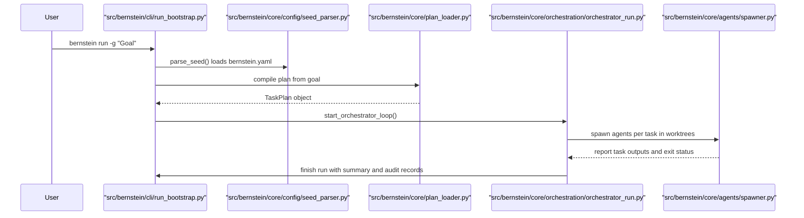
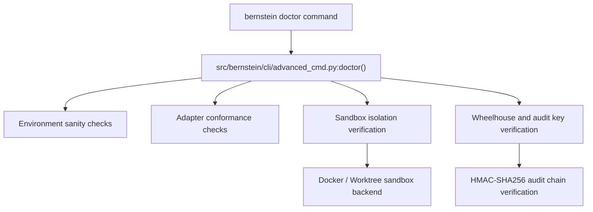

<!-- source: DeepWiki mcp.deepwiki.com · repo sipyourdrink-ltd/bernstein · page 1.1 Getting Started · fetched 2026-10-26 -->

# Getting Started

<details>
<summary>Relevant source files</summary>

The following files were used as context for generating this wiki page:

- [.well-known/security.txt](.well-known/security.txt)
- [SECURITY.md](SECURITY.md)
- [bernstein.yaml](bernstein.yaml)
- [docker/sandbox/docker-compose.researcher.yaml](docker/sandbox/docker-compose.researcher.yaml)
- [docs/getting-started/quickstart-demo.md](docs/getting-started/quickstart-demo.md)
- [docs/index.md](docs/index.md)
- [docs/operations/CONFIG.md](docs/operations/CONFIG.md)
- [docs/operations/commands.md](docs/operations/commands.md)
- [docs/operations/deployment-guide.md](docs/operations/deployment-guide.md)
- [docs/reference/FEATURE_MATRIX.md](docs/reference/FEATURE_MATRIX.md)
- [docs/routine-scenarios.md](docs/routine-scenarios.md)
- [docs/use-cases.md](docs/use-cases.md)
- [docs/whats-new.md](docs/whats-new.md)
- [examples/cluster/cloudflared/Dockerfile](examples/cluster/cloudflared/Dockerfile)
- [examples/cluster/cloudflared/config.yml](examples/cluster/cloudflared/config.yml)
- [examples/cluster/cloudflared/docker-compose.yml](examples/cluster/cloudflared/docker-compose.yml)
- [examples/cluster/tailscale/bernstein.yaml](examples/cluster/tailscale/bernstein.yaml)
- [examples/cluster/tailscale/docker-compose.yml](examples/cluster/tailscale/docker-compose.yml)
- [examples/cluster/tailscale/tailscale.json](examples/cluster/tailscale/tailscale.json)
- [packaging/npm/package.json](packaging/npm/package.json)
- [scripts/researcher_sandbox.sh](scripts/researcher_sandbox.sh)
- [src/bernstein/adapters/openai_agents_builtins.py](src/bernstein/adapters/openai_agents_builtins.py)
- [src/bernstein/cli/commands/api_check_cmd.py](src/bernstein/cli/commands/api_check_cmd.py)
- [src/bernstein/cli/commands/dep_impact_cmd.py](src/bernstein/cli/commands/dep_impact_cmd.py)
- [src/bernstein/cli/commands/impact_cmd.py](src/bernstein/cli/commands/impact_cmd.py)
- [src/bernstein/cli/commands/init_wizard_cmd.py](src/bernstein/cli/commands/init_wizard_cmd.py)
- [src/bernstein/cli/commands/routine_cmd.py](src/bernstein/cli/commands/routine_cmd.py)
- [src/bernstein/cli/release_notes.py](src/bernstein/cli/release_notes.py)
- [src/bernstein/cli/utils/aliases.py](src/bernstein/cli/utils/aliases.py)
- [src/bernstein/core/agents/spawner_sandbox_session.py](src/bernstein/core/agents/spawner_sandbox_session.py)
- [src/bernstein/core/config/config_schema.py](src/bernstein/core/config/config_schema.py)
- [src/bernstein/core/config/seed_config.py](src/bernstein/core/config/seed_config.py)
- [src/bernstein/core/config/seed_parser.py](src/bernstein/core/config/seed_parser.py)
- [src/bernstein/core/orchestration/dependency_scan_tasks.py](src/bernstein/core/orchestration/dependency_scan_tasks.py)
- [src/bernstein/core/orchestration/orchestrator_run.py](src/bernstein/core/orchestration/orchestrator_run.py)
- [src/bernstein/core/orchestration/stalled_manager.py](src/bernstein/core/orchestration/stalled_manager.py)
- [src/bernstein/core/protocols/mcp/mcp_sandbox.py](src/bernstein/core/protocols/mcp/mcp_sandbox.py)
- [src/bernstein/core/quality/ab_test.py](src/bernstein/core/quality/ab_test.py)
- [src/bernstein/core/sandbox/backends/docker.py](src/bernstein/core/sandbox/backends/docker.py)
- [src/bernstein/core/sandbox/explicit_attach.py](src/bernstein/core/sandbox/explicit_attach.py)
- [src/bernstein/core/security/sandbox.py](src/bernstein/core/security/sandbox.py)
- [tests/integration/cluster/test_cluster_tunnel_smoke.py](tests/integration/cluster/test_cluster_tunnel_smoke.py)
- [tests/unit/sandbox/test_docker_backend_unit.py](tests/unit/sandbox/test_docker_backend_unit.py)
- [tests/unit/sandbox/test_explicit_attach.py](tests/unit/sandbox/test_explicit_attach.py)
- [tests/unit/sandbox/test_pool_cmd.py](tests/unit/sandbox/test_pool_cmd.py)
- [tests/unit/test_cli_command_registration.py](tests/unit/test_cli_command_registration.py)
- [tests/unit/test_impact_consolidation.py](tests/unit/test_impact_consolidation.py)
- [tests/unit/test_sandbox.py](tests/unit/test_sandbox.py)
- [tests/unit/test_seed.py](tests/unit/test_seed.py)
- [tests/unit/test_seed_preflight_dedup.py](tests/unit/test_seed_preflight_dedup.py)
- [tests/unit/test_spawner_explicit_container_runtime.py](tests/unit/test_spawner_explicit_container_runtime.py)
- [tests/unit/test_spawner_sandbox.py](tests/unit/test_spawner_sandbox.py)
- [tests/unit/test_spawner_sandbox_session.py](tests/unit/test_spawner_sandbox_session.py)
- [tests/unit/test_stalled_manager.py](tests/unit/test_stalled_manager.py)

</details>


This page provides comprehensive technical guidance for installing Bernstein, performing the first-run setup with `bernstein init`, understanding the `.sdd/` directory layout, details of the primary configuration file `bernstein.yaml`, running quickstart examples, using the `doctor` pre-flight check command, and leveraging the examples/ plan library with 24 ready-made plans for common workflows.

Bernstein is a deterministic multi-agent orchestrator that runs CLI coding agents in parallel isolated worktrees, provides an auditable HMAC-signed lineage and audit chain, and enforces quality gates for reliable software development workflows.

---

## Installation

Bernstein is primarily a Python package requiring **Python 3.12+**. Multiple installation methods are supported depending on your environment and security posture.

### Standard Installation

You can install Bernstein using `pip`, `pipx`, or `uv`:

```bash
# Recommended: Using uv tool installer
uv tool install bernstein

# Or using pipx for isolated installs
pipx install bernstein

# Or directly via pip
pip install bernstein
```

### Homebrew

For macOS users, Bernstein can be installed using Homebrew:

```bash
brew tap chernistry/tap
brew install bernstein
```

### npm Package

Bernstein also provides an npm package for frontend tooling and integration environments:

```bash
npm install -g bernstein-orchestrator
```

### Docker

Prebuilt Docker images are available for isolated sandboxed runs, researcher sandboxes, or clustered deployments. The docker-compose stack examples live under `docker/` and `examples/cluster/`.

### Air-Gap Wheelhouse Installation

For restricted network environments, Bernstein supports an air-gap deployment profile using wheelhouses—bundles of signed pip wheels.

Build a wheelhouse bundle on a connected machine:

```bash
bernstein wheelhouse build --output ./bundle/
```

Transfer the bundle and install offline with pip:

```bash
pip install --no-index --find-links ./bundle/ bernstein
```

This flow ensures cryptographic verification of installed packages and integrity of configured audit chains.

| Installation Method | Notes |
| ------------------- | ----- |
| `pip install bernstein` | Standard install, requires internet |
| `pipx install bernstein` | Isolated environment |
| `uv tool install bernstein` | Handles virtualenv and upgrades |
| Homebrew | macOS native package via tap |
| npm | For some integration tooling |
| Docker Compose | Container sandbox runs for dev and infra |
| Air-gap wheelhouse | Secure offline deployment with signed bundles |

Sources: [README.md:40-61](), [src/bernstein/core/distribution/doctor_airgap.py:1-40](), [docs/operations/deployment-guide.md:30-115]()

---

## First-Run Setup with `bernstein init`

After installation, you initialize your Bernstein project workspace using:

```bash
bernstein init
```

This command bootstraps your project directory by:

- Creating the `.sdd/` storage directory structure to persist all run state.
- Generating a baseline `bernstein.yaml` configuration file.
- Setting up directories for task backlog, runtime state, plans, and audit logs.

### The `.sdd/` Directory Structure

Bernstein’s core data and ephemeral state are stored hierarchically within `.sdd/` in your project root:

| Directory              | Description                                                |
|------------------------|------------------------------------------------------------|
| `.sdd/backlog/`        | Contains issue backlog tickets split into `open/` and `closed/` folders, storing YAML or Markdown task definitions. |
| `.sdd/runtime/`        | Runtime state: active tasks, worktree metadata, checkpoints, ephemeral files for current execution. |
| `.sdd/runtime/plans/`  | Stores YAML `TaskPlan` documents representing decomposed workflows. |
| `.sdd/runtime/agent_tokens/` | Stores zero-trust JWT tokens for authenticating worker agents securely with the task server and orchestrator. |
| `.sdd/traces/`         | Diagnostic traces from runs and adapters, in JSONL format. |
| `.sdd/metrics/`        | Metrics and cost accounting data collected during runs. |

This file-based approach avoids external database dependencies and enables reproducibility, auditability, and crash recovery without server components.

### Layout Diagram



Sources: [bernstein.yaml:1-38](), [src/bernstein/cli/commands/init_wizard_cmd.py:20-60](), [README.md:26-33]()

---

## The `bernstein.yaml` Configuration File

`bernstein.yaml` is the core project configuration file Bernstein parses at bootstrap to control runtime behavior.

A representative minimal layout:

```yaml
goal: "Add JWT authentication with refresh tokens, tests, and API docs"
cli: claude
max_agents: 7

role_model_policy:
  manager:
    model: opus
    effort: max
  backend:
    model: sonnet
    effort: high
  qa:
    model: sonnet
    effort: high

budget: $0  # USD hard spending limit

internal_llm_provider: claude
internal_llm_model: claude-sonnet-4-6

quality_gates:
  enabled: true
  lint: true
  lint_command: ruff check .
  type_check: false
  tests: false

context_files:
  - docs/architecture/DESIGN.md
  - CLAUDE.md

agency:
  path: ./external/agency-agents
```

### Key Config Sections

| Section           | Purpose                                      | Notes                                                              |
|-------------------|----------------------------------------------|--------------------------------------------------------------------|
| `goal`            | Natural language goal for the orchestrator   | Starting point for task decomposition                              |
| `cli`             | Selected default CLI agent adapter            | Examples: `claude`, `codex`, `gemini`, or `auto`                   |
| `max_agents`      | Max concurrent spawned agent workers          | Limits parallelism                                                  |
| `role_model_policy`| Per-role LLM model and effort override       | Dictates effort levels and model selection by role                 |
| `budget`          | Hard spending budget in USD                    | Terminates run when cost exceeded                                  |
| `internal_llm_provider`| Configures internal LLM for planning & evolution | Defaults to none or disabled unless explicitly configured         |
| `quality_gates`   | Enables linting, tests, and type checks       | Gates tasks before merge or completion                             |
| `context_files`   | Files injected into agents’ contexts          | Can be documentation, architecture specs, conventions             |
| `agency`          | External agency-agent path override            | Scopes external multi-agent ecosystem                              |

Sources: [bernstein.yaml:1-38](), [src/bernstein/core/config/seed_parser.py:1-200](), [tests/unit/test_seed.py:20-155]()

---

## Quickstart Examples

Once initialized, you can immediately start a Bernstein run from a natural language goal.

### Run from Goal String

```bash
bernstein -g "Add a /health endpoint to the FastAPI server"
```

This triggers:

- Parsing the natural language goal.
- Automatic plan decomposition into tasks.
- Spawning concurrent agents in isolated git worktrees.
- Running each task with model-driven scripted agents.
- Running quality gates, tests, and merges on completion.

### Run from Plan File

You can also run predefined scenario plans:

```bash
bernstein run plans/ci-tasks.yaml
```

Example plans are provided in the `examples/plans/` directory, covering 24 common workflows including CI/CD pipelines, database migrations, and authentication system development.

### Run Lifecycle Diagram

The following sequence diagram outlines the data flow through major CLI and core components during a run triggered by a goal:



Sources: [README.md:63-67](), [src/bernstein/cli/run_bootstrap.py:44-72](), [src/bernstein/core/config/seed_parser.py:1-200]()

---

## Pre-flight Verification with `bernstein doctor`

The `doctor` command provides a comprehensive health check of your Bernstein environment before running tasks to ensure that dependencies, environment variables, sandbox integration, network connectivity, and agent adapter configurations are correct.

### Checks Performed

- **Environment Validation:** Python version, binary dependencies (`git`, `uv`) [src/bernstein/cli/run_bootstrap.py:207-217]().
- **Adapter Health:** Confirm CLI agents can be executed and authenticated.
- **Sandbox Verification:** Docker or worktree sandboxes are isolated and operational.
- **Air-gap Verification:** Integrity checks of signed wheelhouse bundles, audit chain keys [src/bernstein/core/distribution/doctor_airgap.py:5-40]().

### Doctor Command Flow



### Usage

Simply run:

```bash
bernstein doctor
```

Or for extended air-gap checks:

```bash
bernstein doctor --airgap
```

The command emits detailed diagnostic output and suggestions.

Sources: [src/bernstein/cli/advanced_cmd.py:20-70](), [src/bernstein/core/distribution/doctor_airgap.py:1-40](), [src/bernstein/cli/run_bootstrap.py:207-217]()

---

## Examples and Plan Library

Bernstein ships with a library of 24 ready-made plans for common software development workflows, stored under the `examples/plans/` directory.

### Example Plans Include

| Example Plan                 | Description                                              |
|-----------------------------|----------------------------------------------------------|
| `ci-tasks.yaml`              | Typical CI pipeline tasks for code linting and tests     |
| `auth-system.yaml`           | Multi-role implementation of JWT authentication          |
| `db-migration.yaml`          | Schema migration tasks with verification gates           |
| `microservice-skeleton.yaml` | Base microservice scaffolding and deployment steps        |
| `release-checklist.yaml`     | Release preparation and compliance gate certification     |

These plans define `stages` and `steps` in YAML, describing task dependencies, gating conditions, and spawning policies. They make it easy to customize complex pipelines without hand-coding orchestration logic.

You can run any example plan directly:

```bash
bernstein run examples/plans/ci-tasks.yaml
```

### Plan File Structure

A plan YAML file typically looks like:

```yaml
stages:
  - name: lint
    steps:
      - name: ruff-check
        command: ruff check src/

  - name: test
    steps:
      - name: unit-tests
        command: pytest tests/unit/
        depends_on: [ruff-check]
```

Bernstein's planner compiles this into a DAG of tasks, executes them concurrently constrained by dependencies and resource limits.

Sources: [docs/getting-started/quickstart-demo.md](), [src/bernstein/core/plan_loader.py:30-90](), [README.md:66-67]()

---

# Summary

This page covered:

- **Installation** options: pip, Homebrew, npm, Docker, and air-gap wheelhouses.
- **First-run setup** with `bernstein init` which creates the `.sdd/` state directory and the `bernstein.yaml` configuration file.
- The **file-based `.sdd/` directory structure** supporting reproducible state and audit.
- The **`bernstein.yaml`** seed configuration file, controlling agent models, roles, budget, quality gates, and context.
- A **quickstart example** showing natural language goal-driven runs.
- The **`bernstein doctor`** pre-flight tool for environment verification and diagnostics.
- The **examples/ plan library** of 24 ready-made plans to accelerate common workflows.

Bernstein’s design emphasizes deterministic orchestration with maximal observability and compliance support, suitable for forward-deployed engineering, CI/CD automation, and secure multi-agent coordination.

---

**Further Reading**

- See the [Architecture](architecture/ARCHITECTURE.md) page for internal subsystem details.
- Browse the [CLI Reference](docs/operations/commands.md) for comprehensive command documentation.
- Check [Installation and Air Gap guide](installation/air-gap.md) for secure deployment patterns.
- Explore [Examples and Quickstarts](docs/getting-started/quickstart-demo.md) for interactive tutorials.

Sources: [bernstein.yaml:1-38](), [README.md:40-74](), [src/bernstein/cli/run_bootstrap.py:40-70](), [src/bernstein/cli/advanced_cmd.py:25-60](), [src/bernstein/core/distribution/doctor_airgap.py:1-40](), [docs/operations/deployment-guide.md:25-115]()

---

