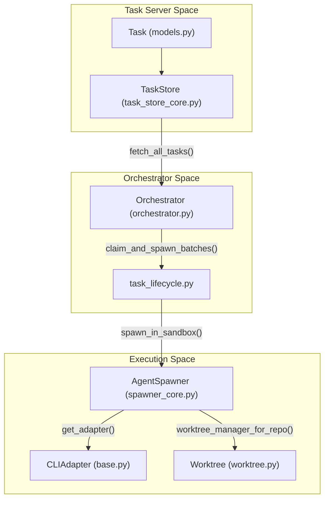
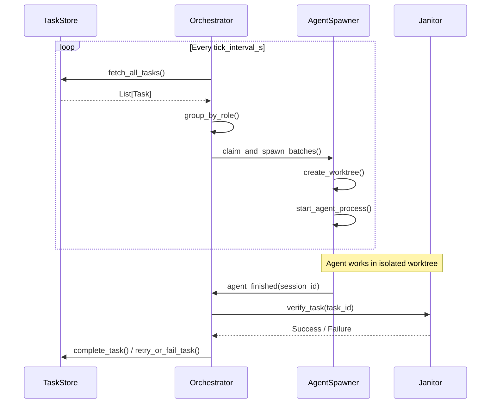

<!-- source: DeepWiki mcp.deepwiki.com · repo sipyourdrink-ltd/bernstein · page 1.2 Core Concepts and Terminology · fetched 2026-10-26 -->

# Core Concepts and Terminology

<details>
<summary>Relevant source files</summary>

The following files were used as context for generating this wiki page:

- [.cursor/rules/module-map.mdc](.cursor/rules/module-map.mdc)
- [.cursor/rules/overview.mdc](.cursor/rules/overview.mdc)
- [.goosehints](.goosehints)
- [.plugin/plugin.json](.plugin/plugin.json)
- [AGENTS.md](AGENTS.md)
- [CHANGELOG.md](CHANGELOG.md)
- [CLAUDE.md](CLAUDE.md)
- [CONVENTIONS.md](CONVENTIONS.md)
- [README.md](README.md)
- [docs/adapters/ADAPTER_GUIDE.md](docs/adapters/ADAPTER_GUIDE.md)
- [docs/architecture/plans.md](docs/architecture/plans.md)
- [docs/integrations/agent-session.md](docs/integrations/agent-session.md)
- [docs/operations/run.md](docs/operations/run.md)
- [docs/orchestration/worker-coordination.md](docs/orchestration/worker-coordination.md)
- [docs/reference/cli-reference.md](docs/reference/cli-reference.md)
- [docs/release-notes/unreleased.md](docs/release-notes/unreleased.md)
- [docs/release-notes/v3.13.0.md](docs/release-notes/v3.13.0.md)
- [docs/release-notes/v3.14.159.md](docs/release-notes/v3.14.159.md)
- [mcp.json](mcp.json)
- [mkdocs.yml](mkdocs.yml)
- [plugin.json](plugin.json)
- [pyproject.toml](pyproject.toml)
- [schemas/agent-plugins/1.0.0/mcp.schema.json](schemas/agent-plugins/1.0.0/mcp.schema.json)
- [schemas/agent-plugins/1.0.0/plugin.schema.json](schemas/agent-plugins/1.0.0/plugin.schema.json)
- [schemas/agent-plugins/README.md](schemas/agent-plugins/README.md)
- [scripts/gen_distribution_manifests.py](scripts/gen_distribution_manifests.py)
- [server.json](server.json)
- [src/bernstein/adapters/_contract.py](src/bernstein/adapters/_contract.py)
- [src/bernstein/adapters/council_runner.py](src/bernstein/adapters/council_runner.py)
- [src/bernstein/adapters/env_isolation.py](src/bernstein/adapters/env_isolation.py)
- [src/bernstein/adapters/openai_agents.py](src/bernstein/adapters/openai_agents.py)
- [src/bernstein/adapters/openai_agents_runner.py](src/bernstein/adapters/openai_agents_runner.py)
- [src/bernstein/adapters/registry.py](src/bernstein/adapters/registry.py)
- [src/bernstein/adapters/report.py](src/bernstein/adapters/report.py)
- [src/bernstein/adapters/use_cases.py](src/bernstein/adapters/use_cases.py)
- [src/bernstein/cli/commands/adapter_cmd.py](src/bernstein/cli/commands/adapter_cmd.py)
- [src/bernstein/cli/main.py](src/bernstein/cli/main.py)
- [src/bernstein/cli/run_bootstrap.py](src/bernstein/cli/run_bootstrap.py)
- [src/bernstein/cli/run_preflight.py](src/bernstein/cli/run_preflight.py)
- [src/bernstein/core/agents/spawner_core.py](src/bernstein/core/agents/spawner_core.py)
- [src/bernstein/core/instrumentation.py](src/bernstein/core/instrumentation.py)
- [src/bernstein/core/orchestration/orchestrator.py](src/bernstein/core/orchestration/orchestrator.py)
- [src/bernstein/core/security/audit_chain.py](src/bernstein/core/security/audit_chain.py)
- [src/bernstein/core/tasks/models.py](src/bernstein/core/tasks/models.py)
- [src/bernstein/core/tasks/task_lifecycle.py](src/bernstein/core/tasks/task_lifecycle.py)
- [src/bernstein/core/tasks/task_store_core.py](src/bernstein/core/tasks/task_store_core.py)
- [templates/roles/manager/system_prompt.md](templates/roles/manager/system_prompt.md)
- [templates/roles/manager/task_prompt.md](templates/roles/manager/task_prompt.md)
- [tests/integration/test_manager_auth_to_task_server.py](tests/integration/test_manager_auth_to_task_server.py)
- [tests/unit/test_adapter_contract.py](tests/unit/test_adapter_contract.py)
- [tests/unit/test_detached_run_visibility.py](tests/unit/test_detached_run_visibility.py)
- [tests/unit/test_distribution_manifests.py](tests/unit/test_distribution_manifests.py)
- [tests/unit/test_env_isolation.py](tests/unit/test_env_isolation.py)
- [tests/unit/test_instrumentation_capture.py](tests/unit/test_instrumentation_capture.py)
- [tests/unit/test_readme_api_coverage.py](tests/unit/test_readme_api_coverage.py)
- [tests/unit/test_run_cmd_track_b.py](tests/unit/test_run_cmd_track_b.py)
- [tests/unit/test_run_preflight_model_resolution.py](tests/unit/test_run_preflight_model_resolution.py)
- [tests/unit/test_spawner_agent_token.py](tests/unit/test_spawner_agent_token.py)
- [tests/unit/test_startup_task_count_consistency.py](tests/unit/test_startup_task_count_consistency.py)
- [tests/unit/test_task_release_receipt.py](tests/unit/test_task_release_receipt.py)
- [tests/unit/test_worker_cmd_spawn.py](tests/unit/test_worker_cmd_spawn.py)
- [uv.lock](uv.lock)

</details>


This page defines the fundamental abstractions and technical entities that comprise the Bernstein orchestration engine. Bernstein is designed as a **deterministic multi-agent system**, where coordination logic is implemented in pure Python to ensure auditability, zero-token coordination overhead, and predictable scheduling [src/bernstein/core/orchestration/orchestrator.py:1-15]().

---

## 1. The Task and Agent Abstractions

The core of Bernstein's state machine revolves around the relationship between **Tasks** (work to be done) and **Agents** (the execution units).

### Tasks

A `Task` is the primary unit of work in Bernstein. It represents a discrete piece of work that an agent can execute. Tasks are defined with rich metadata, including dependencies, file ownership, and completion contracts.

- **Lifecycle:** Tasks move through a well-defined state machine:
  
  ```
  OPEN → CLAIMED → IN_PROGRESS → DONE → CLOSED
  ```
  
  Each state transition is controlled, and external signals/verification are required to progress [src/bernstein/core/tasks/models.py:152-167]().
  
- **Decomposition:** Large or complex tasks are automatically decomposed into smaller subtasks. This functionality is implemented by the `Manager` role, which applies heuristics to split work items to manageable units [src/bernstein/core/tasks/task_lifecycle.py:131-141]().

- **File Ownership:** Tasks explicitly track `owned_files` to prevent parallel agents from introducing conflicting changes. The system enforces ownership during spawning and completion phases to guarantee isolation and consistent merges [src/bernstein/core/tasks/task_lifecycle.py:104-134]().

### Agents and Roles

An **Agent** is a process or execution entity spawned to complete a specific task. Agents are ephemeral: they initialize, run, complete their assigned task, and exit.

- **Roles:** Agents are classified by **roles**, which determine their configuration such as system prompts, model adapters, and tool access. Typical roles include:
  
  - `manager` — orchestrates task decomposition and planning.
  - `backend`, `frontend` — specialized developer roles.
  - `qa` — quality assurance.
  - `security` — security reviews.
  - `architect` — high level design.
  
  Roles are defined in role catalogs and influence agent behavior [src/bernstein/agents/catalog.py:32-43]().

- **Agent Card:** Each agent produces a signed identity card at session start. This card attests to the agent’s identity, configured capabilities, and exact model/adapter used. It is essential for audits and replay verification.

### Technical Data Flow: Task to Agent

This diagram bridges natural language concepts (Tasks, Agents) to their technical implementation entities, showing how a `Task` becomes a running `Agent` with an isolated `Worktree`.



Sources: [src/bernstein/core/orchestration/orchestrator.py:94-104](), [src/bernstein/core/tasks/task_lifecycle.py:1-6](), [src/bernstein/core/agents/spawner_core.py:15-26](), [src/bernstein/core/tasks/models.py:152-167]()

---

## 2. The State Directory (`.sdd/`)

Bernstein uses a file-based state model stored under the directory `.sdd/` (State Definition Directory). This approach ensures that all orchestration state is transparent, filesystem-backed, and recoverable after crashes.

| Directory         | Content Description                        | Implementation Reference                              |
|-------------------|-------------------------------------------|------------------------------------------------------|
| `.sdd/tasks/`     | JSONL logs recording every task mutation | [src/bernstein/core/tasks/task_store_core.py:52-80]() |
| `.sdd/runtime/`   | Agent heartbeats, locks, completion signals | [src/bernstein/core/agents/spawner_core.py:175-195]() |
| `.sdd/agents/`    | Cached agent role definitions and catalogs | [src/bernstein/agents/catalog.py:27-30]()            |
| `.sdd/wal/`       | Write-Ahead Log (WAL) for recovery        | [src/bernstein/core/orchestration/orchestrator.py:143-144]() |

The `.sdd/` directory acts as a shared durable ledger coordinating the state transitions of tasks and agents without requiring a central database.

---

## 3. Orchestration Components

### The Janitor and Completion Signals

The **Janitor** subsystem enforces correctness and quality gates on task completion. Before a task can transition to `DONE`, the Janitor verifies that all configured **Completion Signals** pass—these signals act as checkpoints or evidence conditions.

- **Completion Signals** can be diverse, including:
  - `path_exists` — check that a file path is present.
  - `test_passes` — run test suites and require success.
  - `api_responds` — verify API endpoints return expected results.
  - `llm_judge` — language-model based judgment (as a QA step).
  
- **Verification Flow:** When an agent reports completion, the Janitor checks these signals before the orchestrator moves the task to `DONE` [src/bernstein/core/tasks/task_lifecycle.py:38-40](), [src/bernstein/core/tasks/task_store_core.py:30-35]().

### The Audit Chain and Lineage

Bernstein maintains an **HMAC-chained audit log** recording every important event in the system, ensuring tamper-evident transparency.

- This log is modeled as a **chain** where each event contains the HMAC of the previous event, enabling offline verification and strong integrity guarantees.

- **Lineage** tracks the provenance of every code artifact produced by agents, mapping commits and outputs back to the originating tasks and agent sessions.

- Together, they provide cryptographically verifiable audit trails for every code and artifact modification [src/bernstein/core/security/audit_chain.py:1-150](), [src/bernstein/core/tasks/task_store_core.py:98-114]().

### Worktree Isolation

Each agent runs inside an isolated **Git worktree** created specifically for the task. Worktrees provide filesystem and git isolation, avoiding merge conflicts, enabling atomic merges, and supporting parallelism.

- The **WorktreeManager** tracks the lifecycle of these worktrees—creation, classification, and eventual garbage collection.

- This isolation guarantees no mutable shared state between concurrent agents, supporting deterministic replayability [src/bernstein/core/agents/spawner_core.py:80-90]().

---

## 4. Execution Lifecycle

The Orchestrator executes a deterministic "tick" loop managing task progression and agent spawning. During each tick:

1. The `TaskStore` is queried for all tasks [fetch_all_tasks()].

2. Tasks are grouped by role, dependencies are resolved, and batches of tasks ready for execution are claimed.

3. An `AgentSpawner` creates the isolated environment (worktree), selects/adapts the agent role, and launches the agent process.

4. Agents execute independently, modifying files inside their worktrees.

5. Upon agent completion, the orchestrator invokes the **Janitor** to verify all completion signals.

6. If verified, tasks transition to `DONE`; otherwise, retry or fail logic is applied.

**Sequence Diagram of Orchestrator Tick:**



Sources: [src/bernstein/core/orchestration/orchestrator.py:94-110](), [src/bernstein/core/tasks/task_lifecycle.py:131-141](), [src/bernstein/core/agents/spawner_core.py:28-42]()

---

## 5. The Plan Formats: TaskPlan and Plan YAML

Bernstein workflows are defined declaratively using **Plan YAML** schemas:

- A **Plan** is a declarative YAML file describing a directed acyclic graph (DAG) of tasks, their dependencies, roles, and orchestration parameters.

- The **TaskPlan** is a higher-level abstraction that may aggregate or refine Plans dynamically, facilitating automatic task decomposition and incremental execution [src/bernstein/core/orchestration/orchestrator.py:103-104]().

These plans form the "recipe" that the orchestrator executes via the agent/task lifecycle.

---

## 6. The Agent Card

Each agent session creates an **Agent Card**:

- It is a signed manifest attesting to the identity, role, capabilities, environment, model adapter, and configuration of that agent instance.

- The Agent Card serves as cryptographic evidence for audits and verification, enabling offline trust and forensic analysis.

- Agent Card generation and verification are integrated into agent session startup and completion procedures [src/bernstein/agents/catalog.py:47-72]().

---

## 7. The `.bernstein/rules.yaml` Organizational Rule Enforcement File

Bernstein supports organizational policy enforcement via `.bernstein/rules.yaml`:

- This file encodes rules for enforcing role permissions, task creation policies, adapter configuration limits, and other governance rules.

- The orchestrator and task server validate these rules during task lifecycles and agent admissions to ensure compliance with organizational standards.

- The rules file enables teams to enforce guardrails declaratively without modifying orchestration code.

---

# Summary Table of Fundamental Terms

| Term                  | Description                                               | Representative File / Class / Function                  |
|-----------------------|-----------------------------------------------------------|---------------------------------------------------------|
| **Task**              | Discrete unit of work with lifecycle and file ownership. | `Task` (models.py) [src/bernstein/core/tasks/models.py:152-167]() |
| **Agent**             | Short-lived process executing a Task, configured by Role. | `AgentSpawner` (spawner_core.py) [src/bernstein/core/agents/spawner_core.py:15-30]() |
| **Role**              | Classification driving agent prompts and capabilities.   | Role catalog [src/bernstein/agents/catalog.py:32-43]()  |
| **Worktree**          | Git worktree isolation for agent execution.               | `WorktreeManager` [src/bernstein/core/agents/spawner_core.py:80-90]() |
| **.sdd/**             | File-based state directory for durable orchestration state. | [src/bernstein/core/tasks/task_store_core.py:52-80]()   |
| **TaskPlan/Plan YAML**| Declarative workflow definitions in YAML format.          | [src/bernstein/core/orchestration/orchestrator.py:103-104]() |
| **Completion Signal** | Validation checkpoints for task completion.                | [src/bernstein/core/tasks/task_store_core.py:30-35]()   |
| **Janitor**           | Verification engine enforcing quality gates on tasks.     | [src/bernstein/core/tasks/task_lifecycle.py:38-40]()    |
| **Audit Chain**       | HMAC-chained tamper-evident event log.                     | [src/bernstein/core/security/audit_chain.py:1-50]()     |
| **Agent Card**        | Signed attestation of agent identity and configuration.    | [src/bernstein/agents/catalog.py:47-72]()               |
| **.bernstein/rules.yaml** | Organizational rule enforcement file.                    | Enforcement hooks (dispersed in orchestration code)     |

---

This page covers the foundational concepts and entities essential for understanding Bernstein’s internal engine, data flows, and compliance mechanisms. For deeper technical details about each subsystem, see the linked pages and source files.

Sources:  
[src/bernstein/core/orchestration/orchestrator.py:1-149](),  
[src/bernstein/core/tasks/models.py:1-167](),  
[src/bernstein/core/tasks/task_lifecycle.py:1-153](),  
[src/bernstein/core/agents/spawner_core.py:1-95](),  
[src/bernstein/agents/catalog.py:25-85](),  
[src/bernstein/core/tasks/task_store_core.py:25-85](),  
[src/bernstein/core/security/audit_chain.py:1-150]()

---

