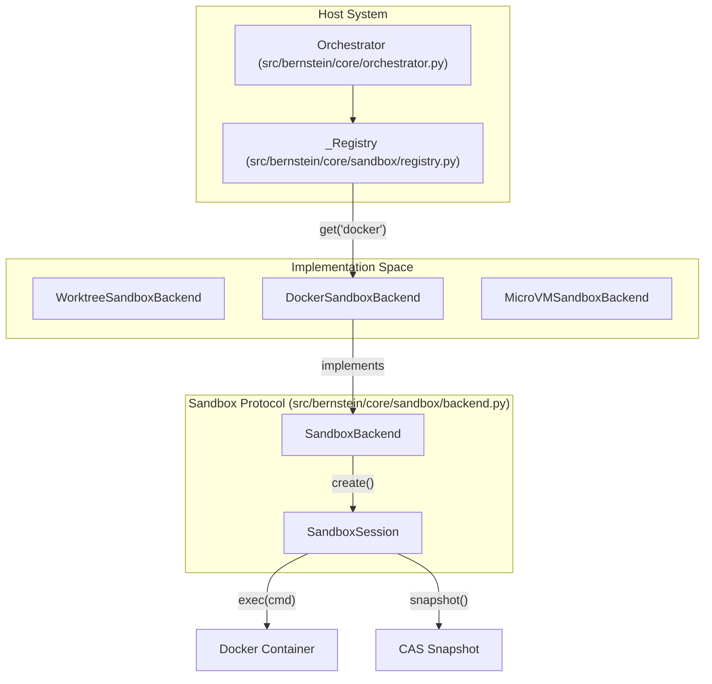
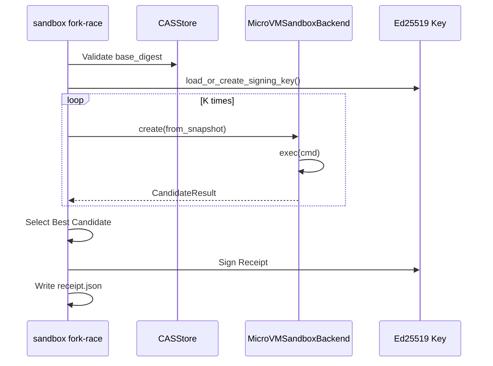

<!-- source: DeepWiki mcp.deepwiki.com · repo sipyourdrink-ltd/bernstein · page 11.3 Docker and Sandbox Backends · fetched 2026-10-26 -->

# Docker and Sandbox Backends

Relevant source files

The following files were used as context for generating this wiki page:

- [Dockerfile](Dockerfile)
- [action/entrypoint.sh](action/entrypoint.sh)
- [deploy/github-app/app.yml](deploy/github-app/app.yml)
- [deploy/grafana/dashboards/bernstein-otel.json](deploy/grafana/dashboards/bernstein-otel.json)
- [deploy/grafana/provisioning/dashboards/bernstein.yml](deploy/grafana/provisioning/dashboards/bernstein.yml)
- [deploy/helm/bernstein/Chart.yaml](deploy/helm/bernstein/Chart.yaml)
- [deploy/otel-collector/otel-collector-config.yaml](deploy/otel-collector/otel-collector-config.yaml)
- [deploy/prometheus/prometheus.yml](deploy/prometheus/prometheus.yml)
- [docker-compose.yaml](docker-compose.yaml)
- [docker/demo/Dockerfile](docker/demo/Dockerfile)
- [docker/demo/demo-cycle.sh](docker/demo/demo-cycle.sh)
- [docs/architecture/sandbox.md](docs/architecture/sandbox.md)
- [docs/integrations/github-action.md](docs/integrations/github-action.md)
- [docs/operations/microvm-libkrun.md](docs/operations/microvm-libkrun.md)
- [docs/sandbox/playwright-self-test.md](docs/sandbox/playwright-self-test.md)
- [packages/cursor-plugin/skills/bernstein-agents/scripts/agents.sh](packages/cursor-plugin/skills/bernstein-agents/scripts/agents.sh)
- [packages/cursor-plugin/skills/bernstein-alerts/scripts/alerts.sh](packages/cursor-plugin/skills/bernstein-alerts/scripts/alerts.sh)
- [packages/cursor-plugin/skills/bernstein-approve/scripts/approvals.sh](packages/cursor-plugin/skills/bernstein-approve/scripts/approvals.sh)
- [packages/cursor-plugin/skills/bernstein-cost/scripts/costs.sh](packages/cursor-plugin/skills/bernstein-cost/scripts/costs.sh)
- [packages/cursor-plugin/skills/bernstein-create-task/scripts/create-task.sh](packages/cursor-plugin/skills/bernstein-create-task/scripts/create-task.sh)
- [packages/cursor-plugin/skills/bernstein-plan/scripts/plan.sh](packages/cursor-plugin/skills/bernstein-plan/scripts/plan.sh)
- [packages/cursor-plugin/skills/bernstein-quality/scripts/quality.sh](packages/cursor-plugin/skills/bernstein-quality/scripts/quality.sh)
- [scripts/ci_debug.sh](scripts/ci_debug.sh)
- [scripts/safe-push-main.sh](scripts/safe-push-main.sh)
- [src/bernstein/cli/commands/sandbox_cmd.py](src/bernstein/cli/commands/sandbox_cmd.py)
- [src/bernstein/core/sandbox/backends/_libkrun.py](src/bernstein/core/sandbox/backends/_libkrun.py)
- [src/bernstein/core/sandbox/backends/_libkrun_launcher/krunlaunch.c](src/bernstein/core/sandbox/backends/_libkrun_launcher/krunlaunch.c)
- [src/bernstein/core/sandbox/backends/_libkrun_launcher/krunlaunch.entitlements.plist](src/bernstein/core/sandbox/backends/_libkrun_launcher/krunlaunch.entitlements.plist)
- [src/bernstein/core/sandbox/backends/_vmmonitor.py](src/bernstein/core/sandbox/backends/_vmmonitor.py)
- [src/bernstein/core/sandbox/backends/microvm.py](src/bernstein/core/sandbox/backends/microvm.py)
- [src/bernstein/core/sandbox/fork_race.py](src/bernstein/core/sandbox/fork_race.py)
- [src/bernstein/core/sandbox/playwright_runner.py](src/bernstein/core/sandbox/playwright_runner.py)
- [src/bernstein/core/sandbox/registry.py](src/bernstein/core/sandbox/registry.py)
- [src/bernstein/core/sandbox/selection_receipt.py](src/bernstein/core/sandbox/selection_receipt.py)
- [tests/integration/sandbox/test_microvm_firecracker.py](tests/integration/sandbox/test_microvm_firecracker.py)
- [tests/integration/sandbox/test_microvm_libkrun.py](tests/integration/sandbox/test_microvm_libkrun.py)
- [tests/unit/sandbox/conftest.py](tests/unit/sandbox/conftest.py)
- [tests/unit/sandbox/test_fork_race.py](tests/unit/sandbox/test_fork_race.py)
- [tests/unit/sandbox/test_libkrun_monitor.py](tests/unit/sandbox/test_libkrun_monitor.py)
- [tests/unit/sandbox/test_microvm_backend.py](tests/unit/sandbox/test_microvm_backend.py)
- [tests/unit/sandbox/test_playwright_runner.py](tests/unit/sandbox/test_playwright_runner.py)
- [tests/unit/sandbox/test_registry.py](tests/unit/sandbox/test_registry.py)
- [tests/unit/sandbox/test_sandbox_cli.py](tests/unit/sandbox/test_sandbox_cli.py)
- [tests/unit/sandbox/test_vmmonitor_canonical.py](tests/unit/sandbox/test_vmmonitor_canonical.py)
- [tests/unit/test_shipped_shell_cli_invocations.py](tests/unit/test_shipped_shell_cli_invocations.py)

Bernstein utilizes a multi-layered containerization and sandboxing strategy to ensure that autonomous agents operate within strictly defined boundaries. This system encompasses production Docker images, a dedicated researcher environment for security analysis, and a pluggable backend protocol that abstracts the execution environment (Docker, E2B, microVM, or local worktrees).

## Docker Image Hierarchy

The project maintains three primary Docker images, each tailored for specific lifecycle stages of the orchestration engine.

| Image | Purpose | Key Components |
| :--- | :--- | :--- |
| `bernstein:latest` | Production Orchestrator | Task Server, Orchestrator, Python 3.13 runtime, and the `bernstein` CLI [Dockerfile:13-56](). |
| `bernstein-demo` | Interactive Showcase | Pre-loaded with `demo-cycle.sh`, Node.js, and Claude Code to demonstrate agentic loops [docker/demo/Dockerfile:18-57](). |
| `bernstein-worker` | Scalable Execution | Shared image with `bernstein:latest`, configured to claim tasks from a central server [docker-compose.yaml:123-129](). |

### Cluster Deployment (Docker Compose)
For production-like environments, a `docker-compose.yaml` defines a multi-node cluster including the Task Server (port 8052), the Orchestrator, and scalable Workers [docker-compose.yaml:70-130](). It also provisions a monitoring stack with Prometheus and Grafana [docker-compose.yaml:176-185]().

**Sources:** [Dockerfile:1-56](), [docker/demo/Dockerfile:1-57](), [docker-compose.yaml:1-130]()

## Sandbox Backend Protocol

Bernstein abstracts the execution environment through the `SandboxBackend` protocol. This allows the system to launch agents in various isolation tiers depending on the configuration in `plan.yaml` or `bernstein.yaml` [docs/architecture/sandbox.md:37-49]().

### Registry and Discovery
The `_Registry` class in `src/bernstein/core/sandbox/registry.py` serves as the central lookup for all available backends. It loads built-in backends (like `worktree` and `docker`) eagerly and third-party backends (like `e2b` or `modal`) via entry points [src/bernstein/core/sandbox/registry.py:34-185]().

### Backend Capabilities
Every backend advertises its supported features via `SandboxCapability` [docs/architecture/sandbox.md:64-69]():
*   `FILE_RW`: Basic filesystem access.
*   `EXEC`: Ability to run commands.
*   `SNAPSHOT`: Ability to freeze and resume execution state.
*   `NETWORK`: Egress/Ingress capabilities.

**Sources:** [src/bernstein/core/sandbox/registry.py:34-185](), [docs/architecture/sandbox.md:18-69]()

## First-Party Backends

### Worktree Backend
The default backend. It uses `git worktree` to isolate parallel agents on the local filesystem [docs/architecture/sandbox.md:94](). It provides zero provisioning latency but minimal process isolation.

### Docker Backend
Launches a container per agent session using the Python Docker SDK [docs/architecture/sandbox.md:95](). This requires mounting the host Docker socket if Bernstein itself is running inside a container [docker-compose.yaml:48-64]().

### MicroVM Backend (libkrun / Firecracker)
Provides hardware-level isolation. The `MicroVMSandboxBackend` uses a `VMMonitor` shim to drive hypervisors [docs/architecture/sandbox.md:117-147]().
*   **Libkrun**: Boots a guest via `libkrun` for local dev on macOS/Linux [docs/architecture/sandbox.md:148-150]().
*   **Deterministic Fork-and-Race**: Enables spawning $K$ microVMs from a single content-addressed base snapshot to find the best agent trajectory [src/bernstein/cli/commands/sandbox_cmd.py:183-231]().

**Sources:** [docs/architecture/sandbox.md:90-150](), [src/bernstein/core/sandbox/registry.py:143-166](), [src/bernstein/cli/commands/sandbox_cmd.py:183-231]()

## Web Sandbox and Self-Testing

For UI-centric tasks, the `PlaywrightRunner` drives browser-based scenarios against a development server [src/bernstein/core/sandbox/playwright_runner.py:1-43]().

### Execution Flow
1.  **Scenario Loading**: YAML files define steps like `navigate`, `click`, and `assert_visible` [src/bernstein/core/sandbox/playwright_runner.py:125-180]().
2.  **Browser Orchestration**: A headless Chromium instance executes the steps and captures screenshots [src/bernstein/core/sandbox/playwright_runner.py:198-208]().
3.  **LLM Judging**: An optional `EvalJudge` reviews the visual artifacts against the task description to provide a pass/fail verdict [src/bernstein/cli/commands/sandbox_cmd.py:143-150]().

**Sources:** [src/bernstein/core/sandbox/playwright_runner.py:1-208](), [src/bernstein/cli/commands/sandbox_cmd.py:53-124]()

## Sandbox Escape Detection and Health Checks

The `bernstein doctor` command (and associated pre-flight checks) verifies the integrity of the isolation layer.

### Pre-flight Validation
*   **Digest Integrity**: The `fork-race` command validates that the base snapshot exists in the Content-Addressable Store (CAS) before dispatching any candidates [src/bernstein/cli/commands/sandbox_cmd.py:125-130]().
*   **Permissions Check**: The CLI verifies that output directories for receipts and audit logs are writable before side-effecting the host [tests/unit/sandbox/test_sandbox_cli.py:116-156]().

### Audit and Lineage
Every microVM fork-and-race event generates a signed receipt using Ed25519 keys [src/bernstein/cli/commands/sandbox_cmd.py:204-210](). This ensures that the trajectory selected by the orchestrator is cryptographically linked to the base snapshot and the specific agent execution [tests/unit/sandbox/test_sandbox_cli.py:159-182]().

**Sources:** [src/bernstein/cli/commands/sandbox_cmd.py:183-231](), [tests/unit/sandbox/test_sandbox_cli.py:47-182](), [docs/architecture/sandbox.md:117-150]()

---

