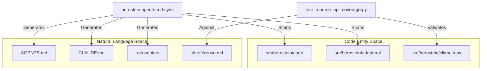
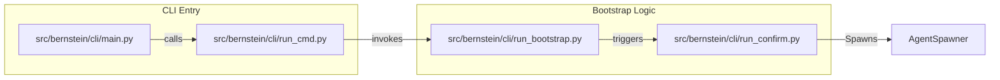

<!-- source: DeepWiki mcp.deepwiki.com · repo sipyourdrink-ltd/bernstein · page 13 Contributing and Development · fetched 2026-10-26 -->

# Contributing and Development

<details>
<summary>Relevant source files</summary>

The following files were used as context for generating this wiki page:

- [.clusterfuzzlite/build.sh](.clusterfuzzlite/build.sh)
- [.clusterfuzzlite/requirements.txt](.clusterfuzzlite/requirements.txt)
- [.cursor/rules/module-map.mdc](.cursor/rules/module-map.mdc)
- [.cursor/rules/overview.mdc](.cursor/rules/overview.mdc)
- [.goosehints](.goosehints)
- [AGENTS.md](AGENTS.md)
- [CLAUDE.md](CLAUDE.md)
- [CONTRIBUTORS.md](CONTRIBUTORS.md)
- [CONVENTIONS.md](CONVENTIONS.md)
- [README.md](README.md)
- [docs/adapters/ADAPTER_GUIDE.md](docs/adapters/ADAPTER_GUIDE.md)
- [docs/architecture/DEPENDENCY_RESOLVER.md](docs/architecture/DEPENDENCY_RESOLVER.md)
- [docs/architecture/permission-modes.md](docs/architecture/permission-modes.md)
- [docs/architecture/quality-pipeline.md](docs/architecture/quality-pipeline.md)
- [docs/architecture/skills.md](docs/architecture/skills.md)
- [docs/architecture/state-persistence.md](docs/architecture/state-persistence.md)
- [docs/architecture/storage.md](docs/architecture/storage.md)
- [docs/assets/banner-readme.png](docs/assets/banner-readme.png)
- [docs/compliance/lineage-export.md](docs/compliance/lineage-export.md)
- [docs/operations/compliance.md](docs/operations/compliance.md)
- [docs/operations/performance-tuning.md](docs/operations/performance-tuning.md)
- [docs/operations/security.md](docs/operations/security.md)
- [docs/playbooks/docs-drift.md](docs/playbooks/docs-drift.md)
- [docs/playbooks/docs-update-sweep.md](docs/playbooks/docs-update-sweep.md)
- [docs/reference/cli-reference.md](docs/reference/cli-reference.md)
- [docs/release-notes/unreleased.md](docs/release-notes/unreleased.md)
- [docs/security/capability-matrix.md](docs/security/capability-matrix.md)
- [docs/security/lethal-trifecta.md](docs/security/lethal-trifecta.md)
- [scripts/regen_contract_drift.py](scripts/regen_contract_drift.py)
- [src/bernstein/adapters/_contract.py](src/bernstein/adapters/_contract.py)
- [src/bernstein/adapters/registry.py](src/bernstein/adapters/registry.py)
- [src/bernstein/adapters/report.py](src/bernstein/adapters/report.py)
- [src/bernstein/adapters/use_cases.py](src/bernstein/adapters/use_cases.py)
- [src/bernstein/cli/commands/adapter_cmd.py](src/bernstein/cli/commands/adapter_cmd.py)
- [src/bernstein/cli/main.py](src/bernstein/cli/main.py)
- [src/bernstein/core/security/audit_chain.py](src/bernstein/core/security/audit_chain.py)
- [tests/unit/test_adapter_contract.py](tests/unit/test_adapter_contract.py)
- [tests/unit/test_contract_drift_autofix_workflow_yaml.py](tests/unit/test_contract_drift_autofix_workflow_yaml.py)
- [tests/unit/test_readme_api_coverage.py](tests/unit/test_readme_api_coverage.py)
- [tests/unit/test_regen_contract_drift.py](tests/unit/test_regen_contract_drift.py)

</details>


This page outlines the standards, environment setup, and processes for contributing to the Bernstein orchestrator. Bernstein is a deterministic Python scheduler designed for high-compliance environments, necessitating strict adherence to coding conventions and verification pipelines.

## Development Environment Setup

Bernstein uses `hatchling` as its build backend and `uv` for dependency management and environment isolation.

### Prerequisites
- **Python**: >= 3.12 [README.md:22]()
- **Package Manager**: `uv` is recommended for performance and lockfile consistency.

### Setup Steps
1. **Clone and Install**:
   ```bash
   git clone https://github.com/sipyourdrink-ltd/bernstein
   cd bernstein
   uv sync --all-extras
   ```
2. **Pre-commit Hooks**: Install hooks to enforce linting and formatting before commits.
   ```bash
   bernstein install-hooks
   ```
   *Note: This registers hooks defined in the `advanced_cmd` module [src/bernstein/cli/main.py:36]().*

### Optional Dependencies
Bernstein provides several extras for specific development needs:
- `dev`: Full suite for testing (pytest, hypothesis, ruff, pyright).
- `grpc`: Protobuf and gRPC stub generation.
- `docker`/`e2b`: Sandbox backend provider SDKs.

**Sources:** [README.md:22-60](), [src/bernstein/cli/main.py:1-45]()

## Coding Conventions and Documentation

Bernstein enforces consistency through several auto-generated and manually curated convention files. These files ensure that both human contributors and AI agents (like Claude or Cursor) understand the system boundaries.

### Core Convention Files
- **`CONVENTIONS.md`**: General coding standards and architectural rules [CONVENTIONS.md:1-2]().
- **`CLAUDE.md`**: Specialized instructions for the Claude Code agent, including the module map [CLAUDE.md:1-4]().
- **`AGENTS.md`**: The source of truth for agent-related documentation and the module map [AGENTS.md:1-2]().
- **`.cursor/rules/`**: Context-specific rules for the Cursor IDE, such as `module-map.mdc` [.cursor/rules/module-map.mdc:1-7]().

### The Module Map
The module map is a critical piece of documentation that categorizes the codebase into two main areas:
1. **Orchestration Engine (`src/bernstein/core/`)**: Contains the scheduler, security (HMAC audit chain), and persistence logic [CLAUDE.md:10-66]().
2. **CLI Agent Adapters (`src/bernstein/adapters/`)**: Contains the 40+ adapters for tools like Aider, Claude Code, and Gemini [README.md:39-48](), [src/bernstein/adapters/registry.py:83-143]().

**Sources:** [CONVENTIONS.md:1-8](), [CLAUDE.md:1-112](), [AGENTS.md:1-10](), [.cursor/rules/module-map.mdc:1-104](), [src/bernstein/adapters/registry.py:83-154]()

## Development Workflow

### PR Process and Code Review
Bernstein follows a strict "Vertical Slice" planning and execution model. Every PR should ideally address a single goal with a complete audit trail.
- **Review Standards**: Reviews are coordinated by the `review` sub-package, which assigns perspectives to different adapters to ensure cross-model verification [CLAUDE.md:62]().
- **Audit Verification**: Every contribution is recorded in the HMAC-SHA256 audit chain to ensure tamper-evident history [src/bernstein/core/security/audit_chain.py:1-24]().

### The `agents_md` Dogfood Test
To prevent documentation rot, Bernstein uses a "dogfooding" test. The `agents-md` command (and its associated test) ensures that the `AGENTS.md`, `CLAUDE.md`, and `.goosehints` files are perfectly synchronized with the actual file structure.
- **Implementation**: The `agents-md` generator scans the source tree and updates the markdown tables [tests/unit/test_readme_api_coverage.py:87]().
- **Verification**: CI fails if these files are out of sync with the codebase.

### README API Coverage
A specialized test, `test_readme_api_coverage.py`, ensures that every top-level CLI command registered in `src/bernstein/cli/main.py` is documented in `docs/reference/cli-reference.md` [tests/unit/test_readme_api_coverage.py:1-6]().
- **Maintenance**: When adding a command to `main.py`, it must either be documented in the reference or added to the `UNDOCUMENTED_EXEMPTIONS` dictionary in the test file [tests/unit/test_readme_api_coverage.py:84-142]().

**Sources:** [src/bernstein/cli/main.py:1-165](), [tests/unit/test_readme_api_coverage.py:1-153](), [src/bernstein/core/security/audit_chain.py:1-150]()

## Technical Implementation: Documentation Sync

The following diagram illustrates how the `agents-md` subsystem synchronizes natural language documentation with the physical code structure.

### Documentation Sync Flow

**Sources:** [tests/unit/test_readme_api_coverage.py:1-74](), [AGENTS.md:1-2](), [CLAUDE.md:1-2](), [.goosehints:1-2]()

## Internationalization (i18n)

Bernstein maintains translated READMEs to support a global contributor base. The `readme-l10n` gate ensures that translations do not drift from the English source [docs/release-notes/unreleased.md:33]().
- **Supported Languages**: Simplified Chinese (`zh-Hans`) and Traditional Chinese (`zh-TW`) are currently supported [README.md:31]().
- **Process**: `bernstein readme-l10n verify` recomputes content hashes to detect drift in translated sections [docs/release-notes/unreleased.md:33]().
- **Verbatim Enforcement**: Commands, flags, and the header/footer must remain verbatim in all translations [docs/release-notes/unreleased.md:33]().

**Sources:** [README.md:31](), [docs/release-notes/unreleased.md:33]()

## Testing and Verification

Bernstein employs a multi-layered verification strategy to maintain its "audit-grade" status.

| Test Category | Purpose | Key File/Module |
| :--- | :--- | :--- |
| **CLI Coverage** | Detects undocumented public CLI commands | `tests/unit/test_readme_api_coverage.py` [tests/unit/test_readme_api_coverage.py:1-6]() |
| **Audit Chain** | Validates the HMAC-SHA256 tamper-evident log | `src/bernstein/core/security/audit_chain.py` [src/bernstein/core/security/audit_chain.py:1-24]() |
| **Adapter Contract**| Ensures adapters conform to expected behavior | `src/bernstein/adapters/_contract.py` [CLAUDE.md:90]() |
| **Clean Run** | Proves ground-truth was not leaked during eval | `docs/release-notes/unreleased.md:34` [docs/release-notes/unreleased.md:34]() |

### Execution Bootstrap Flow
The `run` sequence handles pre-flight checks and setup for any agent execution, ensuring the environment is safe before spawning processes.


**Sources:** [src/bernstein/cli/main.py:12-13](), [docs/reference/cli-reference.md:73-81](), [src/bernstein/cli/main.py:48-165]()

---

