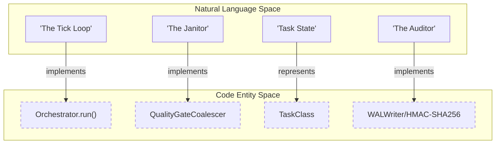
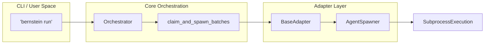

<!-- source: DeepWiki mcp.deepwiki.com · repo sipyourdrink-ltd/bernstein · page 14 Glossary · fetched 2026-10-26 -->

# Glossary

Relevant source files

The following files were used as context for generating this wiki page:

- [.cursor/rules/module-map.mdc](.cursor/rules/module-map.mdc)
- [.cursor/rules/overview.mdc](.cursor/rules/overview.mdc)
- [.goosehints](.goosehints)
- [.plugin/plugin.json](.plugin/plugin.json)
- [AGENTS.md](AGENTS.md)
- [CHANGELOG.md](CHANGELOG.md)
- [CLAUDE.md](CLAUDE.md)
- [CONVENTIONS.md](CONVENTIONS.md)
- [README.md](README.md)
- [docs/ENTERPRISE.md](docs/ENTERPRISE.md)
- [docs/adapters/ADAPTER_GUIDE.md](docs/adapters/ADAPTER_GUIDE.md)
- [docs/architecture/plans.md](docs/architecture/plans.md)
- [docs/getting-started/first-run.md](docs/getting-started/first-run.md)
- [docs/getting-started/quickstart-tutorial.md](docs/getting-started/quickstart-tutorial.md)
- [docs/integrations/agent-session.md](docs/integrations/agent-session.md)
- [docs/operations/MODEL_POLICY.md](docs/operations/MODEL_POLICY.md)
- [docs/operations/TROUBLESHOOTING.md](docs/operations/TROUBLESHOOTING.md)
- [docs/operations/cost-optimization.md](docs/operations/cost-optimization.md)
- [docs/operations/run.md](docs/operations/run.md)
- [docs/operations/session-handoff.md](docs/operations/session-handoff.md)
- [docs/orchestration/worker-coordination.md](docs/orchestration/worker-coordination.md)
- [docs/reference/GLOSSARY.md](docs/reference/GLOSSARY.md)
- [docs/reference/KNOWN_LIMITATIONS.md](docs/reference/KNOWN_LIMITATIONS.md)
- [docs/reference/cli-reference.md](docs/reference/cli-reference.md)
- [docs/release-notes/unreleased.md](docs/release-notes/unreleased.md)
- [docs/release-notes/v3.13.0.md](docs/release-notes/v3.13.0.md)
- [docs/release-notes/v3.14.159.md](docs/release-notes/v3.14.159.md)
- [mcp.json](mcp.json)
- [mkdocs.yml](mkdocs.yml)
- [plugin.json](plugin.json)
- [pyproject.toml](pyproject.toml)
- [schemas/agent-plugins/1.0.0/mcp.schema.json](schemas/agent-plugins/1.0.0/mcp.schema.json)
- [schemas/agent-plugins/1.0.0/plugin.schema.json](schemas/agent-plugins/1.0.0/plugin.schema.json)
- [schemas/agent-plugins/README.md](schemas/agent-plugins/README.md)
- [scripts/gen_distribution_manifests.py](scripts/gen_distribution_manifests.py)
- [server.json](server.json)
- [src/bernstein/adapters/_contract.py](src/bernstein/adapters/_contract.py)
- [src/bernstein/adapters/council_runner.py](src/bernstein/adapters/council_runner.py)
- [src/bernstein/adapters/env_isolation.py](src/bernstein/adapters/env_isolation.py)
- [src/bernstein/adapters/openai_agents.py](src/bernstein/adapters/openai_agents.py)
- [src/bernstein/adapters/openai_agents_runner.py](src/bernstein/adapters/openai_agents_runner.py)
- [src/bernstein/adapters/registry.py](src/bernstein/adapters/registry.py)
- [src/bernstein/adapters/report.py](src/bernstein/adapters/report.py)
- [src/bernstein/adapters/use_cases.py](src/bernstein/adapters/use_cases.py)
- [src/bernstein/cli/commands/adapter_cmd.py](src/bernstein/cli/commands/adapter_cmd.py)
- [src/bernstein/cli/main.py](src/bernstein/cli/main.py)
- [src/bernstein/cli/run_bootstrap.py](src/bernstein/cli/run_bootstrap.py)
- [src/bernstein/cli/run_preflight.py](src/bernstein/cli/run_preflight.py)
- [src/bernstein/core/agents/spawner_core.py](src/bernstein/core/agents/spawner_core.py)
- [src/bernstein/core/instrumentation.py](src/bernstein/core/instrumentation.py)
- [src/bernstein/core/orchestration/orchestrator.py](src/bernstein/core/orchestration/orchestrator.py)
- [src/bernstein/core/orchestration/worker.py](src/bernstein/core/orchestration/worker.py)
- [src/bernstein/core/plugins_core/dep_resolver.py](src/bernstein/core/plugins_core/dep_resolver.py)
- [src/bernstein/core/security/audit_chain.py](src/bernstein/core/security/audit_chain.py)
- [src/bernstein/core/tasks/models.py](src/bernstein/core/tasks/models.py)
- [src/bernstein/core/tasks/task_lifecycle.py](src/bernstein/core/tasks/task_lifecycle.py)
- [src/bernstein/core/tasks/task_store_core.py](src/bernstein/core/tasks/task_store_core.py)
- [templates/roles/manager/system_prompt.md](templates/roles/manager/system_prompt.md)
- [templates/roles/manager/task_prompt.md](templates/roles/manager/task_prompt.md)
- [tests/integration/test_adapter_drift_lifecycle.py](tests/integration/test_adapter_drift_lifecycle.py)
- [tests/integration/test_claim_next_concurrency.py](tests/integration/test_claim_next_concurrency.py)
- [tests/integration/test_manager_auth_to_task_server.py](tests/integration/test_manager_auth_to_task_server.py)
- [tests/integration/test_spawn_lifecycle_e2e.py](tests/integration/test_spawn_lifecycle_e2e.py)
- [tests/integration/test_worker_subprocess_signals.py](tests/integration/test_worker_subprocess_signals.py)
- [tests/unit/test_adapter_contract.py](tests/unit/test_adapter_contract.py)
- [tests/unit/test_dep_resolver.py](tests/unit/test_dep_resolver.py)
- [tests/unit/test_detached_run_visibility.py](tests/unit/test_detached_run_visibility.py)
- [tests/unit/test_distribution_manifests.py](tests/unit/test_distribution_manifests.py)
- [tests/unit/test_env_isolation.py](tests/unit/test_env_isolation.py)
- [tests/unit/test_instrumentation_capture.py](tests/unit/test_instrumentation_capture.py)
- [tests/unit/test_readme_api_coverage.py](tests/unit/test_readme_api_coverage.py)
- [tests/unit/test_run_cmd_track_b.py](tests/unit/test_run_cmd_track_b.py)
- [tests/unit/test_run_preflight_model_resolution.py](tests/unit/test_run_preflight_model_resolution.py)
- [tests/unit/test_spawner_agent_token.py](tests/unit/test_spawner_agent_token.py)
- [tests/unit/test_startup_task_count_consistency.py](tests/unit/test_startup_task_count_consistency.py)
- [tests/unit/test_task_release_receipt.py](tests/unit/test_task_release_receipt.py)
- [tests/unit/test_worker.py](tests/unit/test_worker.py)
- [tests/unit/test_worker_cmd_spawn.py](tests/unit/test_worker_cmd_spawn.py)
- [uv.lock](uv.lock)

This page provides a comprehensive reference for terms, abbreviations, and domain concepts used throughout the Bernstein codebase. Bernstein is a deterministic multi-agent orchestrator designed for compliance-heavy environments, where "deterministic" implies that scheduling and coordination logic is handled by standard Python code rather than an LLM loop [README.md:43-54]().

## Core System Concepts

### .sdd (State Directory)
The `.sdd/` directory is the local file-based state store for a Bernstein project. It contains task definitions, agent tokens, logs, and the Write-Ahead Log (WAL).
*   **Implementation**: Defined in `SDD_DIRS` [src/bernstein/cli/main.py:176]().
*   **Key Files**:
    *   `runtime/agent_tokens/`: Per-session zero-trust JWTs [README.md:50]().
    *   `audit.log`: HMAC-signed records of every scheduling decision [README.md:39]().

### Audit Chain
A tamper-evident sequence of scheduling decisions and agent actions, secured using HMAC-SHA256. It surfaces the `prev_chain_digest` (HMAC of the most recent event) to ensure strict sequence integrity.
*   **Implementation**: `AuditChainStore` acts as a facade over `AuditLog` [src/bernstein/core/security/audit_chain.py:3-7]().
*   **Verification**: Performed via `bernstein verify receipt` or `bernstein lineage verify` [README.md:67-69]().

### Task Lifecycle
Tasks in Bernstein follow a strict state machine: `OPEN` → `CLAIMED` → `IN_PROGRESS` → `DONE` → `CLOSED`.
*   **Orchestrator Role**: The `Orchestrator` tick loop is single-threaded and matches tasks to agents via the spawner and verifies completion via the janitor [src/bernstein/core/orchestration/orchestrator.py:1-9]().
*   **Transition Logic**: Core logic for state transitions, including auto-decomposition and retries, lives in `task_lifecycle.py` [src/bernstein/core/orchestration/orchestrator.py:144-154]().

### Natural Language to Code Entity Map: Orchestration

The following diagram maps high-level orchestration concepts to their specific implementation classes and file locations.

"Orchestration Domain Map"

Sources: [src/bernstein/core/orchestration/orchestrator.py:6-15](), [src/bernstein/core/orchestration/orchestrator.py:90-92](), [src/bernstein/core/orchestration/orchestrator.py:122](), [src/bernstein/core/orchestration/orchestrator.py:156]()

## Agent & Adapter Terms

### Adapter
A Python class that wraps a third-party CLI coding agent (e.g., Claude Code, Aider, Codex) to make it compatible with the Bernstein orchestrator.
*   **Base Class**: `BaseAdapter` (often referred to as `CLIAdapter` in documentation) [src/bernstein/adapters/base.py:100]().
*   **Contract**: Adapters must implement a contract for capability checking and execution [src/bernstein/adapters/_contract.py:90]().

### Agent Card
A signed metadata object (using detached JWS) that identifies an agent's identity, capabilities, and provenance.
*   **Implementation**: Managed via `src/bernstein/core/security/` modules [README.md:39]().

### Lineage
A record of every file write linked back to the producer (agent), inputs, prompt SHA, model, and cost. Used for compliance with EU AI Act Article 12 evidence packs.
*   **Module**: `src/bernstein/core/lineage/` [CLAUDE.md:49]().
*   **Evidence**: The `reportlab` library is used to generate Article 12 evidence packs [pyproject.toml:108-111]().

### Natural Language to Code Entity Map: Agent Spawning

This diagram shows how a request to "Run an agent" flows from the CLI into the adapter subsystem.

"Agent Execution Flow"

Sources: [src/bernstein/cli/main.py:158](), [src/bernstein/core/orchestration/orchestrator.py:146](), [src/bernstein/adapters/base.py:100](), [src/bernstein/core/orchestration/orchestrator.py:1-5]()

## Technical Abbreviations

| Abbreviation | Full Term | Context in Codebase |
| :--- | :--- | :--- |
| **A2A** | Agent-to-Agent | Federation protocol for cross-organisation interoperability [CLAUDE.md:46](). |
| **ACP** | Adapter Communication Protocol | Event channel for IDE and adapter bindings [src/bernstein/adapters/acp_channel.py:91](). |
| **DLQ** | Dead Letter Queue | (Conceptual) Handling of tasks that fail `maybe_retry_task` logic [src/bernstein/core/orchestration/orchestrator.py:149](). |
| **JWS** | JSON Web Signature | Used for detached signatures on agent cards and lineage [README.md:39](). |
| **MCP** | Model Context Protocol | Standard for agents to access tools and substrate resources [src/bernstein/cli/main.py:38](). |
| **SDD** | State Directory | The `.sdd/` directory for local persistence [src/bernstein/cli/main.py:176](). |
| **WAL** | Write-Ahead Log | Journal of state changes for deterministic recovery [src/bernstein/core/orchestration/orchestrator.py:156](). |

## Component Directory

### Core Orchestration (`src/bernstein/core/`)
*   **`bandit_router.py`**: Implements a Contextual Bandit for model selection [src/bernstein/core/orchestration/orchestrator.py:50]().
*   **`orchestration/tick_pipeline.py`**: Handles task fetching, batching, and server interaction [src/bernstein/core/orchestration/orchestrator.py:12]().
*   **`streaming_merge.py`**: Logic for incremental merges of long-running agent outputs [CLAUDE.md:21]().
*   **`wal.py`**: Implementation of `WALWriter`, `WALReader`, and `WALRecovery` [src/bernstein/core/orchestration/orchestrator.py:156]().

### CLI Commands (`src/bernstein/cli/`)
*   **`main.py`**: The primary entry point registering all subcommands [src/bernstein/cli/main.py:1-20]().
*   **`audit_cmd.py`**: Management of the HMAC-signed audit logs [src/bernstein/cli/main.py:50]().
*   **`evolve_cmd.py`**: Triggers the self-evolution loop for codebase improvement [src/bernstein/cli/main.py:104]().
*   **`doctor`**: A pre-flight command for environment and adapter health checks [src/bernstein/cli/main.py:33]().

Sources: [src/bernstein/core/orchestration/orchestrator.py:1-162](), [src/bernstein/cli/main.py:1-165](), [README.md:37-52](), [CLAUDE.md:10-84](), [src/bernstein/core/security/audit_chain.py:1-150]()