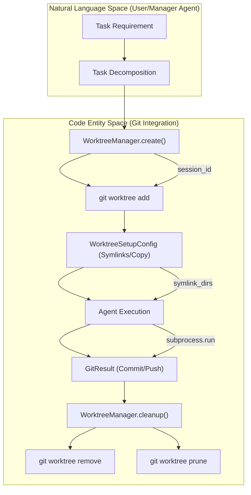
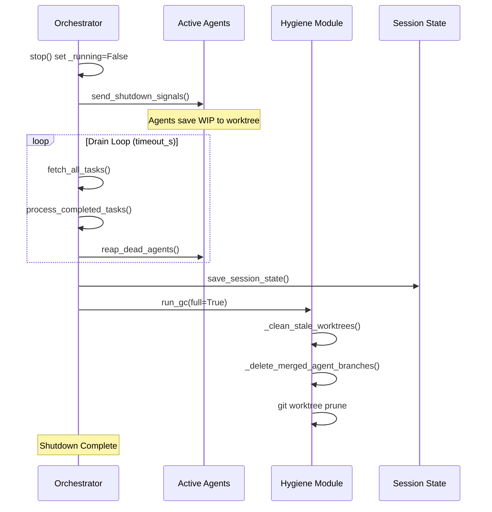

<!-- source: DeepWiki mcp.deepwiki.com · repo sipyourdrink-ltd/bernstein · page 2.5 Git Integration and Worktree Isolation · fetched 2026-10-26 -->

# Git Integration and Worktree Isolation

Relevant source files

The following files were used as context for generating this wiki page:

- [docs/decisions/009-lineage-v1.md](docs/decisions/009-lineage-v1.md)
- [docs/operations/worktrees.md](docs/operations/worktrees.md)
- [scripts/check_test_collection.py](scripts/check_test_collection.py)
- [src/bernstein/cli/commands/blast_radius_cmd.py](src/bernstein/cli/commands/blast_radius_cmd.py)
- [src/bernstein/cli/commands/maintenance_cmd.py](src/bernstein/cli/commands/maintenance_cmd.py)
- [src/bernstein/cli/commands/merge_cmd.py](src/bernstein/cli/commands/merge_cmd.py)
- [src/bernstein/cli/commands/session_cmd.py](src/bernstein/cli/commands/session_cmd.py)
- [src/bernstein/cli/commands/worktrees_cmd.py](src/bernstein/cli/commands/worktrees_cmd.py)
- [src/bernstein/core/agents/agent_cost_ledger.py](src/bernstein/core/agents/agent_cost_ledger.py)
- [src/bernstein/core/agents/agent_discovery.py](src/bernstein/core/agents/agent_discovery.py)
- [src/bernstein/core/agents/agent_identity.py](src/bernstein/core/agents/agent_identity.py)
- [src/bernstein/core/agents/agent_ipc.py](src/bernstein/core/agents/agent_ipc.py)
- [src/bernstein/core/agents/agent_profiling.py](src/bernstein/core/agents/agent_profiling.py)
- [src/bernstein/core/agents/spawner_merge.py](src/bernstein/core/agents/spawner_merge.py)
- [src/bernstein/core/git/git_basic.py](src/bernstein/core/git/git_basic.py)
- [src/bernstein/core/git/git_pr.py](src/bernstein/core/git/git_pr.py)
- [src/bernstein/core/git/salvage.py](src/bernstein/core/git/salvage.py)
- [src/bernstein/core/git/worktree.py](src/bernstein/core/git/worktree.py)
- [src/bernstein/core/lifecycle/blast_radius_gate.py](src/bernstein/core/lifecycle/blast_radius_gate.py)
- [src/bernstein/core/orchestration/preflight.py](src/bernstein/core/orchestration/preflight.py)
- [src/bernstein/core/persistence/sync.py](src/bernstein/core/persistence/sync.py)
- [src/bernstein/core/quality/blast_radius.py](src/bernstein/core/quality/blast_radius.py)
- [src/bernstein/core/security/sanitize.py](src/bernstein/core/security/sanitize.py)
- [src/bernstein/core/sessions/fork.py](src/bernstein/core/sessions/fork.py)
- [src/bernstein/core/worktrees/classifier.py](src/bernstein/core/worktrees/classifier.py)
- [templates/blast-radius/detectors.yaml](templates/blast-radius/detectors.yaml)
- [tests/integration/endpoints/__init__.py](tests/integration/endpoints/__init__.py)
- [tests/unit/test_adapter_conformance_suite.py](tests/unit/test_adapter_conformance_suite.py)
- [tests/unit/test_adapter_selection_allowlists.py](tests/unit/test_adapter_selection_allowlists.py)
- [tests/unit/test_agent_discovery.py](tests/unit/test_agent_discovery.py)
- [tests/unit/test_agent_ipc.py](tests/unit/test_agent_ipc.py)
- [tests/unit/test_auth_middleware_log_sanitization.py](tests/unit/test_auth_middleware_log_sanitization.py)
- [tests/unit/test_blast_radius.py](tests/unit/test_blast_radius.py)
- [tests/unit/test_blast_radius_run_gate.py](tests/unit/test_blast_radius_run_gate.py)
- [tests/unit/test_caching_adapter_correlation.py](tests/unit/test_caching_adapter_correlation.py)
- [tests/unit/test_cost_history.py](tests/unit/test_cost_history.py)
- [tests/unit/test_file_discovery.py](tests/unit/test_file_discovery.py)
- [tests/unit/test_git_basic.py](tests/unit/test_git_basic.py)
- [tests/unit/test_git_hygiene.py](tests/unit/test_git_hygiene.py)
- [tests/unit/test_git_pr.py](tests/unit/test_git_pr.py)
- [tests/unit/test_heartbeat.py](tests/unit/test_heartbeat.py)
- [tests/unit/test_manager_prompts.py](tests/unit/test_manager_prompts.py)
- [tests/unit/test_mergeback_failure_2792.py](tests/unit/test_mergeback_failure_2792.py)
- [tests/unit/test_metric_collector.py](tests/unit/test_metric_collector.py)
- [tests/unit/test_preflight.py](tests/unit/test_preflight.py)
- [tests/unit/test_recorder.py](tests/unit/test_recorder.py)
- [tests/unit/test_server_launch.py](tests/unit/test_server_launch.py)
- [tests/unit/test_session_fork_leak.py](tests/unit/test_session_fork_leak.py)
- [tests/unit/test_spawn_prompt.py](tests/unit/test_spawn_prompt.py)
- [tests/unit/test_task_splitter.py](tests/unit/test_task_splitter.py)
- [tests/unit/test_tick_pipeline.py](tests/unit/test_tick_pipeline.py)
- [tests/unit/test_tui_worktree_status.py](tests/unit/test_tui_worktree_status.py)
- [tests/unit/test_worktree_classifier.py](tests/unit/test_worktree_classifier.py)
- [tests/unit/test_worktree_create_leak.py](tests/unit/test_worktree_create_leak.py)
- [tests/unit/test_worktree_gitignore.py](tests/unit/test_worktree_gitignore.py)
- [tests/unit/test_worktree_graveyard.py](tests/unit/test_worktree_graveyard.py)
- [tests/unit/test_worktree_lifecycle.py](tests/unit/test_worktree_lifecycle.py)
- [tests/unit/test_worktree_salvage.py](tests/unit/test_worktree_salvage.py)
- [tests/unit/test_worktrees_cmd.py](tests/unit/test_worktrees_cmd.py)

Bernstein utilizes **Git Worktrees** to provide strict filesystem isolation for parallel agents. This architecture ensures that multiple agents can operate concurrently on the same repository without file-level conflicts, race conditions during staging, or cross-contamination of build artifacts.

## Worktree Lifecycle and Management

The `WorktreeManager` class handles the full lifecycle of agent environments, from creation and provisioning to salvage and reaping. Every agent session is assigned a unique worktree directory and a corresponding git branch.

### Lifecycle Phases
1.  **Creation**: A new worktree is created at `.sdd/worktrees/{session_id}` linked to a branch `agent/{session_id}` [src/bernstein/core/git/worktree.py:1-13]().
2.  **Provisioning**: The environment is prepared using `WorktreeSetupConfig`, which supports symlinking heavy directories (e.g., `node_modules`), copying specific files (e.g., `.env`), and configuring sparse checkouts [src/bernstein/core/git/worktree.py:50-88]().
3.  **Isolation Validation**: Before an agent starts, the system runs `validate_worktree_isolation` to ensure the worktree is correctly detached from the main working directory [src/bernstein/core/git/worktree.py:30-30]().
4.  **Reaping**: Upon task completion or agent death, `run_gc` (garbage collection) identifies stale worktrees and prunes them from the git registry [src/bernstein/cli/commands/worktrees_cmd.py:24-25]().

### Worktree State Transitions
The following diagram illustrates how the `WorktreeManager` and `Orchestrator` move a worktree through its lifecycle states.

**Diagram: Worktree Lifecycle Data Flow**

Sources: [src/bernstein/core/git/worktree.py:1-93](), [src/bernstein/cli/commands/worktrees_cmd.py:24-25](), [src/bernstein/core/git/git_basic.py:52-97]()

## Incremental Merge and Partial Commits

For long-running tasks, Bernstein supports **Incremental Merges**. This allows agents to push verified subsets of their work (e.g., a batch of passing tests) to the main branch before the entire task is finished.

*   **Mechanism**: The system uses `git checkout agent/<session_id> -- <files>` to pull specific file snapshots into the main repository without a full branch merge [src/bernstein/core/git/incremental_merge.py:19-23]().
*   **State Tracking**: Progress is persisted in `.sdd/runtime/incremental_merges/<session_id>.json` to prevent double-merging and track the `merge_commits` history [src/bernstein/core/git/incremental_merge.py:31-34, 98-112]().
*   **Safety Checks**: The `incremental_merge_files` function checks for `dirty_files` in the target branch to avoid clobbering uncommitted local changes [src/bernstein/core/git/incremental_merge.py:79-81]().

Sources: [src/bernstein/core/git/incremental_merge.py:1-43](), [src/bernstein/core/git/incremental_merge.py:98-131]()

## Git Hygiene and Repository Health

To maintain performance in high-concurrency environments, Bernstein executes periodic "Hygiene" sweeps.

### Mechanical Cleanup (`run_gc`)
The `run_gc` function performs the following non-destructive operations:
*   **Stale Worktree Removal**: Deletes directories in `.sdd/worktrees/` that are no longer tracked by git [src/bernstein/core/worktrees/classifier.py:300-313]().
*   **Merged Branch Deletion**: Identifies `agent/*` branches already merged into the `target_branch` (default `main`) and deletes them [src/bernstein/core/worktrees/classifier.py:315-320]().
*   **Registry Pruning**: Runs `git worktree prune` to clean the internal git metadata [src/bernstein/core/worktrees/classifier.py:325-325]().

### Pre-flight Health Checks
Before spawning agents, `_check_git_health` detects and repairs common corruption:
*   **Stale Locks**: Automatically unlinks `.git/index.lock` or worktree `locked` files if they are older than 5 minutes [src/bernstein/core/git/worktree.py:96-121]().
*   **HEAD Verification**: Ensures `git rev-parse --verify HEAD` succeeds to confirm repository integrity [src/bernstein/core/git/worktree.py:158-172]().

Sources: [src/bernstein/core/worktrees/classifier.py:1-40](), [src/bernstein/core/git/worktree.py:96-178]()

## GitHub Integration and PR Generation

Bernstein integrates with the GitHub CLI (`gh`) to coordinate distributed evolution and manage PRs.

### Evolution Coordination
The `GitHubIssue` class represents issues used to claim work in a distributed cluster [src/bernstein/core/git/github.py:144-166]().
*   **Deduplication**: Uses `evolve-hash-<hex>` labels derived from the task title to prevent multiple Bernstein instances from claiming the same work [src/bernstein/core/git/github.py:27-28, 130-140]().
*   **Community Trust**: Scans for `evolve-candidate` or `feature-request` labels, requiring `maintainer-approved` status for non-collaborator issues [src/bernstein/core/git/github.py:59-62, 178-181]().

### PR Lifecycle
The system automates the transition from local worktree to upstream PR:
1.  **Branch Push**: Pushes the agent branch to the remote.
2.  **PR Creation**: Uses `gh pr create` with auto-generated summaries based on `git diff --stat` [src/bernstein/core/git/git_pr.py:26-28]().
3.  **Auto-Merge**: Optionally enables GitHub auto-merge for PRs that pass all status checks [src/bernstein/core/git/git_pr.py:33-33]().

Sources: [src/bernstein/core/git/github.py:1-35](), [src/bernstein/core/git/github.py:144-191]()

## The Drain and Cleanup Sequence

When the Orchestrator stops, it follows a strict "Drain" sequence to ensure no git state is left in an inconsistent state.

**Diagram: Orchestrator Drain and Git Cleanup**

### Drain Actions
*   **Shutdown Signals**: Agents receive a signal to commit their current work before exiting [src/bernstein/core/orchestration/orchestrator_cleanup.py:30-43]().
*   **Final Reap**: The orchestrator continues to process tasks that finish during the drain window (default 60s) to ensure their git branches are merged [src/bernstein/core/orchestration/orchestrator_cleanup.py:57-104]().
*   **Session Persistence**: Current task statuses and costs are saved to `.sdd/runtime/session.json` for resumption [src/bernstein/core/orchestration/orchestrator_cleanup.py:114-151]().

Sources: [src/bernstein/core/orchestration/orchestrator_cleanup.py:30-112](), [src/bernstein/core/orchestration/orchestrator_cleanup.py:154-196]()

---

