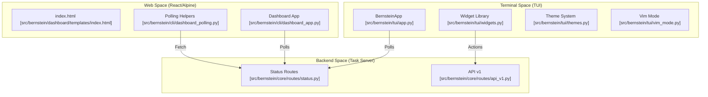
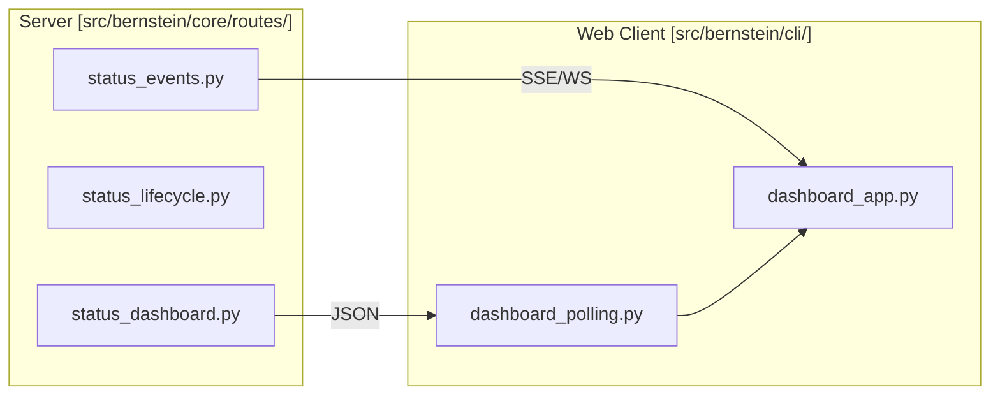

<!-- source: DeepWiki mcp.deepwiki.com · repo sipyourdrink-ltd/bernstein · page 4 TUI and Web Dashboard · fetched 2026-10-26 -->

# TUI and Web Dashboard

Relevant source files

The following files were used as context for generating this wiki page:

- [src/bernstein/cli/dashboard.py](src/bernstein/cli/dashboard.py)
- [src/bernstein/cli/run_cmd.py](src/bernstein/cli/run_cmd.py)
- [src/bernstein/core/routes/status.py](src/bernstein/core/routes/status.py)
- [src/bernstein/dashboard/templates/index.html](src/bernstein/dashboard/templates/index.html)
- [src/bernstein/tui/agent_duration.py](src/bernstein/tui/agent_duration.py)
- [src/bernstein/tui/app.py](src/bernstein/tui/app.py)
- [src/bernstein/tui/layout_persistence.py](src/bernstein/tui/layout_persistence.py)
- [src/bernstein/tui/log_viewer.py](src/bernstein/tui/log_viewer.py)
- [src/bernstein/tui/mouse_support.py](src/bernstein/tui/mouse_support.py)
- [src/bernstein/tui/notification_badge.py](src/bernstein/tui/notification_badge.py)
- [src/bernstein/tui/session_recorder.py](src/bernstein/tui/session_recorder.py)
- [src/bernstein/tui/snapshot_testing.py](src/bernstein/tui/snapshot_testing.py)
- [src/bernstein/tui/styles.tcss](src/bernstein/tui/styles.tcss)
- [src/bernstein/tui/task_detail_overlay.py](src/bernstein/tui/task_detail_overlay.py)
- [src/bernstein/tui/task_search.py](src/bernstein/tui/task_search.py)
- [src/bernstein/tui/themes.py](src/bernstein/tui/themes.py)
- [src/bernstein/tui/toast.py](src/bernstein/tui/toast.py)
- [src/bernstein/tui/vim_mode.py](src/bernstein/tui/vim_mode.py)
- [src/bernstein/tui/widgets.py](src/bernstein/tui/widgets.py)
- [src/bernstein/tui/worktree_status.py](src/bernstein/tui/worktree_status.py)
- [tests/unit/test_agent_profiling.py](tests/unit/test_agent_profiling.py)
- [tests/unit/test_log_viewer.py](tests/unit/test_log_viewer.py)
- [tests/unit/test_route_agent_comparison.py](tests/unit/test_route_agent_comparison.py)
- [tests/unit/test_route_graphql.py](tests/unit/test_route_graphql.py)
- [tests/unit/test_team_dashboard.py](tests/unit/test_team_dashboard.py)
- [tests/unit/test_tui_helpers.py](tests/unit/test_tui_helpers.py)
- [tests/unit/test_tui_layout_persistence.py](tests/unit/test_tui_layout_persistence.py)
- [tests/unit/test_tui_mouse_support.py](tests/unit/test_tui_mouse_support.py)
- [tests/unit/test_tui_notification_badge.py](tests/unit/test_tui_notification_badge.py)
- [tests/unit/test_tui_session_recorder.py](tests/unit/test_tui_session_recorder.py)
- [tests/unit/test_tui_task_detail_overlay.py](tests/unit/test_tui_task_detail_overlay.py)
- [tests/unit/test_tui_task_search.py](tests/unit/test_tui_task_search.py)
- [tests/unit/test_tui_themes.py](tests/unit/test_tui_themes.py)

Bernstein provides two primary interactive interfaces for orchestrating agents and monitoring system state: a high-density **Terminal User Interface (TUI)** built with [Textual](https://textual.textualize.io/) and a **Web Dashboard** built with React and Alpine.js. Both frontends consume the same [Task Server and API](#2.1) backend to provide real-time updates on task progression, agent logs, and system health.

### System Interface Mapping

The following diagram bridges the high-level frontend concepts to the underlying code entities that implement them.

**Frontend Architecture Mapping**

Sources: [src/bernstein/tui/app.py:1-57](), [src/bernstein/core/routes/status.py:1-23](), [src/bernstein/cli/dashboard_app.py:1-12](), [src/bernstein/cli/dashboard_polling.py:38-63]()

---

## Terminal UI (TUI)

The `BernsteinApp` [src/bernstein/tui/app.py:20]() is the primary operational interface for developers. It is designed as a "retro-futuristic" dashboard [src/bernstein/cli/dashboard.py:1-12]() that emphasizes information density and keyboard-driven navigation.

### Core Components and Layouts
The TUI utilizes a flexible layout system managed by `LayoutConfig` [src/bernstein/tui/layout_persistence.py:60-68](), allowing users to switch between three primary presets via keyboard shortcuts [src/bernstein/tui/app.py:86-88]():
*   **Focus:** Minimalist view emphasizing the `TaskListWidget` and `AgentLogWidget` [src/bernstein/tui/layout_persistence.py:22]().
*   **Balanced:** Adds the `NotificationCenterPanel` and `TaskTimeline` [src/bernstein/tui/layout_persistence.py:23-33]().
*   **Observability:** Full suite including the `WaterfallWidget`, `CoordinatorDashboard`, and `ApprovalPanel` [src/bernstein/tui/layout_persistence.py:34-49]().

### Log Rendering Pipeline
Agent logs are processed through a specialized `LogViewer` [src/bernstein/tui/log_viewer.py:185-212]() that provides:
*   **Diff Folding:** Automatically collapses large unified diffs to improve readability [src/bernstein/tui/log_viewer.py:104-116]().
*   **Markdown Heuristics:** Detects and renders markdown prose within agent outputs [src/bernstein/tui/log_viewer.py:154-177]().
*   **Syntax Highlighting:** Uses Pygments via Rich to highlight code blocks [src/bernstein/tui/log_viewer.py:10-11]().

### Operational Panels
*   **Worktree Status:** Monitors the health and "reapability" of git worktrees via `WorktreeListPanel` [src/bernstein/tui/worktree_status.py:187-204]().
*   **Session Recorder:** Supports recording and playing back TUI sessions for audit or debugging [src/bernstein/tui/session_recorder.py:32-39]().
*   **Notification Badge:** Tracks unread events across background panels using a `BadgeTracker` [src/bernstein/tui/notification_badge.py:21-26]().

For deep technical details on TUI widgets and navigation, see [Terminal UI (TUI)](#4.1).

Sources: [src/bernstein/tui/app.py:79-91](), [src/bernstein/tui/layout_persistence.py:21-50](), [src/bernstein/tui/log_viewer.py:200-212](), [src/bernstein/tui/worktree_status.py:159-184]()

---

## Web Dashboard (React)

The Web Dashboard provides a browser-based alternative to the TUI, intended for fleet-wide monitoring and stakeholder approvals. It is served by the Task Server and offers a responsive, high-fidelity view of the orchestration state.

### Implementation Details
*   **Frontend Stack:** Built with a combination of React/TypeScript and Alpine.js for lightweight reactivity [src/bernstein/dashboard/templates/index.html:7-10](), utilizing Tailwind CSS for styling [src/bernstein/dashboard/templates/index.html:12-31]().
*   **Real-time Updates:** Supports multiple data synchronization strategies including WebSockets (WS Live), Server-Sent Events (SSE Live), and standard HTTP polling [src/bernstein/dashboard/templates/index.html:108-114]().
*   **Key Views:**
    *   **Tasks:** A sortable board showing task state machine transitions [src/bernstein/cli/dashboard.py:4]().
    *   **Agents:** Live log streaming and agent identity visualization using `AgentWidget` [src/bernstein/cli/dashboard_header.py:32]().
    *   **Costs:** Real-time spend tracking with sparkline visualizations via `_mini_cost_sparkline` [src/bernstein/cli/dashboard_polling.py:58]().

### Integration
The dashboard interacts with the backend via the `status_dashboard` routes [src/bernstein/core/routes/status.py:15](), which aggregate data from the Orchestrator's state. It also serves as the GUI for the Bernstein VS Code extension.

For implementation details on the React components and API client, see [Web Dashboard (React)](#4.2).

**Dashboard Data Flow**

Sources: [src/bernstein/core/routes/status.py:1-22](), [src/bernstein/dashboard/templates/index.html:92-126](), [src/bernstein/cli/dashboard.py:7-12](), [src/bernstein/cli/dashboard_polling.py:45-57]()

---

