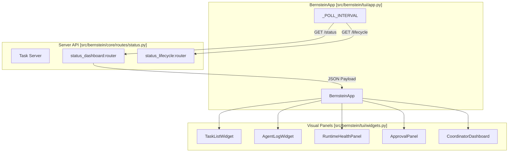
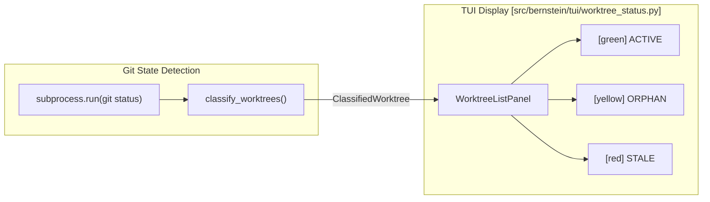

<!-- source: DeepWiki mcp.deepwiki.com · repo sipyourdrink-ltd/bernstein · page 4.1 Terminal UI (TUI) · fetched 2026-10-26 -->

# Terminal UI (TUI)

Relevant source files

The following files were used as context for generating this wiki page:

- [src/bernstein/cli/dashboard.py](src/bernstein/cli/dashboard.py)
- [src/bernstein/cli/run_cmd.py](src/bernstein/cli/run_cmd.py)
- [src/bernstein/core/routes/status.py](src/bernstein/core/routes/status.py)
- [src/bernstein/dashboard/templates/index.html](src/bernstein/dashboard/templates/index.html)
- [src/bernstein/tui/agent_duration.py](src/bernstein/tui/agent_duration.py)
- [src/bernstein/tui/agent_log.py](src/bernstein/tui/agent_log.py)
- [src/bernstein/tui/app.py](src/bernstein/tui/app.py)
- [src/bernstein/tui/approval_panel.py](src/bernstein/tui/approval_panel.py)
- [src/bernstein/tui/command_palette.py](src/bernstein/tui/command_palette.py)
- [src/bernstein/tui/help_screen.py](src/bernstein/tui/help_screen.py)
- [src/bernstein/tui/layout_persistence.py](src/bernstein/tui/layout_persistence.py)
- [src/bernstein/tui/log_viewer.py](src/bernstein/tui/log_viewer.py)
- [src/bernstein/tui/mouse_support.py](src/bernstein/tui/mouse_support.py)
- [src/bernstein/tui/notification_badge.py](src/bernstein/tui/notification_badge.py)
- [src/bernstein/tui/scheduling_panel.py](src/bernstein/tui/scheduling_panel.py)
- [src/bernstein/tui/session_recorder.py](src/bernstein/tui/session_recorder.py)
- [src/bernstein/tui/snapshot_testing.py](src/bernstein/tui/snapshot_testing.py)
- [src/bernstein/tui/styles.tcss](src/bernstein/tui/styles.tcss)
- [src/bernstein/tui/task_context.py](src/bernstein/tui/task_context.py)
- [src/bernstein/tui/task_detail_overlay.py](src/bernstein/tui/task_detail_overlay.py)
- [src/bernstein/tui/task_list.py](src/bernstein/tui/task_list.py)
- [src/bernstein/tui/task_search.py](src/bernstein/tui/task_search.py)
- [src/bernstein/tui/themes.py](src/bernstein/tui/themes.py)
- [src/bernstein/tui/toast.py](src/bernstein/tui/toast.py)
- [src/bernstein/tui/vim_mode.py](src/bernstein/tui/vim_mode.py)
- [src/bernstein/tui/widgets.py](src/bernstein/tui/widgets.py)
- [src/bernstein/tui/worktree_status.py](src/bernstein/tui/worktree_status.py)
- [tests/unit/test_agent_profiling.py](tests/unit/test_agent_profiling.py)
- [tests/unit/test_approval_panel_message.py](tests/unit/test_approval_panel_message.py)
- [tests/unit/test_difficulty_estimator.py](tests/unit/test_difficulty_estimator.py)
- [tests/unit/test_help_screen.py](tests/unit/test_help_screen.py)
- [tests/unit/test_log_viewer.py](tests/unit/test_log_viewer.py)
- [tests/unit/test_route_agent_comparison.py](tests/unit/test_route_agent_comparison.py)
- [tests/unit/test_route_decision.py](tests/unit/test_route_decision.py)
- [tests/unit/test_route_graphql.py](tests/unit/test_route_graphql.py)
- [tests/unit/test_team_dashboard.py](tests/unit/test_team_dashboard.py)
- [tests/unit/test_tui_helpers.py](tests/unit/test_tui_helpers.py)
- [tests/unit/test_tui_layout_persistence.py](tests/unit/test_tui_layout_persistence.py)
- [tests/unit/test_tui_mouse_support.py](tests/unit/test_tui_mouse_support.py)
- [tests/unit/test_tui_notification_badge.py](tests/unit/test_tui_notification_badge.py)
- [tests/unit/test_tui_session_recorder.py](tests/unit/test_tui_session_recorder.py)
- [tests/unit/test_tui_task_detail_overlay.py](tests/unit/test_tui_task_detail_overlay.py)
- [tests/unit/test_tui_task_search.py](tests/unit/test_tui_task_search.py)
- [tests/unit/test_tui_themes.py](tests/unit/test_tui_themes.py)

The Bernstein TUI is a retro-futuristic, information-dense orchestration dashboard built using the [Textual](https://textual.textualize.io/) framework [src/bernstein/tui/app.py:1-20](). It serves as the primary interactive interface for monitoring multi-agent workflows, managing task states, and inspecting real-time agent logs with advanced rendering capabilities like diff folding and syntax highlighting [src/bernstein/tui/log_viewer.py:1-12]().

### Data Flow and Architecture

The TUI operates as a client to the Bernstein Task Server. It polls the server's status endpoints to synchronize the local UI state with the global orchestrator state [src/bernstein/tui/app.py:100-143]().

#### TUI Entity Mapping
The following diagram bridges the visual components to their underlying implementation classes and data sources.

**Diagram: TUI Component Entity Mapping**

**Sources:** [src/bernstein/tui/app.py:100-143](), [src/bernstein/tui/widgets.py:1-73](), [src/bernstein/core/routes/status.py:1-22]().

---

### Layout System and Presets

The TUI uses a flexible grid system managed by `LayoutConfig` [src/bernstein/tui/layout_persistence.py:29-29](). Layouts are persisted to allow session continuity [src/bernstein/tui/app.py:29-29]().

| Preset | Purpose | Key Panels | Shortcut |
| :--- | :--- | :--- | :--- |
| **Focus** | Deep work / Single task | Task List, Search, Agent Log | `1` |
| **Balanced** | Standard monitoring | Adds Notification Center, Context | `2` |
| **Observability** | Full system audit | Adds Waterfall, Coordinator, Session Recorder | `3` |

**Sources:** [src/bernstein/tui/app.py:87-89](), [src/bernstein/tui/layout_persistence.py:29-29]().

---

### Log Rendering Pipeline

Agent logs are processed through a sophisticated rendering pipeline in `LogViewer` to ensure readability of large technical outputs [src/bernstein/tui/log_viewer.py:185-191]().

1.  **Diff Folding**: Unified diffs starting with `diff --git` are detected [src/bernstein/tui/log_viewer.py:23-23](). If they exceed `_DIFF_FOLD_THRESHOLD` (default 20 lines), they are truncated and summarized with a count of added/removed lines [src/bernstein/tui/log_viewer.py:81-102]().
2.  **Markdown Heuristic**: The renderer calculates the density of Markdown indicators (headings, bold, lists). If above the `_MD_THRESHOLD` of 15%, the block is rendered as rich Markdown [src/bernstein/tui/log_viewer.py:154-177]().
3.  **Syntax Highlighting**: Fenced code blocks are extracted via `CODE_BLOCK_PATTERN` and highlighted using Pygments themes (default: `monokai`) [src/bernstein/tui/log_viewer.py:16-16](), [src/bernstein/tui/log_viewer.py:192-212]().

**Sources:** [src/bernstein/tui/log_viewer.py:1-212]().

---

### Navigation and Interaction

#### Vim-Mode and Keybindings
The TUI supports a Vim-inspired navigation system and customizable keybindings. Global bindings are resolved from the `keybinding_config` system [src/bernstein/tui/app.py:71-80]().
*   `/`: Focus task search via `TaskSearchInput` [src/bernstein/tui/app.py:83-83]().
*   `n`: Acknowledge notifications [src/bernstein/tui/app.py:84-84]().
*   `R`: Toggle session recording [src/bernstein/tui/app.py:85-85]().

#### Task Search and Filtering
The `TaskSearchInput` supports structured filtering using prefixes like `status:`, `role:`, `priority:`, and `agent:` [src/bernstein/tui/task_search.py:39-42](). The `matches_task_search` function performs real-time matching against `SupportsTaskSearch` protocol objects [src/bernstein/tui/task_search.py:75-98]().

**Sources:** [src/bernstein/tui/app.py:71-91](), [src/bernstein/tui/task_search.py:1-126]().

---

### Worktree Status Panel

The `WorktreeListPanel` and `RuntimeHealthPanel` provide real-time visibility into the Git worktrees used for agent isolation and the health of the underlying runtime [src/bernstein/tui/worktree_status.py:107-118](), [src/bernstein/tui/worktree_status.py:187-204]().

**Diagram: Worktree Lifecycle in TUI**

*   **Classification**: Worktrees are labeled as `ACTIVE`, `ORPHAN`, `STALE`, or `CORRUPT` [src/bernstein/tui/worktree_status.py:139-144]().
*   **Reapability**: `count_reapable` identifies worktrees that can be safely deleted to reclaim disk space [src/bernstein/tui/worktree_status.py:150-157]().
*   **Runtime Health**: `render_runtime_health` aggregates branch info, active worktree counts, memory usage (MB), and config hashes [src/bernstein/tui/worktree_status.py:80-104]().

**Sources:** [src/bernstein/tui/worktree_status.py:1-223]().

---

### Session Recording and Testing

*   **Session Recorder**: The `SessionRecorder` captures `RecordingFrame` objects. These can be replayed via `SessionPlayer` for debugging or audit purposes [src/bernstein/tui/app.py:32-39]().
*   **Snapshot Testing**: The `snapshot_testing.py` module allows developers to verify TUI layouts by comparing current renders against "golden" reference snapshots [src/bernstein/tui/app.py:59-59]().

**Sources:** [src/bernstein/tui/app.py:32-39](), [src/bernstein/tui/session_recorder.py:1-40]().

---

### Theme System

The TUI supports dynamic theme switching via the `themes.py` module. Configuration is stored and can be cycled via `cycle_theme`, supporting `ThemeMode` variations [src/bernstein/tui/app.py:43-43]().

**Sources:** [src/bernstein/tui/app.py:43-43](), [src/bernstein/tui/themes.py:1-44]().

---

