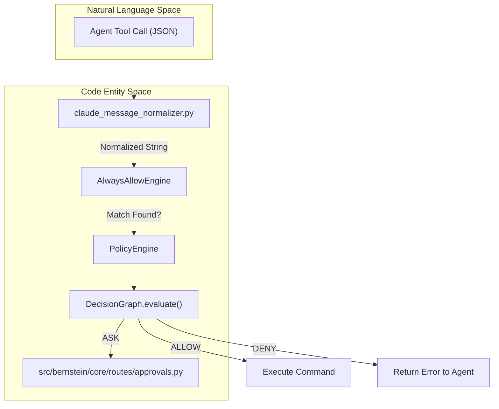
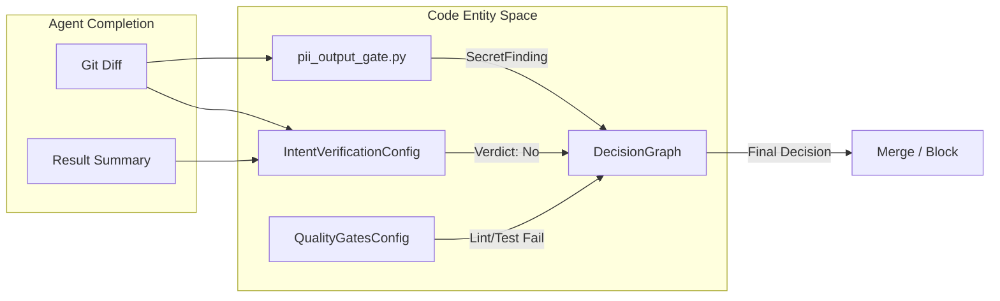

<!-- source: DeepWiki mcp.deepwiki.com · repo sipyourdrink-ltd/bernstein · page 5.2 Command Security and Guardrails · fetched 2026-10-26 -->

# Command Security and Guardrails

Relevant source files

The following files were used as context for generating this wiki page:

- [docs/operations/mcp-gateway.md](docs/operations/mcp-gateway.md)
- [docs/sdd/identity-spawn-anchor.md](docs/sdd/identity-spawn-anchor.md)
- [docs/sdd/toolcall-attestation-interlock.md](docs/sdd/toolcall-attestation-interlock.md)
- [scripts/bench_toolcall_identity.py](scripts/bench_toolcall_identity.py)
- [src/bernstein/benchmark/swe_bench.py](src/bernstein/benchmark/swe_bench.py)
- [src/bernstein/bridges/openclaw_gateway.py](src/bernstein/bridges/openclaw_gateway.py)
- [src/bernstein/cli/commands/quickstart_cmd.py](src/bernstein/cli/commands/quickstart_cmd.py)
- [src/bernstein/cli/dashboard_actions.py](src/bernstein/cli/dashboard_actions.py)
- [src/bernstein/cli/run_confirm.py](src/bernstein/cli/run_confirm.py)
- [src/bernstein/cli/status.py](src/bernstein/cli/status.py)
- [src/bernstein/core/agents/claude_agent_card.py](src/bernstein/core/agents/claude_agent_card.py)
- [src/bernstein/core/agents/claude_message_normalizer.py](src/bernstein/core/agents/claude_message_normalizer.py)
- [src/bernstein/core/cost/completion_budget.py](src/bernstein/core/cost/completion_budget.py)
- [src/bernstein/core/git/merge_queue.py](src/bernstein/core/git/merge_queue.py)
- [src/bernstein/core/git/pr_size_governor.py](src/bernstein/core/git/pr_size_governor.py)
- [src/bernstein/core/git/worktree_claude_md.py](src/bernstein/core/git/worktree_claude_md.py)
- [src/bernstein/core/git/worktree_isolation.py](src/bernstein/core/git/worktree_isolation.py)
- [src/bernstein/core/knowledge/memory_integrity.py](src/bernstein/core/knowledge/memory_integrity.py)
- [src/bernstein/core/lineage/identity.py](src/bernstein/core/lineage/identity.py)
- [src/bernstein/core/observability/traces.py](src/bernstein/core/observability/traces.py)
- [src/bernstein/core/orchestration/run_report.py](src/bernstein/core/orchestration/run_report.py)
- [src/bernstein/core/persistence/file_health.py](src/bernstein/core/persistence/file_health.py)
- [src/bernstein/core/planning/workflow_importer.py](src/bernstein/core/planning/workflow_importer.py)
- [src/bernstein/core/quality/ci_monitor.py](src/bernstein/core/quality/ci_monitor.py)
- [src/bernstein/core/quality/comment_quality.py](src/bernstein/core/quality/comment_quality.py)
- [src/bernstein/core/quality/quality_gates.py](src/bernstein/core/quality/quality_gates.py)
- [src/bernstein/core/security/always_allow.py](src/bernstein/core/security/always_allow.py)
- [src/bernstein/core/security/audit_export.py](src/bernstein/core/security/audit_export.py)
- [src/bernstein/core/security/command_policy.py](src/bernstein/core/security/command_policy.py)
- [src/bernstein/core/security/dlp_scanner_v2.py](src/bernstein/core/security/dlp_scanner_v2.py)
- [src/bernstein/core/security/guardrails.py](src/bernstein/core/security/guardrails.py)
- [src/bernstein/core/security/identity_spawn_anchor.py](src/bernstein/core/security/identity_spawn_anchor.py)
- [src/bernstein/core/security/jwt_tokens.py](src/bernstein/core/security/jwt_tokens.py)
- [src/bernstein/core/security/license_scanner.py](src/bernstein/core/security/license_scanner.py)
- [src/bernstein/core/security/native_toolcall_evidence.py](src/bernstein/core/security/native_toolcall_evidence.py)
- [src/bernstein/core/security/pii_output_gate.py](src/bernstein/core/security/pii_output_gate.py)
- [src/bernstein/core/security/policy_engine.py](src/bernstein/core/security/policy_engine.py)
- [src/bernstein/core/security/post_tool_enforcement.py](src/bernstein/core/security/post_tool_enforcement.py)
- [src/bernstein/core/security/rule_enforcer.py](src/bernstein/core/security/rule_enforcer.py)
- [src/bernstein/core/security/sensitive_file_detector.py](src/bernstein/core/security/sensitive_file_detector.py)
- [src/bernstein/core/security/toolcall_identity.py](src/bernstein/core/security/toolcall_identity.py)
- [src/bernstein/core/security/toolcall_interlock.py](src/bernstein/core/security/toolcall_interlock.py)
- [src/bernstein/eval/scenario_runner.py](src/bernstein/eval/scenario_runner.py)
- [src/bernstein/plugins/hookspecs.py](src/bernstein/plugins/hookspecs.py)
- [src/bernstein/plugins/manager.py](src/bernstein/plugins/manager.py)
- [src/bernstein/plugins/security_review.py](src/bernstein/plugins/security_review.py)
- [tests/unit/security/test_toolcall_identity.py](tests/unit/security/test_toolcall_identity.py)
- [tests/unit/test_always_allow.py](tests/unit/test_always_allow.py)
- [tests/unit/test_dlp_scanner_v2.py](tests/unit/test_dlp_scanner_v2.py)
- [tests/unit/test_hook_exit_codes.py](tests/unit/test_hook_exit_codes.py)
- [tests/unit/test_metrics.py](tests/unit/test_metrics.py)
- [tests/unit/test_pii_output_gate.py](tests/unit/test_pii_output_gate.py)
- [tests/unit/test_worktree_isolation.py](tests/unit/test_worktree_isolation.py)

Bernstein implements a defense-in-depth security model to ensure that autonomous agents operate within strict safety boundaries. This is achieved through a multi-stage **Command Guardrail Pipeline** that intercepts tool calls, normalizes inputs, validates permissions against task-scoped allowlists, and scans outputs for PII or secret leakage.

## The Auto-Approve Pipeline

The system utilizes an automated decision loop to minimize human intervention for safe operations while hard-blocking or escalating risky actions. The pipeline follows a `normalize → decompose → DENY/APPROVE/ASK` flow.

### Command Normalization and Homoglyph Defense
Before evaluation, commands are passed through the `claude_message_normalizer.py` to prevent obfuscation attacks. This includes resolving homoglyphs (visually similar characters used to bypass string matching) and standardizing whitespace.
*   **Source:** [src/bernstein/core/agents/claude_message_normalizer.py:1-50]()

### Decision Logic and Precedence
The `PolicyEngine` and `DecisionGraph` evaluate normalized tool calls. Decisions are categorized by `DecisionType`, which follows a strict order of precedence:

1.  **DENY**: Mandatory block, bypass-immune.
2.  **IMMUNE**: Safety-critical paths (e.g., `.sdd/` state files), bypass-immune.
3.  **SAFETY**: Secret detection or lethal-trifecta violations, bypass-immune.
4.  **ASK**: Requires human approval via the TUI or Dashboard.
5.  **ALLOW**: Permitted to proceed.

**Auto-Approve Flow Diagram**

*   **Sources:** [src/bernstein/core/security/policy_engine.py:32-40](), [src/bernstein/core/security/policy_engine.py:67-99](), [src/bernstein/core/security/always_allow.py:103-134]()

## Always-Allow Rules and Tamper Protection
The `AlwaysAllowEngine` allows project-specific rules to short-circuit approvals for known-safe tool signatures (e.g., `grep` on `src/*`). 

To prevent agents from modifying their own security rules, the `AlwaysAllowEngine` enforces a strict trust model:
1.  **Orchestrator-Only Location**: Rules are preferred in `.sdd/config/always_allow.yaml`, which is an `IMMUNE` path.
2.  **Manifest Pinning**: If rules are loaded from an agent-writable path (like `.bernstein/`), the loader requires a `sha256` match against an orchestrator-signed manifest in `.sdd/config/always_allow.manifest.json`.
3.  **Tamper Error**: Any drift triggers an `AlwaysAllowTamperError` and a `SAFETY` audit event.

*   **Sources:** [src/bernstein/core/security/always_allow.py:12-26](), [src/bernstein/core/security/always_allow.py:63-71]()

## Tool-Call Attestation Interlock
For high-integrity environments, Bernstein provides a `ToolCallAttestationInterlock`. This boundary ensures that every tool call crossing a host dispatch (like `MCPGateway`) is durably recorded in the HMAC audit chain before the side effect occurs.

*   **Enforced Mode**: Fails closed if the `ToolCallEvidenceProvider` cannot establish durable evidence.
*   **Observed Mode**: Logs failures but allows dispatch, resulting in an `observed` rather than `complete` run verdict.
*   **Identity Anchoring**: If configured, the interlock generates an Ed25519 identity envelope (`toolcall.identity-attestation/v1`) to bind the call to a specific signed agent session.

*   **Sources:** [src/bernstein/core/security/toolcall_interlock.py:143-179](), [docs/sdd/toolcall-attestation-interlock.md:34-61]()

## Blocking Hooks and Elicitation
The `PluginManager` allows for custom security hooks. Hooks can block orchestration by exiting with code `2`, raising a `HookBlockingError`.

### Interactive Elicitation
Hooks can request user input via the `ElicitationRequest` protocol. This allows a hook script to pause execution and ask the operator for a decision (e.g., "Confirm deletion of production database?") via `stdin` or the TUI.
*   **Sources:** [src/bernstein/plugins/manager.py:86-93](), [src/bernstein/plugins/hookspecs.py:50-85]()

## Output Gates and DLP

Before any code is merged, it must pass the `PII_Output_Gate` and the `QualityGatesConfig`.

### PII and Secret Detection
The `scan_diff` function in `pii_output_gate.py` uses high-precision regex patterns to catch:
*   Cloud provider keys (AWS, GCP, Azure).
*   Platform tokens (GitHub, Slack, Stripe, JWT).
*   PII (Email, Phone, SSN, Credit Cards).
*   **Redaction:** Raw secrets are never stored; `SecretFinding` objects contain only redacted matches.

### Intent Verification
The `IntentVerificationConfig` triggers an LLM "judge" to compare the original task description against the git diff. It blocks merge if the verdict is `no`, preventing "hallucinated" features or logic bombs.

**Security Output Pipeline**

*   **Sources:** [src/bernstein/core/security/pii_output_gate.py:38-56](), [src/bernstein/core/security/pii_output_gate.py:65-179](), [src/bernstein/core/quality/quality_gates.py:85-115]()

## Approval Routes and API

The Task Server provides an API for managing pending approvals via `src/bernstein/core/routes/approvals.py`.

*   **GET `/approvals`**: Lists pending requests from `.sdd/runtime/pending_approvals/`.
*   **POST `/approvals/{task_id}/approve`**: Validates the request and writes a decision to the state store, unblocking the orchestrator.
*   **POST `/approvals/{task_id}/reject`**: Terminates the agent session and marks the task as blocked or failed.

*   **Sources:** [src/bernstein/core/routes/approvals.py:129-180](), [src/bernstein/cli/status.py:82-90]()

---

