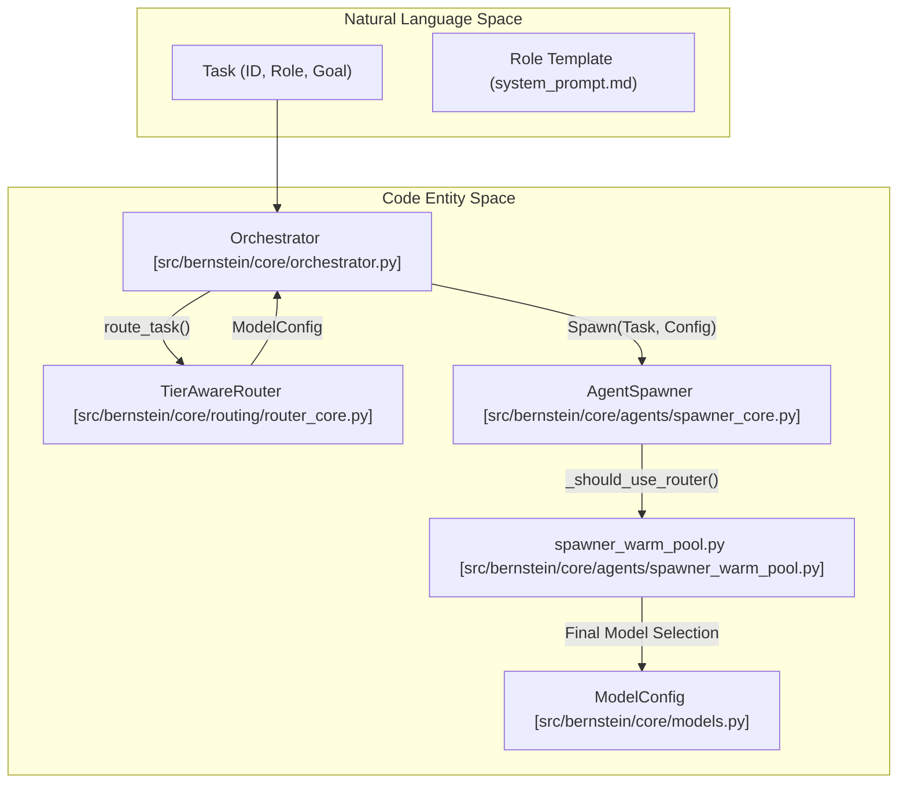
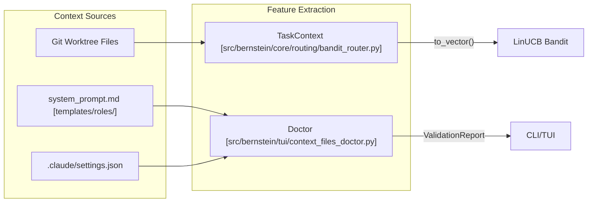

<!-- source: DeepWiki mcp.deepwiki.com · repo sipyourdrink-ltd/bernstein · page 8 Model Routing and Prompt Engineering · fetched 2026-10-26 -->

# Model Routing and Prompt Engineering

Relevant source files

The following files were used as context for generating this wiki page:

- [src/bernstein/cli/ui.py](src/bernstein/cli/ui.py)
- [src/bernstein/core/agents/spawner_warm_pool.py](src/bernstein/core/agents/spawner_warm_pool.py)
- [src/bernstein/core/config/home.py](src/bernstein/core/config/home.py)
- [src/bernstein/core/routing/bandit_router.py](src/bernstein/core/routing/bandit_router.py)
- [src/bernstein/core/routing/cascade.py](src/bernstein/core/routing/cascade.py)
- [src/bernstein/core/routing/router_core.py](src/bernstein/core/routing/router_core.py)
- [src/bernstein/sdd/validator.py](src/bernstein/sdd/validator.py)
- [src/bernstein/tui/context_files_doctor.py](src/bernstein/tui/context_files_doctor.py)
- [tests/integration/test_ticket_validate_cli.py](tests/integration/test_ticket_validate_cli.py)
- [tests/unit/test_cli_ui.py](tests/unit/test_cli_ui.py)
- [tests/unit/test_commit_stats.py](tests/unit/test_commit_stats.py)
- [tests/unit/test_context_files_doctor.py](tests/unit/test_context_files_doctor.py)
- [tests/unit/test_notebook_traces.py](tests/unit/test_notebook_traces.py)
- [tests/unit/test_permission_explain.py](tests/unit/test_permission_explain.py)
- [tests/unit/test_run_summary_issue_953.py](tests/unit/test_run_summary_issue_953.py)
- [tests/unit/test_tokens.py](tests/unit/test_tokens.py)
- [tests/unit/test_transcript_overlay.py](tests/unit/test_transcript_overlay.py)

Bernstein employs a multi-layered system for selecting the optimal Large Language Model (LLM) for a given task and constructing high-precision prompts that maximize both performance and cost-efficiency. This system bridges the gap between abstract task requirements and concrete model execution.

## Overview of Model Selection and Prompting

The orchestration layer does not simply send tasks to a hardcoded model. Instead, it uses a routing pipeline to evaluate task metadata (role, complexity, priority) and current provider health before dispatching to an agent. Once a model is selected, the `AgentSpawner` and `TaskContextBuilder` assemble a prompt that is contextually aware of the codebase, the agent's specific role, and previous lessons learned.

### System Architecture: From Task to Execution

The following diagram illustrates how a task moves from the `Orchestrator` through the routing and prompt assembly logic into an active `AgentSession`.

**Diagram: Model Selection and Prompt Assembly Pipeline**

Sources: [src/bernstein/core/routing/router_core.py:1-8](), [src/bernstein/core/agents/spawner_warm_pool.py:19-48](), [src/bernstein/core/models.py:22-22]()

## Model Routing and Contextual Bandit

The routing subsystem, primarily driven by the `TierAwareRouter`, is responsible for mapping tasks to specific LLM providers and models based on "Criterion Profiles" (e.g., cost-first, safety-first). 

Key features include:
*   **Tier-Based Selection:** Models are categorized into tiers (e.g., `FREE`, `STANDARD`, `PREMIUM`) to match task complexity [src/bernstein/core/routing/router_core.py:139-145]().
*   **Contextual Bandit Router:** A `LinUCB` contextual bandit that learns which models perform best for specific roles, languages, or file types over time by maximizing a composite quality-cost reward [src/bernstein/core/routing/bandit_router.py:1-29]().
*   **Cascade and Fallback:** If a preferred model fails (rate limits, timeouts), the `CascadeFallbackManager` automatically identifies the best alternative agent that meets the `CAPABILITY_FLOOR` for the task complexity [src/bernstein/core/routing/cascade.py:1-48]().
*   **Budget-Aware Routing:** Prevents escalation to high-cost models (like `opus`) when the remaining run budget is low [src/bernstein/core/routing/router_core.py:38-58]().

For more details on routing logic and profiles, see [Model Router and Contextual Bandit](#8.1).

## Prompt Engineering and Cache Locality

Prompting in Bernstein is a dynamic assembly process. The system prioritizes **KV-cache locality** to reduce latency and costs, especially for providers supporting prompt caching (e.g., Anthropic `cache_control`).

### Prompt Assembly Components
The system dynamically loads role-specific configurations and prompts from the `templates/roles/` directory [src/bernstein/tui/context_files_doctor.py:128-140]().

| Component | Description | Code Entity |
| :--- | :--- | :--- |
| **Role Templates** | Base instructions loaded from `system_prompt.md` and `task_prompt.md`. | `_load_role_config` |
| **Skills Injection** | Injecting specific tool capabilities and MCP server schemas. | `check_mcp_servers` |
| **Memory Injection** | Injecting "lessons" from `lessons.jsonl` to prevent repeat mistakes. | `Knowledge Diary` |
| **Cache Alignment** | Ensuring prefixes are byte-identical to trigger provider-side caching. | `PromptCacheLocality` |

### Bridging Context to Model Space

The system ensures that the information provided to the LLM is relevant to the task's `TaskContext`, which includes complexity, scope, and language signals.

**Diagram: Context Injection Flow**

Sources: [src/bernstein/core/routing/bandit_router.py:135-180](), [src/bernstein/tui/context_files_doctor.py:108-117](), [src/bernstein/sdd/validator.py:103-129]()

### Cache Locality and Drift
Bernstein tracks prompt effectiveness and model usage to monitor how often prompt changes invalidate the KV-cache. It uses vendor-specific strategies to optimize long-context performance, ensuring that common prefixes (like role definitions) remain stable.

For more details on prompt construction and caching, see [Prompt Engineering and Cache Locality](#8.2).

## Operational Controls

Routing and prompting behavior can be tuned via global configuration in `~/.bernstein/config.yaml` or project-specific `.sdd/` overrides [src/bernstein/core/config/home.py:5-14](). These controls include:
*   **Budget Caps:** Enforcing spending limits in USD per run [src/bernstein/core/config/home.py:98-98]().
*   **Effort Levels:** Controlling model reasoning depth (e.g., `low`, `high`, `max`) [src/bernstein/core/config/home.py:53-54]().
*   **Health Monitoring:** The `ProviderHealth` system tracks latency and success rates to avoid degraded providers [src/bernstein/core/routing/router_core.py:158-168]().

Sources: [src/bernstein/core/config/home.py:32-58](), [src/bernstein/core/routing/router_core.py:139-189](), [src/bernstein/core/agents/spawner_warm_pool.py:68-110]()

---

