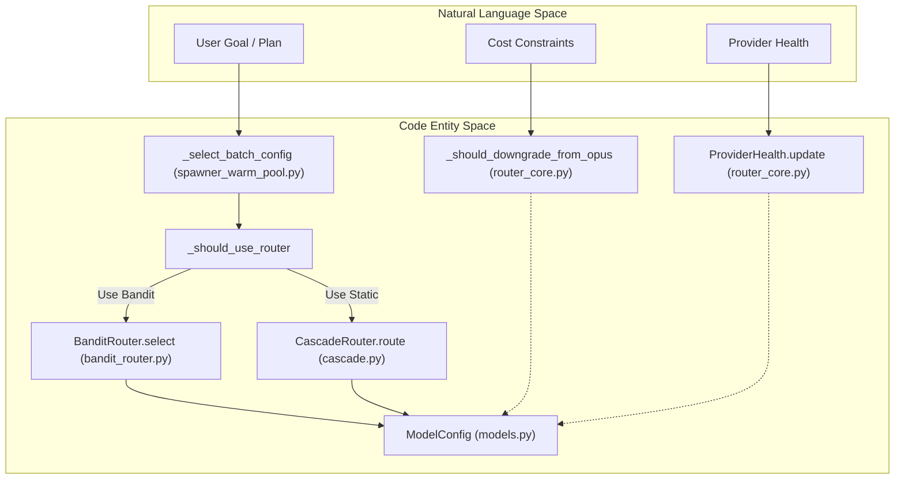
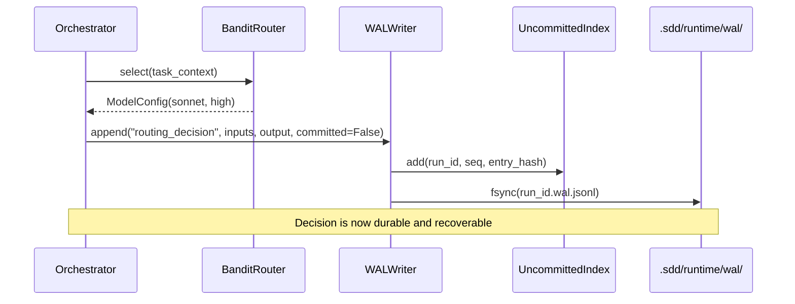

<!-- source: DeepWiki mcp.deepwiki.com · repo sipyourdrink-ltd/bernstein · page 8.1 Model Router and Contextual Bandit · fetched 2026-10-26 -->

# Model Router and Contextual Bandit

Relevant source files

The following files were used as context for generating this wiki page:

- [docs/architecture/ARCHITECTURE.md](docs/architecture/ARCHITECTURE.md)
- [docs/gui/index.md](docs/gui/index.md)
- [docs/guides/index.md](docs/guides/index.md)
- [src/bernstein/cli/ui.py](src/bernstein/cli/ui.py)
- [src/bernstein/core/agents/spawner_warm_pool.py](src/bernstein/core/agents/spawner_warm_pool.py)
- [src/bernstein/core/config/home.py](src/bernstein/core/config/home.py)
- [src/bernstein/core/git/changelog.py](src/bernstein/core/git/changelog.py)
- [src/bernstein/core/git/git_context.py](src/bernstein/core/git/git_context.py)
- [src/bernstein/core/knowledge/knowledge_base.py](src/bernstein/core/knowledge/knowledge_base.py)
- [src/bernstein/core/observability/loop_detector.py](src/bernstein/core/observability/loop_detector.py)
- [src/bernstein/core/persistence/wal.py](src/bernstein/core/persistence/wal.py)
- [src/bernstein/core/routing/bandit_router.py](src/bernstein/core/routing/bandit_router.py)
- [src/bernstein/core/routing/cascade.py](src/bernstein/core/routing/cascade.py)
- [src/bernstein/core/routing/router_core.py](src/bernstein/core/routing/router_core.py)
- [src/bernstein/sdd/validator.py](src/bernstein/sdd/validator.py)
- [src/bernstein/tui/context_files_doctor.py](src/bernstein/tui/context_files_doctor.py)
- [tests/integration/test_ticket_validate_cli.py](tests/integration/test_ticket_validate_cli.py)
- [tests/property/__init__.py](tests/property/__init__.py)
- [tests/property/test_wal_cas_bughunt.py](tests/property/test_wal_cas_bughunt.py)
- [tests/unit/test_acp.py](tests/unit/test_acp.py)
- [tests/unit/test_bandit_router.py](tests/unit/test_bandit_router.py)
- [tests/unit/test_cli_ui.py](tests/unit/test_cli_ui.py)
- [tests/unit/test_commit_stats.py](tests/unit/test_commit_stats.py)
- [tests/unit/test_container_wiring.py](tests/unit/test_container_wiring.py)
- [tests/unit/test_context_files_doctor.py](tests/unit/test_context_files_doctor.py)
- [tests/unit/test_differential_privacy.py](tests/unit/test_differential_privacy.py)
- [tests/unit/test_eu_ai_act.py](tests/unit/test_eu_ai_act.py)
- [tests/unit/test_incident.py](tests/unit/test_incident.py)
- [tests/unit/test_license_scanner.py](tests/unit/test_license_scanner.py)
- [tests/unit/test_mcp_cmd.py](tests/unit/test_mcp_cmd.py)
- [tests/unit/test_memory_integrity.py](tests/unit/test_memory_integrity.py)
- [tests/unit/test_merkle.py](tests/unit/test_merkle.py)
- [tests/unit/test_notebook_traces.py](tests/unit/test_notebook_traces.py)
- [tests/unit/test_permission_explain.py](tests/unit/test_permission_explain.py)
- [tests/unit/test_run_benchmark.py](tests/unit/test_run_benchmark.py)
- [tests/unit/test_run_summary_issue_953.py](tests/unit/test_run_summary_issue_953.py)
- [tests/unit/test_runbooks.py](tests/unit/test_runbooks.py)
- [tests/unit/test_tokens.py](tests/unit/test_tokens.py)
- [tests/unit/test_transcript_overlay.py](tests/unit/test_transcript_overlay.py)
- [tests/unit/test_wal.py](tests/unit/test_wal.py)
- [tests/unit/test_wal_replay.py](tests/unit/test_wal_replay.py)
- [tests/unit/test_workflow.py](tests/unit/test_workflow.py)

The Bernstein routing system manages the selection of LLM providers, models, and effort levels for every task. It employs a multi-layered approach ranging from deterministic tier-aware logic to a reinforcement-learning-based contextual bandit that optimizes for quality and cost based on historical performance.

## Tier-Aware Router

The `TierAwareRouter` is the primary entry point for model selection. It maps task metadata (complexity, scope, and role) to a specific `ModelConfig` while respecting provider health, regional constraints, and API pricing tiers [src/bernstein/core/routing/router_core.py:1-8]().

### Routing Strategy and Tiers
The router categorizes API access into three distinct tiers:
*   **FREE**: Trial accounts or unused quotas [src/bernstein/core/routing/router_core.py:142-142]().
*   **STANDARD**: Regular paid API access [src/bernstein/core/routing/router_core.py:143-143]().
*   **PREMIUM**: High-rate limit or dedicated capacity [src/bernstein/core/routing/router_core.py:144-144]().

### Budget-Aware Routing
Bernstein implements a safety mechanism to prevent expensive model escalations (e.g., to Claude 3 Opus) when the run budget is nearly exhausted [src/bernstein/core/routing/router_core.py:38-43]().
*   **Opus Downgrade**: If the remaining budget is less than `BUDGET_AWARE_OPUS_MARGIN` (default 2.0) times the estimated cost of an Opus task, the router forces a downgrade to a more cost-effective model like Sonnet [src/bernstein/core/routing/router_core.py:103-116]().
*   **Context Management**: The Orchestrator updates the global budget context via `set_budget_context` during the tick loop [src/bernstein/core/routing/router_core.py:69-89]().

Sources: [src/bernstein/core/routing/router_core.py:1-190]()

## Contextual Bandit Router

The `BanditRouter` wraps static heuristics with a LinUCB (Linear Upper Confidence Bound) contextual bandit. It learns the optimal `(model, effort)` selection by maximizing a composite quality-cost reward signal [src/bernstein/core/routing/bandit_router.py:1-7]().

### Feature Extraction
The `TaskContext` class converts task metadata into a `FEATURE_DIM` (currently 33) float vector [src/bernstein/core/routing/bandit_router.py:70-71]().
*   **Complexity & Scope**: Encoded as ordinal tiers (0=Low/Small, 1=Medium, 2=High/Large) [src/bernstein/core/routing/bandit_router.py:168-169]().
*   **Priority**: Normalized to a 0.0–1.0 range [src/bernstein/core/routing/bandit_router.py:170-170]().
*   **One-Hot Encoding**: Includes task type (e.g., `FIX`, `FEATURE`) and primary language (e.g., `python`, `go`) inferred from `owned_files` [src/bernstein/core/routing/bandit_router.py:188-193]().
*   **Role Embedding**: A hash-based embedding of the role string [src/bernstein/core/routing/bandit_router.py:194-194]().

### Reward Signal and Effort Bandit
The system uses a specific reward formula: `quality_score * (1 - normalized_cost)` [src/bernstein/core/routing/bandit_router.py:21-25]().
*   **EffortBandit**: A separate UCB1 bandit keyed on `(task_type, model)` selects between `low`, `high`, and `max` effort levels [src/bernstein/core/routing/bandit_router.py:9-14]().
*   **Warm-up**: The bandit delegates to static heuristics until a `warmup_min` threshold (default 50) is reached [src/bernstein/core/routing/bandit_router.py:4-7]().

Sources: [src/bernstein/core/routing/bandit_router.py:1-194](), [tests/unit/test_bandit_router.py:59-142]()

## Model Fallback and Coercion

The system ensures compatibility between the selected model and the active agent adapter.

*   **Adapter Applicability**: The router's internal arms (`haiku`, `sonnet`, `opus`) are Claude-specific. If a non-Claude adapter (e.g., Codex) is used, `_coerce_model_for_non_claude_adapter` replaces Claude tier names with the adapter's default model to prevent execution failures [src/bernstein/core/agents/spawner_warm_pool.py:68-80]().
*   **Precedence**: Explicit operator pins in `role_model_policy` take absolute priority over both the `TierAwareRouter` and the `BanditRouter` [src/bernstein/core/agents/spawner_warm_pool.py:32-38]().

Sources: [src/bernstein/core/agents/spawner_warm_pool.py:19-63](), [src/bernstein/core/agents/spawner_warm_pool.py:68-110]()

## Provider Health Monitoring

The `ProviderHealth` class tracks metrics to detect degradation and trigger failover [src/bernstein/core/routing/router_core.py:158-160]().
*   **Metrics**: Tracks `consecutive_failures`, `avg_latency_ms` (via exponential moving average), and `success_rate` [src/bernstein/core/routing/router_core.py:161-168]().
*   **Status Tiers**: Providers are marked as `HEALTHY`, `DEGRADED`, `UNHEALTHY`, `RATE_LIMITED`, or `OFFLINE` [src/bernstein/core/routing/router_core.py:147-153]().

Sources: [src/bernstein/core/routing/router_core.py:147-188]()

## Routing Decision Flow

The following diagram illustrates the flow from a task entering the system to a model being assigned.

### Logic to Entity Mapping: Routing Pipeline

Sources: [src/bernstein/core/agents/spawner_warm_pool.py:19-63](), [src/bernstein/core/routing/router_core.py:103-116](), [src/bernstein/core/routing/bandit_router.py:1-29]()

## Routing Decision Logging (WAL)

Every routing decision is recorded in the Write-Ahead Log (WAL) to ensure auditability and enable the `BanditRouter` to learn from past outcomes [src/bernstein/core/persistence/wal.py:1-5]().

*   **WAL Entry**: Decisions are stored as `WALEntry` objects containing `decision_type`, `inputs`, and `output` [src/bernstein/core/persistence/wal.py:41-58]().
*   **Integrity**: Entries are hash-chained (`prev_hash`) to ensure the decision history is tamper-evident [src/bernstein/core/persistence/wal.py:10-12]().
*   **Uncommitted Index**: A sidecar index (`uncommitted.idx.json`) tracks decisions that haven't been confirmed, allowing for crash recovery [src/bernstein/core/persistence/wal.py:75-85]().

### Data Flow: Routing Decision Persistence

Sources: [src/bernstein/core/persistence/wal.py:41-58](), [src/bernstein/core/persistence/wal.py:164-180](), [tests/unit/test_wal.py:84-95]()

---

