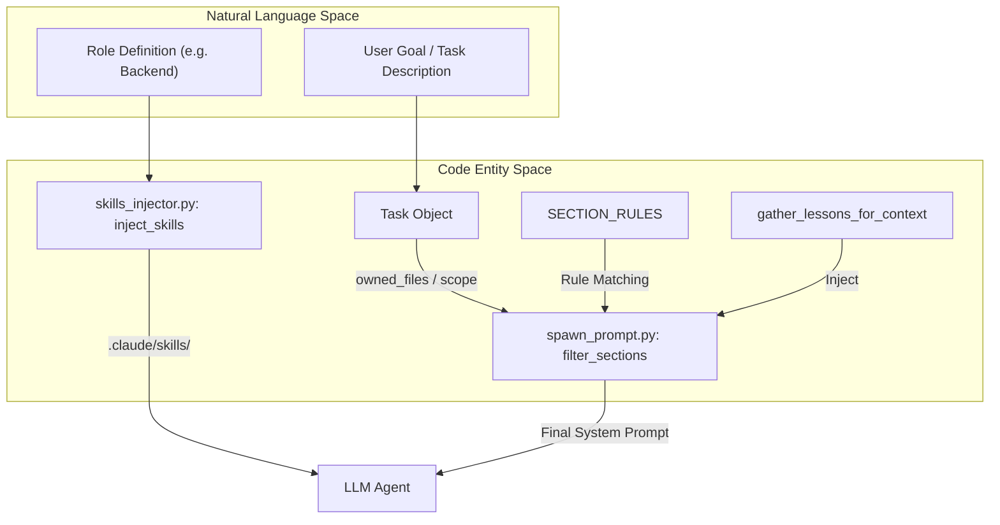
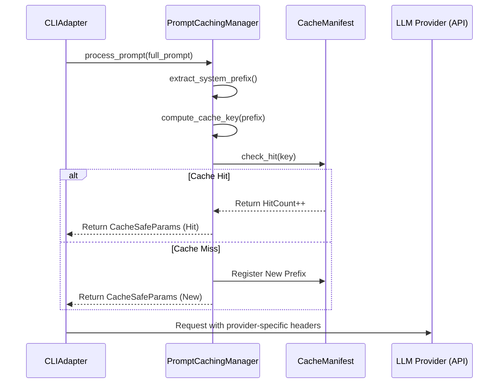

<!-- source: DeepWiki mcp.deepwiki.com · repo sipyourdrink-ltd/bernstein · page 8.2 Prompt Engineering and Cache Locality · fetched 2026-10-26 -->

# Prompt Engineering and Cache Locality

Relevant source files

The following files were used as context for generating this wiki page:

- [docs/operations/skill-selection-rules.md](docs/operations/skill-selection-rules.md)
- [docs/operations/work-ledger.md](docs/operations/work-ledger.md)
- [docs/sdd/skill-selection-rules.md](docs/sdd/skill-selection-rules.md)
- [sdk/python/src/bernstein_sdk/adapters/jira.py](sdk/python/src/bernstein_sdk/adapters/jira.py)
- [sdk/python/src/bernstein_sdk/client.py](sdk/python/src/bernstein_sdk/client.py)
- [sdk/python/tests/test_client.py](sdk/python/tests/test_client.py)
- [src/bernstein/adapters/skills_injector.py](src/bernstein/adapters/skills_injector.py)
- [src/bernstein/cli/__init__.py](src/bernstein/cli/__init__.py)
- [src/bernstein/cli/commands/ledger_cmd.py](src/bernstein/cli/commands/ledger_cmd.py)
- [src/bernstein/cli/commands/resume_cmd.py](src/bernstein/cli/commands/resume_cmd.py)
- [src/bernstein/cli/helpers.py](src/bernstein/cli/helpers.py)
- [src/bernstein/core/__init__.py](src/bernstein/core/__init__.py)
- [src/bernstein/core/agents/prompt_cache_locality.py](src/bernstein/core/agents/prompt_cache_locality.py)
- [src/bernstein/core/agents/spawn_prompt.py](src/bernstein/core/agents/spawn_prompt.py)
- [src/bernstein/core/compat_redirect_ledger.py](src/bernstein/core/compat_redirect_ledger.py)
- [src/bernstein/core/defaults.py](src/bernstein/core/defaults.py)
- [src/bernstein/core/observability/prometheus.py](src/bernstein/core/observability/prometheus.py)
- [src/bernstein/core/persistence/ledger_git.py](src/bernstein/core/persistence/ledger_git.py)
- [src/bernstein/core/routes/identities.py](src/bernstein/core/routes/identities.py)
- [src/bernstein/core/routes/slack.py](src/bernstein/core/routes/slack.py)
- [src/bernstein/core/skills/selection_rules.py](src/bernstein/core/skills/selection_rules.py)
- [src/bernstein/plugins/__init__.py](src/bernstein/plugins/__init__.py)
- [templates/skills/bernstein-completion-protocol.md](templates/skills/bernstein-completion-protocol.md)
- [templates/skills/bernstein-signal-check.md](templates/skills/bernstein-signal-check.md)
- [templates/skills/bernstein-test-runner.md](templates/skills/bernstein-test-runner.md)
- [tests/unit/agents/test_issue_3015_prompt_completion_coherence.py](tests/unit/agents/test_issue_3015_prompt_completion_coherence.py)
- [tests/unit/skills/test_injector_activation_log.py](tests/unit/skills/test_injector_activation_log.py)
- [tests/unit/skills/test_selection_rules.py](tests/unit/skills/test_selection_rules.py)
- [tests/unit/test_agent_identity.py](tests/unit/test_agent_identity.py)
- [tests/unit/test_audit_chain_work_ledger.py](tests/unit/test_audit_chain_work_ledger.py)
- [tests/unit/test_batch_router.py](tests/unit/test_batch_router.py)
- [tests/unit/test_bulletin_status_notification.py](tests/unit/test_bulletin_status_notification.py)
- [tests/unit/test_cli_server_url.py](tests/unit/test_cli_server_url.py)
- [tests/unit/test_context_compression.py](tests/unit/test_context_compression.py)
- [tests/unit/test_crash_guard_middleware.py](tests/unit/test_crash_guard_middleware.py)
- [tests/unit/test_llm_watcher_detector_pack.py](tests/unit/test_llm_watcher_detector_pack.py)
- [tests/unit/test_prompt_cache_locality.py](tests/unit/test_prompt_cache_locality.py)
- [tests/unit/test_prompt_cache_locality_vendors.py](tests/unit/test_prompt_cache_locality_vendors.py)
- [tests/unit/test_prompt_caching.py](tests/unit/test_prompt_caching.py)
- [tests/unit/test_skills_injector.py](tests/unit/test_skills_injector.py)
- [tests/unit/test_spawn_prompt_memory_inject.py](tests/unit/test_spawn_prompt_memory_inject.py)
- [tests/unit/test_sqlite_memory_store.py](tests/unit/test_sqlite_memory_store.py)

This page details the implementation of prompt assembly, context optimization, and the mechanisms used to maximize KV-cache locality across different LLM providers. Bernstein optimizes for "zero-LLM coordination" by ensuring that agents receive high-density, cache-friendly context packets that minimize latency and token costs.

## Prompt Assembly and Injection

Prompt construction in Bernstein is a multi-stage pipeline that transforms task requirements and repository state into a structured system prompt. The core logic resides in `src/bernstein/core/agents/spawn_prompt.py`, which utilizes a template-based approach to inject role-specific skills and project-wide lessons.

### Assembly Pipeline
1.  **Role Templates**: The system fetches base templates for specific roles (e.g., `backend`, `qa`) using the `render_role_prompt` function [src/bernstein/core/agents/spawn_prompt.py:20-20]().
2.  **Skills Injection**: Bernstein writes role-specific capabilities into the worktree's `.claude/skills/` directory before spawning an agent [src/bernstein/adapters/skills_injector.py:8-16](). This includes the `bernstein-completion-protocol.md` and `bernstein-signal-check.md` which are injected for every role [src/bernstein/adapters/skills_injector.py:72-75]().
3.  **Memory/Lessons Injection**: The `gather_lessons_for_context` function retrieves historical "lessons learned" from the `.sdd/` directory to prevent recurring errors [src/bernstein/core/agents/spawn_prompt.py:18-18]().
4.  **Conditional Context Activation**: To keep prompts lean, Bernstein uses `SectionRule` to determine if optional sections like `team awareness` or `file ownership` are necessary for the current task scope [src/bernstein/core/agents/spawn_prompt.py:39-60]().

### Prompt Structure and Code Entities

The following diagram illustrates how natural language requirements are mapped to code-driven prompt sections.

**Prompt Assembly Data Flow**

Sources: [src/bernstein/core/agents/spawn_prompt.py:96-121](), [src/bernstein/adapters/skills_injector.py:78-90](), [tests/unit/test_spawn_prompt_memory_inject.py:1-20]()

---

## KV-Cache Locality and Optimization

Bernstein implements aggressive KV-cache management to leverage provider-specific caching features. This is managed by the `PromptCachingManager` and `AgentCacheTracker`.

### Cache Locality Strategies
*   **Byte-Identical Prefixes**: Bernstein ensures that the "System Prefix" (Role + Project Context) remains static across multiple agent turns to trigger provider-side caching [tests/unit/test_prompt_caching.py:94-119]().
*   **Vendor Alignment**: 
    *   **Anthropic**: The `claude_prompt_cache_optimizer` handles specific segments for Claude models [src/bernstein/core/__init__.py:107-107]().
    *   **OpenAI**: Bernstein optimizes for 256-token boundary alignment to maximize hit rates [tests/unit/test_prompt_caching.py:22-27]().
*   **Drift Tracking**: The `PromptCacheLocality` system tracks "cache drift"—the divergence of prompts that should be identical—and alerts via Prometheus metrics [src/bernstein/core/observability/prometheus.py:136-136]().

### Cache Key Computation
The `compute_cache_key` function generates a SHA-256 hash of the stable system prefix [tests/unit/test_prompt_caching.py:139-147](). If the hash matches a previous entry in the `CacheManifest`, Bernstein reuses the cached structure [tests/unit/test_prompt_caching.py:52-67]().

**Cache Locality Mechanism**

Sources: [tests/unit/test_prompt_caching.py:161-193](), [src/bernstein/core/agents/prompt_cache_locality.py:1-30]()

---

## Context Compression

To handle large codebases without exceeding context windows, Bernstein employs a multi-strategy `ContextCompressor` [tests/unit/test_context_compression.py:180-191]().

### Compression Components
1.  **DependencyGraph**: Analyzes Python imports to find files reachable from the current task's `owned_files` [tests/unit/test_context_compression.py:92-110]().
2.  **BM25Ranker**: Ranks repository files by relevance to the task title and description using the BM25 algorithm [tests/unit/test_context_compression.py:143-157]().
3.  **Token Estimation**: Uses `_estimate_tokens` to calculate prefix and suffix sizes for caching decisions [tests/unit/test_prompt_caching.py:22-22]().

| Feature | Implementation | Purpose |
| :--- | :--- | :--- |
| **Relevance Ranking** | `BM25Ranker` | Selects top-K most relevant files for context. |
| **Dependency Analysis** | `DependencyGraph` | Includes critical import-chain files. |
| **Token Limits** | `AGENT.idle_log_age_threshold_s` | Used in stall detection to manage context lifetime [src/bernstein/core/defaults.py:160-160](). |
| **Skill Injection** | `skills_injector` | Reduces prompt size by 30-40% by moving boilerplate to skills [src/bernstein/adapters/skills_injector.py:12-13](). |

Sources: [src/bernstein/core/defaults.py:152-162](), [tests/unit/test_context_compression.py:1-30]()

---

## Monitoring and Metrics

The `PromptCacheLocality` system integrates with the task server to provide real-time observability into caching performance.

*   **Prometheus Metrics**:
    *   `bernstein_prompt_cache_drift_total`: Cumulative count of detected cache-breaking prompt variations [src/bernstein/core/observability/prometheus.py:136-136]().
    *   `bernstein_cost_usd_total`: Tracked per-model to validate savings from caching [src/bernstein/core/observability/prometheus.py:222-223]().
*   **Skill Activation**: The `ActivationRecord` logs each time a skill is injected, tracking the `trigger_source` (e.g., `role-binding` or `auto-route`) [tests/unit/skills/test_injector_activation_log.py:75-80]().

Sources: [src/bernstein/core/observability/prometheus.py:108-152](), [tests/unit/skills/test_injector_activation_log.py:50-83]()

---

